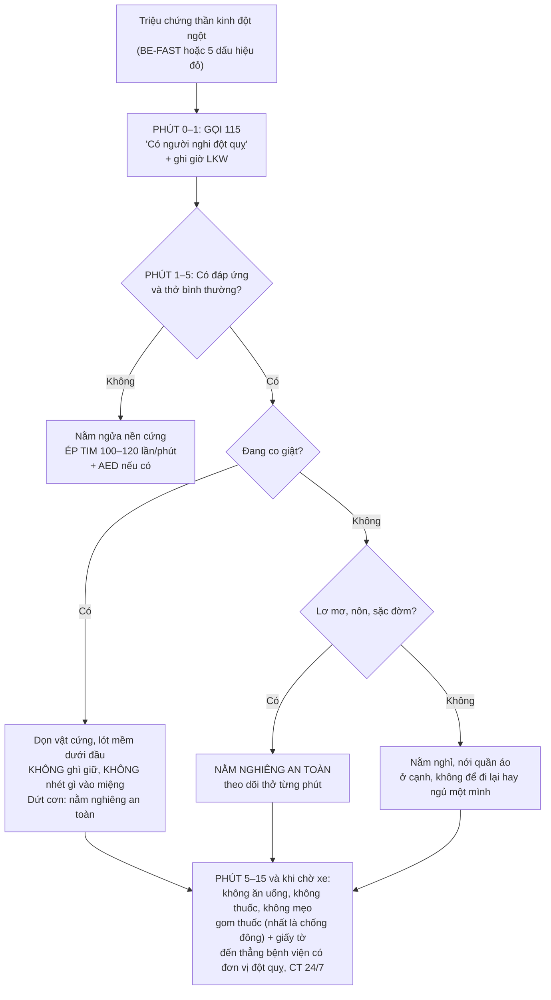

# Đột quỵ não: tài liệu kiến thức chuẩn (bản cuối)

> **Tệp:** `claude_merge_final.md` · **Phiên bản:** 2.0 (bản cuối) · **Ngày chốt:** 27/11/2026
> **Hợp nhất từ:** `claude_merge.md` (Claude, bản 1.0) và `gemini_merge.md` (Gemini). Cả hai bản đều tổng hợp từ hai tài liệu nghiên cứu gốc `gemini.md` và `chatgpt.md`.
> **Mục đích:** nguồn kiến thức duy nhất làm nền nội dung cho website và app Android về phòng chống, sơ cứu đột quỵ.
> **Lưu ý y khoa:** tài liệu thông tin và giáo dục sức khỏe, không thay thế chẩn đoán hay điều trị. Trước khi phát hành, nội dung cần bác sĩ chuyên khoa thần kinh hoặc cấp cứu thẩm định. **Mọi tình huống nghi đột quỵ: gọi 115 ngay.**

---

## Mục lục

- [0. Cách đọc tài liệu](#0-cách-đọc-tài-liệu)
- [1. Mười điều cốt lõi](#1-mười-điều-cốt-lõi)
- [2. Sơ cứu khẩn cấp](#2-sơ-cứu-khẩn-cấp)
- [3. Thang giai đoạn cho bài kiểm tra và app](#3-thang-giai-đoạn-cho-bài-kiểm-tra-và-app)
- [4. Dịch tễ học](#4-dịch-tễ-học)
- [5. Bản chất và cơ chế](#5-bản-chất-và-cơ-chế)
- [6. Phân loại](#6-phân-loại)
- [7. Nguyên nhân, yếu tố nguy cơ và yếu tố khởi phát](#7-nguyên-nhân-yếu-tố-nguy-cơ-và-yếu-tố-khởi-phát)
- [8. Nhận biết từ cực sớm đến muộn](#8-nhận-biết-từ-cực-sớm-đến-muộn)
- [9. Kiểm tra nhanh, thang sàng lọc, bệnh giả đột quỵ, công nghệ](#9-kiểm-tra-nhanh-thang-sàng-lọc-bệnh-giả-đột-quỵ-công-nghệ)
- [10. Đông y, mẹo dân gian, thực phẩm chức năng](#10-đông-y-mẹo-dân-gian-thực-phẩm-chức-năng)
- [11. Chẩn đoán và điều trị tại bệnh viện](#11-chẩn-đoán-và-điều-trị-tại-bệnh-viện)
- [12. Tiên lượng và phục hồi](#12-tiên-lượng-và-phục-hồi)
- [13. Phòng ngừa và tầm soát](#13-phòng-ngừa-và-tầm-soát)
- [14. Ca bệnh thật](#14-ca-bệnh-thật)
- [15. Mười hai quan niệm sai](#15-mười-hai-quan-niệm-sai)
- [16. Câu hỏi khoa học còn mở](#16-câu-hỏi-khoa-học-còn-mở)
- [17. Năm bộ lọc phản biện](#17-năm-bộ-lọc-phản-biện)
- [18. Ma trận mức độ bằng chứng](#18-ma-trận-mức-độ-bằng-chứng)
- [19. Đối chiếu hai tài liệu gốc](#19-đối-chiếu-hai-tài-liệu-gốc)
- [20. Nguồn chính](#20-nguồn-chính)
- [Phụ lục A. Nhật ký hợp nhất bản cuối](#phụ-lục-a-nhật-ký-hợp-nhất-bản-cuối)
- [Phụ lục B. Dùng cho website và app](#phụ-lục-b-dùng-cho-website-và-app)

---

## 0. Cách đọc tài liệu

Phần lớn nội dung được **cả hai tài liệu gốc thống nhất** và không gắn nhãn. Những chỗ cần biết nguồn được gắn nhãn:

| Nhãn | Ý nghĩa |
|---|---|
| **[Cả hai]** | `gemini.md` và `chatgpt.md` cùng nêu và thống nhất |
| **[G]** | Chỉ có trong `gemini.md` |
| **[C]** | Chỉ có trong `chatgpt.md` |
| **[BS]** | Bổ sung trong quá trình hợp nhất, **không có trong hai tài liệu gốc**. Đây là kiến thức phổ thông hoặc theo hướng dẫn quốc tế quen thuộc, nhưng **chưa được kiểm chứng riêng** trong dự án |
| **[Lệch]** | Hai tài liệu gốc nêu khác nhau, xem mục 19 |
| **[Đã kiểm]** | Đã đối chiếu thêm với nguồn bên ngoài ngày 27/11/2026 |

**Quy tắc cho người thẩm định:** số liệu gắn **[G]**, **[C]**, **[BS]** hoặc **[Lệch]** cần được bác sĩ kiểm tra lại trước khi hiển thị trên app.

---

## 1. Mười điều cốt lõi

Hai tài liệu gốc và hai bản hợp nhất thống nhất hoàn toàn ở mười điểm dưới đây.

1. **Bất kỳ triệu chứng thần kinh nào xuất hiện đột ngột** (méo miệng, yếu tê một bên, nói khó, mất thăng bằng, mất thị lực, nhìn đôi, đau đầu sét đánh, khó nuốt, lú lẫn) **đều phải coi là đột quỵ** cho tới khi bác sĩ loại trừ, kể cả khi nhẹ, không đau, người bệnh vẫn tỉnh, hoặc đã tự hết.
2. **Gọi 115 ngay**, nói rõ “nghi đột quỵ”. Không chờ xem có đỡ không.
3. **Ghi giờ “lần cuối thấy người bệnh còn bình thường”** (*Last Known Well*, LKW). Ngủ dậy mới thấy thì LKW là lúc đi ngủ.
4. **FAST âm tính, hay thậm chí BE-FAST âm tính, không có nghĩa là không đột quỵ.** Đột quỵ tuần hoàn sau (thân não, tiểu não) hay bị bỏ sót vì không méo miệng, không liệt.
5. **Không cho ăn, uống, hay uống bất kỳ thuốc gì**: không aspirin, không thuốc hạ áp, không An Cung Ngưu Hoàng Hoàn, không nước gừng, nước đường.
6. **Không chích máu đầu ngón tay hay dái tai, không cạo gió, không xoa bóp hay nắn cổ, không bấm huyệt** thay cho việc gọi 115.
7. **Ưu tiên đường thở:** nôn, lơ mơ hoặc vừa co giật thì **nằm nghiêng an toàn**; không đáp ứng và không thở bình thường thì **ép tim (CPR)**.
8. **Triệu chứng tự hết vẫn là cấp cứu** (cơn thiếu máu não thoáng qua, TIA). Nguy cơ đột quỵ thật dồn vào 48 giờ đầu.
9. **Thức dậy mới phát hiện, hoặc không rõ giờ, vẫn còn cơ hội điều trị** nhờ MRI hoặc CT tưới máu. Không tự bỏ cuộc.
10. **Không có bài test tại nhà, thiết bị đeo hay AI nào loại trừ hoặc dự báo chính xác đột quỵ** ở từng người. Gọi nhầm 115 cho một ca giả đột quỵ thì an toàn; bỏ sót một ca thật mới là sai lầm nguy hiểm nhất.

---

## 2. Sơ cứu khẩn cấp

### 2.1 Quy tắc quyết định

> **Triệu chứng thần kinh mới, xuất hiện đột ngột → gọi 115, ghi LKW, bảo vệ đường thở, không ăn uống, không thuốc, không chờ.**

- Tại Việt Nam: gọi **115** và nói ngay câu đầu tiên **“Có người nghi đột quỵ”**. Bệnh viện Bạch Mai cũng khuyến nghị như vậy. [C]
- **Không tự lái xe** nếu chính mình đang có triệu chứng. [C] **Không chở người bệnh bằng xe máy.** [G]

### 2.2 Nhận diện: BE-FAST và 5 dấu hiệu đỏ

Chỉ cần **một** dấu hiệu là đủ để gọi 115. Không cần đủ điểm.

| Chữ | Cách thử nhanh (30–60 giây) | Dấu hiệu báo động |
|---|---|---|
| **B: Balance (Thăng bằng)** | Quan sát ngồi, đứng, bước đi; chỉ thử đứng khi người bệnh tỉnh hẳn, có người đỡ sát bên | Đột ngột chóng mặt dữ dội, đi loạng choạng như say, ngã, mất phối hợp tay chân |
| **E: Eyes (Mắt)** | Hỏi nhìn rõ không; che từng mắt | Đột ngột mờ mắt, nhìn đôi, mất nửa tầm nhìn, **mù một mắt không đau** như rèm sập xuống |
| **F: Face (Mặt)** | Bảo cười hoặc nhe răng | Một bên khóe miệng xệ, nhân trung lệch, nếp mũi má mờ, tê một bên mặt |
| **A: Arms (Tay, chân)** | Nhắm mắt, giơ thẳng hai tay ra trước, lòng bàn tay ngửa, giữ 10 giây | Một tay không nâng lên được, rơi xuống hoặc xoay úp; đột nhiên rơi đồ; yếu tê một chân |
| **S: Speech (Lời nói)** | Nhắc lại một câu đơn giản, ví dụ “Hôm nay trời rất đẹp” | Nói ngọng, đớ, lắp bắp, khó tìm từ, nói trôi chảy nhưng vô nghĩa, không hiểu lời |
| **T: Time (Thời gian)** | Hành động ngay | **Gọi 115**, ghi giờ khởi phát và giờ LKW |

**5 dấu hiệu đỏ ngoài BE-FAST.** Gemini gốc nêu 3 dấu hiệu, `gemini_merge.md` bổ sung thêm 2 từ các ca bệnh ChatGPT dẫn.
1. **Đau đầu dữ dội kiểu sét đánh**, đạt đỉnh tức thì (“đau nhất đời”). [Cả hai]
2. **Đột ngột khó nuốt, uống sặc, khàn tiếng.** [Cả hai]
3. **Đột ngột lú lẫn, thay đổi hành vi, ngủ gà khó đánh thức.** [Cả hai]
4. **Đột ngột vụng một bàn tay, ngón tay; chữ viết biến dạng; không làm được thao tác quen thuộc.** [C]
5. **Đau một bên cổ gáy mới xuất hiện** (nhất là sau vận động hoặc vặn cổ), **kèm chóng mặt, sụp mi hoặc bất kỳ dấu thần kinh nào**. Có thể là bóc tách động mạch cổ. [Cả hai]

### 2.3 Sơ đồ hành động và việc theo từng mốc phút

| Thời điểm | Việc ưu tiên | Ghi chú |
|---|---|---|
| **0–1 phút** | Nhận ra dấu hiệu → **gọi 115** → ghi giờ LKW và giờ phát hiện | Không “thử xem có tự hết không” |
| **1–5 phút** | Kiểm tra **đáp ứng** và **thở bình thường hay không** | Không đáp ứng, không thở bình thường (hoặc thở ngáp cá): nằm ngửa trên nền cứng, **ép tim liên tục 100–120 lần/phút**, sâu khoảng 5–6 cm [BS, theo AHA], dùng AED nếu có. Trẻ em: ép tim kèm thổi ngạt theo AHA 2025 [G] |
| **1–5 phút** | Bảo vệ đường thở; **nhịn ăn uống hoàn toàn** | Nôn, lơ mơ, sau co giật: **nằm nghiêng an toàn**. Tỉnh hoàn toàn: nằm nghỉ, nới cổ áo, thắt lưng |
| **5–15 phút** | Chuẩn bị hồ sơ | Giấy tờ, BHYT; **danh sách hoặc vỏ thuốc (nhất là chống đông: warfarin, rivaroxaban, apixaban, dabigatran, edoxaban; kháng tiểu cầu)**, thuốc tiểu đường, huyết áp; bệnh nền; dị ứng; số điện thoại người chứng kiến |
| **Trong lúc chờ xe** | Ở cạnh theo dõi | Không để tự đi lại, **không để ngủ một mình không giám sát** [G]; theo dõi ý thức, thở, nôn, co giật; mở cửa, bật đèn, dọn lối cho kíp cấp cứu [G] |

### 2.4 Gọi 115: nói gì

Câu đầu tiên: **“Có người nghi đột quỵ.”** Sau đó nói 5 thông tin [G]:

1. **Địa chỉ chính xác**, điểm mốc dễ tìm, số điện thoại liên hệ.
2. Tuổi, giới tính, **giờ khởi phát hoặc giờ LKW**.
3. Dấu hiệu nổi bật (méo miệng, yếu liệt nửa người, nói ngọng, chóng mặt nôn, đau đầu sét đánh).
4. Tình trạng ý thức và nhịp thở (tỉnh, lơ mơ, co giật, bất tỉnh còn thở, ngừng thở đang ép tim).
5. Bệnh nền và **thuốc chống đông** đang dùng.

Mẹo [G]:
- Với người sống một mình, người không nói được hoặc ngủ dậy mới phát hiện: xem lịch sử cuộc gọi và tin nhắn gần nhất trên điện thoại của họ để thu hẹp giờ LKW.
- Khi đang ép tim: bật loa ngoài để tổng đài viên hướng dẫn.
- Báo trước cho bệnh viện (“Code Stroke”) giúp rút ngắn tới khoảng 30 phút chờ tại cấp cứu.

### 2.5 Mười điều tuyệt đối không làm trước khi chụp CT

| # | Không làm | Vì sao |
|---|---|---|
| 1 | **Uống aspirin** | Chưa chụp CT thì không biết tắc mạch hay vỡ mạch; aspirin làm khối máu tụ lan rộng. Nhai aspirin chỉ dành cho đau ngực nghi nhồi máu cơ tim |
| 2 | **Uống, ngậm thuốc hạ áp**, kể cả khi đo được 190–200 mmHg | INTERACT4 (*NEJM* 2024, n=2.404): hạ áp trước CT có lợi ở xuất huyết não (OR 0,75) nhưng **gây hại ở nhồi máu não (OR 1,30)** [G]. Huyết áp cao lúc nhồi máu não có thể đang giúp duy trì tưới máu [C] |
| 3 | **An Cung Ngưu Hoàng Hoàn, tam thất, đan sâm, thuốc “hoạt huyết”, nattokinase, thuốc “tan cục máu đông”** | Làm chảy máu nặng hơn nếu là xuất huyết; gây sặc; mất giờ vàng |
| 4 | **Cho ăn, uống**, kể cả nước lọc, nước đường, nước chanh, nước gừng | Rối loạn nuốt rất thường gặp → sặc, ngạt, viêm phổi hít |
| 5 | **Chích máu 10 đầu ngón tay, dái tai**; **bấm nhân trung thay cho kiểm tra nhịp thở** | Không có cơ sở sinh lý; đau làm tăng huyết áp; nhiễm trùng; mất giờ vàng; quên kiểm tra thở và CPR |
| 6 | **Cạo gió, giác hơi, bôi dầu nóng; châm cứu tại nhà khi đang khởi phát** | Không tác động tới mạch máu trong sọ; làm chậm cấp cứu |
| 7 | **Xoa bóp, ấn, nắn, bẻ cổ gáy** | Có thể bung mảng xơ vữa, gây nhịp chậm, ngừng tim, làm rách thêm động mạch đang bóc tách |
| 8 | **Nhét đũa, thìa, khăn, chanh, ngón tay vào miệng; ghì giữ tay chân khi co giật** | Gãy răng, rơi vào đường thở, chấn thương. AHA/Hội Chữ thập đỏ 2024 xếp vào nhóm gây hại |
| 9 | **Chở bằng xe máy; đi lòng vòng qua phòng khám, trạm y tế không có CT** | Ngã, gập cổ tắc đường thở; mất thời gian |
| 10 | **Nằm chờ xem có đỡ không; để ngủ một mình; ở nhà vì triệu chứng đã hết** | Mất cửa sổ điều trị; buồn ngủ tăng dần có thể là phù não hoặc chảy máu lan rộng |

### 2.6 Tư thế: nằm phẳng, kê đầu hay nằm nghiêng?

- **HeadPoST** (*NEJM* 2017, 11.093 bệnh nhân, chủ yếu đột quỵ nhẹ): nằm phẳng 0° so với kê đầu 30° **không khác nhau** về tàn tật sau 90 ngày. [Cả hai]
- **ZODIAC** (*JAMA Neurol* 09/2025, n=92, dừng sớm): ở bệnh nhân **đã chụp xác định tắc mạch lớn và đang chờ lấy huyết khối trong bệnh viện**, nằm đầu bằng 0° giảm xấu đi thần kinh sớm so với 30°. [G] Thử nghiệm nhỏ, chỉ áp dụng trong bệnh viện.
- **HeadSOAR** (*BMJ* 08/2026): đánh giá tư thế đầu **sau** khi đã lấy huyết khối. [G]

**Tại nhà, khi chưa có CT:** không tốn thời gian chỉnh góc đầu. **Ưu tiên đường thở:**

| Tình trạng | Tư thế |
|---|---|
| Tỉnh, thở êm, không nôn | Nằm nghỉ phẳng hoặc gối mỏng, thoải mái; tránh dựng ngồi dậy đột ngột |
| Nôn, sặc đờm, lơ mơ, sau co giật, bất tỉnh còn thở | **Nằm nghiêng an toàn** (nếu không nghi chấn thương cột sống) |
| Không đáp ứng, không thở bình thường | **Nằm ngửa trên nền cứng, ép tim** |

### 2.7 Có nên đo huyết áp, đường huyết tại nhà?

- **Chỉ khi máy có sẵn ngay cạnh, người làm biết dùng, và đã gọi 115 xong**; không được làm chậm vận chuyển (dưới 30–60 giây). Kết quả chỉ để **báo bác sĩ**. [Cả hai]
- **Đường huyết** (người đái tháo đường có máy): giúp phát hiện hạ đường huyết dưới 60 mg/dL, một bệnh giả đột quỵ hay gặp, để báo kíp cấp cứu. [G] **Không đổ nước đường vào miệng** nếu người bệnh lơ mơ hoặc khó nuốt. [Cả hai]
- **Huyết áp:** chỉ ghi số. **Không tự cho thuốc hạ áp** dù số đo rất cao (mục 2.5).

### 2.8 Vận chuyển và chọn bệnh viện

- **Gọi 115 luôn là lựa chọn đầu tiên.** Dữ liệu từ chương trình Paul Coverdell (500.829 bệnh nhân, Hoa Kỳ) và Singapore: đi bằng xe cấp cứu giúp chụp CT nhanh hơn và tăng tỷ lệ được tiêm tiêu sợi huyết trong 60 phút lên **1,61–2,58 lần**. [G]
- **Nếu 115 báo không có xe hoặc phải chờ lâu:** đi ngay bằng **ô tô** (xe nhà, taxi). Người bệnh nằm ghế sau ở tư thế bảo vệ đường thở, có người ngồi cạnh theo dõi thở. **Gọi báo trước bệnh viện. Không đi xe máy.** [G]
- **Chọn nơi đến:** bệnh viện có **CT 24/7 và đơn vị đột quỵ**. Không ghé trạm y tế, phòng khám không có CT. [G]
- **Làm theo điều phối của 115**; không tự bỏ qua cơ sở có năng lực đánh giá đột quỵ để lái xe nhiều giờ tới “bệnh viện lớn”. [C] Nếu bệnh viện tỉnh gần nhà nằm trong mạng lưới đột quỵ (có CT và tiêu sợi huyết) mà lên tuyến trung ương mất nhiều giờ, hãy vào bệnh viện tỉnh để được tiêm tiêu sợi huyết sớm, sau đó chuyển tuyến lấy huyết khối nếu cần. Mô hình này gọi là *drip-and-ship*. (Tổng hợp trong `gemini_merge.md` từ hai nguồn.)
- Nghi tắc mạch lớn (triệu chứng nặng) ở nơi chưa có hệ thống chuyển viện nhanh: ưu tiên bệnh viện gần nhất **có khả năng lấy huyết khối cơ học** (theo AHA/ASA 2026). [G]

**Mạng lưới đột quỵ Việt Nam** [G, một phần Đã kiểm]:
- Hội Đột quỵ Việt Nam (2024): **124 bệnh viện sẵn sàng cấp cứu đột quỵ** (năm 2016 chỉ có 12). Hà Nội 14 bệnh viện, đều làm cả tiêu sợi huyết và lấy huyết khối. TP.HCM 16 bệnh viện, 10 bệnh viện làm cả hai kỹ thuật.
- 5 Vùng Angels: Hà Nội 1, Đà Nẵng, TP.HCM 1, Cần Thơ, An Giang.
- **Bệnh viện Bạch Mai** được WSO trao chứng nhận **Trung tâm Đột quỵ Chuyên sâu** ngày 23/10/2026 (Seoul), là cơ sở đầu tiên của Việt Nam đạt mức này. **[Đã kiểm]**
- Khi đưa danh sách bệnh viện lên app: lấy từ nguồn chính thức (Hội Đột quỵ Việt Nam) và ghi ngày cập nhật.

### 2.9 Mười tình huống thực tế [G]

| Tình huống | Làm ngay | Tránh |
|---|---|---|
| **Tỉnh táo hoàn toàn, yếu nhẹ hoặc méo miệng** | Gọi 115, ghi LKW; nằm nghỉ nơi thoáng, nới quần áo, giữ ấm nhẹ; trấn an; gom đơn thuốc | Để tự đi vệ sinh, đi lại, lái xe; cho uống nước hay thuốc; nghe lời “để nằm nghỉ 30 phút xem sao” |
| **Nói khó nhưng vẫn hiểu lời** | Gọi 115; nhìn vào mắt người bệnh, nói “xe cấp cứu đang tới”; chỉ hỏi câu Có/Không (gật, lắc, chớp mắt); xem điện thoại để xác định LKW | Bắt nói nhiều; cho uống nước vì tưởng khô họng |
| **Liệt rõ một bên** | Gọi 115; nằm trên mặt phẳng an toàn, kê gối mỏng dưới vai và tay bên liệt; khi khiêng, ôm đỡ cả thân và vai bên liệt | **Kéo giật tay liệt** (dễ trật khớp vai); xoa bóp, nắn khớp; chích máu |
| **Chóng mặt dữ dội, nôn liên tục** | Gọi 115; **nằm nghiêng an toàn**; lau sạch miệng; theo dõi thở | **Nằm ngửa**; uống nước gừng, thuốc chống nôn, thuốc tiền đình |
| **Lơ mơ, gọi mở mắt rồi thiếp đi** | Gọi 115, báo “nghi đột quỵ, giảm ý thức”; nằm nghiêng an toàn; tháo răng giả lỏng nếu lấy được an toàn; theo dõi thở từng phút | Đổ nước, nước đường, thuốc vào miệng; lay lắc mạnh đầu cổ |
| **Bất tỉnh nhưng còn thở bình thường** | Gọi 115; nằm nghiêng an toàn; theo dõi thở liên tục, cảnh giác chuyển sang thở ngáp cá | Để nằm ngửa (tụt lưỡi); bấm nhân trung, chích máu thay vì giữ đường thở |
| **Co giật** | Gọi 115; dọn vật cứng, lót mềm dưới đầu; bấm giờ cơn giật; dứt cơn thì nằm nghiêng an toàn, kiểm tra thở | Ghì giữ; nhét bất cứ thứ gì vào miệng; cho uống khi còn lơ mơ |
| **Không đáp ứng, không thở bình thường** | Gọi 115, bật loa ngoài, nhờ lấy AED; nằm ngửa nền cứng; **ép tim liên tục 100–120 lần/phút**; dán AED ngay khi có | Mất thời gian bắt mạch; nhầm thở ngáp cá là thở bình thường |
| **Thức dậy mới thấy triệu chứng, hoặc không rõ giờ** | **Vẫn gọi 115 ngay**; ghi **2 mốc**: giờ đi ngủ (LKW) và giờ phát hiện; đề nghị đến nơi có MRI hoặc CT tưới máu | Ăn sáng, uống thuốc buổi sáng; chờ tới giờ hành chính; tự cho rằng “quá giờ rồi” |
| **Triệu chứng đã tự hết (nghi TIA)** | Coi là cấp cứu; gọi 115 hoặc đi ô tô tới cấp cứu, đơn vị đột quỵ **trong ngày**, tốt nhất trong vài giờ, chậm nhất dưới 24 giờ; ghi lại triệu chứng gì, bên nào, kéo dài bao lâu | Tự uống aspirin; hẹn khám phòng khám thường |

Co giật cần gọi cấp cứu khi: cơn đầu tiên, nghi đột quỵ, kéo dài trên 5 phút, nhiều cơn liên tiếp, khó thở, hoặc không trở lại trạng thái bình thường sau cơn. [Cả hai] Khoảng 2–23% bệnh nhân nhồi máu não có co giật trong những ngày đầu. [G]

### 2.10 Phân vai: người dân và nhân viên y tế [G]

| Lĩnh vực | Người dân làm | Người dân **không** làm | Chỉ nhân viên y tế làm |
|---|---|---|---|
| **Nhận diện, vận chuyển** | BE-FAST và 5 dấu hiệu đỏ; gọi 115; ghi LKW; mở cửa đón xe | Chờ tự khỏi; bỏ qua TIA; đi xe máy; ghé nơi không có CT | Chấm điểm phát hiện tắc mạch lớn (RACE, LAMS); báo trước Code Stroke; điều phối tới nơi lấy huyết khối |
| **Đường thở, tuần hoàn** | Nằm nghiêng an toàn khi nôn, lơ mơ; ép tim và AED khi ngừng thở | Để nằm ngửa khi nôn; nhét vật vào miệng; bấm nhân trung thay CPR | Hút đờm, đặt nội khí quản, cho thở oxy **khi SpO₂ dưới 94%** (không cho oxy thường quy) |
| **Thuốc, ăn uống** | Nhịn ăn uống hoàn toàn; gom vỏ thuốc đang dùng | Cho uống nước, sữa, nước gừng, aspirin, thuốc hạ áp, An Cung, tam thất, nattokinase | Truyền glucose nếu hạ đường huyết; tiêm tiêu sợi huyết, hạ áp đường tĩnh mạch, đảo ngược chống đông **sau khi có phim CT** |

### 2.11 Hai câu hỏi hay gặp

**Triệu chứng hết rồi có cần đi cấp cứu không? Có.**
- TIA là rối loạn thần kinh thoáng qua do thiếu máu, **không có ổ nhồi máu** trên MRI khuếch tán (DWI). Nếu MRI thấy nhồi máu thì đó là đột quỵ thật dù triệu chứng đã hết.
- Nguy cơ đột quỵ sau TIA dồn vào những ngày đầu (mục 19, điểm lệch số 3).
- Chương trình chăm sóc TIA khẩn **EXPRESS** giảm nguy cơ đột quỵ 90 ngày từ **10,3% xuống 2,1%** (HR hiệu chỉnh 0,20). [C]
- Không uống aspirin rồi đi ngủ.

**Không biết giờ khởi phát hoặc thức dậy mới thấy? Vẫn gọi 115 ngay.**
- Đột quỵ khi ngủ chiếm khoảng **14–27%** nhồi máu não. [G]
- AHA/ASA 2026 cho phép chọn một số bệnh nhân không rõ giờ, hoặc trong 4,5–9 giờ, để tiêm tiêu sợi huyết dựa trên MRI (bất tương xứng DWI–FLAIR) hoặc chụp tưới máu. Lấy huyết khối cho tắc mạch lớn được xét tới 24 giờ. [Cả hai]

### 2.12 Thẻ báo bác sĩ cho gia đình

In khổ A4 dán tủ lạnh, hoặc lưu trong Thẻ y tế trên app.

| Mục | Điền sẵn |
|---|---|
| Cấp cứu | **115** · Bệnh viện có đơn vị đột quỵ gần nhất: ……… · Hotline: ……… |
| Người bệnh | Họ tên ……… · Năm sinh ……… · Nhóm máu ……… · Cân nặng ước tính ……… kg (để bác sĩ tính liều thuốc) |
| **Hai mốc giờ** (ghi ngay khi xảy ra) | 1. Lần cuối thấy bình thường (LKW): …… giờ …… phút · 2. Giờ phát hiện triệu chứng: …… giờ …… phút |
| Thuốc quan trọng | ☐ Chống đông (warfarin, rivaroxaban, apixaban, dabigatran, edoxaban): giờ uống liều cuối ……… ☐ Kháng tiểu cầu (aspirin, clopidogrel) ☐ Thuốc tiểu đường, insulin ☐ Thuốc huyết áp |
| Bệnh nền, cảnh báo | ☐ Tăng huyết áp ☐ Đái tháo đường ☐ Rung nhĩ, van tim ☐ Đột quỵ hoặc TIA cũ ☐ Mổ hoặc chảy máu gần đây ☐ Dị ứng thuốc: ……… |

### 2.13 Phân biệt nhanh với các cấp cứu dễ nhầm [G]

| | Đột quỵ | Ngất | Động kinh | Nhồi máu cơ tim | Ngừng tim |
|---|---|---|---|---|---|
| **Bản chất** | Tắc hoặc vỡ mạch nuôi một vùng não, tủy, võng mạc | Giảm tưới máu toàn não thoáng qua | Phóng điện bất thường của vỏ não | Tắc động mạch vành | Tim ngừng bơm máu |
| **Biểu hiện chính** | Thiếu hụt thần kinh **một vùng** đột ngột; đa số **vẫn tỉnh** | Tối sầm, mất ý thức ngắn, **tự tỉnh nhanh và hoàn toàn** khi nằm | Co giật, cắn lưỡi; sau cơn lú lẫn hoặc liệt tạm thời (liệt Todd) | Đau thắt ngực lan hàm, tay trái, vã mồ hôi, khó thở | Gục, **không đáp ứng, không thở bình thường** |
| **Bẫy** | Tắc thân nền hoặc xuất huyết lớn có thể hôn mê ngay | Tắc thân nền, xuất huyết dưới nhện có thể bắt đầu bằng ngất | Cơn giật ban đêm không ai thấy, sáng ra liệt Todd giống đột quỵ khi ngủ | Có thể xảy ra cùng lúc với đột quỵ | Đột quỵ nặng có thể gây ngừng tim |
| **Sơ cứu** | 115, LKW, đường thở, **không aspirin** | Nằm ngang, nâng nhẹ chân, nới quần áo | Bảo vệ đầu, không ghì, không nhét gì vào miệng | 115; tỉnh và không chống chỉ định thì có thể **nhai aspirin 162–325 mg** | 115, **CPR + AED** |

---

## 3. Thang giai đoạn cho bài kiểm tra và app

### 3.1 Nguyên tắc

- Ý tưởng ban đầu của dự án là chia **“rất sớm, sớm, bình thường, muộn”**. Hai tài liệu gốc khẳng định: **không có bộ dấu hiệu nào dự báo đột quỵ sẽ xảy ra sau vài ngày hay vài tuần**, và nhiều ca xảy ra không báo trước. [Cả hai]
- Vì vậy “giai đoạn” **không đo được bằng bài test**. Bài test chỉ trả lời “có dấu hiệu hay không”. Sau khi khởi phát, giai đoạn được tính bằng **thời gian từ lúc LKW**, giống cách bác sĩ quyết định điều trị.
- **Thời gian và mức độ nặng là hai trục khác nhau.** Một người có thể đến sớm nhưng rất nặng, hoặc đến muộn nhưng nhẹ. Dấu hiệu nguy kịch (lơ mơ, ngừng thở, nôn, co giật) xử lý theo đường thở **ở bất kỳ giai đoạn nào**.

### 3.2 Mô hình đề xuất cho app: hai trục

**Trục nguy cơ, dùng khi chưa có dấu hiệu.** Bài “Nguy cơ của tôi” cho kết quả: **Thấp, Trung bình, Cao, Rất cao.** Hành động tương ứng: duy trì Life's Essential 8, khám định kỳ, kiểm soát huyết áp, mỡ máu, đường huyết, tìm rung nhĩ, kế hoạch giảm nguy cơ.

**Trục thời gian, dùng khi có hoặc đã có dấu hiệu** (“Thước giờ vàng”):

| Ý tưởng ban đầu | Tên trong app | Xác định bằng | Hành động | Bài kiểm tra |
|---|---|---|---|---|
| **Rất sớm** | **Cảnh báo sớm** (dấu hiệu đã tự hết, TIA) | Dấu hiệu BE-FAST xuất hiện rồi tự hết | **Đi cấp cứu trong hôm nay**; tái lại thì gọi 115 ngay | “Dấu hiệu đã tự hết?” |
| **Sớm** | **Giờ vàng: 0–4,5 giờ** | Giờ LKW | Gọi 115, đồng hồ đếm, bệnh viện có đơn vị đột quỵ | BE-FAST 60 giây |
| **Bình thường** | **Còn cơ hội: 4,5–24 giờ** | Giờ LKW | Gọi 115; vẫn có thể điều trị nhờ hình ảnh học | BE-FAST 60 giây |
| **Muộn** | **Muộn: trên 24 giờ** | Giờ LKW | **Vẫn đi viện ngay** để xử trí biến chứng và phòng tái phát | BE-FAST 60 giây |

**Ghi chú về chữ “bình thường”:** người đang hoảng dễ đọc “bình thường” thành “không sao”, nên app dùng tên **“Còn cơ hội”**. Nếu “bình thường” trong ý tưởng ban đầu nghĩa là “chưa có dấu hiệu, nguy cơ thấp”, thì nội dung đó nằm ở **trục nguy cơ** (mức Thấp). Cả hai cách hiểu đều được mô hình này bao phủ. Cả ba mức sau khởi phát đều dẫn tới **gọi 115**.

### 3.3 Đối chiếu với mô hình 4 mức của `gemini_merge.md`

`gemini_merge.md` đề xuất: 🟢 Bình thường (nguy cơ thấp), 🟡 Rất sớm (nguy cơ tích tụ), 🟠 Sớm (TIA và vừa khởi phát), 🔴 Muộn hoặc nguy kịch.

Bản cuối **không dùng mô hình này làm mô hình chính**, vì ba lý do:
1. Mô hình gộp thời gian và mức độ nặng vào cùng một thang.
2. Mô hình xếp “nguy cơ tích tụ” (chưa có triệu chứng) là “rất sớm”, dễ làm người dùng hiểu nhầm là đã có đột quỵ.
3. Mô hình gộp TIA (đã tự hết) với ca đang khởi phát, trong khi hai trường hợp này cần thông điệp khác nhau.

Ý đúng của mô hình 4 mức vẫn được giữ: **mức nguy kịch** (lơ mơ, nôn, ngừng thở) luôn được ưu tiên xử lý đường thở, bất kể giờ.

---

## 4. Dịch tễ học

### 4.1 Toàn cầu [G]

- WSO 2025 và GBD 2021: đột quỵ là **nguyên nhân tử vong thứ 2** (khoảng 7 triệu ca mỗi năm) và thứ 3 nếu tính cả tử vong lẫn tàn tật. Mỗi năm có 11,9 triệu ca mới; 93,8 triệu người đang sống chung với đột quỵ; mất 160,5 triệu năm sống khỏe mạnh (DALYs).
- **1 trong 4 người trên 25 tuổi** sẽ bị đột quỵ trong đời. Các nước thu nhập thấp và trung bình chịu 87% số ca tử vong.
- Cơ cấu toàn cầu: nhồi máu não 65,3%, xuất huyết não 28,8%, xuất huyết dưới nhện 5,8%.
- **84–90,7%** gánh nặng đột quỵ gắn với yếu tố nguy cơ **có thể điều chỉnh được** (INTERSTROKE, WSO/GBD). [Cả hai]

### 4.2 Việt Nam [G]

| Chỉ số | Giá trị | Nguồn |
|---|---|---|
| Ca mới mỗi năm | khoảng **222.000** | Bộ Y tế, 03/2026 |
| Tử vong mỗi năm | khoảng 136.000 (170 ca/100.000 dân) | GBD (*Global Epidemiology* 2025) |
| Đến viện trong giờ vàng 4,5 giờ | chỉ **23,2%** | Bộ Y tế, 2026 |
| Vận chuyển bằng 115 | khoảng **20%** | Bộ Y tế, 2026 |
| Cơ cấu (RES-Q, hơn 121.700 bệnh nhân) | nhồi máu 77%, xuất huyết não 18%, dưới nhện 2%, chưa phân loại 3% | Sổ bộ RES-Q |
| Tuổi khởi phát trung vị | **nam 60–64, nữ 65–69** (sớm hơn nước phát triển khoảng 10 năm) | RES-Q |
| Nam so với nữ | nguy cơ tử vong cao hơn khoảng 58% | RES-Q |
| 4 nguyên nhân tử vong hàng đầu | tăng huyết áp (79.000), ăn uống không lành mạnh (43.000), đường huyết cao (35.000), ô nhiễm không khí (33.000) | Tran và cộng sự 2025 |

**Kết luận** [Cả hai]: rào cản lớn nhất tại Việt Nam không phải kỹ thuật điều trị trong bệnh viện mà là **nhận diện muộn, chuyển tuyến lòng vòng và niềm tin vào mẹo dân gian**.

---

## 5. Bản chất và cơ chế

### 5.1 Thuật ngữ

| Thuật ngữ | Nghĩa hiện đại |
|---|---|
| **Đột quỵ (stroke)** | Tổn thương thần kinh cấp do nguyên nhân mạch máu. Định nghĩa AHA/ASA 2013 (Sacco và cộng sự) dựa trên **bằng chứng hình ảnh hoặc giải phẫu bệnh** về chết tế bào não, tủy sống hoặc võng mạc; không còn dựa vào mốc 24 giờ như định nghĩa WHO 1970. Gồm nhồi máu, xuất huyết nhu mô (ICH), xuất huyết dưới nhện (SAH), huyết khối tĩnh mạch não (CVT). WHO, ICD-11 vẫn giữ tiêu chuẩn lâm sàng cho thống kê. [G] |
| **Tai biến mạch máu não** | Cách gọi cũ, phổ thông. Giới chuyên môn hạn chế chữ “tai biến” vì bệnh có thể phòng ngừa và can thiệp được, không phải tai nạn ngẫu nhiên. [G] |
| **TIA (cơn thiếu máu não thoáng qua)** | Rối loạn thần kinh thoáng qua do thiếu máu, **không có nhồi máu cấp trên MRI-DWI**; thường vài phút, hiếm khi quá 1 giờ. Nếu triệu chứng hết nhưng MRI thấy ổ nhồi máu mới thì gọi là **đột quỵ nhẹ**. TIA **không phải “đột quỵ nhẹ”** mà là báo động đỏ. |
| **Nhồi máu não âm thầm (SBI)** | Ổ nhồi máu thấy tình cờ trên MRI ở người chưa từng có biến cố cấp. Gặp ở **10–30%** người lớn tuổi; tăng **2–4 lần** nguy cơ đột quỵ sau này. [G] Không đồng nghĩa với TIA. [C] |
| **Trúng phong / trúng gió** | Tên gọi Đông y và dân gian. Dân gian hay gọi đột quỵ là “trúng gió”, dẫn tới xử trí sai bằng cạo gió, xoa dầu. |

### 5.2 Chuyện gì xảy ra trong não

Tóm tắt từ chuỗi 14 cấp độ (Gemini trình bày chi tiết, ChatGPT thống nhất):

1. **Tắc mạch** (huyết khối trên mảng xơ vữa, cục tắc từ tim, thoái hóa mạch nhỏ), hoặc **vỡ mạch** (tăng huyết áp mạn, bệnh mạch dạng bột, vỡ phình).
2. **Ngưỡng tưới máu:** lưu lượng máu não bình thường khoảng 50 mL/100 g/phút. Dưới khoảng 20 thì tế bào ngừng dẫn truyền (gây liệt nhưng mô còn sống) [BS]. Dưới khoảng **10** thì màng tế bào sụp đổ không hồi phục trong vài phút. [G]
3. **Cạn ATP** → hỏng bơm Na⁺/K⁺ → khử cực, nước tràn vào tế bào → **phù độc tế bào** trong vài phút. Đây là cơ sở để MRI-DWI phát hiện nhồi máu rất sớm (độ nhạy 88–100%). [G]
4. **Glutamate** tích tụ → kích thích quá mức thụ thể NMDA → **quá tải canxi** → enzyme phân hủy, **gốc tự do (ROS)**, rối loạn ty thể.
5. **Viêm thần kinh** khuếch đại tổn thương nhiều ngày.
6. **Chết tế bào:** hoại tử ở lõi; apoptosis, necroptosis, pyroptosis, ferroptosis ở vùng lân cận.
7. **Vỡ hàng rào máu não** (MMP-9) → **phù vận mạch** từ 18–24 giờ, **đỉnh 48–72 giờ** → tăng áp lực nội sọ, thoát vị não; **chuyển dạng xuất huyết**. [G]
8. **Tổn thương tái tưới máu và tắc vi mạch (no-reflow):** tái thông là bắt buộc để cứu mô, nhưng có thể kèm đợt ROS mới.

**Phản biện quan trọng** [Cả hai]: cơ chế sinh học hợp lý **không chứng minh** một loại thảo dược, châm cứu hay chất chống oxy hóa cứu được não người. Hàng trăm thuốc “bảo vệ thần kinh” thành công trên động vật đã thất bại khi thử trên người (ví dụ citicoline trong ICTUS).

### 5.3 Lõi nhồi máu, vùng tranh tối tranh sáng, “Time is brain”

- **Lõi nhồi máu** là mô đã chết. **Vùng tranh tối tranh sáng** (penumbra) là mô thiếu máu, mất chức năng nhưng **còn cứu được** nhờ tuần hoàn bàng hệ.
- **Time is brain** (Saver, *Stroke* 2006): ở nhồi máu do tắc mạch lớn điển hình chưa điều trị, mỗi **giây** mất khoảng 32.000 tế bào thần kinh; mỗi **phút** mất khoảng **1,9 triệu tế bào thần kinh**, 14 tỷ synap, 12 km sợi trục; mỗi **giờ** não “già” thêm khoảng **3,6 năm**. [G] Đây là ước tính từ mô hình, đúng về bậc độ lớn. **[Đã kiểm]**
- **Tiến triển nhanh và chậm** (Rocha và Jovin, *Stroke* 2017): tốc độ lõi lan rộng khác nhau rất nhiều, chủ yếu do **tuần hoàn bàng hệ**. Người tiến triển nhanh có thể mất phần lớn vùng cứu được trong 1–4,5 giờ; người tiến triển chậm giữ được tới 16–24 giờ. Trong một đoàn hệ 137 bệnh nhân tắc M1 được tái thông, tỷ lệ sống độc lập là 71,9% (chậm) so với 38,9% (nhanh). [G]
- **Hệ quả thực hành** [Cả hai]: ở nhà **không biết** ai tiến triển nhanh, nên phải hành động gấp từ phút đầu. Ngược lại, **đến muộn hay ngủ dậy mới thấy vẫn không được bỏ cuộc**.

### 5.4 Tuần hoàn trước và sau

- **Tuần hoàn trước** (cảnh trong → não trước, não giữa): khoảng 75% đột quỵ.
- **Tuần hoàn sau** (đốt sống → thân nền → não sau): khoảng 25%, nuôi **thân não, tiểu não, đồi thị, thùy chẩm**. Tổn thương nhỏ cũng có thể **rất nguy hiểm dù NIHSS thấp hoặc FAST âm tính**. [Cả hai]

---

## 6. Phân loại

### 6.1 Bốn trục (bổ sung cho nhau) [Cả hai]

| Trục | Nội dung |
|---|---|
| **1. Căn nguyên, bệnh học** | Nhồi máu theo **TOAST**: xơ vữa động mạch lớn, thuyên tắc từ tim, mạch nhỏ (ổ khuyết), nguyên nhân xác định khác, không rõ căn nguyên. Xuất huyết: ICH, SAH. Tĩnh mạch: CVT |
| **2. Vị trí, kích thước mạch** | Tuần hoàn trước hoặc sau (TACI, PACI, LACI, POCI theo Oxfordshire). Tắc mạch lớn (LVO: cảnh trong, M1, thân nền) hoặc tắc mạch trung bình, xa (MeVO: M2/M3, A2/A3, P2/P3) |
| **3. Hoàn cảnh khởi phát** | Đột quỵ khi ngủ hoặc không rõ giờ: là một **tình huống**, không phải thể bệnh |
| **4. Tình trạng liên quan** | TIA, nhồi máu não âm thầm |

TOAST là phân loại **căn nguyên**. “LVO” mô tả **vị trí tắc**. “Lõi lớn” mô tả **trạng thái mô**. Không lẫn các khái niệm này. [C]

### 6.2 Các thể chính

| Thể | Cơ chế, nguyên nhân | Đặc trưng | Dễ bỏ sót | Chẩn đoán | Điều trị chính | Tiên lượng, tái phát |
|---|---|---|---|---|---|---|
| **Nhồi máu do xơ vữa động mạch lớn** | Mảng xơ vữa nứt → huyết khối hoặc cục tắc; xơ vữa nội sọ phổ biến ở người châu Á | Liệt nửa người, méo miệng, rối loạn ngôn ngữ; hay có TIA cùng vùng trước | Yếu tay thoáng qua, mù một mắt thoáng qua; nặng dần từng nấc khi tụt áp, mất nước | CT + CTA, MRI, Doppler | Tiêu sợi huyết, lấy huyết khối nếu tắc mạch lớn, kháng tiểu cầu, statin liều cao, tái thông hẹp cảnh có triệu chứng | Hẹp cảnh có triệu chứng: tái phát 10–15% trong 2 tuần [G] |
| **Thuyên tắc từ tim** | Cục máu đông từ tim (chủ yếu rung nhĩ), van tim, lỗ bầu dục thông | **Nặng tối đa ngay lập tức**; thất ngôn, bán manh, liệt nặng; có thể nhiều ổ | Đa ổ nhỏ gây lú lẫn cấp | CT, CTA, MRI + ECG, **Holter dài ngày**, siêu âm tim | Tái thông; dự phòng **chống đông (ưu tiên DOAC), khởi trị sớm trong 4 ngày** ở ca nhẹ–vừa | Tử vong cao nhất trong các thể nhồi máu; tái phát 2 năm khoảng 22% nếu không chống đông [G] |
| **Mạch nhỏ (ổ khuyết)** | Tắc tiểu động mạch xuyên do tăng huyết áp, đái tháo đường | Liệt vận động đơn thuần, tê đơn thuần, bàn tay vụng và nói đớ, liệt thất điều; **không** thất ngôn, bán manh | Tê kín đáo, nhầm “tê bì tuổi già” | **MRI-DWI** (CT giờ đầu thường bình thường) | Tiêu sợi huyết nếu gây tàn tật; kháng tiểu cầu kép 21 ngày nếu nhẹ | Tốt nhất (sống 2 năm khoảng 85%), nhưng nhiều ổ gây sa sút trí tuệ |
| **Căn nguyên khác, chưa rõ** | **Bóc tách động mạch cổ** (hàng đầu ở người trẻ), viêm mạch, hội chứng kháng phospholipid, Moyamoya, CADASIL; hoặc không rõ căn nguyên | Đau một bên cổ, đầu, sụp mi rồi liệt hoặc chóng mặt (bóc tách) | Rung nhĩ ẩn, PFO | CTA, MRA cổ–sọ, xét nghiệm tăng đông, tự miễn, siêu âm tim cản âm, Holter | Theo căn nguyên | Không gán cơ chế khi chưa chứng minh [C] |
| **Xuất huyết não (ICH)** | Vỡ mạch sâu do tăng huyết áp; mạch thùy do bệnh mạch dạng bột; thuốc chống đông; AVM | Đau đầu dữ dội, nôn vọt, huyết áp rất cao, liệt tiến triển nhanh, giảm ý thức | Ổ nhỏ giống hệt nhồi máu nhẹ: **không phân biệt được nếu không chụp CT** | **CT không cản quang**; CTA, MRA, DSA tìm dị dạng | Hạ áp có kiểm soát, đảo ngược chống đông, phẫu thuật chọn lọc | Chiếm khoảng 10–18% ca nhưng tới 50% tử vong do đột quỵ; tử vong 30 ngày 20–50% |
| **Xuất huyết dưới nhện (SAH)** | Chủ yếu do vỡ phình mạch | **Đau đầu sét đánh**, cứng gáy, nôn, sợ ánh sáng, ngất; có thể sụp mi, giãn đồng tử | **Đau đầu cảnh báo** trước vỡ lớn (10–43% ca); nhầm migraine | CT trong 6 giờ đầu rất nhạy; chọc dịch não tủy nếu cần; CTA, DSA | Bít túi phình sớm (nút mạch hoặc kẹp), **nimodipine** | Tử vong trong viện khoảng 18% (tới 41% ở nơi thiếu nguồn lực); tái vỡ nguy hiểm nhất trong 24–72 giờ |
| **Huyết khối tĩnh mạch não (CVT)** | Thai kỳ, hậu sản, thuốc tránh thai, tăng đông, nhiễm trùng | **Phụ nữ trẻ**: đau đầu tăng dần nhiều ngày, **co giật**, phù gai thị | Nhầm đau đầu căng thẳng, migraine | **MRI + MRV** hoặc CT + CTV | **Chống đông ngay**, kể cả khi có xuất huyết tĩnh mạch | Tử vong hoặc phụ thuộc khoảng 10–15% |
| **Tắc thân nền, đột quỵ thân não** | Xơ vữa, thuyên tắc, bóc tách đốt sống | Nặng: hôn mê, liệt tứ chi, hội chứng khóa trong. Nhẹ: **Wallenberg** (chóng mặt, khó nuốt, khàn tiếng, nấc, sụp mi, mất cảm giác chéo) | Chỉ nuốt sặc, khàn tiếng → nhầm tai mũi họng, tiêu hóa | CTA, MRA, MRI-DWI | **Lấy huyết khối trong 24 giờ** khi đủ tiêu chuẩn | Tắc thân nền: tử vong 90 ngày 31–55% [G]. 3 năm: 55,7% (lấy huyết khối) so với 73,1% (điều trị nội) |
| **Đột quỵ tiểu não** | Hố sau chật hẹp; phù dễ chèn thân não, gây úng thủy | Chóng mặt dữ dội, nôn liên tục, **không tự ngồi hoặc đứng vững** dù cử động tay chân trên giường bình thường | Bị cho thuốc tiền đình về nhà rồi hôn mê | CT để loại xuất huyết + **MRI** + khám dáng đi, HINTS (bác sĩ) | Tái thông nếu nhồi máu; **mổ giải áp hố sau** khi chèn ép hoặc máu tụ trên 15 mL | Xấu đột ngột sau 24–72 giờ nếu phù lớn; hồi phục rất tốt nếu giải áp kịp |
| **Đột quỵ khi ngủ** | Phần lớn gần sáng; LKW tính từ lúc đi ngủ | Ngủ dậy thấy yếu, méo miệng, nói khó, chóng mặt | Nghĩ “nằm đè tê tay” | MRI bất tương xứng DWI–FLAIR hoặc CT tưới máu | Tiêu sợi huyết và lấy huyết khối theo hình ảnh | WAKE-UP: 53,3% hồi phục tốt so với 41,8% |
| **TIA** | Thiếu máu thoáng qua, tự tái thông | Giống đột quỵ nhưng **hết hoàn toàn** | Bị cho là “trúng gió nhẹ” | Khám cấp cứu trong 24 giờ: MRI-DWI, CTA hoặc siêu âm cảnh, ECG, điểm ABCD2 | Kháng tiểu cầu kép 21 ngày nếu nguy cơ cao, statin, chống đông nếu rung nhĩ | Báo động đỏ cho đột quỵ thật |

---

## 7. Nguyên nhân, yếu tố nguy cơ và yếu tố khởi phát

Cần tách rõ 4 nhóm: **nguyên nhân bệnh học trực tiếp**, **yếu tố nguy cơ dài hạn**, **yếu tố khởi phát ngắn hạn**, và **lời đồn chưa chứng minh nhân quả**. [Cả hai]

> **Cách đọc số liệu:** RR 1,33 hay OR 2,0 là **mức tăng nguy cơ tương đối** trong một quần thể. Nó **không** có nghĩa 33% người gặp yếu tố đó sẽ bị đột quỵ. Cũng không có công thức kiểu “giảm 1°C thì tăng X% nguy cơ” cho từng người. [Cả hai]

### 7.1 Yếu tố nguy cơ dài hạn

| Yếu tố | Số liệu chính | Nguồn |
|---|---|---|
| **Tăng huyết áp** | Yếu tố hàng đầu có thể can thiệp. Khoảng 48% nguy cơ quy thuộc toàn cầu (60% ở Đông Nam Á), 56,8% DALYs. Hạ 5 mmHg huyết áp tâm thu giảm khoảng 22% đột quỵ (RR 0,78) | [Cả hai]; số liệu [G] |
| **Rung nhĩ, bệnh tim** | Rung nhĩ làm tăng khoảng 5 lần nguy cơ [BS]. Khoảng 20% ca đột quỵ do rung nhĩ chỉ phát hiện rung nhĩ **ngay lúc đột quỵ**. Nguy cơ năm theo CHA2DS2-VASc: điểm 0 khoảng 0,38%; điểm 1 khoảng 0,6–0,8%; từ 2 trở lên ≥1,7–3%; nhóm cao nhất trên 15% | [Cả hai]; số liệu [G] |
| **Mỡ máu, xơ vữa** | Tỷ số ApoB/ApoA1 chiếm 67,6% nguy cơ quy thuộc ở Đông Nam Á. Giảm 1 mmol/L LDL-C bằng statin giảm khoảng 21–24% nhồi máu não. Hẹp cảnh **có triệu chứng** 70–99%: 10–15% đột quỵ trong 2 tuần; **không triệu chứng**: khoảng 1–2%/năm | [Cả hai]; số liệu [G] |
| **Đái tháo đường** | Nữ RR 2,28, nam RR 1,83 (nữ cao hơn 27%) | [G] |
| **Hút thuốc** (kể cả thuốc lá điện tử, thụ động) | Gần 2 lần nhồi máu, 2,9 lần xuất huyết dưới nhện; mỗi 10 điếu/ngày HR 1,25; hút thụ động RR 1,3–1,6 | [Cả hai]; số liệu [G] |
| **Rượu bia nặng** (trên 4 đơn vị/ngày) | Nhồi máu RR 1,14; xuất huyết não RR 1,67; dưới nhện RR 1,82 | [G] |
| **Béo phì, ăn mặn** | Tỷ số eo/hông chiếm khoảng 18% nguy cơ quy thuộc; 76% tác động đi qua huyết áp, mỡ máu, đường huyết | [Cả hai]; số liệu [G] |
| **Ít vận động, ngồi lâu** | Ít vận động chiếm khoảng 36% nguy cơ quy thuộc. Ngồi giải trí từ 8 giờ/ngày kèm ít vận động (người dưới 60): nguy cơ 4,2–7 lần | [G] |
| **Ô nhiễm không khí (bụi mịn)** | 16,6% DALYs đột quỵ toàn cầu; 33.000 ca tử vong mỗi năm tại Việt Nam | [G] |
| **Ngưng thở khi ngủ, bệnh thận mạn, stress mạn** | Yếu tố nguy cơ độc lập (AHA/ASA 2024). Stress tâm lý xã hội chiếm khoảng 5,8% nguy cơ quy thuộc trong INTERSTROKE [BS, chưa kiểm] | [Cả hai]; bệnh thận mạn [C] |
| **Giấc ngủ** | Liên quan hình chữ U (số liệu khác nhau, mục 19). Làm ca đêm RR khoảng 1,08 [C] | [Lệch] |

### 7.2 Người trẻ và phụ nữ [G]

- Người **15–49 tuổi** chiếm **10–15%** đột quỵ toàn cầu (1,76 triệu ca mỗi năm) và đang tăng. 30–40% ca chưa tìm ra nguyên nhân sau xét nghiệm cơ bản.
- Nguyên nhân đặc thù:
  - **Bóc tách động mạch cổ**: khoảng 15% ca tuổi 15–49; 12–34% gắn với chấn thương cổ nhẹ. Rặn mạnh, nâng nặng, ho, nôn, **nắn cổ** cũng có liên quan. [Cả hai]
  - **Lỗ bầu dục thông (PFO)**: gặp ở tới 45% ca không rõ nguyên nhân ở người trẻ.
  - Phình mạch chưa vỡ (3–4% người lớn), dị dạng mạch (AVM).
  - Hội chứng kháng phospholipid, lupus, viêm mạch, co mạch có hồi phục (RCVS), Moyamoya.
  - Bệnh di truyền hiếm: Fabry, CADASIL, MELAS, hồng cầu hình liềm.
  - **Chất kích thích** (cocaine, amphetamine): 9,4% nhồi máu não tuổi 18–44 trong một nghiên cứu Mỹ.
- **Phụ nữ dưới 35 tuổi** có nguy cơ nhồi máu cao hơn nam cùng tuổi 44%. Liên quan:
  - Tiền sản giật, thai kỳ và 6 tuần hậu sản: bắt buộc điều trị khi huyết áp từ 160/110.
  - Suy buồng trứng sớm (dưới 40 tuổi), mãn kinh sớm (dưới 45), lạc nội mạc tử cung.
  - Tổ hợp nguy hiểm **migraine có aura + thuốc tránh thai chứa estrogen + hút thuốc**.

### 7.3 Mười bốn yếu tố khởi phát ngắn hạn và lời đồn

| Yếu tố | Phân loại | Bằng chứng | Khuyên thực hành |
|---|---|---|---|
| **Nhiễm trùng cấp gần đây** (hô hấp, tiết niệu, cúm, COVID, zona) | Khởi phát ngắn hạn, **bằng chứng mạnh**, hay bị bỏ qua | Nhiễm trùng trong 7 ngày trước OR 2,91 [C]. COVID-19 gấp 7,5 lần so với cúm; zona mắt RR 2,05 trong tháng đầu [G] | Người già, người có bệnh nền khi sốt: uống đủ nước, **không tự ngừng thuốc** chống tiểu cầu, chống đông, huyết áp; tiêm phòng cúm, zona |
| **Uống rượu nặng trong 24 giờ** | Khởi phát ngắn hạn, bằng chứng mạnh | OR 2,66 [C] | Tránh nhậu quá chén, nhất là khi trời lạnh |
| **Tức giận, xúc động mạnh** | Khởi phát ngắn hạn | INTERSTROKE 2022 (n=13.462): trong 1 giờ trước, OR 1,37; xuất huyết não OR 2,05 [G]. ChatGPT: tín hiệu yếu hơn trong tổng quan cũ | Kiểm soát huyết áp nền; quản lý căng thẳng |
| **Lạnh hoặc nóng cực đoan** | Liên quan thống kê | Phân tích gộp 20 nghiên cứu: lạnh RR 1,33, nóng RR 1,10 [Cả hai]. Chủ yếu dữ liệu quan sát, **chưa chứng minh nhân quả ở từng người** [C] | Người già, người tăng huyết áp: giữ ấm phòng ngủ, nhà tắm; tránh chênh nhiệt đột ngột |
| **Tắm nước quá lạnh hoặc quá nóng** | Khởi phát trên nền xơ vữa, tăng huyết áp | Nhật 2024 (n=1.753): 3% khởi phát quanh lúc tắm, gắn với xơ vữa (PR 2,07) [G]. Nhật 2026 (n=14.772): liên quan với trời lạnh **mất ý nghĩa** sau hiệu chỉnh [C] | Nước ấm vừa, phòng tắm ấm và kín gió, không khóa trái cửa, **không tắm sau khi uống rượu** |
| **“Tắm đêm gây đột quỵ”** | **Chưa chứng minh nhân quả** [Cả hai] | Không có nghiên cứu nào cho thấy giờ tắm tự nó gây đột quỵ | Không hoang mang; thủ phạm là sốc nhiệt, rượu và bệnh nền |
| **Gắng sức cực độ đột ngột** | Khởi phát cho xuất huyết, vỡ phình | INTERSTROKE 2022: **không** tăng nhồi máu (OR 0,89) nhưng tăng xuất huyết não [G]. Vỡ phình ở người trên 60: RR 13 [G] | Tập vừa phải đều đặn **giảm mạnh** đột quỵ dài hạn; chỉ tránh gắng sức bùng nổ khi huyết áp chưa kiểm soát |
| **Rặn mạnh khi đại tiện** | Khởi phát vỡ phình, bóc tách | Vlak 2011: vỡ phình RR 7,3 (RR 23 ở người trên 60) [G] | Chữa táo bón ở người già, người tăng huyết áp |
| **Quan hệ tình dục** | Khởi phát vỡ phình ở người đã có túi phình | Nguy cơ tương đối tăng nhưng **nguy cơ tuyệt đối mỗi lần rất thấp** [G] | Không cần kiêng ở người bệnh đã điều trị ổn định; tránh thuốc kích dục không rõ nguồn gốc |
| **Mất nước** | Hợp lý sinh học; nhân quả chưa đủ | Người từ 80 tuổi OR 1,98 (hồi cứu) [C]; ở người **đã** nhồi máu, làm tăng gần 4 lần nguy cơ xấu đi sớm (OR 3,91) [G] | Uống nước đều trong ngày, nhất là người già, khi nóng, sốt, tiêu chảy |
| **Thiếu ngủ mạn, ngủ quá dài, làm ca đêm** | Yếu tố nguy cơ **dài hạn** | Liên quan quan sát hình chữ U [Lệch]. **Không** chứng minh một đêm thức khuya gây đột quỵ | Ngủ đều 7–8 giờ |
| **Dùng điện thoại, máy tính lâu** | Gián tiếp qua lối sống tĩnh tại | Không có bằng chứng màn hình hay sóng điện thoại gây đột quỵ [G] | Đứng dậy vận động mỗi 45–60 phút |
| **Bẻ cổ, nắn chỉnh cột sống cổ** | Liên quan thống kê với bóc tách động mạch | Tuyên bố AHA/ASA 2014; phân tích gộp 2025 về chấn thương cổ nhẹ [Cả hai]. Nguy cơ tuyệt đối rất thấp nhưng hậu quả có thể chết người | Tránh bẻ cổ mạnh. **Đau cổ mới kèm chóng mặt, nhức đầu vùng chẩm: không đi nắn cổ, đi khám thần kinh** |
| **Căng thẳng công việc, stress** | Yếu tố hỗn hợp | Stress mạn là yếu tố nguy cơ độc lập (AHA/ASA 2024) | Nghỉ ngơi, vận động, tuân thủ thuốc huyết áp |

---

## 8. Nhận biết từ cực sớm đến muộn

### 8.1 Nguyên tắc nền [Cả hai]

- **Chưa có xét nghiệm, thiết bị hay phương pháp nào dự đoán chính xác** một cơn đột quỵ sẽ xảy ra trước nhiều giờ, nhiều ngày ở từng người.
- Nhiều năm trước, ta chỉ nhận ra **trạng thái nguy cơ**. Vài phút đến vài ngày trước, một số ca có **TIA**. Xuất huyết dưới nhện có thể có **đau đầu cảnh báo** (10–43%).
- **Không bao giờ chờ triệu chứng nặng lên mới gọi cấp cứu.**

### 8.2 Năm khung thời gian A–E [G]

Đây là công cụ phân tích, **không phải các bước tuần tự** mà ai cũng đi qua.

| Khung | Nội dung | Trên app |
|---|---|---|
| **A. Nhiều tháng, nhiều năm trước** | Chỉ phát hiện qua khám: huyết áp cao (thường không đau đầu), mỡ máu, đường huyết, mạch loạn nhịp, ngáy kèm ngưng thở, nhồi máu âm thầm hoặc hẹp cảnh thấy tình cờ | Trục nguy cơ |
| **B. Vài tuần, vài ngày trước** | Dấu hiệu có giá trị: **TIA**; **đau đầu cảnh báo**; **đau một bên cổ gáy mới kèm chóng mặt**. **Không phải dấu hiệu đáng tin**: mệt mỏi kéo dài, mất ngủ, ngáp nhiều, đau đầu âm ỉ, mỏi gáy mạn, tê đầu ngón tay hai bên | Rất sớm (cảnh báo) |
| **C. Vài giờ, vài phút trước** | Những biểu hiện kín đáo lúc này **thường chính là cơn đột quỵ đã bắt đầu**: giọng hơi khàn, nói chậm hoặc ngập ngừng; đi kéo lê một bên dép; bỏ sót nửa trang giấy, va khung cửa một bên; **rơi đũa, rơi cốc, bấm nhầm nút điện thoại**; khóe miệng trễ nhẹ khi cười | Sớm: gọi 115 |
| **D. Vừa khởi phát** | Ngoài FAST, cảnh giác 6 nhóm dễ lọt (dưới đây). Phần lớn bệnh nhân nhồi máu giai đoạn đầu **vẫn tỉnh và nói chuyện được** | Sớm, Còn cơ hội |
| **E. Diễn tiến nặng** | Ý thức giảm tới hôn mê; liệt hoàn toàn; rối loạn nuốt nặng và viêm phổi hít; co giật; phù não ác tính (đỉnh 48–72 giờ); chuyển dạng xuất huyết | Mức nguy kịch: đường thở trước, gọi 115 |

**Sáu nhóm biểu hiện dễ lọt lưới** [G]:
1. **Người cao tuổi**: lú lẫn cấp, ngủ gà, té ngã không rõ lý do.
2. **Người trẻ**: lú lẫn, rối loạn hành vi, chóng mặt kèm đau cổ.
3. **Tuần hoàn sau**: bị bỏ sót gấp 2 lần tuần hoàn trước; tới 35% ca có chóng mặt bị chẩn đoán nhầm.
4. **Không liệt nửa người**: thùy chẩm (mất nửa tầm nhìn), đột quỵ mắt, tiểu não, Wallenberg.
5. **Không méo miệng**: nhồi máu động mạch não trước (yếu một chân), thất ngôn Wernicke.
6. **Vẫn tỉnh táo, nói chuyện được.**

### 8.3 Ma trận 28 triệu chứng

Gemini gốc có 24 triệu chứng. Bản cuối hợp nhất thêm từ ChatGPT và `gemini_merge.md`: chữ viết thay đổi, mất kỹ năng quen thuộc, mất nửa tầm nhìn, nấc, điếc đột ngột một tai, đau cổ gáy cấp.

**Nguyên tắc chung cho mọi dòng: khởi phát đột ngột → gọi 115.** Với hầu hết triệu chứng đơn lẻ, **chưa có số liệu độ nhạy, độ đặc hiệu riêng**, và giá trị dự báo thay đổi theo bối cảnh. [C]

| # | Triệu chứng | Gợi ý vùng, thể | Dễ nhầm với | Sai lầm thường gặp |
|---|---|---|---|---|
| 1 | Méo miệng, xệ một bên mặt | Liệt mặt trung ương (nửa dưới mặt); một phần FAST | Liệt Bell (liệt cả nửa mặt). Người dân **không** dùng dấu “nhăn trán được” để yên tâm | Đi châm cứu, xoa dầu vì nghĩ “trúng gió” |
| 2 | Yếu, liệt một bên tay chân | Bó tháp; một phần FAST | Liệt sau động kinh, hạ đường huyết | Xoa bóp, chích máu bên liệt |
| 3 | Yếu thoáng qua rồi tự hết | **TIA** (hoặc nhồi máu nhỏ nếu DWI dương tính) | Hạ đường huyết, động kinh cục bộ | Mừng vì “tự khỏi” rồi ở nhà |
| 4 | Yếu đơn độc bàn tay, ngón tay; cầm đồ tự rơi | Vỏ vận động vùng bàn tay (“hand knob”) | Ống cổ tay, chèn ép rễ cổ, liệt thần kinh quay | Nghĩ trượt tay; bị chẩn đoán nhầm thần kinh ngoại biên [C] |
| 5 | Chữ viết thay đổi đột ngột [C] | Thùy đỉnh bán cầu ưu thế, tiểu não | Run, chấn thương tay | Bỏ qua |
| 6 | Mất kỹ năng thao tác quen thuộc [C] | Thùy đỉnh, vùng tiền vận động | Sa sút trí tuệ (diễn tiến chậm) | Bỏ qua |
| 7 | Tê một bên mặt, tay hoặc chân | Đồi thị, vỏ não cảm giác | Thoái hóa cột sống, ống cổ tay, migraine aura (lan từ từ) | Nghĩ “ngủ đè tay” |
| 8 | Mất phối hợp (thất điều) | Tiểu não, thân não | Say rượu, an thần | Không thử dáng đi khi bệnh nhân nằm |
| 9 | Nói ngọng, đớ | Cơ môi, lưỡi, hầu; một phần FAST | Say rượu, hạ đường huyết, răng giả tuột | Nghĩ do mệt, cho ngủ tiếp |
| 10 | Nói khó (thất ngôn Broca) | Thùy trán bán cầu ưu thế | Động kinh, migraine | Đút nước “cho trơn họng” |
| 11 | Không hiểu lời, nói vô nghĩa (Wernicke) | Thùy thái dương bán cầu ưu thế; thường **không liệt** | Mê sảng, loạn thần | Đưa đi khám tâm thần, cúng bái |
| 12 | Khó tìm từ | Mạng ngôn ngữ thái dương–đỉnh | Mệt, thiếu ngủ | Bỏ qua vì vẫn nói được câu ngắn. NIHSS 1–2 điểm vẫn có thể là khiếm khuyết gây tàn tật |
| 13 | Mất thị lực thoáng qua một mắt | TIA võng mạc, hẹp cảnh nặng | Migraine thị giác (chớp sáng cả hai mắt) | Bỏ qua vì mắt sáng lại |
| 14 | Mù đột ngột một mắt, không đau | **Đột quỵ mắt (CRAO)**, thuộc định nghĩa đột quỵ | Bong võng mạc, glôcôm cấp (đau nhức) | Hẹn khám mắt hôm sau |
| 15 | Mất nửa tầm nhìn (bán manh) | Thùy chẩm (động mạch não sau); **FAST hay bỏ sót** | Migraine aura | Đổ cho mắt kém, hay va đồ một bên |
| 16 | Nhìn đôi | Thân não; **phình động mạch thông sau** chèn dây III | Nhược cơ, bệnh mắt do đái tháo đường | Đi đo kính, nhỏ thuốc mắt |
| 17 | Chóng mặt cấp | Tiền đình trung ương, tiểu não | Chóng mặt tư thế lành tính (chỉ vài chục giây khi trở mình), viêm thần kinh tiền đình | **Thấp nếu đơn độc**, **rất cao** nếu liên tục kèm không đứng vững. Tự uống thuốc tiền đình; người dân không tự làm HINTS |
| 18 | Mất thăng bằng, không tự ngồi hoặc đứng vững | Tiểu não, thân não; dấu chỉ điểm mạnh | Tụt huyết áp tư thế | Đổ cho tuổi già |
| 19 | Đi loạng choạng, lệch một bên | Tiểu não, nhánh não trước | Say, bệnh tủy cổ | Tưởng đói, đi nằm |
| 20 | **Khó nuốt, uống sặc** | **Hành não (Wallenberg)**; có ca **chỉ** khó nuốt | Dị vật, bệnh thực quản | Nội soi tiêu hóa nhiều ngày; cố đút cháo. **Nhịn ăn uống, gọi 115** |
| 21 | Khàn tiếng đột ngột (không viêm họng) | Dây X ở hành não | Viêm thanh quản | Chỉ khám tai mũi họng |
| 22 | Nấc kéo dài bất thường [C] | Hành não; chỉ có ý nghĩa **khi đi cùng** khó nuốt, khàn tiếng, chóng mặt | Trào ngược, kích thích cơ hoành | Coi là chuyện nhỏ |
| 23 | Điếc đột ngột một tai kèm chóng mặt [G] | Nhánh tiểu não trước dưới (AICA) | Điếc đột ngột vô căn, viêm mê đạo | Chỉ khám tai |
| 24 | Buồn nôn, nôn, nôn vọt | Tiểu não, thân não, tăng áp lực nội sọ; xuất huyết | Ngộ độc, viêm dạ dày | **Để nằm ngửa gây sặc**; cạo gió, ép uống nước gừng |
| 25 | **Đau đầu sét đánh** | **Xuất huyết dưới nhện**, xuất huyết não, RCVS, CVT, bóc tách | Migraine nặng (chỉ chẩn đoán sau khi loại xuất huyết) | Uống giảm đau rồi ngủ |
| 26 | Đau đầu mới tăng dần; đau một bên cổ gáy cấp | CVT; bóc tách động mạch cổ | Đau cơ vai gáy, migraine | Đi bóp, nắn cổ; uống giảm đau che triệu chứng |
| 27 | Lú lẫn cấp, thay đổi hành vi, bỏ quên một bên | Đồi thị, thùy trán, bán cầu phải (chỉ ăn nửa đĩa cơm, cạo râu một bên) | Hạ đường huyết, hạ natri, nhiễm trùng ở người già | Chờ tới sáng; đổ cho “lẫn tuổi già” |
| 28 | Ngủ gà, li bì, hôn mê | Thân não, đồi thị; tắc thân nền; xuất huyết lớn | Hạ đường huyết nặng, ngộ độc thuốc ngủ | “Để ngủ lấy sức” |

### 8.4 Tám bẫy khiến bệnh nhân Việt Nam mất giờ vàng [G]

| Bẫy | Hay bị hiểu nhầm là | Thực chất có thể là | Phải làm |
|---|---|---|---|
| Chóng mặt liên tục, nôn, không đứng vững nhưng không liệt | Rối loạn tiền đình, tụt huyết áp | Đột quỵ tiểu não, tuần hoàn sau | **Gọi 115** |
| Mù một mắt không đau, hoặc mờ vài phút rồi sáng lại | Mỏi mắt | Đột quỵ mắt, TIA võng mạc | Coi như đột quỵ não cấp |
| Khó nuốt, sặc, khàn tiếng, nấc | Viêm họng, trào ngược | Wallenberg (hành não) | **Nhịn ăn uống**, đi cấp cứu thần kinh |
| Đau đầu sét đánh kèm cứng gáy | Migraine | Xuất huyết dưới nhện | Gọi 115 |
| Tê, nói vấp, rơi đũa 5–15 phút rồi hết | “Trúng gió nhẹ đã khỏi” | **TIA** | Khám cấp cứu **trong ngày** |
| Người trẻ đau một bên cổ gáy mới, kèm chóng mặt hoặc sụp mi | Đau mỏi vai gáy | Bóc tách động mạch | **Không xoa bóp, bẻ cổ**; chụp mạch cổ |
| Ngủ dậy yếu nhẹ một bên, nói hơi ngọng | Nằm đè tay | Đột quỵ khi ngủ | Gọi 115, nhớ giờ đi ngủ, **không ăn sáng** |
| Vẫn tỉnh, FAST âm tính, CT đầu tiên bình thường | “Không sao” | Nhồi máu sớm; nhồi máu hố sau (CT giờ đầu chỉ nhạy khoảng 25% với đột quỵ tuần hoàn sau có chóng mặt) | Đề nghị MRI, đánh giá chuyên khoa |

---

## 9. Kiểm tra nhanh, thang sàng lọc, bệnh giả đột quỵ, công nghệ

### 9.1 So sánh các thang sàng lọc

| Thang | Dành cho | Hiệu năng | Ghi chú |
|---|---|---|---|
| **FAST** | Người dân | Meyran 2020: độ nhạy 0,86, độ đặc hiệu 0,38. Chen 2022: 0,77 / 0,60 [G]. Bỏ sót khoảng **14% nhồi máu** và tới **40% tuần hoàn sau** [Cả hai]. Một đoàn hệ tuần hoàn sau: chỉ phát hiện 58,7% [C] | AHA/Hội Chữ thập đỏ 2024 và ILCOR 2025 khuyến nghị cho người dân (khuyến cáo yếu, độ chắc chắn thấp). **Dễ nhớ nhất** |
| **BE-FAST** | Người dân, điều phối 115 | Aroor 2017 (n=736): giảm bỏ sót từ 14,1% xuống 2,5% [G]. Đoàn hệ tuần hoàn sau: 97,8%, đổi lại độ đặc hiệu rất thấp [C]. Chen 2022: độ nhạy 0,68 (khoảng tin cậy rất rộng 0,23–0,93), độ đặc hiệu 0,85 [G] | Tăng độ nhạy, giảm độ đặc hiệu. Bạch Mai dùng trong truyền thông [C]. Kết quả sơ bộ ISC 2025: người học FAST nhớ dấu hiệu tốt hơn, nhưng cả hai nhóm đều khoảng 90% gọi cấp cứu [G]. **BE-FAST âm tính vẫn không loại trừ** (khó nuốt đơn độc, đau đầu sét đánh, mất viết chữ…) |
| **CPSS** | Nhân viên cấp cứu | 0,81 / 0,55 [G] | |
| **LAPSS, MASS** (có đo đường huyết) | Nhân viên cấp cứu | LAPSS 0,78 / **0,86**; MASS 0,85 / 0,82 [G] | Đo đường huyết **tăng mạnh độ đặc hiệu**, không được làm chậm vận chuyển |
| **RACE, LAMS, G-FAST, FAST-ED, C-STAT** (phát hiện tắc mạch lớn) | Nhân viên cấp cứu | Dekker 2025: RACE AUROC 0,81; LAMS 0,80; G-FAST 0,80; C-STAT 0,75 [G]. Phân tích gộp 2026: RACE ≥5: 0,75 / 0,76; FAST-ED ≥4: 0,71 / 0,75 [C] | **Điểm thấp không loại trừ tắc mạch lớn** |
| **HINTS** (khám vận nhãn khi chóng mặt cấp) | **Chỉ bác sĩ được đào tạo** | Độ nhạy khoảng 94–95% ở cả ba phân tích gộp. Độ đặc hiệu **thay đổi theo người khám**: 71,2% (tổng quan PMC6960692) [G]; **92,6% khi chỉ tính người khám được đào tạo** (*Ann Neurol* 2023, PMID 37038843) [C]; Cochrane 2023: 86,9% **[Đã kiểm]**. MRI-DWI trong 24–48 giờ đầu vẫn có khoảng 15% âm tính giả [C] | Chỉ có ý nghĩa với chóng mặt cấp **liên tục** đúng định nghĩa. **Người dân không tự làm để quyết định ở nhà** |
| **Trẻ em** | | Các thang người lớn như FAST hoạt động kém, **không được dùng đơn độc** để sàng lọc hay loại trừ [G] | Có hướng dẫn nhi khoa đầu tiên trong AHA/ASA 2026 |

**Đề xuất cho app và web:** dạy **BE-FAST + 5 dấu hiệu đỏ**, nhấn mạnh **“chỉ cần một dấu hiệu”**. Như vậy giữ được ưu điểm dễ nhớ mà không biến bài thành bài thi đủ điểm.

### 9.2 Quy trình kiểm tra 60 giây tại nhà [G]

**Thấy bất thường ở bất kỳ bước nào thì dừng kiểm tra và gọi 115 ngay.**

1. **Mặt và mắt (10 giây):** “Cười tươi hoặc nhe răng ra.” Hỏi: “Có nhìn mờ, nhìn đôi, tối sầm một bên không?”
2. **Tay và chân (15 giây):** “Nhắm mắt, giơ thẳng hai tay ra trước ngang vai, lòng bàn tay ngửa, giữ 10 giây.” Xem có tay nào rơi xuống hoặc xoay úp. Hỏi có tê, yếu, vụng một bên không.
3. **Lời nói (15 giây):** nhắc lại một câu đơn giản cố định (app dùng thống nhất một câu, ví dụ “Hôm nay trời rất đẹp”). Nghe nói ngọng, sai từ, trả lời lạc đề.
4. **Thăng bằng, nuốt, đau đầu (20 giây):** hỏi có đau đầu dữ dội đột ngột, chóng mặt liên tục, sặc nước bọt hoặc khàn tiếng không. **Chỉ khi người bệnh hoàn toàn tỉnh và không liệt chân** mới thử ngồi hoặc đứng, và luôn có người đỡ sát.

### 9.3 Bệnh giả đột quỵ: không được tự loại trừ ở nhà

- Khoảng **20–50%** ca nghi đột quỵ vào viện cuối cùng là bệnh giả đột quỵ. [G]

| Bệnh giả | Điểm nghiêng về bệnh giả | Vì sao không được tự kết luận ở nhà |
|---|---|---|
| Hạ đường huyết (dưới 60 mg/dL) | Vã mồ hôi, run, người dùng insulin hoặc thuốc hạ đường huyết | Có thể gây liệt nửa người, thất ngôn, thậm chí tổn thương trên MRI giống nhồi máu; **đo đường huyết không được làm chậm 115** |
| Động kinh, liệt Todd (13–28,5% bệnh giả) | Có người chứng kiến cơn giật | Đột quỵ cũng gây co giật; liệt sau cơn vẫn phải chụp |
| Migraine có aura (7,8–14,7%) | Tiền sử nhiều cơn giống hệt; chớp sáng lan dần | Aura lần đầu, kéo dài hoặc khác thường không tự loại đột quỵ |
| Rối loạn tiền đình ngoại biên (khoảng 23%) | Chóng mặt theo tư thế đầu | Nhồi máu tiểu não giai đoạn đầu giống hệt; CT giờ đầu thường âm tính |
| Liệt Bell | Liệt cả nửa mặt, đau sau tai | Đột quỵ cầu não có thể gây liệt mặt kiểu ngoại biên |
| Ngất, ngộ độc, nhiễm trùng, rối loạn điện giải | Mất ý thức toàn bộ ngắn; hơi rượu; sốt; hạ natri | Có thể **cùng lúc** bị đột quỵ (nhiễm trùng là yếu tố khởi phát) |
| Triệu chứng đột quỵ cũ tái hiện; rối loạn thần kinh chức năng | Nặng lại khi sốt, mất nước; triệu chứng không theo vùng mạch | Chỉ chẩn đoán được ở bệnh viện sau khi MRI không thấy ổ mới |

**Kết luận** [Cả hai]: đưa nhầm một ca migraine hay hạ đường huyết vào cấp cứu vẫn **an toàn** và giúp điều trị đúng bệnh. Tỷ lệ xuất huyết khi lỡ tiêm tiêu sợi huyết cho bệnh giả rất thấp: Gemini gốc ghi “cực thấp”, `gemini_merge.md` ghi khoảng 0–0,5% [BS, chưa kiểm]. Tự loại trừ sai một ca thật có thể **trả giá bằng tàn phế hoặc tính mạng**.

### 9.4 Thiết bị đeo, AI, dấu ấn sinh học

- **AI trên điện thoại và thiết bị đeo phát hiện đột quỵ cấp**: tính đến 27/11/2026 vẫn là **công cụ nghiên cứu, bổ trợ**. [Cả hai]
  - Tổng quan hệ thống 2026 (PMID 41731797) chỉ có **3 nghiên cứu** dùng cảm biến gia tốc; AUROC 0,95–0,99 nhưng **nhiều báo động giả**. Nghiên cứu smartphone đa phương thức (ESOC 2026) chỉ thử trên 30 người khỏe. [C]
  - Tổng quan *Stroke* 10/2025: hệ thống nhận diện méo miệng, giọng nói, video vận động đạt độ nhạy khoảng 83%, độ đặc hiệu khoảng 81% trong thử nghiệm. [G]
  - **Chưa có app hay đồng hồ nào được dùng để “kiểm tra âm tính rồi không gọi 115”.**
- **Đồng hồ phát hiện rung nhĩ**: giá trị thật là phát hiện **yếu tố nguy cơ**, không dự báo cơn đột quỵ (mục 13.4).
- **Dấu ấn sinh học máu**: GFAP phân biệt xuất huyết với nhồi máu, độ đặc hiệu khoảng 95%, độ nhạy 75–78% [G]. Tổ hợp “NIHSS ≥10 + rung nhĩ + D-dimer” đặc hiệu 98% nhưng **độ nhạy chỉ 17%**, không dùng để loại trừ được [C]. **Chưa thay được CT.**

---

## 10. Đông y, mẹo dân gian, thực phẩm chức năng

### 10.1 “Trúng phong” và giới hạn trong giai đoạn cấp [Cả hai]

- Đông y gọi bệnh cảnh tương ứng là **Trúng phong**. Các chứng hậu gồm Phong, Đàm thấp, Huyết ứ, Hỏa nhiệt, Khí hư, Âm hư dương cang. Phân độ thành Trúng kinh lạc (còn tỉnh) và Trúng tạng phủ (hôn mê, gồm Bế chứng và Thoát chứng). [G]
- Khái niệm khí huyết, huyết ứ, đàm thấp là **hệ lý luận truyền thống**, không tương đương trực tiếp với cục máu đông, vùng tranh tối tranh sáng hay túi phình. [C] Đàm thấp, huyết ứ có tương quan thống kê với hội chứng chuyển hóa. [G]
- **Bắt mạch, xem lưỡi, nhìn sắc mặt không phân biệt được nhồi máu (77%) với xuất huyết (18%).** Vì hai thể bệnh có cách cứu **trái ngược**, áp dụng biện chứng Đông y hay mẹo dân gian **thay cho chụp CT** mang rủi ro sinh tử.

### 10.2 Thông tin sai trên mạng xã hội [G]

- **TikTok** (*Sci Rep* 12/2025, 100 video đột quỵ nhiều lượt thích nhất): **31%** sai lệch. Ở người làm nội dung không chuyên, tỷ lệ sai khoảng 42%, cao gần 5 lần nhân viên y tế (8,8%). **Toàn bộ nội dung nguy hiểm** (chữa không bằng chứng, mẹo nguy hiểm, gây trì hoãn) đến từ người không có chuyên môn.
- **YouTube, Bilibili, TikTok** (300 video, 2026): video ngắn nhiều lượt thích nhưng chất lượng trung bình. **Lượt xem không phải bằng chứng.**
- Chuyện “chích máu 10 đầu ngón tay” bắt nguồn từ **chuỗi email tin giả năm 2003**, Snopes bác bỏ năm 2004.
- Giới hạn chung của các tài liệu: **không truy cập được** nhóm kín Facebook hay toàn bộ TikTok, YouTube. [Cả hai]

### 10.3 Bảng kiểm chứng 13 phương pháp

Nguyên tắc an toàn: **không đưa vào sơ cứu, không trình bày cách thực hiện**.

| Phương pháp | Bằng chứng trên người | Nguy cơ | Kết luận |
|---|---|---|---|
| **Chích máu 10 đầu ngón tay** | Phân tích gộp 17 RCT (Kim và Han 2024) và RCT n=360: chỉ **dùng kèm Tây y trong bệnh viện**, đo điểm số ngắn hạn; cả 17 RCT sai lệch cao, **không có dữ liệu tử vong hay tàn tật, không có thử nghiệm sơ cứu ngoài viện** [Cả hai] | Đau làm tăng huyết áp; nhiễm trùng, uốn ván; chảy máu khi tiêm tiêu sợi huyết; **mất giờ vàng** | **Cấm khi sơ cứu** |
| **Chích máu dái tai** | Không có RCT; giai thoại từ email 2003 | Viêm sụn tai, nhiễm trùng, mất giờ vàng | **Cấm** |
| **Kéo, vỗ tai; bấm nhân trung; bấm huyệt tay chân** | Không có bằng chứng sơ cứu ngoài viện. Châm cứu Đốc mạch trong viện chỉ giảm nhẹ NIHSS, chất lượng thấp [G] | Bầm, rách môi; **quên kiểm tra thở và CPR** | **Không dùng; không trì hoãn 115** |
| **Xoa bóp mạnh tay chân lúc cấp** [C] | Tài liệu xoa bóp thuộc giai đoạn phục hồi, không phải tái thông mạch | Trật khớp vai bên liệt; trì hoãn | **Không dùng lúc cấp** |
| **Xoa bóp, nắn cổ, vùng động mạch cảnh** | **Có hại trực tiếp**: xoa xoang cảnh gây biến chứng thần kinh 1% (0,1% vĩnh viễn) trong loạt 1.000 người già; ca tự xoa cổ gây ngừng tim và nhồi máu [G]; liên quan bóc tách [C] | Bung mảng xơ vữa, nhịp chậm, ngừng tim, bóc tách | **Cấm tuyệt đối** |
| **Cạo gió, giác hơi, bôi dầu nóng** | Không có bằng chứng | Bầm tụ máu lan rộng ở người dùng chống đông; bỏng; **thủ phạm hàng đầu gây trễ giờ vàng** | **Cấm** |
| **Nước gừng, nước chanh, nước đường** | Không có RCT trong đột quỵ cấp; dữ liệu đông máu mâu thuẫn | **Sặc phổi**; tương tác warfarin (có ca tăng INR) | **Cấm** |
| **An Cung Ngưu Hoàng Hoàn** | **ANGONG TRIAL** (*Chin Med J* 2024–2025, RCT mù đôi pilot, 120 ca ngẫu nhiên, 117 ca phân tích, nhồi máu vừa–nặng **trong viện**): **kết cục chính âm tính** (thể tích nhồi máu p=0,30; phù não p=0,15) [Cả hai] | Chứa **chu sa (thủy ngân) và hùng hoàng (asen)** khoảng 10% mỗi loại trong nhiều công thức [G]; **chống chỉ định tuyệt đối trong xuất huyết não**; sặc; hàng giả (Bộ Y tế 02/10/2026 yêu cầu gỡ sản phẩm chưa cấp phép trên sàn thương mại điện tử) [G] | **Cấm tự dùng sơ cứu, cấm uống định kỳ phòng bệnh** |
| **Tam thất và Xuesaitong** | **Bột tam thất thô** tự pha cấp cứu: không có bằng chứng. **Xuesaitong** chuẩn hóa (*JAMA Netw Open* 2023, n=2.966, Trung Quốc) dùng **sau khi đã chụp loại trừ xuất huyết**, trong 14 ngày: tăng độc lập lúc 3 tháng (89,3% so với 82,4%) [G]. ChatGPT: chưa đủ bằng chứng kết cục vững [Lệch] | Chảy máu nếu là xuất huyết hoặc dùng cùng chống đông; sặc | **Cấm dùng sơ cứu.** Chế phẩm chuẩn hóa chỉ do bác sĩ cân nhắc khi đã loại trừ xuất huyết |
| **Đan sâm** [C] | Phân tích gộp dùng kèm không đồng nhất, chất lượng thấp | Tăng chảy máu với warfarin, chống tiểu cầu | **Không dùng cấp cứu, không thay thuốc chuẩn** |
| **“Hoạt huyết dưỡng não”, Ginkgo uống, citicoline** [G] | Cochrane: **không có bằng chứng** ủng hộ Ginkgo uống thường quy. Citicoline: ICTUS (*Lancet* 2012) **không hiệu quả**. (Dạng tiêm tĩnh mạch nội viện của Ginkgo là chuyện khác) | Người bệnh tự bỏ thuốc huyết áp, statin; Ginkgo tăng chảy máu với chống đông | **Không dùng sơ cứu, không thay thuốc phòng ngừa** |
| **Nattokinase, lumbrokinase, “thuốc tan huyết khối” online** | Enzyme bị phân hủy ở đường tiêu hóa. **NAPS** (RCT mù đôi, n=265, 3 năm): **không tác dụng** lên xơ vữa cảnh và đông máu [G]. Hầu hết sản phẩm không có RCT đạt chuẩn [C] | Chảy máu khi dùng cùng chống đông; bệnh nhân rung nhĩ bỏ DOAC để uống nattokinase | **Cấm dùng sơ cứu, không thay thuốc kê đơn** |
| **Châm cứu** | Giai đoạn cấp: Cochrane 2018 (33 RCT, 3.946 người), so với châm giả không có ý nghĩa chắc chắn, độ chắc chắn thấp hoặc rất thấp [C]. Giai đoạn phục hồi: Cochrane (31 RCT) gợi ý cải thiện sinh hoạt (chất lượng thấp), nhưng thử nghiệm có châm giả chất lượng cao **không khác biệt** [G] | Tụ máu ở người dùng chống đông, nhiễm trùng | **Không phải sơ cứu.** Có thể là bổ trợ ở **giai đoạn ổn định**, tại cơ sở được cấp phép |

### 10.4 Năm câu hỏi kiểm tra lời kể “chích máu, uống An Cung xong tỉnh lại”

1. **Có CT hoặc MRI xác nhận đột quỵ không?** Hay đó là TIA, hạ đường huyết, ngất, động kinh? **TIA tự hết sau vài phút dù không làm gì.** Nếu đúng lúc đó người nhà đang chích máu, họ sẽ gán sự hồi phục cho cây kim (ngụy biện “sau đó nên do đó”). [Cả hai]
2. **Người bệnh có được tiêm tiêu sợi huyết hay lấy huyết khối cùng lúc không?** Câu chuyện kể công cho viên thuốc nhưng quên phần điều trị ở bệnh viện. [C]
3. **Triệu chứng có tự dao động không?** Đột quỵ tuần hoàn sau, hoặc tắc mạch có bàng hệ tốt, thường tốt lên rồi xấu đi theo đợt. [C]
4. **Những ca thất bại có bị bỏ khỏi câu chuyện không?** Người uống An Cung khi xuất huyết rồi tử vong không còn cơ hội kể chuyện (sai lệch chọn lọc, sai lệch sống sót). [C]
5. **Châm cứu thuộc giai đoạn nào?** Không có vai trò cấp cứu; chỉ có thể là bổ trợ ở giai đoạn phục hồi ổn định (mục 10.5).

Lời kể **không ước tính được hiệu quả điều trị**.

### 10.5 Đặt Đông y đúng chỗ [G]

- **0–72 giờ đầu:** y học hiện đại giữ vai trò trung tâm, không thể thay thế. Không mẹo dân gian, không tự uống thuốc Đông y.
- **Giai đoạn bán cấp, mạn tính, khi đã ổn định** (thường sau 2–4 tuần): một số liệu pháp y học cổ truyền có thể là **bổ trợ song hành**, không thay thế vật lý trị liệu, ngôn ngữ trị liệu hay thuốc dự phòng.

---

## 11. Chẩn đoán và điều trị tại bệnh viện

> **Chỉ để hiểu.** Mọi chỉ định do bác sĩ chuyên khoa thực hiện trong bệnh viện. **Không phải phác đồ tự dùng.** [Cả hai]

### 11.1 Quy trình “Code Stroke”

- Kích hoạt song song: đường thở, tuần hoàn, **đo đường huyết**, điểm **NIHSS**, chụp hình ảnh, tái thông.
- Mục tiêu AHA/ASA 2026 [G]: chụp **CT trong 25 phút** kể từ lúc vào viện; thời gian từ cửa tới lúc tiêm tiêu sợi huyết **45–60 phút**.
- **NIHSS** (0–42 điểm) **đánh giá thấp dấu hiệu tuần hoàn sau**. Quyết định dựa trên **“khiếm khuyết gây tàn tật”**, không chỉ dựa vào con số: thất ngôn đơn độc hoặc bán manh chỉ 2 điểm vẫn có thể gây tàn tật. [Cả hai]
- **Hình ảnh học:**
  - **CT không cản quang**: loại xuất huyết; thường **bình thường trong 6–8 giờ đầu** của nhồi máu. [G]
  - **CTA**: tìm tắc mạch lớn, tắc mạch trung bình, bóc tách, phình.
  - **CT hoặc MRI tưới máu**: đo lõi và vùng cứu được ở người đến muộn.
  - **MRI-DWI, FLAIR**: nhạy cao; phù hợp cho tuần hoàn sau, ổ khuyết, trẻ em, và đột quỵ khi ngủ.
- **Không trì hoãn tiêu sợi huyết ≤4,5 giờ** chỉ để chờ chụp nâng cao hay chờ troponin. [Cả hai]
- Xét nghiệm: đường huyết, đông máu, công thức máu, thận, troponin, ECG 12 chuyển đạo. [G]

### 11.2 Tiêu sợi huyết tĩnh mạch (IVT)

| Cửa sổ | Nội dung | Nguồn |
|---|---|---|
| **≤4,5 giờ**, khiếm khuyết gây tàn tật | AHA/ASA 2026 (khuyến cáo mạnh): **tenecteplase 0,25 mg/kg (tối đa 25 mg, tiêm một lần)** hoặc **alteplase 0,9 mg/kg** là hai lựa chọn ngang nhau. Dựa trên AcT, ATTEST-2, ORIGINAL (sống độc lập 72,7% so với 70,3%; xuất huyết có triệu chứng 1,2% ở cả hai nhóm). Tenecteplase thuận tiện hơn khi phải chuyển viện | [Cả hai]; số liệu [G] |
| ≤4,5 giờ, **nhẹ, không gây tàn tật** | Không khuyến cáo tiêu sợi huyết; ưu tiên kháng tiểu cầu kép | [G] |
| **4,5–9 giờ, hoặc ngủ dậy mới thấy** | Chọn bằng bất tương xứng DWI–FLAIR (WAKE-UP: 53,3% so với 41,8%) hoặc chụp tưới máu (EXTEND). Hướng dẫn Bộ Y tế 2024 nêu tiêu chuẩn ví dụ: lõi dưới 70 mL, tỷ lệ bất tương xứng trên 1,2, vùng cứu được trên 10 mL [C] | [Cả hai] |
| **4,5–24 giờ (chọn lọc)** | TRACE-III 2024: có lợi ở tắc mạch lớn **nơi không lấy được huyết khối**. TIMELESS 2024: trung tính khi phần lớn đã được lấy huyết khối. **OPTION** (*JAMA* 04/2026, n=566, không tắc mạch lớn): hồi phục tốt 43,6% so với 34,2% (NNT 11), đổi lại xuất huyết có triệu chứng 2,8% so với 0% | [G]; dữ liệu chủ yếu từ Trung Quốc |
| **Tắc thân nền 4,5–24 giờ, thêm tenecteplase trước lấy huyết khối** | **ATTENTION-LATE** (*JAMA* 23/09/2026, n=330): **không thêm lợi ích** (độc lập 30% so với 30%) **[Đã kiểm]**. BRETIS-TNK2 (11/2026): tenecteplase tiêm động mạch trong lúc lấy huyết khối không có lợi. INSIST-IT: dừng sớm. **Không phủ định tenecteplase chuẩn** trong cửa sổ đã được chứng minh | [C] |

Ghi chú [C]: hướng dẫn AHA/ASA 2026 có bản đính chính ngày 27/07/2026, nên phải đọc kèm.

### 11.3 Lấy huyết khối cơ học (EVT)

- **Tắc mạch lớn tuần hoàn trước:** hiệu quả rất cao trong 0–6 giờ; mở rộng **6–24 giờ** theo cửa sổ mô học (DAWN, DEFUSE-3: độc lập 44,6% so với 16,7%). [G]
- **Lõi nhồi máu lớn:** khuyến cáo cho ASPECTS 3–5 chọn lọc trong 6–24 giờ và một số ca ASPECTS 0–2 đến sớm. [C] Phân tích gộp 6 RCT (n=1.887): cải thiện toàn phổ mRS (OR 1,6), mRS 0–3 tăng gần gấp đôi (RR 1,9), xuất huyết có triệu chứng tăng (RR 1,7). [G]
- **Tắc thân nền:** khuyến cáo mạnh **trong 24 giờ** ở người trước đó độc lập (mRS 0–1), **NIHSS ≥10**, PC-ASPECTS ≥6. [C] ATTENTION (≤12 giờ): mRS 0–3 46% so với 23%. BAOCHE (6–24 giờ): 46% so với 24%. Sau 3 năm: 38,4% so với 18,3%; tử vong 55,7% so với 73,1%. [G]
- **Tắc mạch trung bình, xa (MeVO):** ESCAPE-MeVO, DISTAL (2025) và DISCOUNT (*JAMA* 07/2026, dừng sớm vì xuất huyết 11% so với 3%) **không có lợi**. Chỉ một thử nghiệm Trung Quốc (*NEJM* 05/2026) ở nhóm vừa–nặng có lợi. **Chưa khuyến cáo thường quy.** [G]
- **Trẻ em** (lần đầu có trong AHA/ASA 2026): cân nhắc alteplase ≤4,5 giờ cho trẻ 28 ngày đến 18 tuổi; lấy huyết khối cho trẻ từ 6 tuổi tắc mạch lớn trong 6–24 giờ tại trung tâm có chuyên gia nhi. [G]
- **Không dùng thường quy** thuốc chống huyết khối bổ trợ (argatroban, eptifibatide, tirofiban). [G]

### 11.4 Huyết áp, đường huyết, mổ giải áp trong nhồi máu não [G]

- Huyết áp dưới **185/110 trước** tiêu sợi huyết; dưới **180/105** trong 24 giờ sau. Không tái thông thì chỉ hạ khi trên **220 mmHg**.
- **Không hạ tích cực xuống dưới 140 mmHg** sau tái thông (AHA 2026 và ESO 2025/2026, bằng chứng cao).
- **Không kiểm soát đường huyết tích cực** bằng insulin truyền về 80–130 mg/dL. Đích vừa phải thường dùng khoảng 140–180 mg/dL. [BS]
- **Phù não ác tính** do nhồi máu não giữa diện rộng (tử vong tự nhiên 70–80%): **mở sọ giải áp sớm** giảm tử vong xuống khoảng 20–22% (NNT 2).

### 11.5 Xuất huyết não, xuất huyết dưới nhện, huyết khối tĩnh mạch não

- **Xuất huyết não (ICH):**
  - **Hạ huyết áp có kiểm soát.** AHA 2022: với huyết áp tâm thu 150–220, đích khoảng 130–140, **hạ dưới 130 có thể gây hại**. [C] INTERACT3 và ESO/EANS 2025: hạ sớm xuống dưới 140 trong 6 giờ (lý tưởng dưới 2 giờ), giảm dao động, kèm kiểm soát đường huyết và hạ sốt. [G]
  - Đảo ngược chống đông: warfarin dùng **4F-PCC + vitamin K**; dabigatran dùng **idarucizumab**; thuốc kháng yếu tố Xa dùng **andexanet alfa**. [Cả hai]
  - Phẫu thuật: lấy máu tụ xâm lấn tối thiểu có lợi ở **xuất huyết thùy** (ENRICH 2024). Xuất huyết sâu và mở sọ giải áp chưa ngã ngũ (SWITCH). Xuất huyết tiểu não trên 15 mL, chèn thân não hoặc úng thủy cần mổ hoặc dẫn lưu khẩn. [Cả hai]
  - **Không vội giới hạn điều trị.** Khi không đặt lệnh không hồi sinh trong 5 ngày đầu, tử vong 30 ngày thực tế 20,2%, thấp hơn nhiều so với dự đoán 50% của ICH Score. [G]
- **Xuất huyết dưới nhện do vỡ phình:** bít túi phình sớm, tối ưu dưới 24 giờ, bằng **nút mạch** (ưu tiên khi phù hợp, theo ISAT) hoặc **kẹp cổ phình**; **nimodipine** sớm. [Cả hai]
- **Huyết khối tĩnh mạch não:** **chống đông là điều trị nền**, kể cả khi có xuất huyết tĩnh mạch. [Cả hai]

### 11.6 Đơn vị đột quỵ và phòng tái phát sớm

- **Đơn vị đột quỵ:** Cochrane (29 thử nghiệm, 5.902 người): tử vong OR 0,76 (0,66–0,88); tử vong hoặc phụ thuộc OR 0,75 (0,66–0,85); độ chắc chắn trung bình. [C] Tương đương cứ 100 bệnh nhân thêm 2 người sống, 6 người về nhà, 6 người sống độc lập. [G]
- **Kháng tiểu cầu kép** (clopidogrel + aspirin) **21 ngày** cho đột quỵ nhẹ hoặc TIA nguy cơ cao không do tim, khởi trị trong 24 giờ (CHANCE, POINT: giảm khoảng 30% biến cố, HR 0,70). INSPIRES: mở rộng tới **72 giờ** ở nhóm xơ vữa. [G]
- **Rung nhĩ:** **DOAC sớm trong 4 ngày** giảm tái phát 30 ngày (1,7% so với 2,6%, OR 0,66), **không tăng xuất huyết nội sọ** (CATALYST, *Lancet* 2025, n=5.429). [G]
- **Asundexian** (ức chế yếu tố XIa; OCEANIC-STROKE, *NEJM* 04/2026, n=12.327): giảm 26% nhồi máu tái phát (6,2% so với 8,4%), **không tăng chảy máu lớn**. Đến 11/2026 **đang chờ FDA**; **không dùng cho rung nhĩ** (OCEANIC-AF thất bại). [G]

### 11.7 Hướng dẫn Bộ Y tế Việt Nam [Lệch]

- `chatgpt.md` (và `gemini_merge.md` theo đó): **Quyết định 3312/QĐ-BYT ngày 05/11/2024** là hướng dẫn đột quỵ hiện hành, thay Quyết định 5331/QĐ-BYT ngày 23/12/2020.
- `gemini.md` gốc chỉ dẫn Quyết định 5331/QĐ-BYT (2020).
- **[Đã kiểm]:** có nguồn ghi tài liệu chuyên môn về đột quỵ não ban hành theo Quyết định 3312/QĐ-BYT ngày 05/11/2024. Một nguồn ghi tên là “Hướng dẫn chẩn đoán và điều trị Đột quỵ não”. **Chưa thấy văn bản nói rõ việc thay thế Quyết định 5331.** Có trang dẫn số 3312 cho cả quy trình kỹ thuật tiêu sợi huyết.
- **Việc cần làm:** tra trên Cổng thông tin Bộ Y tế hoặc Cơ sở dữ liệu quốc gia về văn bản pháp luật để xác nhận **tên chính xác và việc thay thế** trước khi trích dẫn trên app.
- AHA/ASA 2026 mới hơn hướng dẫn Việt Nam ở một số điểm (lõi lớn, thân nền, tenecteplase, nhi khoa). Thực hành tại Việt Nam cân bằng văn bản Bộ Y tế, thuốc và thiết bị được cấp phép, và năng lực từng cơ sở. **Không áp một mốc giờ duy nhất cho mọi bệnh nhân.** [C]

---

## 12. Tiên lượng và phục hồi

### 12.1 Nguyên tắc

- Không có một con số chung. Tiên lượng phụ thuộc 11 yếu tố [Cả hai]:
  - thể bệnh, vị trí, thể tích lõi hoặc khối máu tụ;
  - NIHSS, GCS, Hunt-Hess ban đầu;
  - tuổi và mức độc lập trước đó;
  - tuần hoàn bàng hệ; thời gian và mức tái thông;
  - bệnh nền; biến chứng (viêm phổi hít, phù não, tái vỡ);
  - chất lượng đơn vị đột quỵ và cường độ phục hồi chức năng.
- **Thang điểm không phải định mệnh**; không dùng đơn độc trong 24–72 giờ đầu để giới hạn điều trị (ESO/EANS 2025). [G]
- Các thang: **NIHSS** (mức nặng); **mRS** (0–1 không tàn tật đáng kể; 0–2 sống độc lập; 3–5 phụ thuộc; 6 tử vong); **ICH Score**; **Hunt-Hess / WFNS**.

### 12.2 Số liệu tiên lượng [G]

| Chỉ tiêu | Giá trị |
|---|---|
| Tử vong trong viện do nhồi máu não | 5–7% |
| Tử vong 30 ngày do nhồi máu theo NIHSS (Medicare, n=33.102) | 0–7: **4,2%** · 8–13: **13,9%** · 14–21: **31,6%** · 22–42: **53,5%** |
| Hồi phục tốt ở ngày 90 khi được tái thông | Tiêu sợi huyết ≤4,5 giờ (ORIGINAL): mRS 0–1 72,7% / 70,3% · WAKE-UP: 53,3% so với 41,8% · DEFUSE-3: mRS 0–2 44,6% so với 16,7% · Tắc thân nền: mRS 0–3 46% so với 23–24% · OPTION: mRS 0–1 43,6% so với 34,2% |
| Xuất huyết não | Tử vong 30 ngày 20–50% (20,2% nếu hồi sức tích cực, không đặt lệnh không hồi sinh sớm); dưới 30% tự lập ở tháng 6 nhưng **tiếp tục cải thiện sau 6–12 tháng** |
| Xuất huyết dưới nhện theo Hunt-Hess | Độ 1–2: 1–5% · Độ 3: 9–19% · Độ 4: 23–42% · Độ 5: 70–77% |
| Thất ngôn kéo dài | 21–40% người sống sót |
| Suy giảm nhận thức | Khoảng 40% trong năm đầu; sa sút trí tuệ 24,4% sau 3 năm ở nhóm suy giảm nhẹ |
| Lo âu, trầm cảm | Khoảng 50% trong năm đầu |
| Tái phát cộng dồn (lịch sử, Mohan 2011) | 30 ngày 3,1% · 1 năm 11,1% · 5 năm 26,4% · 10 năm 39,2% |
| Tái phát với dự phòng hiện đại | 1 năm khoảng 5,7–7,1%; 5 năm khoảng 14–16% |

### 12.3 Nguyên tắc phục hồi

- Phục hồi nhanh nhất trong **3–6 tháng đầu**, nhưng ngôn ngữ, thăng bằng, nuốt và sinh hoạt vẫn cải thiện **sau 1–2 năm** nếu tập đúng cách. Tiến trình khác nhau giữa vận động, ngôn ngữ, nuốt và nhận thức. **Số trung bình không phải tiên lượng tuyệt đối cho một người.** [Cả hai]
- **Sàng lọc nuốt trước ngụm nước hoặc viên thuốc đầu tiên.** Rối loạn nuốt làm tăng viêm phổi hít. [Cả hai]
- **Không tập đứng dậy cường độ cao ngay trong 24 giờ đầu** (bài học từ thử nghiệm AVERT). Xoay trở và vận động sớm cá thể hóa khi đã ổn định. [BS]
- **Tầm soát và điều trị trầm cảm, mệt mỏi, suy giảm nhận thức**, vì chúng làm giảm khả năng tham gia phục hồi. [C]

---

## 13. Phòng ngừa và tầm soát

### 13.1 Nguyên tắc

- Nền tảng: **Hướng dẫn phòng ngừa tiên phát AHA/ASA 2024** (thay bản 2014), **dự phòng thứ phát AHA/ASA 2021**, ESC 2024 (rung nhĩ), USPSTF. [Cả hai]
- **Life's Essential 8**: ăn lành mạnh kiểu Địa Trung Hải; vận động ≥150 phút vừa hoặc 75 phút mạnh mỗi tuần; không thuốc lá, kể cả thuốc lá điện tử và khói thụ động; ngủ 7–8 giờ; cân nặng, vòng eo hợp lý; kiểm soát mỡ máu, đường huyết, huyết áp. [G]
- **Chế độ ăn Địa Trung Hải** có bằng chứng tốt hơn phần lớn thực phẩm chức năng. PREDIMED bản 2013 bị rút do lỗi phân nhóm ngẫu nhiên, được phân tích lại và công bố lại trên *NEJM* 2018 với kết luận giữ nguyên. [Cả hai] Giảm muối (WHO: dưới 5 g muối mỗi ngày). [BS]
- **Tầm soát có mục tiêu, không tầm soát tràn lan.** Không có bằng chứng khuyến nghị thực phẩm chức năng hay dược liệu như một lớp phòng ngừa độc lập. [Cả hai]

### 13.2 Kế hoạch theo 10 nhóm nguy cơ

| Nhóm | Lối sống | Nên khám, xét nghiệm | Thuốc (theo bác sĩ) | Không nên |
|---|---|---|---|---|
| **Dưới 40 tuổi, khỏe** | Không hút thuốc, vape; hạn chế rượu; ngủ 7–8 giờ; vận động đều; đứng dậy mỗi 45–60 phút ngồi máy; tránh chất kích thích, không bẻ cổ mạnh | Đo huyết áp định kỳ từ 18 tuổi. Theo USPSTF: 3–5 năm/lần nếu 18–39 tuổi, huyết áp bình thường, không nguy cơ; hằng năm nếu có nguy cơ [BS]. Đường huyết, mỡ máu nếu thừa cân hoặc gia đình có người bệnh sớm. ECG nếu hồi hộp, ngất [C] | Không cần thuốc thường quy. Phụ nữ có migraine aura: tránh thuốc tránh thai chứa estrogen, không hút thuốc | **Không** chụp MRI, MRA, CTA hay siêu âm cảnh định kỳ “cho yên tâm”; không uống aspirin, An Cung để phòng |
| **40–59 tuổi** | Ăn Địa Trung Hải, giảm muối, giữ vòng eo, tập đều | Đo huyết áp **hằng năm** (USPSTF mức A), xác nhận bằng đo tại nhà trước khi điều trị; mỡ máu, HbA1c; ước tính nguy cơ tim mạch 10 năm; tầm soát ngưng thở khi ngủ nếu ngáy, buồn ngủ ngày; nữ: hỏi tiền sản giật, mãn kinh sớm | Statin nếu đủ tiêu chuẩn. **Aspirin liều thấp chỉ cân nhắc cá thể hóa** (USPSTF mức C) khi nguy cơ 10 năm ≥10% và nguy cơ chảy máu thấp [G] | Không siêu âm cảnh đại trà; **không uống vitamin E** (tăng 22% xuất huyết não) [G] hay nattokinase thay thuốc |
| **Từ 60 tuổi** | Vận động vừa, tập thăng bằng chống ngã, **uống đủ nước, giữ ấm mùa lạnh**, chữa táo bón, tiêm phòng cúm và zona | Đo huyết áp tại nhà; đường huyết, mỡ máu, thận. **Bắt mạch, đánh giá nhịp tim mỗi lần đi khám từ 65 tuổi** (ESC 2024) [C]; USPSTF vẫn xếp mức I cho tầm soát rung nhĩ đại trà | Kiểm soát huyết áp (thường cần ≥2 thuốc); statin theo nguy cơ. **Không tự bắt đầu aspirin phòng ngừa lần đầu từ 60 tuổi** (USPSTF mức D; chảy máu lớn OR 1,44) [G] | Không coi cảnh báo đồng hồ là chẩn đoán rung nhĩ khi chưa có ECG; không uống An Cung |
| **Tăng huyết áp** | Ăn nhạt, tăng rau quả (nếu thận bình thường), giảm cân, bỏ thuốc, hạn chế rượu, tránh gắng sức bùng nổ | Nhật ký huyết áp sáng tối tại nhà; ECG, siêu âm tim, thận | **Uống thuốc mỗi ngày, lâu dài.** Đích cá thể hóa: Gemini gốc nêu dưới 140, dưới 120 ở nhóm nguy cơ cao (SPRINT); `gemini_merge.md` nêu dưới 130/80 làm đích chung [Lệch nhẹ, theo bác sĩ]. Thai phụ, hậu sản: **điều trị khẩn khi từ 160/110** | **Không tự bỏ thuốc khi thấy huyết áp ổn**; không tự tăng giảm theo một lần đo [C]; không thay bằng thảo dược |
| **Đái tháo đường** | Hạn chế tinh bột tinh luyện, đồ uống ngọt; vận động; cân nặng | HbA1c mỗi 3–6 tháng; huyết áp mỗi lần khám; mỡ máu, thận. Chú ý **phụ nữ đái tháo đường** | Kiểm soát huyết áp, statin; **GLP-1RA** ở người nguy cơ tim mạch cao (AHA 2024 khuyến cáo mạnh) [G] | Không chỉ lo đường huyết mà quên huyết áp, mỡ máu [C]; không dùng aspirin đại trà (ASCEND) |
| **Rối loạn mỡ máu; hẹp cảnh không triệu chứng** | Bỏ chất béo chuyển hóa; cá, hạt, dầu thực vật | Mỡ máu (LDL-C, HDL-C, triglyceride, ApoB). Đã tình cờ biết hẹp cảnh trên 50%: theo dõi theo chuyên khoa | **Statin là trụ cột**, thêm ezetimibe khi cần. Hẹp cảnh không triệu chứng ≥70%: nội khoa tích cực là nền; CREST-2 (*NEJM* 11/2025): đặt stent + nội khoa giảm đột quỵ 4 năm (2,8% so với 6,0%) ở ca chọn lọc [G] | Không thay statin bằng nattokinase (NAPS), tỏi, dầu cá thường |
| **Rung nhĩ** | Giảm cân, bỏ rượu, chữa ngưng thở khi ngủ | CHA2DS2-VASc định kỳ, siêu âm tim, thận | **Chống đông** khi có chỉ định (CHA2DS2-VASc ≥2 ở nam, ≥3 ở nữ); **ưu tiên DOAC hơn warfarin**: giảm 19% đột quỵ, **giảm 52% xuất huyết nội sọ**, giảm 10% tử vong (trừ van cơ học, hẹp van hai lá vừa–nặng) | **Aspirin không thay được chống đông** [Cả hai]; không tự bỏ liều; không uống thêm gừng liều cao, ginkgo, nattokinase |
| **Ngưng thở khi ngủ** | Giảm cân, tránh rượu và thuốc an thần buổi tối | **Đa ký giấc ngủ** khi ngáy to kèm ngừng thở, buồn ngủ ngày, tăng huyết áp kháng trị | CPAP theo chỉ định | Không dùng điểm giấc ngủ trên đồng hồ để tự loại trừ [C] |
| **Gia đình có người phình mạch, xuất huyết dưới nhện; thận đa nang** [G] | **Bỏ thuốc lá tuyệt đối**; kiểm soát huyết áp | **Chụp MRA hoặc CTA tầm soát** chỉ khi có **≥2 người thân bậc 1** bị phình hoặc xuất huyết dưới nhện, hoặc mắc **thận đa nang di truyền** | Phát hiện phình: hội chẩn theo dõi hoặc can thiệp | Không chụp đại trà vì có một người thân lớn tuổi bị đột quỵ do tăng huyết áp |
| **Đã bị TIA hoặc đột quỵ** | **Dự phòng sau TIA nghiêm ngặt như sau đột quỵ.** Bỏ thuốc, phục hồi chức năng, giảm ngồi lâu, sàng lọc trầm cảm | Tìm căn nguyên: chụp mạch hoặc Doppler, siêu âm tim (tìm PFO ở người trẻ), **Holter dài ngày** (rung nhĩ ẩn), HbA1c, mỡ máu | Kháng tiểu cầu (kép ngắn hạn rồi đơn) hoặc DOAC nếu rung nhĩ; **statin liều cao, LDL dưới 70 mg/dL**; huyết áp thường **dưới 130/80** [C]; hẹp cảnh có triệu chứng 70–99%: tái thông sớm | **Không tự ngừng thuốc khi thấy khỏe**; không dùng thực phẩm chức năng thay thuốc |

### 13.3 Tầm soát nào có ích

| Có giá trị (chi phí thấp) | Không làm đại trà ở người không triệu chứng |
|---|---|
| **Đo huyết áp** (USPSTF mức A) | **Siêu âm động mạch cảnh** (USPSTF 2021 mức D; AHA 2024: không có lợi) |
| Mỡ máu; đường huyết đói hoặc HbA1c theo nguy cơ | **MRI, MRA, CTA não** trong “gói tầm soát đột quỵ” |
| Đánh giá nguy cơ tim mạch định kỳ | **Tầm soát rung nhĩ đại trà** (USPSTF 2022 mức I) |
| Bắt mạch, đánh giá nhịp tim từ 65 tuổi khi đi khám | Siêu âm tim, Holter cho người trẻ khỏe |

### 13.4 Đồng hồ thông minh

- **Apple Heart Study** (*NEJM* 2019, n=419.297): 0,52% người dùng nhận cảnh báo; 34% được xác nhận rung nhĩ trên miếng dán ECG; giá trị dự báo dương khi xác nhận đồng thời 0,84. [G] FIND AF 2 (báo cáo 10/2026) cho thấy thiết bị đeo khả thi để theo dõi rung nhĩ dài hạn sau đột quỵ. [G]
- ESC liệt kê đồng hồ ECG, miếng dán, PPG, thiết bị cấy là công cụ phát hiện rung nhĩ, nhưng chiến lược tầm soát cộng đồng tối ưu chưa thống nhất. [C]
- **Mọi cảnh báo phải xác nhận bằng ECG 12 chuyển đạo.** Giá trị thật là phát hiện **yếu tố nguy cơ**, không dự báo cơn đột quỵ. [Cả hai]

---

## 14. Ca bệnh thật

Ca báo cáo để học cách nhận diện, **không phải bằng chứng hiệu quả điều trị**.

| # | Ca | Bài học |
|---|---|---|
| 1 | **Việt Nam, BV TWQĐ 108, 08/2024** [G]: nam 50 tuổi đau đầu dữ dội, nôn vọt, liệt trái, huyết áp 200/120; gia đình cho uống **An Cung**, triệu chứng xấu đi. CTA: **xuất huyết** nhân xám | Không phân biệt được xuất huyết ở nhà; tự uống thuốc rất nguy hiểm |
| 2 | **Việt Nam, BVĐK Hùng Vương hội chẩn Bạch Mai** [G]: nam 66 tuổi yếu trái, nói ngọng; gia đình **bôi nước gừng, chích máu ngón tay và dái tai**; đến viện **quá 4,5 giờ**; được lấy huyết khối | Mẹo dân gian cướp mất cơ hội điều trị đơn giản nhất |
| 3 | **Việt Nam, Bộ Y tế và BV Nhân dân 115, 04/2025** [G]: bé gái đột quỵ, **chuyển tuyến lòng vòng 24 giờ**; tới nơi đã chết não | Trẻ em cũng bị đột quỵ; đi thẳng tới nơi điều trị được |
| 4 | **Hoa Kỳ** (PMC6016850) [G]: nữ 32 tuổi **nắn cổ** → bóc tách hai động mạch đốt sống, tắc thân nền, tử vong | Không bẻ cổ mạnh; đau cổ mới phải đi khám thần kinh |
| 5 | **Hoa Kỳ** (PMC9755624) [G]: ngủ 01:00, dậy 07:30 chóng mặt, tê tay; vào viện 10:20 (**hơn 9 giờ**). MRI bất tương xứng DWI–FLAIR, tắc thân nền; tiêu sợi huyết; ngày 15 gần như hồi phục hoàn toàn | **Ngủ dậy mới thấy vẫn còn cơ hội** |
| 6 | **Ma-rốc** [G]: ông 68 tuổi **khó nuốt, sặc lên mũi, khàn tiếng 10 ngày**, không liệt; soi dạ dày bình thường. MRI: Wallenberg, có rung nhĩ chưa biết | Khó nuốt đột ngột có thể là đột quỵ thân não |
| 7 | [C] Nhồi máu hành não **chỉ biểu hiện khó nuốt**, không chóng mặt, không thất điều | Khó nuốt đơn độc có thể là đột quỵ |
| 8 | [C] Nam 50 tuổi nhiều tuần mờ mắt, mất thăng bằng, ù tai; chụp ban đầu không ra; sau đó **không viết được** → nhồi máu tiểu não, tắc thân nền | Triệu chứng tuần hoàn sau dao động không phải “chóng mặt lành tính” |
| 9 | [C] Nữ 24 tuổi đau tai, giảm thính lực, chóng mặt, nhìn đôi, đau cổ; **FAST âm tính** → nhồi máu tiểu não và hành não do bóc tách | **Trẻ tuổi và FAST âm tính không loại đột quỵ** |
| 10 | [C] Nữ 58 tuổi chóng mặt, nôn; CT và CTA ban đầu bình thường → đột quỵ tuần hoàn sau chẩn đoán muộn | CT sớm có thể bỏ sót |
| 11 | [C] Hai ca **yếu đơn độc bàn tay**, ban đầu bị coi là tổn thương thần kinh ngoại biên → MRI xác nhận nhồi máu vỏ não | Yếu bàn tay đột ngột cần nghĩ tới não |
| 12 | [C] Nữ 65 tuổi yếu tay, méo miệng, nói ngọng **rồi đỡ** → MRI vẫn có nhồi máu | “Đã đỡ” không đồng nghĩa TIA |
| 13 | [C] Nam 26 tuổi khó nuốt, chóng mặt, **nấc**, sụp mi → hội chứng hành não bên | Nấc có ý nghĩa khi nằm trong cụm dấu hiệu thân não |
| 14 | [C] Người trên 80 tuổi đột quỵ khi ngủ, tắc M2 → MRI bất tương xứng → tenecteplase | Không rõ giờ vẫn có thể điều trị |
| 15 | [C] Nữ 79 tuổi đau sau hốc mắt, nhìn mờ; phim đầu âm tính; sau đó giảm ý thức → **xuất huyết dưới nhện** | Đau đầu bất thường kèm dấu dây thần kinh sọ không được cho về chỉ vì một phim âm tính |
| 16 | [C] Mất thị trường và chữ viết bất thường nhưng **ROSIER 0**, FAST 0 → nhồi máu thùy đỉnh | **Thang sàng lọc âm tính không phải xét nghiệm loại trừ** |

---

## 15. Mười hai quan niệm sai

| # | Quan niệm sai | Sự thật |
|---|---|---|
| 1 | “Chích máu 10 đầu ngón tay, dái tai giúp xả áp lực, cứu người đột quỵ” | **Sai và gây hại.** Xuất phát từ tin giả năm 2003; đau làm tăng huyết áp, nhiễm trùng, mất giờ vàng |
| 2 | “Uống An Cung khi méo miệng, hoặc uống định kỳ để phòng” | **Sai và nguy hiểm.** Thử nghiệm mù đôi có kết cục chính âm tính; chống chỉ định trong xuất huyết; có thủy ngân, asen; hàng giả |
| 3 | “Huyết áp 200 lúc đột quỵ phải ngậm thuốc hạ áp ngay” | **Sai.** Hạ áp trước CT làm xấu kết cục nhồi máu não (INTERACT4, OR 1,30) |
| 4 | “Nghi đột quỵ thì nhai aspirin như đau tim” | **Sai.** Chưa chụp CT thì không loại trừ được xuất huyết (khoảng 18% ở Việt Nam) |
| 5 | “Tê yếu, mờ mắt 10 phút rồi hết là trúng gió nhẹ, khỏi đi viện” | **Sai.** Đó là TIA; nguy cơ cao nhất trong 48 giờ |
| 6 | “Không méo miệng, không liệt, vẫn tỉnh thì không phải đột quỵ” | **Sai.** Tiểu não, Wallenberg, thùy chẩm, đột quỵ mắt không cần liệt hay méo miệng |
| 7 | “FAST hay BE-FAST âm tính là yên tâm” | **Sai.** FAST bỏ sót khoảng 40% tuần hoàn sau; BE-FAST cũng không loại trừ |
| 8 | “Chụp CT bình thường là chắc chắn không đột quỵ” | **Sai.** CT nhạy với xuất huyết nhưng thường bình thường trong giờ đầu của nhồi máu và ở hố sau |
| 9 | “Ngủ dậy mới thấy thì quá giờ, khỏi cấp cứu” | **Sai.** MRI hoặc chụp tưới máu vẫn có thể chọn người còn điều trị được |
| 10 | “Người trẻ và trẻ em không bị đột quỵ” | **Sai.** Tuổi 15–49 chiếm 10–15%; trẻ em cũng bị |
| 11 | “Tắm đêm chắc chắn gây đột quỵ” | **Chưa có bằng chứng nhân quả.** Thủ phạm là sốc nhiệt, rượu và bệnh nền |
| 12 | “Nattokinase, hoạt huyết dưỡng não, vitamin E làm sạch mạch, thay được thuốc” | **Sai.** Nattokinase vô hiệu (NAPS); Ginkgo uống không có bằng chứng; vitamin E tăng 22% xuất huyết não; tự bỏ thuốc là đường ngắn nhất tới tái phát |

---

## 16. Câu hỏi khoa học còn mở

Tính đến 11/2026:

1. **Lấy huyết khối cho tắc mạch trung bình, xa:** ba thử nghiệm âm tính trái chiều một thử nghiệm dương tính; chờ PEARL-MeVO và phân tích gộp dữ liệu cá thể. [G]
2. **Tiêu sợi huyết tiêm động mạch bổ trợ, thuốc bảo vệ thần kinh sau tái thông:** BRETIS-TNK2 âm tính, INSIST-IT dừng sớm; PEARL-TNK đang tiến hành. [Cả hai]
3. **Colchicine chống viêm** trong dự phòng thứ phát: CONVINCE (2024) chưa đạt mục tiêu chính. [G]
4. **Phẫu thuật xuất huyết não sâu** và mở sọ giải áp. [G]
5. **Tầm soát rung nhĩ đại trà** bằng đồng hồ có thực sự giảm đột quỵ không. [Cả hai]
6. **Phân biệt nhồi máu, xuất huyết trên xe cấp cứu** bằng GFAP, AI, EEG. [Cả hai]
7. **Dự báo chính xác cơn đột quỵ** trước nhiều giờ, nhiều ngày bằng thiết bị đeo, AI hay xét nghiệm máu: chưa đủ dữ liệu. [C]
8. **Vai trò riêng của “tắm đêm”**: bằng chứng chỉ nói về nhiệt độ, môi trường tắm, rượu. [C]
9. **Dược liệu chuẩn hóa** (Xuesaitong, Ginkgo tiêm) và **thuốc ức chế yếu tố XIa**: cần xác nhận ngoài Trung Quốc, chờ phê duyệt. [G]

---

## 17. Năm bộ lọc phản biện

Năm bộ lọc này áp dụng xuyên suốt tài liệu (ChatGPT gốc, `gemini_merge.md` hệ thống hóa):

1. **Cơ chế:** hợp lý về sinh học **không** chứng minh hiệu quả ở người.
2. **Lâm sàng:** điểm thấp không có nghĩa là nhẹ. FAST 0 hay NIHSS 1–2 vẫn có thể là khiếm khuyết gây tàn tật (thất ngôn, mù một mắt, thất điều).
3. **Thống kê:**
   - Nguy cơ tương đối khác nguy cơ tuyệt đối.
   - Giá trị dự báo đo ở trung tâm đột quỵ không áp được cho người khỏe ở nhà.
   - Xét nghiệm có độ nhạy 17% không dùng để loại trừ được.
4. **Bằng chứng trái chiều:** kết luận phải đúng dạng bào chế, quần thể, bối cảnh. Không gộp bột tam thất thô với chế phẩm chuẩn hóa; không suy kết quả nơi không có lấy huyết khối sang nơi có.
5. **An toàn (bất đối xứng sai số):** gọi nhầm 115 cho bệnh giả có chi phí gần bằng 0. Trấn an sai và trì hoãn trên ca thật phải trả bằng tàn tật hoặc tính mạng.

---

## 18. Ma trận mức độ bằng chứng

| # | Kết luận | Bằng chứng chính | Mức tin cậy |
|---|---|---|---|
| 1 | Gọi 115 ngay khi nghi đột quỵ | AHA/Hội Chữ thập đỏ 2024, ILCOR 2025; Paul Coverdell (n=500.829): đi xe cấp cứu tăng tỷ lệ tiêu sợi huyết trong 60 phút 1,61–2,58 lần | **Cao** (khuyến cáo mạnh) |
| 2 | FAST bỏ sót tuần hoàn sau; BE-FAST nhạy hơn nhưng âm tính vẫn không loại trừ | Meyran 2020, Chen 2022, Aroor 2017, đoàn hệ tuần hoàn sau | Trung bình |
| 3 | HINTS do bác sĩ được đào tạo phát hiện đột quỵ hố sau | Ba phân tích gộp (độ nhạy khoảng 94–95%) | Trung bình; người dân không dùng |
| 4 | Không hạ huyết áp trước khi chụp CT | INTERACT4, ESO 2025/2026 | **Cao** |
| 5 | Không aspirin, không thuốc, không ăn uống trước khi chụp CT | AHA/ASA; cơ chế (xuất huyết và nhồi máu xử trí ngược nhau); rối loạn nuốt | **Cao** cho hành động |
| 6 | Tư thế tại nhà: đường thở trước; nằm phẳng thường quy không cải thiện tàn tật | HeadPoST (n=11.093); ZODIAC chỉ áp dụng trong viện | Cao theo bối cảnh |
| 7 | TIA cần đánh giá khẩn dù đã hết triệu chứng | Tuyên bố AHA; EXPRESS (10,3% xuống 2,1%); CHANCE/POINT; INSPIRES | Cao |
| 8 | Tiêu sợi huyết ≤4,5 giờ: tenecteplase hoặc alteplase | AHA/ASA 2026; AcT, ATTEST-2, ORIGINAL | **Cao** (chỉ trong bệnh viện) |
| 9 | Ngủ dậy, 4,5–9 giờ: tiêu sợi huyết chọn lọc theo hình ảnh | WAKE-UP, EXTEND | Trung bình–cao |
| 10 | 4,5–24 giờ chọn lọc (TRACE-III, OPTION) | Dữ liệu chủ yếu Trung Quốc | Trung bình |
| 11 | Lấy huyết khối cho lõi lớn và tắc thân nền ≤24 giờ | AHA/ASA 2026; nhiều RCT | **Cao** |
| 12 | Tenecteplase bổ sung trước lấy huyết khối ở tắc thân nền muộn | ATTENTION-LATE | Cao cho kết luận **không có lợi** |
| 13 | Lấy huyết khối thường quy cho tắc mạch trung bình, xa | RCT trái chiều | **Không đủ bằng chứng** |
| 14 | Không hạ tích cực dưới 140 sau tái thông | ESO 2025/2026 (bằng chứng cao), AHA 2026 | **Cao** |
| 15 | Gói chăm sóc xuất huyết não sớm, đảo ngược chống đông; mổ xâm lấn tối thiểu xuất huyết thùy | INTERACT3, ANNEXa-I, ENRICH | Trung bình; thấp–trung bình cho phẫu thuật |
| 16 | Đơn vị đột quỵ giảm tử vong và phụ thuộc | Cochrane | Trung bình (GRADE) |
| 17 | DOAC sớm ≤4 ngày ở rung nhĩ | CATALYST | Cao (nhẹ–vừa) |
| 18 | Asundexian dự phòng thứ phát không do tim | OCEANIC-STROKE | Trung bình–cao; chờ phê duyệt |
| 19 | 84–90,7% gánh nặng do yếu tố điều chỉnh được, đứng đầu tăng huyết áp | INTERSTROKE, GBD | **Cao** |
| 20 | Không siêu âm cảnh đại trà; không tự khởi trị aspirin phòng ngừa từ 60 tuổi | USPSTF mức D, AHA 2024 | **Cao** |
| 21 | Chế độ ăn Địa Trung Hải | PREDIMED 2018, AHA 2024 | Cao |
| 22 | Lạnh, nóng cực đoan liên quan đột quỵ | Phân tích gộp quan sát | Thấp–trung bình về nhân quả |
| 23 | Ngủ ngắn liên quan đột quỵ | Phân tích gộp đoàn hệ | Trung bình về liên quan, thấp về nhân quả |
| 24 | Chích máu, xoa cổ, cạo gió, nước gừng làm sơ cứu | Không có thử nghiệm ngoài viện; RCT trong viện sai lệch cao; ca gây hại | **Không hiệu quả hoặc có hại** |
| 25 | An Cung sơ cứu hoặc phòng ngừa | ANGONG âm tính; độc tính kim loại nặng | **Không hiệu quả hoặc có hại** |
| 26 | Nattokinase; vitamin E phòng đột quỵ | NAPS; phân tích gộp vitamin E (PMID 21051774) | **Không hiệu quả hoặc có hại** |
| 27 | Châm cứu cấp cứu | Cochrane: thấp, rất thấp | Thấp; chỉ bổ trợ giai đoạn ổn định |
| 28 | Thiết bị đeo, AI tự phát hiện đột quỵ cấp | Tổng quan 2026 (3 nghiên cứu) | **Thấp**, chỉ nghiên cứu hoặc bổ trợ |

Ghi chú phương pháp [C]: nghiên cứu chẩn đoán đánh giá theo QUADAS-2, RCT theo Cochrane RoB, tổng quan theo AMSTAR-2. Không quy đổi khuyến cáo thành điểm sai lệch giả.

---

## 19. Đối chiếu hai tài liệu gốc

### 19.1 Điểm hai tài liệu gốc nêu khác nhau

| # | Chủ đề | `gemini.md` | `chatgpt.md` | Kết luận |
|---|---|---|---|---|
| 1 | **Độ đặc hiệu HINTS** | Độ nhạy 95,5%, độ đặc hiệu 71,2% | Độ nhạy 95,3%, độ đặc hiệu 92,6% | **[Đã kiểm]** Cả hai đúng, từ hai phân tích gộp khác nhau. ChatGPT dẫn *Ann Neurol* 2023 (PMID 37038843), chỉ gồm người khám được đào tạo. Cochrane 2023: độ nhạy 94,0%, độ đặc hiệu 86,9%. **Độ đặc hiệu phụ thuộc người khám** |
| 2 | **Hướng dẫn Bộ Y tế** | 5331/QĐ-BYT (2020) | 3312/QĐ-BYT (05/11/2024), thay bản 2020 | Dùng 3312/2024 là văn bản mới nhất, **xác minh tên và việc thay thế** trước khi trích dẫn (mục 11.7) |
| 3 | **Nguy cơ sau TIA** | 48 giờ: 5–10% nếu không điều trị; 90 ngày khoảng 5% thời hiện đại, 10–20% trước đây | 90 ngày tới khoảng 17,8% ở một số quần thể, gần một nửa trong 2 ngày đầu; EXPRESS 10,3% xuống 2,1% | Khác quần thể, thời kỳ. **Chung: nguy cơ dồn vào 48 giờ đầu; khám khẩn giảm mạnh nguy cơ** |
| 4 | **Giấc ngủ** | Ngủ ngắn HR 1,13; ngủ từ 9 giờ liên quan tử vong HR 1,34–1,35 | Phân tích gộp 43 đoàn hệ: ngủ ngắn HR 1,29; ngủ dài HR 1,46; dị biệt cao | Khác phân tích gộp và kết cục. **Chung: hình chữ U, dữ liệu quan sát** |
| 5 | **Mất nước** | OR 3,91 cho xấu đi sớm ở người **đã** nhồi máu | OR 1,98 cho **mắc** nhồi máu ở người từ 80 tuổi | Hai kết cục khác nhau; nhân quả chưa đủ |
| 6 | **Tắm** | Nhật 2024: 3% khởi phát khi tắm, gắn với xơ vữa | Nhật 2026: liên quan với trời lạnh mất ý nghĩa sau hiệu chỉnh | **Chung: không có bằng chứng “tắm đêm” tự nó gây đột quỵ** |
| 7 | **Gắng sức, tức giận** | INTERSTROKE 2022: tức giận OR 1,37; gắng sức tăng xuất huyết | Tổng quan cũ: tín hiệu yếu, không nhất quán | Ưu tiên INTERSTROKE 2022 (mới và lớn hơn) |
| 8 | **Tam thất** | Xuesaitong chuẩn hóa có RCT dương tính trong viện | Chưa đủ bằng chứng kết cục | Khác dạng bào chế. **Kết luận sơ cứu giống nhau: không dùng** |
| 9 | **Đơn vị đột quỵ** | Tử vong hoặc phụ thuộc OR 0,74 | Tử vong OR 0,76; tử vong hoặc phụ thuộc OR 0,75 | Khác nhau rất nhỏ; kết luận như nhau |
| 10 | **FAST-ED** | Độ nhạy 80%, độ đặc hiệu 47,7% | Ngưỡng ≥4: 0,71 / 0,75 | Khác nghiên cứu, ngưỡng. **Chung: không đủ để loại trừ** |
| 11 | **Cỡ mẫu ANGONG** | n=120 | n=117 | 120 ngẫu nhiên, 117 phân tích |
| 12 | **Vận chuyển** | Đi thẳng nơi có đơn vị đột quỵ; không xe máy | Theo điều phối 115; không bỏ qua cơ sở có năng lực | Bổ sung cho nhau (mục 2.8) |

### 19.2 Nội dung chỉ có ở một tài liệu gốc

**Chỉ có ở `gemini.md`:**
- Dịch tễ chi tiết Việt Nam, mạng lưới 124 bệnh viện, các Vùng Angels.
- Cơ chế 14 cấp độ; bảng 24 triệu chứng; 8 bẫy nhận diện; quy trình 60 giây; 10 tình huống sơ cứu; phiếu gia đình.
- Các thử nghiệm ZODIAC, HeadSOAR, INTERACT4, OPTION, OCEANIC-STROKE, DISCOUNT, CREST-2, CATALYST; nhi khoa trong AHA 2026.
- Nghiên cứu TikTok; nguồn gốc tin giả chích máu; thủy ngân, asen trong An Cung.
- Xuesaitong, Ginkgo, citicoline, nattokinase.
- Bảng tiên lượng; kế hoạch phòng ngừa 10 nhóm; 6 ca bệnh.

**Chỉ có ở `chatgpt.md`:**
- Khung xử lý theo từng phút; khuyến nghị của Bạch Mai.
- Các thử nghiệm ATTENTION-LATE, BRETIS-TNK2, INSIST-IT, TRACE-5; bản đính chính AHA/ASA 2026; chi tiết Quyết định 3312.
- Nhiễm trùng và rượu nặng là yếu tố khởi phát; làm ca đêm.
- Tổng quan thiết bị đeo 2026; giới hạn dấu ấn sinh học (độ nhạy 17%).
- Đan sâm, xoa bóp tay chân.
- Cách đánh giá lời kể; phản biện 5 góc nhìn; 10 ca báo cáo y văn; “NIHSS thấp không có nghĩa là nhẹ”.

---

## 20. Nguồn chính

Danh mục rút gọn. Danh sách đầy đủ (khoảng 400 trích dẫn) nằm trong `gemini.md` và `chatgpt.md`.

**Hướng dẫn chuyên môn**
- Prabhakaran S và cộng sự. *2026 Guideline for the Early Management of Patients With Acute Ischemic Stroke* (AHA/ASA). Stroke 2026. DOI 10.1161/STR.0000000000000513 (kèm đính chính 27/07/2026)
- Sandset EC và cộng sự. *2025 update to ESO guideline on blood pressure management in AIS and ICH*. Eur Stroke J 2026. PMID 42095756
- ESO/EANS. *Guideline on spontaneous intracerebral haemorrhage*. Eur Stroke J 2025. PMID 40401775
- Bushnell C và cộng sự. *2024 Guideline for the Primary Prevention of Stroke* (AHA/ASA). PMID 39429201
- Hoh BL và cộng sự. *2023 Guideline for aneurysmal SAH*. PMID 37212182
- Greenberg SM và cộng sự. *2022 Guideline for spontaneous ICH*. PMID 35579034
- Saposnik G và cộng sự. *Cerebral Venous Thrombosis* (AHA 2024). PMID 38284265
- Kleindorfer DO và cộng sự. *2021 Guideline for secondary prevention*. PMID 34024117
- *2024 AHA and American Red Cross Guidelines for First Aid*. DOI 10.1161/CIR.0000000000001281; ILCOR First Aid 2025 CoSTR, PMID 41122841; AHA CPR and ECC 2025
- Van Gelder IC và cộng sự. *2024 ESC Guidelines for atrial fibrillation*
- USPSTF: hẹp cảnh (2021, PMID 33528528), rung nhĩ (2022, PMID 35076659), aspirin (2022)
- NICE NG128; WHO Stroke Fact Sheet (12/2025)
- Bộ Y tế Việt Nam: Quyết định 5331/QĐ-BYT (23/12/2020); Quyết định 3312/QĐ-BYT (05/11/2024, cần xác minh tên và việc thay thế)

**Dịch tễ, Việt Nam**
- Feigin VL và cộng sự. *WSO Global Stroke Fact Sheet 2025*. PMID 39635884
- Tran MC và cộng sự. *Stroke epidemiology and associated risk factors in Vietnam*. Global Epidemiology 2025. PMC12019019
- Hội Đột quỵ Việt Nam. *Danh sách bệnh viện sẵn sàng cấp cứu đột quỵ 2024*; Angels Initiative
- Bệnh viện Bạch Mai, VietnamNet, WSO: chứng nhận Trung tâm Đột quỵ Chuyên sâu (23/10/2026) **[Đã kiểm]**

**Cơ chế, nguy cơ, nhận diện**
- Sacco RL và cộng sự (PMID 23652265); Saver JL, *Time is brain—quantified* (PMID 16339467) **[Đã kiểm]**; Rocha M, Jovin TG (PMID 28794271)
- INTERSTROKE (Lancet 2016); Smyth A và cộng sự (PMID 34850877); Vlak MHM và cộng sự (PMID 21546472); Biller J và cộng sự (PMID 25104849)
- Meyran D và cộng sự (Cureus 2020); Chen X và cộng sự (Front Neurol 2022); Dekker L và cộng sự (Neurology 2025)
- HINTS: tổng quan PMC6960692; *Ann Neurol* 2023 (PMID 37038843); Cochrane CD015089 **[Đã kiểm]**
- Pedroso AF, Schwamm LH, Khera R (Stroke 2025); tổng quan thiết bị đeo 2026 (PMID 41731797)

**Thử nghiệm và điều trị**
- HeadPoST (PMID 28636854); ZODIAC (JAMA Neurol 2025); HeadSOAR (PMID 42624516)
- INTERACT3 (PMID 37245517); INTERACT4 (NEJM 2024); ENRICH (PMID 38598795); ANNEXa-I (PMID 38749032)
- AcT; ATTEST-2 (PMID 39424558); ORIGINAL (PMID 39264623); WAKE-UP; EXTEND; TRACE-III; TIMELESS; OPTION (PMID 41642827)
- DAWN; DEFUSE-3; lõi lớn (PMID 40245349); ATTENTION, BAOCHE; ATTENTION 3 năm (PMID 41460644)
- ATTENTION-LATE (DOI 10.1001/jama.2026.15496) **[Đã kiểm]**; BRETIS-TNK2; INSIST-IT
- ESCAPE-MeVO (PMID 39908428); DISTAL; DISCOUNT (PMID 42485024); Hu, Nogueira (PMID 42127389)
- Cochrane đơn vị đột quỵ CD000197; CHANCE/POINT; INSPIRES (PMID 38157499); CATALYST (PMID 40570866); OCEANIC-STROKE (PMID 41985132)
- CREST-2 (PMID 41269206); Ruff (PMID 24315724); Apple Heart Study (PMID 31722151); Mohan KM (PMID 21454819); PREDIMED (PMID 29897866); CONVINCE (PMID 38857611)

**Đông y, mạng xã hội, ca bệnh**
- ANGONG TRIAL (PMID 39501831); Kim M, Han C (Healthcare 2024); Xuesaitong (PMID 37338907); Ginkgo diterpene lactone (PMID 37578791); NAPS (PMID 33843667)
- Cochrane châm cứu cấp (2018) và phục hồi (CD004131); Ginkgo (CD003691); ICTUS (Lancet 2012)
- Wang Z và cộng sự (Sci Rep 2025); Shu H và cộng sự (Digital Health 2026); Snopes (2004)
- BV TWQĐ 108 (20/08/2024); Bộ Y tế về An Cung trên sàn thương mại điện tử (02/10/2026); PMC6016850; PMC9755624

---

## Phụ lục A. Nhật ký hợp nhất bản cuối

### A.1 Lấy từ `gemini_merge.md`

| Nội dung | Vị trí trong bản cuối |
|---|---|
| Mục lục | Đầu tài liệu |
| Sơ đồ mermaid cho luồng sơ cứu | 2.3 |
| 5 dấu hiệu đỏ (thêm vụng bàn tay, chữ viết; đau cổ gáy kèm dấu thần kinh) | 2.2 |
| 10 điều cấm đánh số | 2.5 |
| Thẻ báo bác sĩ có **cân nặng** và **hai mốc giờ**; thêm edoxaban | 2.12 |
| Bảng phân vai người dân và nhân viên y tế | 2.10 |
| Ý chuyển tuyến *drip-and-ship* khi bệnh viện tỉnh có năng lực | 2.8 |
| Ma trận 28 triệu chứng (thêm mất nửa tầm nhìn, điếc đột ngột một tai, đau cổ gáy, bỏ quên một bên) | 8.3 |
| Bảng 14 yếu tố khởi phát, đưa nhiễm trùng và rượu nặng lên đầu | 7.3 |
| Khung 5 câu hỏi kiểm tra lời kể | 10.4 |
| Nguyên tắc phục hồi (sàng lọc nuốt, AVERT) | 12.3 |
| Năm bộ lọc phản biện | 17 |
| Tên tác giả hướng dẫn ICH 2022 (Greenberg), ESC 2024 (Van Gelder) | 20 |

### A.2 Sửa so với `gemini_merge.md`

| # | Nội dung trong `gemini_merge.md` | Vấn đề | Bản cuối |
|---|---|---|---|
| 1 | Khẳng định Quyết định 3312 **thay thế** 5331, tên “Hướng dẫn chẩn đoán và xử trí” | Chưa xác minh; có nguồn ghi tên khác | Ghi rõ chưa xác minh, cần tra Cổng Bộ Y tế (11.7) |
| 2 | Hàng HINTS: một PMID 37038843 với khoảng đặc hiệu 71,2–92,6% | Gộp hai phân tích gộp khác nhau vào một nguồn | Tách rõ từng nguồn và thêm Cochrane 2023 (9.1, 19.1) |
| 3 | Tắc thân nền: “không tái thông tử vong 55–73%” | 55,7% là tử vong 3 năm của nhóm **được** lấy huyết khối | Sửa: 3 năm 55,7% (lấy huyết khối) so với 73,1% (điều trị nội) (6.2, 11.3) |
| 4 | Mô hình 4 mức gộp thời gian với mức độ nặng; xếp “nguy cơ tích tụ” là “rất sớm”; gộp TIA với ca đang khởi phát | Lệch với thiết kế app; dễ hiểu nhầm | Mô hình hai trục, giữ ý mức nguy kịch (mục 3) |
| 5 | Gói INTERACT3 với đích “130–140” | Đích 130–140 là của AHA 2022; INTERACT3 đặt đích dưới 140 | Tách hai nguồn (11.5) |
| 6 | Đo huyết áp “ít nhất mỗi 1–2 năm từ 18 tuổi” | Lệch khuyến nghị USPSTF | 3–5 năm nếu 18–39 tuổi không nguy cơ; hằng năm từ 40 hoặc có nguy cơ [BS] (13.2) |
| 7 | Quy đổi OR 0,76 thành “giảm 24% tử vong”, OR 0,66 thành “giảm 34%” | OR không phải tỷ lệ giảm nguy cơ | Giữ nguyên chỉ số OR |
| 8 | Một số số liệu và lời khuyên **không có trong hai tài liệu gốc**: rung nhĩ tăng 5 lần, stress 5,8% nguy cơ quy thuộc, xuất huyết ở bệnh giả 0–0,5%, đích đường huyết 140–180, AVERT, muối dưới 5 g, độ sâu ép tim 5–6 cm | Không rõ nguồn trong dự án | Giữ những điểm hữu ích, gắn nhãn **[BS]** để bác sĩ kiểm |
| 9 | “Tắm từ chân tay lên”, “quan hệ tình dục tương đương leo 2 tầng cầu thang”, “quy tắc dậy từ từ buổi sáng” | Không có bằng chứng trong nguồn | Không đưa vào |
| 10 | Đích huyết áp chung dưới 130/80 cho mọi người tăng huyết áp | Khác `gemini.md` gốc (dưới 140; dưới 120 ở nhóm SPRINT) | Ghi cả hai, để bác sĩ quyết định (13.2) |
| 11 | Không gắn nhãn nguồn; nhiều câu văn cảm thán | Khó thẩm định | Giữ hệ thống nhãn [Cả hai]/[G]/[C]/[BS]/[Lệch]/[Đã kiểm]; văn phong trung tính |

### A.3 Giữ từ `claude_merge.md`

- Hệ thống nhãn nguồn và bảng đối chiếu điểm lệch (mục 19).
- Các kiểm chứng ngoài: HINTS, Quyết định 3312, Bạch Mai, ATTENTION-LATE, Time is brain.
- Bảng 16 ca bệnh đầy đủ; 12 quan niệm sai; phụ lục dùng cho app.

---

## Phụ lục B. Dùng cho website và app

Ánh xạ nội dung sang màn hình trong bản thiết kế `claude/docs/ui-ux/`:

| Màn hình, chuyên mục | Lấy từ mục |
|---|---|
| Nút đỏ, luồng cấp cứu (Gọi 115 → Sơ cứu → Không làm → Thẻ cho bác sĩ) | 2.1–2.5, 2.9, 2.12 |
| Câu mẫu khi gọi 115 | 2.4 |
| Bài kiểm tra BE-FAST 60 giây | 2.2, 9.2 |
| Bài “Dấu hiệu đã tự hết?” | 2.11, 5.1, 19.1 (điểm 3) |
| Thước giờ vàng và bài “Nguy cơ của tôi” | 3, 7.1, 13.2 (công thức tính nguy cơ cần chuyên gia chọn) |
| Chuyên mục Nhận biết | 8 |
| Chuyên mục Ngộ nhận | 10.3, 10.4, 15 |
| Chuyên mục Phòng ngừa | 13 |
| Chuyên mục Sau đột quỵ | 12, 13.2 (dòng dự phòng thứ phát) |
| Thẻ y tế, thẻ báo bác sĩ | 2.12 |
| Từ khóa tìm kiếm dân gian | “trúng gió”, “tai biến”, “méo mồm”, “xệ miệng”, “chích máu”, “An Cung”, “cạo gió”, “rối loạn tiền đình”, “nằm đè tay” |

**Quy tắc biên tập khi đưa lên app:**
- Không bao giờ viết “Bạn không bị đột quỵ”. Kết quả âm tính luôn kèm danh sách dấu hiệu vẫn phải gọi 115.
- Phần điều trị trong bệnh viện (mục 11) chỉ dùng cho chuyên mục “Tìm hiểu”, không đưa vào luồng cấp cứu.
- Số liệu gắn [G], [C], [BS], [Lệch] cần bác sĩ duyệt trước khi hiển thị.
- Mỗi bài ghi tên người thẩm định và ngày cập nhật.
- Dùng thống nhất một câu mẫu cho bài kiểm tra lời nói trên toàn app.

---

*Tài liệu chỉ mang tính thông tin và giáo dục sức khỏe, không thay thế tư vấn, chẩn đoán hay điều trị của bác sĩ. Trong mọi tình huống nghi đột quỵ, hãy gọi 115 hoặc đến ngay cơ sở y tế có đơn vị đột quỵ gần nhất.*
