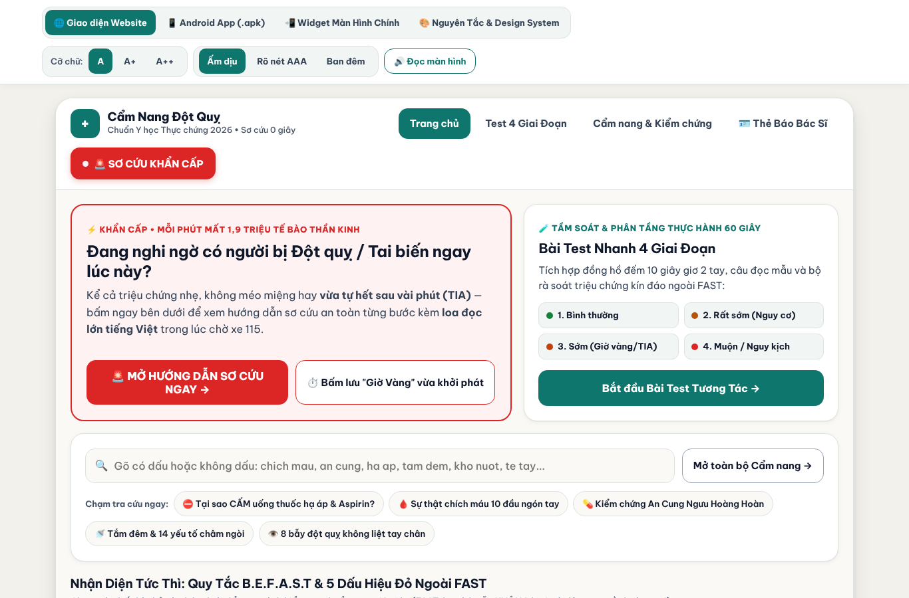

# Báo cáo review thiết kế UI/UX: Gemini và Claude

> **Ngày:** 27/11/2026 · **Người review:** Claude
> **Đối tượng review:**
> - Thiết kế của Gemini: `gemini/docs/ui-ux/` gồm `README.md`, 2 ảnh concept trong `assets/` và bản demo `demo-giao-dien.html` (2.008 dòng).
> - Thiết kế của Claude: `claude/docs/ui-ux/` gồm `README.md` và `ban-thiet-ke.html` (bản thiết kế có prototype app bấm thử được).
>
> **Mục tiêu:** so sánh hai thiết kế, giữ ưu điểm của mỗi bên, sửa nhược điểm, đề xuất **một thiết kế tối ưu duy nhất** để bắt tay vào làm sản phẩm thật.
>
> **Cập nhật 27/11/2026:** thêm mục **6.5 Lịch sử kiểm tra**: lưu kết quả theo từng lần trên máy, mở app thấy lần gần nhất, kiểm tra lại. Prototype chưa có phần này; khi viết mã thì làm theo mục 6.5.

---

## Mục lục

1. [Kết luận nhanh](#1-kết-luận-nhanh)
2. [Cách review](#2-cách-review)
3. [Bảng so sánh tổng thể](#3-bảng-so-sánh-tổng-thể)
4. [Review thiết kế Gemini](#4-review-thiết-kế-gemini)
5. [Tự review thiết kế Claude](#5-tự-review-thiết-kế-claude)
6. [Thiết kế tối ưu hợp nhất](#6-thiết-kế-tối-ưu-hợp-nhất)
7. [Danh sách việc cần làm theo mức ưu tiên](#7-danh-sách-việc-cần-làm-theo-mức-ưu-tiên)
8. [Kế hoạch thử nghiệm với người dùng](#8-kế-hoạch-thử-nghiệm-với-người-dùng)
9. [Phụ lục: số liệu kiểm thử](#9-phụ-lục-số-liệu-kiểm-thử)

---

## 1. Kết luận nhanh

**Hai thiết kế đi cùng một hướng**, và hướng đó đúng:
- tách hai chế độ “bình tĩnh” và “khẩn cấp”;
- dùng BE-FAST;
- ghi giờ lần cuối thấy bình thường (LKW);
- có màn hình chống mẹo dân gian, thẻ thông tin cho bác sĩ, giọng đọc tiếng Việt, nhịp ép tim, widget Android;
- chạy được khi mất mạng; dùng một mã nguồn cho web và `.apk`.

**Gemini mạnh hơn ở:**
- Sơ cứu **theo tình huống** (nôn, co giật, ngừng thở, ngủ dậy mới thấy…).
- Thẻ **“Nên làm / Tuyệt đối cấm” đặt cạnh nhau** trong từng tình huống.
- Bài viết **đọc 3 lớp**.
- Các nút **đổi chế độ hiển thị** (ấm dịu, tương phản cao, ban đêm).
- Ý tưởng **giữ màn hình luôn sáng**.
- **5 dấu hiệu đỏ** ngoài BE-FAST.
- Thẻ y tế có **cân nặng**; minh họa widget rõ ràng.

**Claude mạnh hơn ở:**
- **Luồng cấp cứu đặt nút “Gọi 115” lên đầu.**
- **Bài kiểm tra an toàn:** có lựa chọn “Không chắc”; không bao giờ ghi kết quả “bình thường”.
- **Đồng hồ khởi phát và thước giờ vàng.**
- **Tìm kiếm hiểu từ dân gian**, và tự hiện thẻ “Gọi 115” khi người dùng gõ triệu chứng.
- **Cỡ chữ mặc định lớn hơn**; biểu tượng vẽ bằng SVG thay vì emoji.

**Thiết kế Gemini có 6 lỗi an toàn cần sửa trước khi làm sản phẩm** (mục 4.2). Ba lỗi nặng nhất:
1. Bài kiểm tra **hiện sẵn kết quả “Mức 1: Bình thường” trước khi người dùng trả lời câu nào**.
2. Trên điện thoại, nút **“Gọi 115” nằm cách đầu màn hình cấp cứu khoảng 3 lần chiều cao màn hình**.
3. **Đau đầu sét đánh bị xếp là “Muộn”.**

**Thiết kế Claude cũng có nhược điểm** (mục 5.2):
- Một số chữ phụ chỉ 13–14px; vài nút nhỏ hơn 44px.
- “1 chạm tới 115” thực tế là 2 chạm.
- Thiếu bước chọn tình huống.
- Chưa có chức năng giữ màn hình sáng.
- Nút tương phản cao chưa hoạt động.

**Cả hai thiết kế đều chưa lưu kết quả kiểm tra theo lần** (G17, C13). Người bệnh có thể thấy bình thường đúng lúc làm bài, nên một lần kiểm tra là chưa đủ. Mục 6.5 thiết kế phần **Lịch sử kiểm tra**:
- tự lưu trên máy;
- mở app thấy ngay lần gần nhất, kiểm tra lại bằng một chạm;
- cảnh báo khi dấu hiệu “có rồi hết”.

**Đề xuất:** lấy **khung luồng cấp cứu và logic bài kiểm tra của Claude** làm xương sống. Ghép vào đó **bước chọn tình huống, thẻ Nên/Cấm, đọc 3 lớp, các nút đổi chế độ hiển thị và giữ màn hình sáng của Gemini**. Toàn bộ nội dung y khoa lấy từ một nguồn duy nhất là `claude_merge_final.md`. Chi tiết ở mục 6.

---

## 2. Cách review

| Bước | Nội dung |
|---|---|
| Đọc tài liệu | `README.md` hai bên; ảnh concept của Gemini; mã nguồn demo của Gemini (giao diện, dữ liệu, logic) |
| Chạy thử | Mở demo Gemini bằng Chromium không giao diện, ở hai cỡ màn hình: máy tính 1366×900 và điện thoại 390×844, cả chế độ Website và chế độ App. Chạy các luồng: bài test, sơ cứu, tìm kiếm, ghi giờ, đổi cỡ chữ |
| Đo đạc | Lỗi JavaScript; tràn ngang; kích thước vùng chạm; phân bố cỡ chữ thực tế; vị trí nút “Gọi 115”; độ tương phản màu (công thức WCAG) |
| So sánh công bằng | Chạy cùng bộ đo trên prototype của Claude |
| Đối chiếu y khoa | So nội dung trong demo với `claude_merge_final.md` |

Kết quả đo chi tiết ở mục 9.

---

## 3. Bảng so sánh tổng thể

Thang điểm 1–5 (5 là tốt nhất), chấm theo những gì **đang có trong demo**, không phải theo những gì tài liệu mô tả.

| Tiêu chí | Gemini | Claude | Ghi chú |
|---|:-:|:-:|---|
| **An toàn của câu chữ và kết quả** | 2 | 5 | Gemini hiện sẵn “Bình thường”, xếp đau đầu sét đánh là “Muộn”, không có “Không chắc” |
| **Tốc độ tới cuộc gọi 115** | 2 | 4 | Gemini: phải cuộn khoảng 3 màn hình. Claude: nút gọi ở trên cùng nhưng vẫn cần 2 chạm |
| **Luồng sơ cứu** | 4 | 4 | Gemini: theo tình huống, nhưng thứ tự sai. Claude: tuyến tính, thiếu bước chọn tình huống |
| **Hướng dẫn Nên/Cấm** | 5 | 3 | Gemini đặt cạnh nhau trong từng tình huống. Claude tách thành một màn riêng |
| **Bài kiểm tra** | 2 | 4 | Gemini trộn kiểm tra dấu hiệu với đánh giá nguy cơ. Claude tách hai bài, nhưng điểm nguy cơ mới là minh họa |
| **Lưu kết quả theo lần** | 1 | 1 | Cả hai mất kết quả khi đóng app. Gemini chỉ lưu Thẻ y tế. Xem mục 6.5 |
| **Đồng hồ khởi phát, thước giờ vàng** | 2 | 5 | Gemini chỉ có 2 mốc giờ; sau 30 giờ vẫn ghi “đang trong cửa sổ cấp cứu” |
| **Tìm kiếm** | 2 | 5 | Gemini: gõ ở trang chủ là bị chuyển trang, ô tìm biến mất; “te tay” không ra kết quả |
| **Tra cứu bài viết** | 5 | 3 | Mẫu đọc 3 lớp của Gemini rõ ràng hơn |
| **Trợ năng người cao tuổi** | 3 | 3 | Gemini có nhiều chế độ hiển thị nhưng nhiều chữ 12–13px. Claude chữ chính 17–18px nhưng một số nhãn 13px, vài nút 36–40px |
| **Hệ thống màu, chữ** | 3 | 4 | Gemini ghi “AAA” nhưng màu teal và đỏ chỉ đạt AA. Claude ghi tỷ lệ đúng |
| **Biểu tượng** | 2 | 4 | Gemini dùng emoji (hiển thị khác nhau giữa các máy, TalkBack đọc tên emoji) |
| **Tính năng riêng Android** | 4 | 4 | Hai bên cùng có widget, thẻ y tế. Gemini thêm gửi SMS vị trí; Claude thêm lối tắt, ô cài đặt nhanh, màn hình khóa |
| **Website** | 4 | 4 | Gemini: phần đầu trang chia đôi rõ. Claude: ô tìm kiếm là trung tâm, thanh 2 nút ở đáy trên điện thoại |
| **Độ hoàn thiện demo** | 4 | 4 | Cả hai không lỗi JavaScript, không tràn ngang |
| **Tài liệu thiết kế** | 4 | 4 | Gemini có sơ đồ luồng mermaid. Claude có nghiên cứu nguồn, câu hỏi duyệt, kế hoạch tính năng |

---

## 4. Review thiết kế Gemini



### 4.1 Điểm mạnh nên giữ

1. **Chọn tình huống khi sơ cứu.** Người dùng chọn đúng cảnh đang thấy (nôn, lơ mơ, co giật, ngừng thở, ngủ dậy mới thấy, triệu chứng đã tự hết) và nhận hướng dẫn riêng. Sát thực tế hơn một luồng chung.
2. **Khung “Việc cần làm ngay / Tuyệt đối cấm” đặt cạnh nhau** trên cùng một thẻ. Người đọc thấy ngay việc nên làm và điều cấm, không cần sang màn khác.
3. **Đọc 3 lớp cho mỗi bài:** tóm tắt 15 giây, hành động nên và cấm, bằng chứng mở rộng. Hợp cho cả người già lẫn người muốn tìm hiểu sâu.
4. **Ba chế độ hiển thị bấm được:** Ấm dịu, Rõ nét (tương phản cao), Ban đêm. Có thanh đổi cỡ chữ ba mức ở đầu trang.
5. **5 dấu hiệu đỏ ngoài BE-FAST** có thẻ bấm xem giải thích. Mỗi thẻ có nút “Có dấu hiệu này → Sơ cứu ngay”.
6. **Thẻ báo bác sĩ có cân nặng** (để bác sĩ tính liều thuốc). Thông tin được lưu trên máy để lần sau không phải nhập lại.
7. **Nhịp ép tim 110 lần/phút** có tiếng bíp, hiện tự động ở tình huống ngừng thở.
8. **Ý tưởng giữ màn hình luôn sáng** trong chế độ cấp cứu, và **gửi SMS vị trí cho người thân** khi gọi 115.
9. **Phần đầu trang web chia đôi rõ:** bên trái khẩn cấp, bên phải bài test. Có hàng nút chủ đề tra cứu nhanh (“Tại sao cấm uống thuốc hạ áp”, “Sự thật chích máu”…).
10. **Sơ đồ luồng điều hướng bằng mermaid** trong README dễ đọc với đội phát triển.
11. Demo chạy ổn: **không lỗi JavaScript, không tràn ngang** ở cả hai cỡ màn hình, kể cả cỡ chữ lớn nhất.

### 4.2 Lỗi an toàn (phải sửa)

| # | Lỗi | Bằng chứng khi chạy thử | Vì sao nguy hiểm | Cách sửa |
|---|---|---|---|---|
| **G1** | **Kết quả “Mức 1: Bình thường” hiện sẵn khi mở bài test**, trước khi trả lời câu nào. Bấm “Làm lại” cũng quay về kết quả này | Kết quả ban đầu: “🟢 MỨC 1: BÌNH THƯỜNG / NGUY CƠ NỀN THẤP · Chưa ghi nhận triệu chứng thần kinh khu trú bất thường” | Người đang hoảng nhìn lướt sẽ thấy chữ xanh “Bình thường” và yên tâm sai | Khi chưa có câu trả lời, ô kết quả để trống: “Kết quả sẽ hiện sau khi trả lời” |
| **G2** | **Kết quả âm tính khẳng định “Hiện tại khuôn mặt, vận động hai tay, lời nói và thăng bằng ổn định”**, không kèm lưu ý | Trả lời bình thường cả 5 bước thì ra đúng câu trên | Trái nguyên tắc “không bao giờ trấn an sai” trong cả hai bộ kiến thức. Các thang sàng lọc đều có thể bỏ sót | Đổi thành “Chưa thấy dấu hiệu thường gặp. Kết quả này không loại trừ đột quỵ”, kèm danh sách dấu hiệu vẫn phải gọi 115 |
| **G3** | **Không có lựa chọn “Không chắc”**; mỗi câu chỉ có bình thường, đã tự hết, hoặc đang có | Bước 1 chỉ có 3 nút | Người không chắc sẽ chọn “bình thường” | Thêm “Không chắc”, xử lý như “Có” |
| **G4** | **Đau đầu sét đánh, nôn vọt, sặc, ngủ gà bị xếp là “Mức 4: Muộn”** | Chọn “Đau đầu sét đánh” ở bước 3 thì ra “🔴 MỨC 4: GIAI ĐOẠN MUỘN” | Đau đầu sét đánh là cấp cứu **tối cấp** (nghi vỡ phình mạch), không phải “muộn”. Thang này trộn **mức độ nặng** với **thời gian** | Tách hai trục (xem `claude_merge_final.md` mục 3): dấu hiệu nặng là **mức nguy kịch**, ưu tiên đường thở; thời gian tính theo LKW |
| **G5** | **Nút “Gọi 115” trong màn hình sơ cứu nằm cuối thẻ**, sau phần ghi giờ, hàng chọn tình huống và hai danh sách | Điện thoại 390×844: nút nằm ở khoảng **2.537px** tính từ đầu trang, phải cuộn khoảng 3 màn hình. Máy tính: ở mép dưới màn hình (763/900px) | Hành động quan trọng nhất lại nằm xa nhất. Nút đỏ “Sơ cứu khẩn cấp” ở đầu trang chỉ mở màn hình, không gọi | Đặt nút “Gọi 115” lớn **trên cùng** màn hình cấp cứu; thêm một nút gọi nhỏ cố định ở mọi bước |
| **G6** | **Sau 30 giờ, dòng LKW vẫn ghi “Đang trong cửa sổ cấp cứu!”** | Ghi LKW cách đây 1.800 phút thì hiện “Đã trôi qua 1800 phút… Đang trong cửa sổ cấp cứu!” | Thông tin thời gian sai, và không phân biệt được giờ vàng với các mức sau | Dùng thước giờ vàng: 0–4,5 giờ / 4,5–24 giờ / trên 24 giờ, kèm thông điệp đúng từng mức (nhưng **luôn** gọi 115) |


Lưu ý: phần đầu ảnh là thanh điều khiển của demo (chọn Website/App, cỡ chữ). Ngay cả khi bỏ thanh này, nút “Gọi 115” vẫn nằm dưới phần ghi giờ, hàng chọn tình huống và hai danh sách.

### 4.3 Vấn đề trải nghiệm (nên sửa)

| # | Vấn đề | Bằng chứng | Cách sửa |
|---|---|---|---|
| G7 | **Gõ tìm kiếm ở trang chủ là bị chuyển sang trang Cẩm nang, ô tìm kiếm biến mất.** Trang Cẩm nang không có ô tìm kiếm riêng | Gõ “meo mieng”: ô tìm kiếm không còn hiện, trang Cẩm nang mở ra | Hiện kết quả ngay dưới ô tìm kiếm; trang Tra cứu có ô tìm kiếm riêng |
| G8 | **Tìm kiếm chỉ so trùng nguyên cụm, không hiểu từ đồng nghĩa.** Gợi ý trong ô có “te tay” nhưng gõ “te tay” thì không ra kết quả | “te tay”: “Không tìm thấy”. “tai bien”: chỉ ra bài chích máu | Dùng bộ tìm kiếm của Claude: bỏ dấu, tách từ, từ dân gian (“trúng gió”, “tai biến” → đột quỵ), và hiện thẻ “Gọi 115” khi người dùng gõ triệu chứng |
| G9 | **Bài test trộn hai việc khác nhau.** Kiểm tra dấu hiệu đang xảy ra (bước 1–3) bị nối liền với đánh giá yếu tố nguy cơ (bước 4–5) | Một luồng 5 bước | Tách thành hai bài: “Kiểm tra dấu hiệu ngay” và “Nguy cơ của tôi”. Kiểm tra dấu hiệu xong, nếu âm tính thì gợi ý làm bài nguy cơ |
| G10 | **Mức 2 “Rất sớm” lại có nghĩa là “có yếu tố nguy cơ”** | Đồng hồ: Bình thường → Rất sớm (nguy cơ) → Sớm → Muộn | Người có huyết áp cao sẽ hiểu là “đã bị đột quỵ giai đoạn rất sớm”. Dùng tên “Nguy cơ: Thấp / Trung bình / Cao / Rất cao” cho trục nguy cơ |
| G11 | **Nút “Tình huống trước / Tình huống tiếp theo”** khiến các tình huống trông như các bước tuần tự | Nút ở cuối thẻ sơ cứu | Tình huống là các lựa chọn thay thế nhau. Bỏ hai nút này; giữ nút quay lại bước chọn tình huống |
| G12 | **Chế độ khẩn cấp không khác chế độ thường.** README ghi “ẩn mọi menu phụ”, nhưng demo vẫn giữ nguyên đầu trang, thanh điều hướng, nền | So ảnh trang chủ với màn hình sơ cứu | Khi vào cấp cứu: nền và thanh trạng thái đổi màu đỏ, ẩn thanh điều hướng, chỉ còn nút thoát, nút đọc to, nút gọi |
| G13 | **Ghi giờ chỉ có 3 lựa chọn** (vừa xảy ra, 15 phút trước, ngủ dậy mới thấy) | Phần LKW | Thêm 30 phút, 1 giờ, 3 giờ, “Không rõ”, và chọn giờ cụ thể |
| G14 | **Biểu tượng là emoji** (🚨🧪📖🫀…) | Toàn bộ giao diện | Emoji hiển thị khác nhau giữa các đời Android, và TalkBack đọc tên emoji gây nhiễu. Dùng bộ biểu tượng nét (SVG) kèm nhãn chữ |
| G15 | **Thông báo “Đang đọc…” hiện ngay cả khi máy không có giọng tiếng Việt** | Hàm đọc không kiểm tra giọng | Kiểm tra giọng `vi-VN`; nếu không có thì báo cách cài |
| G16 | **Ở độ rộng 1366px, nút “Sơ cứu khẩn cấp” bị đẩy xuống dòng thứ hai** dưới logo | Ảnh trang chủ máy tính | Gom thanh điều hướng, hoặc rút gọn nhãn |
| G17 | **Kết quả bài test không được lưu.** Đóng app hoặc bấm “Làm lại” là mất | `triageHistory` chỉ là biến tạm, bị xoá khi làm lại. `localStorage` chỉ dùng cho Thẻ y tế (`dotquy_med_id`) | Lưu theo từng lần trên máy (mục 6.5) |

### 4.4 Chỗ README mô tả khác với demo

| README ghi | Thực tế trong demo |
|---|---|
| “Chuẩn WCAG 2.2 AAA” | Xanh teal `#0F766E` với chữ trắng là **5,47:1**, đỏ `#DC2626` là **4,83:1**: chỉ đạt **AA**, chưa đạt AAA (cần 7:1). README ghi đỏ là 5,6:1, đo thực tế là 4,83:1 |
| Chữ nội dung 16px ở mức A | Ở mức A, đo được **15 đoạn chữ 12px và 28 đoạn 13px** (nhãn, mô tả thẻ, hàng nút) |
| Vùng chạm tối thiểu 48–56px, trang thiết kế ghi 54–60px | Các nút chủ đề và nút điều khiển chỉ **38px** |
| Giữ màn hình sáng (WakeLock) | **Chưa có trong mã** |
| 10 tình huống sơ cứu | Demo có **6** tình huống |
| Thanh điều hướng 4 nút | Ảnh concept có **5** nút, trong đó có “Tài khoản” (trái nguyên tắc “không bắt tạo tài khoản”) |
| Demo “hoạt động cả khi mất mạng, 100% độc lập” | Phông chữ tải từ Google Fonts; khi mất mạng vẫn chạy nhưng đổi sang phông hệ thống |

### 4.5 Ảnh concept

Ảnh `android-app-screens.jpg` và `website-ui-concept.jpg` có bố cục và màu sắc đẹp, **nhưng không nên dùng làm mẫu cho đội phát triển** vì có các lỗi sau:

- **Nút “CÓ” màu xanh lá, “KHÔNG” màu cam** ở bài test. Ngược với nghĩa: “Có dấu hiệu” là nguy hiểm.
- **Đồng hồ “Thời gian còn lại 0:58:12”** trong màn hình sơ cứu. Đếm ngược tạo cảm giác hết giờ là hết hy vọng, trái với thông điệp “không bỏ cuộc”.
- **“Nằm nghiêng… đầu thấp hơn thân”** sai tư thế. README đã ghi chú lỗi này.
- Bài test gọi từng bước là **“Giai đoạn 1: Méo mặt?”**, dễ nhầm “bước kiểm tra” với “giai đoạn bệnh”. Đồng hồ hiện **điểm số “2.5”** không có nghĩa với người dùng.
- Web: nhãn tiếng Anh (“Balance”, “Eyes”, “Audio read-aloud”); menu **không có mục “Sơ cứu”**; thứ tự 4 mức khác với README.
- Ngày “Thứ Hai, 15/05/2024” đã cũ; dùng từ “Nạn nhân” thay vì “Người bệnh”.

### 4.6 Nội dung y khoa trong demo

Phần lớn khớp với `claude_merge_final.md`. Một số chỗ cần sửa:
- **Bài “8 cái bẫy”:** con số FAST nhạy 58,7% ở tuần hoàn sau bị gán cho nghiên cứu Aroor 2017. Con số này đến từ một đoàn hệ khác.
- **Tình huống “Ngủ dậy mới thấy”:** ghi “Quyết định 3312 đã mở cửa sổ… tới 9–24 giờ”. Theo tài liệu gốc, hướng dẫn Bộ Y tế nói 4,5–9 giờ; mốc 24 giờ là của AHA/ASA 2026. Việc Quyết định 3312 thay thế 5331 cũng **chưa được xác minh**.
- **Demo và README dẫn `gemini_merge.md`.** Bản đó còn các lỗi đã sửa trong `claude_merge_final.md` (nguồn HINTS, tử vong tắc thân nền, đích huyết áp xuất huyết não…). Nên đổi sang **một nguồn kiến thức duy nhất**.

---

## 5. Tự review thiết kế Claude

### 5.1 Điểm mạnh nên giữ

1. **Luồng cấp cứu 4 bước, nút “Gọi 115” to nhất nằm trên cùng**: cách đầu khung điện thoại khoảng 180px, không cần cuộn. Đi kèm câu mẫu để nói với tổng đài và địa chỉ GPS.
2. **Đồng hồ khởi phát và thước giờ vàng** (0–4,5 / 4,5–24 / trên 24 giờ) chạy liên tục ở đầu mọi bước cấp cứu, đồng bộ với thẻ bác sĩ. Có 6 mốc chọn giờ, kể cả “Không rõ”.
3. **Bài kiểm tra an toàn:**
   - Mỗi câu có “Có / Không / Không chắc”; “Không chắc” được xử lý như “Có”.
   - Kết quả âm tính không bao giờ ghi “bình thường”, luôn kèm danh sách dấu hiệu vẫn phải gọi 115.
   - Bài “Dấu hiệu đã tự hết?” tách riêng.
4. **Tìm kiếm thông minh:** bỏ dấu, hiểu từ dân gian (“trúng gió”, “tai biến”, “méo mồm”); gõ triệu chứng thì hiện thẻ đỏ “Gọi 115”. Kết quả hiện ngay tại chỗ.
5. **Thẻ hành động 3 cấp** (Gọi 115 ngay / Đi khám trong hôm nay / Theo dõi). Màu đỏ chỉ dùng cho cấp cứu.
6. **Biểu tượng nét SVG kèm nhãn chữ**; tự theo chế độ sáng, tối của máy; tôn trọng cài đặt giảm chuyển động.
7. **Lối vào không cần mở app**: widget, lối tắt khi nhấn giữ icon, ô cài đặt nhanh, màn hình khóa.
8. Tài liệu có **nghiên cứu nguồn, 8 nguyên tắc kèm câu hỏi duyệt, kế hoạch tính năng theo giai đoạn**.

### 5.2 Nhược điểm cần sửa

| # | Nhược điểm | Bằng chứng | Cách sửa |
|---|---|---|---|
| C1 | **“1 chạm tới 115” là chưa đúng.** Nút đỏ ở thanh điều hướng mở màn hình gọi, phải chạm thêm một lần nữa | Luồng prototype | Ghi đúng “1 chạm tới màn hình gọi, 2 chạm tới bàn phím gọi”. Widget và lối tắt “Gọi 115” mở bàn phím gọi ngay |
| C2 | **Thiếu bước chọn tình huống.** Ai cũng đi qua 5 bước giống nhau, dù người bệnh đang co giật hay đã ngừng thở | Luồng sơ cứu tuyến tính | Thêm màn “Người bệnh đang thế nào?” với 3 lựa chọn lớn (mục 6.3) |
| C3 | **Điều cấm nằm ở một màn riêng** (bước 3). Người dùng có thể bỏ qua | Luồng 4 bước | Mỗi thẻ sơ cứu có 1–2 điều cấm liên quan ngay bên dưới (học từ Gemini); vẫn giữ màn tổng hợp 10 điều cấm |
| C4 | **Một số chữ còn nhỏ** | Trang chủ ở cỡ chữ thường: 7 đoạn 13px, 11 đoạn 14px (nhãn thanh điều hướng, nhãn phụ, thanh trạng thái) | Nhãn thanh điều hướng và chú thích tối thiểu 14px; ở mức Lớn, Rất lớn tăng theo |
| C5 | **Vài vùng chạm dưới 44px** | Nút gợi ý tìm kiếm 40px; nút A/A+/A++ 36px; liên kết “làm BE-FAST” trong thẻ bác sĩ 20px | Nâng tối thiểu 48px; liên kết trong câu đổi thành nút |
| C6 | **Chưa giữ màn hình sáng** trong chế độ cấp cứu | Không có trong mã | Thêm giữ màn hình sáng (WakeLock trên web, KeepScreenOn trên Android) |
| C7 | **Nút “Tương phản cao” chỉ bật tắt, chưa đổi giao diện** | Màn Hồ sơ | Làm chế độ tương phản cao thật (học từ Gemini) |
| C8 | **Dùng 2 họ phông** (Lexend + Be Vietnam Pro) | Hệ thống chữ | Dùng một họ Be Vietnam Pro cho nhẹ app. Nếu cần, chỉ dùng Lexend cho số lớn (đồng hồ) |
| C9 | **Điểm nguy cơ mới là minh họa** | Bài “Nguy cơ của tôi” | Chọn công thức đã kiểm định (mục 6.4) |
| C10 | **Bài viết chưa có mẫu 3 lớp rõ ràng** (mới có “Tóm tắt 30 giây”) | Mẫu bài viết | Dùng mẫu đọc 3 lớp của Gemini |
| C11 | **Prototype nằm trong một trang tài liệu dài**, không tách thành bản demo độc lập như Gemini | `ban-thiet-ke.html` | Khi làm sản phẩm thật, dựng thành app riêng |
| C12 | **Chỉ có 3 dấu hiệu đỏ** (làm trước khi có bộ kiến thức cuối) | Màn BE-FAST | Cập nhật lên 5 dấu hiệu đỏ theo `claude_merge_final.md` |
| C13 | **Không lưu kết quả kiểm tra theo lần.** Không bắt được trường hợp dấu hiệu “có rồi hết” giữa hai lần kiểm tra | Kết quả chỉ nằm trong bộ nhớ của phiên; mã không dùng `localStorage` hay IndexedDB | Thêm phần Lịch sử kiểm tra (mục 6.5) |

---

## 6. Thiết kế tối ưu hợp nhất

Tên tạm vẫn là **Giờ Vàng**. Nội dung y khoa lấy từ **`claude_merge_final.md`**.

### 6.1 Mười nguyên tắc

| # | Nguyên tắc | Nguồn |
|---|---|---|
| 1 | **Hai chế độ khác hẳn nhau.** Bình tĩnh: dịu, có cấu trúc. Khẩn cấp: nền đỏ, ẩn menu, một việc mỗi màn hình, đọc to tự động, giữ màn hình sáng | Cả hai |
| 2 | **Nút “Gọi 115” luôn ở trên cùng và luôn nhìn thấy** trong chế độ khẩn cấp | Claude |
| 3 | **Không bao giờ trấn an sai.** Không có kết quả “bình thường”; luôn có “Không chắc”; **kết quả cũ luôn kèm giờ**, không bao giờ trình bày như tình trạng hiện tại | Claude |
| 4 | **Thời gian và mức độ nặng là hai trục khác nhau.** Thời gian tính theo LKW; mức nguy kịch xử lý đường thở ở mọi thời điểm | Claude (sửa G4) |
| 5 | **Nên làm và Cấm đặt cạnh nhau** trên từng thẻ | Gemini |
| 6 | **Chọn đúng tình huống, nhưng tối đa 3 lựa chọn** khi đang hoảng | Gemini, rút gọn |
| 7 | **Màu là tín hiệu:** đỏ chỉ cho cấp cứu; vàng cho thời gian; xanh lá cho “nên làm”; không dùng màu một mình | Cả hai |
| 8 | **Đọc 3 lớp:** tóm tắt, hành động, bằng chứng | Gemini |
| 9 | **Chữ to, vùng chạm lớn, không emoji**: chữ nội dung 18px; chạm tối thiểu 48px, chuẩn 56px, cấp cứu 72px | Claude, sửa C4, C5 |
| 10 | **Không đăng nhập; phần cấp cứu chạy khi mất mạng; ghi rõ ai thẩm định** | Cả hai |

### 6.2 Cấu trúc

**App Android:** thanh điều hướng 5 mục, nhãn chữ tối thiểu 14px.

| Mục | Nội dung |
|---|---|
| **Trang chủ** | Khối đỏ “Có người nghi đột quỵ?”; thẻ **“Lần kiểm tra gần nhất”** kèm nút “Kiểm tra lại ngay” (mục 6.5); 3 bài kiểm tra; 6 chữ BE-FAST và 5 dấu hiệu đỏ (bấm xem giải thích, học từ Gemini); nhắc việc hôm nay |
| **Kiểm tra** | “Kiểm tra dấu hiệu ngay” (BE-FAST và 5 dấu hiệu đỏ) · “Dấu hiệu đã tự hết?” · “Nguy cơ của tôi” · **Lịch sử kiểm tra** · Cảm biến (giai đoạn sau) |
| **Cấp cứu** (nút đỏ ở giữa) | Luồng mục 6.3 |
| **Tra cứu** | Ô tìm kiếm thông minh + hàng chủ đề + bài viết 3 lớp |
| **Hồ sơ** | Thẻ y tế (hồ sơ gia đình); cỡ chữ; chế độ hiển thị (Theo máy · Ấm dịu · Tương phản cao · Ban đêm); giọng đọc |

Không có mục “Tài khoản”.

**Lối vào ngoài app:**
- Widget 2×2 (một nút “Đột quỵ? Chạm ngay”) và 4×2 (theo mẫu của Gemini: Sơ cứu · 115 và Thẻ y tế · Kiểm tra).
- Lối tắt khi nhấn giữ icon: “Gọi 115” mở bàn phím gọi ngay.
- Ô cài đặt nhanh; thẻ y tế trên màn hình khóa.

**Website:**
- **Dải đỏ cố định trên đầu mọi trang:** “Nghi đột quỵ? Gọi 115 · Xem sơ cứu”. Trên điện thoại, chuyển thành **thanh 2 nút ở đáy** (Claude).
- **Phần đầu trang chia đôi** (Gemini):
  - Trái: khối đỏ khẩn cấp với nút “Gọi 115” và “Sơ cứu từng bước”.
  - Phải: **ô tìm kiếm** cùng các gợi ý (Claude) và nút “Kiểm tra dấu hiệu”.
- Bên dưới: 3 cánh cửa (Khẩn cấp · Kiểm tra · Phòng ngừa); BE-FAST và 5 dấu hiệu đỏ; ngộ nhận; danh sách bệnh viện.
- **Menu:** Nhận biết · Kiểm tra · **Sơ cứu** · Phòng ngừa · Sau đột quỵ · Hỏi đáp; nút “Aa” và “Nghe”.

### 6.3 Luồng cấp cứu tối ưu

| Bước | Màn hình | Lấy từ | Ngân sách thời gian |
|---|---|---|---|
| **0** | **Vào chế độ khẩn cấp** từ widget, lối tắt, nút đỏ hoặc thẻ dấu hiệu. Nền đỏ, ẩn thanh điều hướng, **giữ màn hình sáng**, đọc to tự động (tắt được) | Cả hai | ≤3 giây |
| **1** | **Gọi 115.** Nút gọi lớn nhất **trên cùng**. Câu mẫu để nói. Địa chỉ GPS chữ to. Chọn giờ LKW: Vừa xong · 15 phút · 30 phút · 1 giờ · 3 giờ · Ngủ dậy mới thấy · Không rõ. Đồng hồ khởi phát bắt đầu chạy. Có tùy chọn gửi SMS vị trí cho người thân | Claude + Gemini (SMS) | ≤10 giây |
| **2** | **“Người bệnh đang thế nào?”** 3 nút lớn: **① Không đáp ứng, không thở bình thường** · **② Lơ mơ, nôn, hoặc đang co giật** · **③ Tỉnh táo** | Gemini, rút gọn | 1 chạm |
| **3a** | Nếu chọn ①: **ép tim** với nhịp 110 lần/phút có tiếng và rung, hướng dẫn dùng AED, nhắc bật loa ngoài | Cả hai | Liên tục |
| **3b** | Nếu chọn ②: **nằm nghiêng an toàn**. Nếu đang co giật: dọn vật cứng, không ghì, không nhét gì vào miệng, dứt cơn thì nằm nghiêng | Gemini | Từng bước |
| **3c** | Nếu chọn ③: **nằm nghỉ**, nới quần áo, ở cạnh theo dõi. **Nếu vẫn chưa chắc có phải đột quỵ không, làm BE-FAST 60 giây** (dấu hiệu tự ghi vào thẻ bác sĩ) | Claude | Từng bước |
| **Mọi thẻ ở bước 3** | Mỗi thẻ là một việc, có hình minh họa. **Khung xanh “Nên làm” và khung đỏ “Cấm” (1–2 điều liên quan) đặt cạnh nhau.** Nút “Xong · Tiếp” ở vùng ngón cái. Thanh trên cùng luôn có **đồng hồ khởi phát và nút gọi 115 nhỏ** | Gemini + Claude | |
| **4** | **10 điều tuyệt đối không làm**: bấm “Vì sao?” để mở giải thích | Claude | 1 màn |
| **5** | **Thẻ báo bác sĩ:** 2 mốc giờ, cân nặng, thuốc chống đông (tô nổi), bệnh nền, dấu hiệu đã ghi, **diễn biến các lần kiểm tra trong 24 giờ** (mục 6.5), người thân. Nút gửi Zalo, SMS, phóng to toàn màn hình. Bệnh viện có đơn vị đột quỵ gần nhất | Claude + Gemini (cân nặng) | Khi xe tới |

Ghi chú kỹ thuật:
- Nút “Gọi 115” trên Android nên mở **bàn phím gọi đã điền sẵn 115**. Cách này không cần xin quyền gọi điện. Gọi thẳng thì phải xin quyền và chịu thêm ràng buộc chính sách của Google Play.
- Thước giờ vàng hiện đúng mức theo thời gian. **Không dùng đồng hồ đếm ngược “thời gian còn lại”** (lỗi trong ảnh concept của Gemini).

### 6.4 Bài kiểm tra tối ưu

**“Kiểm tra dấu hiệu ngay” (60 giây).** Câu hỏi:
1. Mặt (cười).
2. Tay: đồng hồ đếm 10 giây (học từ Gemini).
3. Lời nói: **một câu mẫu cố định** cho toàn app.
4. Thăng bằng.
5. Mắt.
6. 5 dấu hiệu đỏ.

Cách hoạt động:
- Mỗi câu có **Có / Không / Không chắc**, và đánh số là **“Bước”**, không gọi là “giai đoạn”.
- **Gặp “Có” hoặc “Không chắc” thì dừng ngay**, chuyển sang màn đỏ “Gọi 115”. Gemini gọi cơ chế này là “cắt mạch”.
- **Khi chưa trả lời, không hiện kết quả.**

| Kết quả | Màn hình |
|---|---|
| Có dấu hiệu, hoặc không chắc | **Màn đỏ: “Gọi 115 ngay”**, danh sách dấu hiệu đã ghi vào thẻ bác sĩ |
| Dấu hiệu đã tự hết | **Màn cam: “Cảnh báo sớm: đi cấp cứu trong hôm nay; tái lại thì gọi 115”** |
| Không thấy dấu hiệu | **Màn trung tính: “Chưa thấy dấu hiệu thường gặp. Kết quả này không loại trừ đột quỵ.”** Kèm danh sách dấu hiệu vẫn phải gọi 115 và gợi ý làm bài “Nguy cơ của tôi” |

Mọi kết quả **tự lưu theo từng lần** trên máy. Màn kết quả so sánh với lần trước của cùng người. Nếu lần trước có dấu hiệu mà lần này không thấy, màn kết quả phải cảnh báo TIA trước (mục 6.5).

**“Nguy cơ của tôi” (3 phút).** Dùng **đồng hồ bán nguyệt 4 mức của Gemini** cho trục nguy cơ: **Thấp · Trung bình · Cao · Rất cao**. Có phần “thử thay đổi” của Claude. Công thức tính phải do chuyên gia chọn và kiểm định (ví dụ dựa trên Stroke Riskometer). **Không hiện điểm số thập phân.**

**Thước giờ vàng** (chỉ dùng sau khi có dấu hiệu): Cảnh báo sớm (TIA) · Giờ vàng 0–4,5 giờ · Còn cơ hội 4,5–24 giờ · Trên 24 giờ. **Mức nào cũng phải gọi 115.**

### 6.5 Lịch sử kiểm tra (lưu trên máy)

> Bổ sung ngày 27/11/2026. Lý do: người bệnh có thể thấy bình thường **đúng lúc** làm bài, nên kết quả phải được lưu theo từng lần. Hai prototype hiện tại **chưa có** phần này (G17, C13). Khi viết mã, làm theo mục này.

#### 6.5.1 Vì sao cần

Dấu hiệu đột quỵ có thể đến rồi đi, hoặc nặng dần theo giờ. Một lần kiểm tra chỉ cho biết tình trạng **ở đúng lúc đó**. Lưu từng lần giúp được 4 việc:

| # | Việc | Ví dụ |
|---|---|---|
| 1 | **Bắt được mẫu “có rồi hết”** (nghi TIA). Theo `claude_merge_final.md` (mục 1 điều 8, mục 2.9), trường hợp này vẫn là cấp cứu | 08:10 có méo miệng; 09:00 kiểm tra lại không thấy. App **không được** chỉ hiện màn trung tính, mà phải nhắc đi cấp cứu trong hôm nay |
| 2 | **Thu hẹp giờ LKW** (mục 2.4 cũng khuyên xem điện thoại để thu hẹp LKW) | 07:30 làm bài chưa thấy dấu hiệu; 10:15 thấy yếu tay. Mốc 07:30 giúp người nhà nhớ lại giờ cuối cùng thấy người bệnh bình thường |
| 3 | **Cho bác sĩ thấy diễn biến** | Dấu hiệu nào, xuất hiện lúc nào, đã hết hay thêm mới |
| 4 | **Nhắc kiểm tra lại, theo dõi nguy cơ dài hạn** | Còn lo thì kiểm tra lại sau 15 phút; làm lại bài “Nguy cơ của tôi” sau vài tháng |

#### 6.5.2 Tám quy tắc an toàn (bắt buộc)

| # | Quy tắc | Lý do |
|---|---|---|
| **H1** | **Kết quả cũ không bao giờ được trình bày như tình trạng hiện tại.** Mọi kết quả đi kèm giờ: “Lúc 14:10: chưa thấy dấu hiệu BE-FAST”. Kết quả cũ hơn 2 giờ có thêm dòng “Tình trạng có thể đã thay đổi. Kiểm tra lại nếu còn lo.” | Người nhà mở app, thấy kết quả âm tính từ sáng và yên tâm sai |
| **H2** | **Kết quả âm tính không dùng màu xanh lá, dấu tích, hay chữ “Bình thường”, “Ổn”, “An toàn”.** Dùng màu trung tính (`--muted`) | Xanh lá dành cho “Nên làm” và “Đã xong” (mục 6.7). Giữ nguyên tắc 3 |
| **H3** | **Mẫu “có rồi hết” luôn được nêu bật.** Cùng một người có kết quả “Có” hoặc “Không chắc” trong 48 giờ qua, mà lần này không thấy dấu hiệu: **thẻ cam cảnh báo TIA hiện trên cùng**, kết quả trung tính xếp bên dưới. Nếu lần có dấu hiệu đó đã được đánh dấu “Đã đi khám”, chỉ hiện một dòng nhắc | Triệu chứng tự hết vẫn là cấp cứu; nguy cơ đột quỵ thật dồn vào 48 giờ đầu |
| **H4** | **Các lần âm tính trước không làm nhẹ đi kết quả dương tính lúc này.** Không tính trung bình, không vẽ “xu hướng” cho BE-FAST | Mỗi lần dương tính đều là cấp cứu |
| **H5** | **App chỉ gợi ý giờ LKW từ lịch sử; người dùng phải xác nhận.** Thẻ bác sĩ hiện **dữ liệu gốc** (từng mốc giờ và kết quả), không hiện con số do app tự suy ra | Một lần âm tính không chứng minh người bệnh hoàn toàn bình thường, vì bài kiểm tra có thể bỏ sót (mục 9.1 của `claude_merge_final.md`). Khi dấu hiệu hết rồi quay lại, tính LKW thế nào là việc của bác sĩ |
| **H6** | **Lịch sử không bao giờ chắn đường tới 115.** Trên trang chủ, khối đỏ cấp cứu luôn nằm trên thẻ lịch sử. Chế độ khẩn cấp không hiện lịch sử, trừ mục diễn biến trên thẻ bác sĩ | Nguyên tắc 2 |
| **H7** | **Chỉ có nút “Nhắc kiểm tra lại” sau kết quả âm tính.** Kết quả dương tính không có nút “nhắc sau” | Không tạo cớ để trì hoãn gọi 115 |
| **H8** | **Lưu thất bại không bao giờ chặn kết quả hay nút gọi.** Bộ nhớ đầy, tab ẩn danh, lỗi cơ sở dữ liệu: vẫn hiện kết quả, chỉ thêm dòng “Lần này chưa lưu được” | Bài kiểm tra phải chạy trong mọi điều kiện |

Các ngưỡng giờ trong mục này (2 giờ, 24 giờ, 48 giờ, 15 phút) là **đề xuất thiết kế, cần bác sĩ duyệt**.

#### 6.5.3 Màn hình và luồng

**① Trang chủ: thẻ “Lần kiểm tra gần nhất”**, nằm ngay dưới khối đỏ cấp cứu.

- Dòng đầu: người được kiểm tra và tên bài (“Bố · BE-FAST”).
- Dòng chính: kết quả kèm giờ, có màu theo kết quả (“Lúc 14:10, 50 phút trước: chưa thấy dấu hiệu”).
- Dải chấm cho 6 lần gần nhất. TalkBack đọc thành câu, ví dụ “6 lần gần nhất: 5 lần chưa thấy dấu hiệu, 1 lần có dấu hiệu”.
- Nút chính **“Kiểm tra lại ngay”**: vào thẳng câu hỏi 1, giữ người đã chọn. Nút phụ **“Lịch sử (12)”**.
- Chưa có lần nào thì không hiện thẻ trống.

```
│ [ĐỎ] Có người nghi bị đột quỵ?
│      Gọi 115 và sơ cứu từng bước                 ›
│
│ LẦN KIỂM TRA GẦN NHẤT · Bố · BE-FAST
│ Lúc 14:10 (50 phút trước)
│ Chưa thấy dấu hiệu BE-FAST. Không loại trừ đột quỵ.
│ ○ ○ ● ○ ○ ○   6 lần gần nhất (● có dấu hiệu)
│ [ Kiểm tra lại ngay ]          [ Lịch sử (12) ]
```

**② Băng nhắc việc tiếp theo** trên trang chủ. Hiện khi có kết quả dương tính trong 24 giờ, hoặc kết quả “Dấu hiệu đã tự hết” trong 48 giờ, mà **chưa ghi nhận hành động**:

| Loại | Câu chữ | Nút |
|---|---|---|
| Đỏ (có dấu hiệu) | “Lúc 14:10 Bố có dấu hiệu: méo miệng. Đã gọi 115 chưa?” | **Gọi 115** · Đã gọi / đã vào viện |
| Cam (đã tự hết) | “Lúc 08:10 Bố có dấu hiệu rồi tự hết. Cần đi cấp cứu trong hôm nay.” | **Bệnh viện gần nhất** · Gọi 115 · Đã đi khám |

Bấm nút “Đã…” thì lưu hành động kèm giờ, và băng biến mất. Bấm “Gọi 115” ở màn kết quả thì app tự ghi “Đã bấm gọi 115 lúc …”. App không biết cuộc gọi có kết nối hay không, nên **không** ghi “Đã gọi 115”.

**③ Màn kết quả BE-FAST: so sánh với lần trước** (cùng một người, trong 24 giờ; riêng mẫu “có rồi hết” xét trong 48 giờ)

| Lần trước | Lần này | Màn kết quả |
|---|---|---|
| Chưa có | Có dấu hiệu | Màn đỏ như mục 6.4 |
| Chưa thấy dấu hiệu (14:10) | Có dấu hiệu | Màn đỏ, thêm dòng “Lúc 14:10 chưa thấy dấu hiệu này”. Thêm câu hỏi: **“Lần cuối thấy Bố bình thường là lúc nào?”** với các lựa chọn **14:10 (lần kiểm tra trước)** · Muộn hơn, chọn giờ · Không rõ. Chọn xong thì sang bước Gọi 115 với giờ LKW đã điền sẵn, vẫn sửa được |
| Có dấu hiệu | Có dấu hiệu | Màn đỏ, kèm so sánh: **Mới:** yếu tay · **Vẫn còn:** méo miệng · **Đã hết:** (nếu có). Ghi giờ mỗi dấu hiệu xuất hiện lần đầu |
| Có dấu hiệu (trong 48 giờ) | Chưa thấy dấu hiệu | **Thẻ cam TIA trên cùng** (H3): “Lúc 08:10 có méo miệng, bây giờ không thấy. Dấu hiệu tự hết vẫn là cấp cứu: đi cấp cứu ngay trong hôm nay. Nếu dấu hiệu quay lại, gọi 115 ngay.” Nút **Gọi 115** · **Bệnh viện gần nhất**. Kết quả trung tính xếp bên dưới |
| Chưa thấy dấu hiệu | Chưa thấy dấu hiệu | Màn trung tính như mục 6.4, kèm nhắc kiểm tra lại (④) |

Quy tắc ghi:
- Kết quả **tự lưu** khi tới màn kết quả, không cần bấm “Lưu”, vì người đang hoảng sẽ quên. Dưới kết quả có dòng nhỏ “Đã lưu lúc 14:10 · Xem lịch sử”.
- Mỗi lần tới màn kết quả là **một lần mới**. “Làm lại” tạo lần mới, không ghi đè lần cũ.
- Bài BE-FAST dừng ngay khi gặp “Có” hoặc “Không chắc” (mục 6.4), nên các câu phía sau lưu là “chưa hỏi”. Khi so sánh, chỉ so những câu có ở cả hai lần.
- Bỏ dở khi mới trả lời “Không”: lưu là **“Bỏ dở ở bước 3”** (màu xám). Lần bỏ dở **không được tính là âm tính** khi so sánh, và không hiện trên thẻ trang chủ.

**④ Nhắc kiểm tra lại** (chỉ sau kết quả âm tính, H7)

- Hàng nút: “Nhắc tôi kiểm tra lại sau: **15 phút · 1 giờ · Không nhắc**”. Mặc định không chọn gì.
- Thông báo: “Đến giờ kiểm tra lại cho Bố. Chạm để bắt đầu.” Chạm vào thì mở thẳng câu hỏi 1. Thông báo **không ghi tên dấu hiệu** để giữ riêng tư trên màn hình khoá.
- Android 13 trở lên: chỉ xin quyền thông báo (`POST_NOTIFICATIONS`) **khi người dùng chọn nhắc lần đầu**, không xin lúc cài app.
- Không cần chính xác đến từng phút, nên dùng `AlarmManager.setAndAllowWhileIdle()`: vẫn kêu khi máy đang ngủ, không cần quyền báo thức chính xác.
- Website: chỉ đếm giờ khi trang còn mở, và nói rõ điều đó.

**⑤ Màn “Lịch sử kiểm tra”**

- Vào từ: thẻ trang chủ, tab Kiểm tra, thẻ bác sĩ.
- Lọc theo người: Tất cả · Bố · Mẹ · Tôi · Người khác. Nhóm theo ngày: Hôm nay · Hôm qua · 25/11/2026.
- Mỗi dòng cao tối thiểu 64px, gồm: giờ, biểu tượng và màu kết quả, tên bài, kết quả ngắn, người, hành động đã ghi.
- Đầu màn có dòng: “Chỉ lưu trên máy này. Không gửi đi đâu, trừ khi bạn bấm chia sẻ.”
- Nút dưới cùng: **“Kiểm tra lại ngay”**.
- Menu: Xuất file · Xoá tất cả. Xoá phải xác nhận ngay trong trang; nút xoá dùng màu `--warn`, **không dùng đỏ cấp cứu**.

```
│ ‹  Lịch sử kiểm tra
│ [Tất cả] [Bố] [Mẹ] [Tôi] [Người khác]
│ Chỉ lưu trên máy này.
│
│ HÔM NAY
│ 14:40  ● BE-FAST · Méo miệng, yếu tay trái
│          Bố · Đã bấm gọi 115 lúc 14:41
│ 14:10  ○ BE-FAST · Chưa thấy dấu hiệu
│          Bố
│ 08:10  ◐ Dấu hiệu đã tự hết? · Có, rồi tự hết
│          Bố · Đã đi khám lúc 10:30
│ HÔM QUA
│ 20:05  ◇ Nguy cơ của tôi · Cao
│          Tôi
│
│ [            Kiểm tra lại ngay            ]
```

**⑥ Chi tiết một lần**

- Từng câu trả lời, ví dụ: B Không · E Không chắc · F, A, S chưa hỏi (đã chuyển sang cấp cứu).
- So sánh với lần trước (nếu có).
- Hành động đã ghi. Có thể thêm: “Đã gọi 115”, “Đã đi khám”, hoặc ghi chú ngắn (ví dụ “ngủ dậy mới thấy”).
- Nút: Gửi cho người thân hoặc bác sĩ (Zalo, SMS, văn bản soạn sẵn) · Xoá lần này.

**⑦ Thẻ bác sĩ: mục “Diễn biến các lần kiểm tra (24 giờ)”**

- Nằm ngay dưới “Dấu hiệu ghi nhận”. Mặc định hiện 3 mốc gần nhất, bấm để xem hết.
- Chỉ hiện **dữ liệu gốc** (H5), ví dụ:
  - 08:10 · Dấu hiệu đã tự hết: méo miệng, khoảng 10 phút, bên trái
  - 14:10 · BE-FAST: chưa thấy dấu hiệu
  - 14:40 · BE-FAST: méo miệng, yếu tay trái
- Giờ LKW trên thẻ là giờ **người dùng đã xác nhận**.

**⑧ Bài “Dấu hiệu đã tự hết?”** Khi trả lời “Có, rồi tự hết”, hỏi thêm 4 câu nhanh. Các câu này **không bắt buộc** và không chặn nút gọi:

- Dấu hiệu nào (chọn nhiều).
- Bắt đầu lúc nào (chọn mốc giờ).
- Kéo dài bao lâu: dưới 5 phút · 5–15 phút · 15–60 phút · hơn 1 giờ · không rõ.
- Bên nào: trái · phải · không rõ.

`claude_merge_final.md` mục 2.9 dặn ghi lại đúng những thông tin này.

**⑨ Bài “Nguy cơ của tôi”**

- Lưu mỗi lần làm. Màn kết quả có dòng so sánh: “Lần trước (25/08): Cao → lần này: Trung bình”.
- Biểu đồ xu hướng **chỉ dùng cho bài nguy cơ**, không dùng cho BE-FAST (H4).
- Có tùy chọn nhắc làm lại sau vài tháng.

#### 6.5.4 Ai được kiểm tra

- Màn bắt đầu BE-FAST có hàng chọn **“Kiểm tra cho: Bố · Mẹ · Tôi · Người khác”**. App **chọn sẵn người của lần trước**, nên không thêm bước nào.
- Danh sách người lấy từ hồ sơ gia đình. Hồ sơ đầy đủ để ở giai đoạn sau (P2). Bản đầu cho **thêm nhanh một tên gọi** (Bố, Mẹ…) chỉ để tách lịch sử.
- “Người khác” dùng khi giúp người lạ hoặc hàng xóm. Mục này không gắn hồ sơ, và chỉ so sánh các lần cách nhau dưới 1 giờ.
- Mọi so sánh (H3, so với lần trước, gợi ý LKW) chỉ làm **trong cùng một người**.

#### 6.5.5 Mô hình dữ liệu

```ts
type Result =
  | 'emergency'     // có dấu hiệu
  | 'uncertain'     // không chắc, xử lý như có
  | 'tia_warning'   // dấu hiệu đã tự hết
  | 'no_signs'      // chưa thấy dấu hiệu (không bao giờ gọi là "bình thường")
  | 'abandoned'     // bỏ dở, không tính là âm tính
  | 'risk_low' | 'risk_medium' | 'risk_high' | 'risk_very_high';

type Answer = 'y' | 'n' | 'u' | 'not_asked';

interface TestRecord {
  id: string;                 // UUID
  schema: 1;                  // phiên bản cấu trúc dữ liệu
  test: 'befast' | 'resolved' | 'risk';
  test_version: string;       // phiên bản bộ câu hỏi, ví dụ "befast-5redflags-2026.11"
  person_id: string;          // id người trong gia đình, hoặc 'other'
  started_at: string;         // ISO 8601 có múi giờ, ví dụ 2026-11-27T14:09:30+07:00
  finished_at: string;
  answers: Record<string, Answer>;   // B, E, F, A, S và 5 dấu hiệu đỏ
  result: Result;
  resolved?: {                // chỉ cho bài "Dấu hiệu đã tự hết?"
    signs: string[];
    onset_at?: string;
    duration?: 'lt5' | '5_15' | '15_60' | 'gt60' | 'unknown';
    side?: 'left' | 'right' | 'unknown';
  };
  risk?: { inputs: Record<string, unknown>; level: string };  // không lưu điểm thập phân
  lkw_confirmed_at?: string;  // giờ LKW người dùng đã xác nhận
  actions: { type: 'tapped_call_115' | 'called_115' | 'visited' | 'note'; at: string; text?: string }[];
}
```

Ghi chú:
- Lưu giờ **có múi giờ** để sắp xếp đúng khi đổi múi giờ. Nếu một lần có giờ nằm trong tương lai, hiện ghi chú “Giờ trên máy có thể bị sai”.
- `test_version` giúp các lần cũ vẫn hiện đúng câu hỏi của thời điểm đó khi bộ câu hỏi thay đổi (ví dụ thêm dấu hiệu đỏ).

#### 6.5.6 Lưu ở đâu

| Nơi | Cách lưu | Ghi chú |
|---|---|---|
| **App Android** | SQLite **mã hoá** (SQLCipher, ví dụ plugin `@capacitor-community/sqlite`); khoá giữ trong **Android Keystore** | Dữ liệu sức khoẻ là dữ liệu nhạy cảm. Không lưu bằng `Preferences` hoặc `localStorage` không mã hoá |
| **Sao lưu tự động của Android** | **Mặc định loại khỏi Auto Backup**: `dataExtractionRules` cho Android 12 trở lên, `fullBackupContent` cho bản cũ hơn | Tránh dữ liệu sức khoẻ tự lên Google Drive mà người dùng không biết |
| **Đổi máy** | Nút **“Xuất lịch sử”** ra file (PDF để đưa bác sĩ, JSON để chuyển sang máy mới) và **“Nhập lịch sử”** | Nói rõ: gỡ app hoặc đổi máy mà chưa xuất thì mất lịch sử |
| **Website** | **IndexedDB**; gọi `navigator.storage.persist()` để trình duyệt hạn chế tự xoá | Ghi rõ: “Lịch sử chỉ lưu trên trình duyệt này. Xoá dữ liệu duyệt web hoặc dùng tab ẩn danh sẽ mất.” Safari trên iPhone có thể **tự xoá dữ liệu nếu 7 ngày không mở trang**, trừ khi trang được thêm vào màn hình chính |
| **Máy chủ** | **Không có.** Không đăng nhập, không đồng bộ đám mây ở bản đầu | Giữ nguyên tắc 10. Đồng bộ giữa điện thoại các thành viên gia đình để giai đoạn sau và phải có sự đồng ý rõ ràng |

**Cấu trúc mã:**
- Mọi thao tác đi qua **một giao diện chung** `HistoryStore`: `add`, `list(personId?, from?, to?)`, `get`, `addAction`, `remove`, `clear`, `export`, `import`.
- Giao diện này có 2 bản cài đặt: SQLite cho Android, IndexedDB cho web.
- Phần màn hình không gọi thẳng vào nơi lưu.

#### 6.5.7 Thời hạn lưu, xoá, quyền riêng tư

**Thời hạn lưu và xoá:**
- Mặc định giữ **12 tháng**. Người dùng chọn được: 30 ngày · 12 tháng · Không tự xoá.
- Giới hạn khoảng 1.000 lần trên một máy. Vượt giới hạn thì xoá lần cũ nhất.
- Xoá được từng lần, theo từng người, hoặc tất cả.
- Khi xoá hồ sơ một người, hỏi có xoá luôn lịch sử của người đó không.

**Quyền riêng tư và pháp lý** (cần luật sư xác nhận trước khi phát hành):
- **Thông báo, không chặn.** Lần đầu lưu, hiện một dòng giải thích (không phải hộp thoại chặn): “Kết quả được lưu trên máy này để bạn so sánh các lần kiểm tra. Có thể tắt hoặc xoá trong Hồ sơ.”
- **Công tắc lưu.** Mục Hồ sơ có công tắc **“Lưu lịch sử kiểm tra”**. Đề xuất mặc định bật, vì lịch sử giúp bắt mẫu “có rồi hết” (H3). Việc mặc định bật cần luật sư xem.
- **Khoá màn Lịch sử** bằng vân tay hoặc mã máy: là tùy chọn, **mặc định tắt**. **Không bao giờ khoá** luồng cấp cứu và thẻ bác sĩ.
- **Luật Việt Nam.** Nghị định 13/2023/NĐ-CP xếp thông tin sức khoẻ vào nhóm dữ liệu cá nhân nhạy cảm. Việt Nam đã có thêm Luật Bảo vệ dữ liệu cá nhân (2025), nên cần đối chiếu văn bản đang có hiệu lực.
- **Google Play.** Dữ liệu chỉ nằm trên máy và chỉ rời máy khi người dùng tự bấm chia sẻ. Vì vậy phần **Data safety** có thể khai là không thu thập dữ liệu sức khoẻ. Cần đối chiếu hướng dẫn hiện hành của Google Play khi nộp, kể cả tờ khai dành cho ứng dụng sức khoẻ trong Play Console.

#### 6.5.8 Câu chữ mẫu

| Tình huống | Viết | Không viết |
|---|---|---|
| Âm tính | “Lúc 14:10: chưa thấy dấu hiệu BE-FAST. Không loại trừ đột quỵ.” | “Bình thường”, “Ổn”, “Không bị đột quỵ” |
| Âm tính đã cũ (trên 2 giờ) | “Kết quả lúc 08:00. Tình trạng có thể đã thay đổi.” | “Tình trạng hiện tại: tốt” |
| Có rồi hết | “Lúc 08:10 có méo miệng, bây giờ không thấy. Dấu hiệu tự hết vẫn là cấp cứu.” | “Đã hồi phục”, “Đã khỏi” |
| Thêm dấu hiệu | “Mới: yếu tay. Vẫn còn: méo miệng.” | “Nặng hơn 40%” |
| Gợi ý LKW | “Lần cuối thấy Bố bình thường là lúc nào? Gợi ý: 14:10 (lần kiểm tra trước).” | “Giờ khởi phát: 14:10” |
| Hành động | “Đã bấm gọi 115 lúc 14:41” | “Đã gọi 115” (app không biết cuộc gọi có kết nối không) |

#### 6.5.9 Tiêu chí nghiệm thu khi viết mã

1. Làm BE-FAST, đóng app, mở lại: trang chủ hiện đúng lần vừa làm, kèm giờ.
2. Lần 1 có méo miệng; lần 2 sau đó không quá 48 giờ, trả lời “Không” hết: màn kết quả lần 2 hiện thẻ cam TIA **phía trên** kết quả trung tính.
3. Lần 1 lúc 14:10 trả lời “Không” hết; lần 2 lúc 14:40 có dấu hiệu:
   - màn đỏ gợi ý giờ LKW 14:10;
   - chọn gợi ý thì bước Gọi 115 điền sẵn 14:10;
   - thẻ bác sĩ hiện cả hai mốc.
4. Kết quả âm tính đã quá 2 giờ: thẻ trang chủ có dòng “Tình trạng có thể đã thay đổi”.
5. Không màn nào dùng chữ “Bình thường”, “Ổn”, hay màu xanh lá cho kết quả âm tính. Kiểm bằng cách tìm chuỗi trong mã và xem ảnh chụp màn hình.
6. Thử ở chế độ máy bay, tab ẩn danh (web) và khi giả lập bộ nhớ đầy: bài kiểm tra vẫn chạy và vẫn hiện kết quả (H8).
7. Ở mọi cỡ chữ, kể cả cỡ chữ hệ thống 200%, khối đỏ cấp cứu luôn nằm trên thẻ lịch sử.
8. Thông báo nhắc hiện trên màn hình khoá không chứa tên dấu hiệu.
9. Sau “Xoá tất cả” rồi mở lại app, không còn dữ liệu. Bản sao lưu Android không chứa cơ sở dữ liệu lịch sử.

### 6.6 Tra cứu và tìm kiếm

- **Bộ tìm kiếm của Claude:**
  - Bỏ dấu, tách từ, từ đồng nghĩa dân gian.
  - **Thẻ “Gọi 115” tự hiện khi gõ triệu chứng.**
  - Kết quả hiện **ngay dưới ô tìm**, không chuyển trang.
  - Có tìm bằng giọng nói.
- **Mẫu bài 3 lớp của Gemini:**
  - **Lớp 1:** tóm tắt 15–30 giây.
  - **Lớp 2:** khung Nên làm / Cấm.
  - **Lớp 3:** bằng chứng (mở rộng).
- Mỗi bài ghi tên người thẩm định và ngày cập nhật; có nút “Nghe bài”, “Aa”, “Gửi Zalo”.
- **Khung file `.md` cho mỗi bài:**
  - phần đầu file: `title`, `category`, `tldr` (lớp 1), `keywords` (từ dân gian), `reviewed_by`, `updated`;
  - các khối `:::cap-cuu`, `:::nen-lam`, `:::khong-lam` (lớp 2);
  - khối `:::bang-chung` (lớp 3).
  - Kết hợp khung trong `claude/docs/ui-ux/README.md` với ba lớp của Gemini.

### 6.7 Hệ thống thiết kế hợp nhất

**Màu** (đã đo tương phản):

| Token | Sáng | Tối | Dùng cho | Tương phản |
|---|---|---|---|---|
| `--primary` | `#115E59` (xanh ngọc đậm) | `#2DD4BF` | Nút chính, liên kết, kiến thức | Chữ trắng 7,58:1 (**AAA**); trên nền tối 9,5:1 |
| `--emergency` | `#B91C1C` | `#F87171` (chữ), `#DC2626` (nền nút) | **Chỉ cho cấp cứu** | Chữ trắng 6,47:1 |
| `--time` | `#F0B323` (vàng giờ vàng) | `#F5C451` | Đồng hồ khởi phát, thước giờ vàng | Chữ mực 9,5:1 |
| `--warn` | `#B45309` | `#F2A23A` | “Đi khám trong hôm nay”, thuốc chống đông | Chữ trắng 5,02:1 |
| `--do` | `#15803D` | `#4CC495` | Khung “Nên làm”, hoàn thành | Chữ trắng 5,02:1 |
| `--ink` / `--muted` | `#0F172A` / `#475569` | `#E6EDF3` / `#9DB0C2` | Chữ chính, chữ phụ | 16,96:1 / 7,20:1 |
| `--bg` | `#FAF9F6` (nền ấm, theo Gemini) | `#0F1A1F` | Nền chế độ bình tĩnh | |

Ghi chú về màu:
- Xanh ngọc của Gemini được **làm đậm hơn** (`#0F766E` → `#115E59`) để đạt AAA thật sự.
- Đỏ đổi từ `#DC2626` (4,83:1) sang `#B91C1C` (6,47:1).
- Vàng thời gian giữ của Claude.

**Chế độ hiển thị:** Theo máy (mặc định) · Ấm dịu · Tương phản cao · Ban đêm (theo Gemini). **Chế độ khẩn cấp giữ nền đỏ ở mọi chế độ.**

**Chữ:**
- Một họ **Be Vietnam Pro**.
- Ba mức: **18 / 21 / 24px** cho chữ nội dung (Claude). Mức thấp nhất của Gemini là 16px, nhỏ quá với người già.
- Chú thích và nhãn tối thiểu **14px**; tiêu đề khẩn cấp 32px.
- Bố cục phải chịu được cỡ chữ hệ thống 200%.

**Vùng chạm:** tối thiểu 48px (kể cả các nút chủ đề); chuẩn 56px; nút cấp cứu và nút Có/Không 72px; nút Gọi 115 từ 96px, rộng hết màn hình; khoảng cách giữa các nút tối thiểu 8–12px.

**Biểu tượng:** nét 2px, bo tròn, SVG, **luôn có nhãn chữ**; không dùng emoji trong giao diện.

**Chuyển động, âm thanh:**
- Chuyển màn 200ms, không hiệu ứng nảy.
- Rung 1 nhịp khi sang bước, 2 nhịp khi có kết quả đỏ.
- Tắt chuyển động khi máy bật “giảm chuyển động”.
- Đọc to ở tốc độ 0,9. Kiểm tra có giọng tiếng Việt; nếu không có thì hướng dẫn cài.

**Hình minh họa:** người Việt; mỗi hình một hành động. Hình nằm nghiêng phải **đúng tư thế** (đầu ngang, hơi ngửa); cần bác sĩ duyệt từng hình.

### 6.8 Công nghệ

Hai bên thống nhất: một mã nguồn web tĩnh, đóng gói `.apk` bằng **Capacitor**, nội dung lấy từ `.md` lúc build.

**Đề xuất cụ thể:**
- **Astro** cho website (đọc `.md` trực tiếp, nhanh, tốt cho tìm kiếm Google).
- **Capacitor** cho Android, kèm plugin cho:
  - widget, lối tắt, ô cài đặt nhanh, màn hình khóa (Kotlin);
  - giữ màn hình sáng; giọng đọc; rung; mở bàn phím gọi; SMS vị trí.
- Nội dung cấp cứu đóng gói sẵn trong `.apk`. Website dùng PWA để lưu đệm phần cấp cứu.
- **Lịch sử kiểm tra** (mục 6.5):
  - Android: SQLite mã hoá, khoá trong Keystore, loại khỏi Auto Backup.
  - Web: IndexedDB.
  - Cả hai đi qua một giao diện chung `HistoryStore`.
  - Nhắc kiểm tra lại: `AlarmManager.setAndAllowWhileIdle()` cùng thông báo cục bộ.

**Nguồn nội dung duy nhất:** `claude_merge_final.md`, tách thành các file bài viết theo khung ở mục 6.6.

---

## 7. Danh sách việc cần làm theo mức ưu tiên

**P0: bắt buộc trước bản thử nghiệm đầu tiên**

| # | Việc | Bên | Liên quan |
|---|---|---|---|
| 1 | Bỏ kết quả mặc định “Bình thường”; sửa câu kết quả âm tính | Thiết kế, nội dung | G1, G2 |
| 2 | Thêm “Không chắc” vào mọi câu kiểm tra, xử lý như “Có” | Thiết kế | G3 |
| 3 | Tách trục thời gian và trục mức độ nặng; bỏ nhãn “Muộn” cho đau đầu sét đánh | Thiết kế, nội dung | G4 |
| 4 | Đặt nút Gọi 115 trên cùng màn cấp cứu và luôn hiện ở mọi bước | Thiết kế | G5, C1 |
| 5 | Thước giờ vàng với các mức đúng; bỏ đồng hồ đếm ngược | Thiết kế | G6, ảnh concept |
| 6 | Thống nhất nguồn nội dung là `claude_merge_final.md`; bác sĩ duyệt | Nội dung | 4.6 |
| 7 | Sửa ảnh minh họa tư thế nằm nghiêng; bác sĩ duyệt mọi hình sơ cứu | Thiết kế, y khoa | 4.5 |
| 8 | **Lưu kết quả theo từng lần** trên máy (tự lưu); thẻ “Lần kiểm tra gần nhất” và nút “Kiểm tra lại ngay”; cảnh báo mẫu “có rồi hết”; kết quả cũ luôn kèm giờ; lưu lỗi không chặn kết quả | Thiết kế, kỹ thuật | 6.5 (H1–H8), G17, C13 |

**P1: cần có trong bản phát hành đầu**

| # | Việc | Liên quan |
|---|---|---|
| 9 | Màn “Người bệnh đang thế nào?” 3 lựa chọn; thẻ Nên/Cấm đặt cạnh nhau | C2, C3 |
| 10 | Chế độ khẩn cấp khác biệt: nền đỏ, ẩn điều hướng, giữ màn hình sáng, đọc to | G12, C6 |
| 11 | Bộ tìm kiếm thông minh, kết quả tại chỗ, thẻ 115 khi gõ triệu chứng | G7, G8 |
| 12 | Tách bài “Kiểm tra dấu hiệu” và “Nguy cơ của tôi”; đổi tên trục nguy cơ | G9, G10 |
| 13 | Ghi giờ LKW đủ mốc, có “Không rõ” | G13 |
| 14 | Chữ tối thiểu 14px, mặc định 18px; vùng chạm tối thiểu 48px | C4, C5, 4.4 |
| 15 | Màu mới đạt AAA cho nút chính và nút cấp cứu; chế độ tương phản cao thật | 4.4, C7 |
| 16 | Bộ biểu tượng SVG thay emoji | G14 |
| 17 | Widget 2×2 và 4×2, lối tắt Gọi 115, thẻ y tế trên màn hình khóa | 6.2 |
| 18 | Mẫu bài viết 3 lớp | C10 |
| 19 | Màn Lịch sử và chi tiết từng lần; diễn biến 24 giờ trên thẻ bác sĩ; gợi ý LKW từ lịch sử; băng nhắc việc tiếp theo; nhắc kiểm tra lại | 6.5.3 |
| 20 | Lưu mã hoá trên Android, loại khỏi Auto Backup, xuất và nhập file; web dùng IndexedDB kèm cảnh báo; thời hạn lưu, xoá | 6.5.6, 6.5.7 |

**P2: giai đoạn sau**

| # | Việc |
|---|---|
| 21 | Hồ sơ gia đình đầy đủ (con cài cho bố mẹ) |
| 22 | Bản đồ bệnh viện có đơn vị đột quỵ |
| 23 | Nhắc đo huyết áp, uống thuốc, biểu đồ |
| 24 | Câu đố, huy hiệu cho người trẻ |
| 25 | Tự kiểm tra bằng cảm biến (chỉ hỗ trợ, không bao giờ kết luận âm tính) |
| 26 | Đồng bộ lịch sử kiểm tra giữa điện thoại các thành viên gia đình (cần tài khoản và sự đồng ý rõ ràng) |

---

## 8. Kế hoạch thử nghiệm với người dùng

Làm trước khi phát hành, với bản prototype hợp nhất.

| Nhóm | Số người | Nhiệm vụ | Chỉ số đạt |
|---|---|---|---|
| Người từ 60 tuổi | 8–10 | Từ màn hình chính, gọi 115 cho người nhà nghi đột quỵ | Mở được bàn phím gọi **dưới 10 giây**; không bấm nhầm |
| Con cháu chăm người già | 8–10 | Làm theo hướng dẫn khi người bệnh nôn và lơ mơ | Chọn đúng tình huống, đặt nằm nghiêng đúng; không làm điều cấm |
| Người dùng chung | 10 | Làm bài kiểm tra dấu hiệu với các kịch bản dựng sẵn | **0 người** hiểu kết quả âm tính là “không sao” |
| Người dùng chung | 10 | Tìm “trúng gió”, “tê tay”, “an cung” | Mở đúng bài trong 2 lần thử |
| Người có thị lực kém | 5 | Đọc thẻ bác sĩ ở cỡ chữ lớn nhất, ngoài trời | Đọc đúng giờ LKW và tên thuốc chống đông |
| Con cháu chăm người già | 8–10 | Kịch bản: sáng làm bài thấy méo miệng, trưa làm lại không thấy | **Mọi người** hiểu là phải đi cấp cứu trong hôm nay; không ai hiểu là “đã khỏi” |
| Người từ 60 tuổi | 8–10 | Mở app, tìm kết quả lần trước, rồi kiểm tra lại | Nói đúng giờ của lần trước; bắt đầu kiểm tra lại bằng **1 chạm** từ trang chủ |
| Người dùng chung | 10 | Mở app đang có kết quả âm tính từ 5 giờ trước | **0 người** hiểu đó là tình trạng hiện tại |

Thử thêm trong **điều kiện căng thẳng**: bấm giờ, có tiếng ồn, cầm máy một tay. Ghi lại mọi chỗ người dùng ngập ngừng quá 3 giây.

---

## 9. Phụ lục: số liệu kiểm thử

### 9.1 Demo Gemini (`gemini/docs/ui-ux/demo-giao-dien.html`)

| Kiểm tra | Kết quả |
|---|---|
| Lỗi JavaScript | Không có |
| Tràn ngang ở 390px (Website, App, cỡ chữ A++) | 0px |
| Kết quả bài test khi chưa trả lời | “🟢 MỨC 1: BÌNH THƯỜNG / NGUY CƠ NỀN THẤP” |
| Trả lời bình thường cả 5 bước | “Hiện tại khuôn mặt, vận động hai tay, lời nói và thăng bằng ổn định…” (không có lưu ý) |
| Chọn “đau đầu sét đánh” ở bước 3 | “🔴 MỨC 4: GIAI ĐOẠN MUỘN / NGUY KỊCH” |
| Lựa chọn ở bước 1 | 3 lựa chọn, không có “Không chắc” |
| Ghi LKW cách đây 30 giờ | “Đã trôi qua 1800 phút… Đang trong cửa sổ cấp cứu!” |
| Vị trí nút Gọi 115 trong màn sơ cứu | Máy tính: y=763/900px. Điện thoại: y=2.537px (màn hình cao 844px) |
| Gõ “meo mieng” ở trang chủ | Chuyển sang Cẩm nang, ô tìm kiếm bị ẩn |
| Tìm “te tay” | Không có kết quả (dù ô tìm gợi ý từ này) |
| Tìm “tai bien”, “trung gio” | Chỉ ra bài chích máu |
| Nút dưới 44px đang hiện | 14 nút cao 38px (gồm 3 nút chủ đề tra cứu; còn lại là thanh điều khiển của demo) |
| Cỡ chữ thực tế ở mức A | 12px: 15 đoạn · 13px: 28 · 14px: 6 · 15px: 4 · 16px: 18 · lớn hơn: 10 |
| Giữ màn hình sáng | Không có trong mã |
| Lưu kết quả bài test giữa các lần mở | Không. `triageHistory` là biến tạm; `localStorage` chỉ lưu Thẻ y tế |

### 9.2 Prototype Claude (`claude/docs/ui-ux/ban-thiet-ke.html`)

| Kiểm tra | Kết quả |
|---|---|
| Lỗi JavaScript | Không có |
| Vị trí nút Gọi 115 trong màn cấp cứu | Cách đầu khung điện thoại khoảng 180px (khung cao 722px) |
| Nút dưới 44px | Màn Tra cứu: 5 nút gợi ý 40px. Màn Hồ sơ: 3 nút cỡ chữ 36px. Thẻ bác sĩ: liên kết “làm BE-FAST” 20px |
| Cỡ chữ thực tế ở trang chủ (cỡ thường) | 13px: 7 đoạn · 14px: 11 · 15px: 2 · 16px: 1 · 17px: 7 · 18px: 1 · 24px: 7 |
| Lưu kết quả bài test giữa các lần mở | Không. Chỉ giữ trong bộ nhớ của phiên; mã không dùng `localStorage` hay IndexedDB |

### 9.3 Độ tương phản (công thức WCAG)

| Cặp màu | Tỷ lệ | Mức |
|---|---|---|
| Gemini: chữ trắng trên `#0F766E` | 5,47:1 | AA |
| Gemini: chữ trắng trên `#DC2626` | 4,83:1 | AA (README ghi 5,6:1) |
| Gemini: chữ đỏ `#DC2626` trên nền đỏ nhạt `#FEF2F2` | 4,41:1 | **Dưới AA** cho chữ thường |
| Gemini: cung vàng `#D97706` trên đồng hồ | 3,19:1 với nền trắng | Chỉ dùng làm mảng màu, không dùng cho chữ |
| Đề xuất: chữ trắng trên `#115E59` | 7,58:1 | **AAA** |
| Đề xuất: chữ trắng trên `#B91C1C` | 6,47:1 | AA, gần AAA |
| Đề xuất: chữ `#B91C1C` trên `#FEF2F2` | 5,91:1 | AA |
| Đề xuất: chữ mực trên vàng `#F0B323` | 9,50:1 | AAA |

---

*Báo cáo review thiết kế giao diện. Mọi nội dung y khoa hiển thị trong sản phẩm phải theo `claude_merge_final.md` và được bác sĩ thẩm định trước khi phát hành.*
