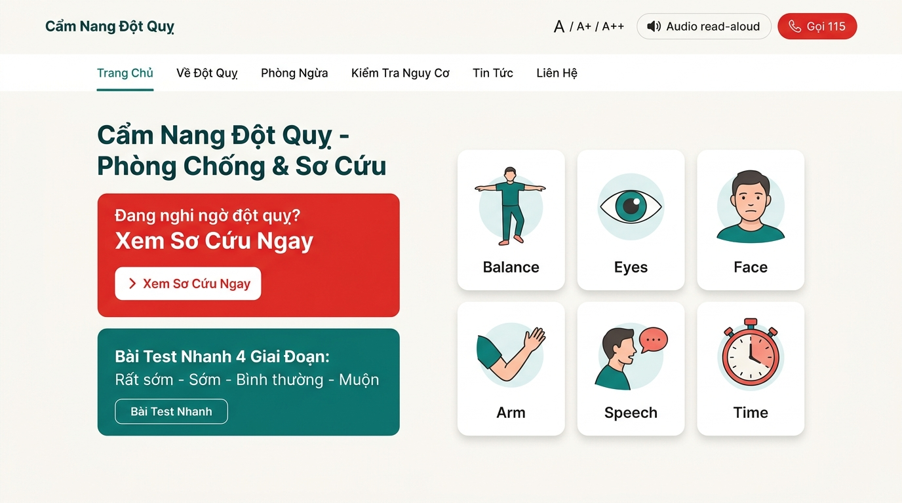
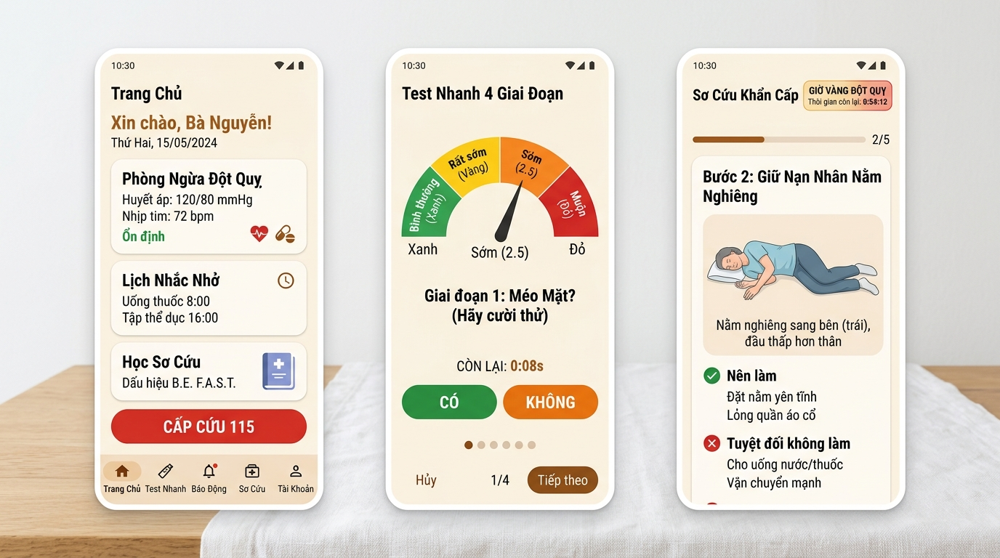
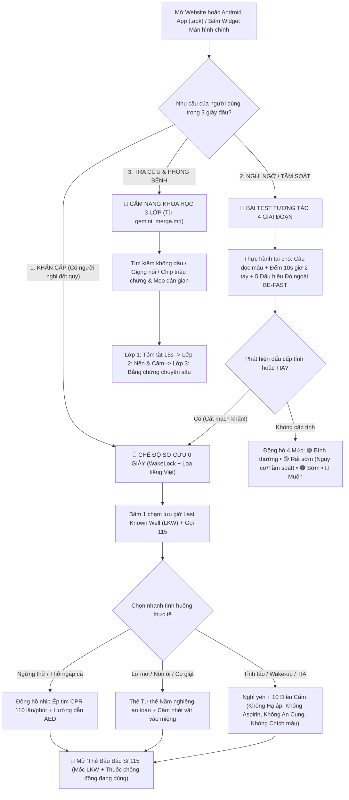

# Thiết Kế UI/UX Hệ Sinh Thái Website & Android App (`.apk`) Phòng Chống — Sơ Cứu Đột Quỵ

> **Phiên bản thiết kế:** `Gemini UI/UX Architecture v2.0` (Đồng bộ hoàn toàn với cơ sở tri thức y khoa chuẩn hóa [`gemini_merge.md`](../../../gemini_merge.md) chốt ngày 27/11/2026).
> **Bản Demo tương tác độc lập (100% Standalone HTML/CSS/JS):** Mở trực tiếp file [`demo-giao-dien.html`](./demo-giao-dien.html) trên mọi trình duyệt máy tính hoặc điện thoại (hoạt động cả khi mất mạng).

---

## 1. Bài Toán Thiết Kế & Bối Cảnh Thực Chiến Tại Việt Nam

Theo dữ liệu Bộ Y tế Việt Nam và sổ bộ quốc gia RES-Q tổng hợp trong [`gemini_merge.md`](../../../gemini_merge.md):
- Việt Nam ghi nhận khoảng **222.000 ca đột quỵ mới/năm**, nhưng **chỉ 23,2% đến viện trong "Giờ Vàng" (≤4,5 giờ)** và chỉ **~20% tiếp cận xe cấp cứu 115**.
- Hơn **3/4 số bệnh nhân mất cơ hội vàng** không phải vì bệnh viện thiếu kỹ thuật (cả nước đã có 124 bệnh viện sẵn sàng cấp cứu đột quỵ), mà vì **3 rào cản hành vi tại nhà**:
  1. **Nhận diện trễ các thể kín đáo:** Bỏ qua cơn thiếu máu não thoáng qua (*TIA* tự hết sau 5–15 phút), đột quỵ tuần hoàn sau (*chóng mặt, nôn, khó nuốt, mù 1 mắt* nhưng `FAST = 0`), hoặc đột quỵ khi thức dậy (*Wake-up stroke*).
  2. **Hoảng loạn & "Đường hầm nhận thức" (*Cognitive Tunneling*):** Khi người thân gục xuống, tay run, nhịp tim vọt cao, người nhà không thể đọc nổi bài báo y khoa dài 2.000 chữ hay tìm nút trong menu nhiều tầng.
  3. **Tự sơ cứu sai lầm gây tử vong/tàn phế:** Chích máu 10 đầu ngón tay/dái tai, tự nhét thuốc hạ huyết áp dưới lưỡi (gây hại cho nhồi máu não `OR 1,30` theo RCT `INTERACT4`), tự uống Aspirin hoặc An Cung Ngưu Hoàng Hoàn (chí mạng nếu thuộc nhóm 18% xuất huyết não), ép uống nước gừng/nước chanh gây sặc phổi, hoặc xoa bóp vùng cổ.

**Mục tiêu cốt lõi của hệ thống UI/UX này:** Xây dựng một giao diện **Vừa Đẹp Chuẩn Y Khoa Hiện Đại — Vừa Tức Thì 0 Giây Lúc Nguy Kịch — Vừa Cực Dễ Dùng Cho Cả Cụ Già 80 Tuổi Lẫn Người Trẻ 20 Tuổi** trên cả **Website** và **Ứng dụng Android (`.apk` 100% Offline)**.

---

## 2. Tổng Hợp Nghiên Cứu Từ 5 Chuẩn Mực UX Y Tế Khẩn Cấp Quốc Tế

| Nguồn tham chiếu quốc tế | Tinh hoa UX được kiểm chứng | Chuyển hóa sáng tạo vào sản phẩm Website & Android `.apk` |
| :--- | :--- | :--- |
| **1. Red Cross First Aid App** *(Hội Chữ Thập Đỏ Mỹ / Anh)* | Không bao giờ bắt đăng nhập; mở ứng dụng thấy ngay chế độ Cấp cứu; hoạt động **100% Offline**; tách bạch rõ việc *Phải làm* và *Cấm làm*. | Thiết kế **Nút Đỏ Sơ Cứu 0 Giây** cố định trên mọi màn hình + **Android Home Screen Widget (4x2)** bấm 1 chạm ngoài màn hình chính không cần tìm app. |
| **2. "Designing for Stress & Emergency"** *(Gov.uk Task Pattern / Smashing Magazine)* | Trong khủng hoảng, con người mất khả năng đa nhiệm (*single-tasking only*), thị trường thu hẹp và kỹ năng vận động tinh suy giảm mạnh. | Chuyển toàn bộ quy trình sơ cứu thành **Thẻ Đơn Nhiệm (1 Bước = 1 Màn hình)** chữ cực lớn, tích hợp **Loa đọc tiếng Việt rảnh tay**, **Đồng hồ nhịp ép tim CPR 110 lần/phút** và giữ sáng màn hình liên tục (`WakeLock`). |
| **3. WSO Stroke Riskometer™ & PreventS-MD** *(Tổ chức Đột quỵ Thế giới)* | Biểu đồ đồng hồ bán nguyệt màu sắc trực quan giúp người dân hiểu ngay mức độ khẩn cấp thay vì điểm số y khoa trừu tượng. | Xây dựng **Đồng hồ Phân tầng 4 Giai đoạn** (*Bình thường → Rất sớm → Sớm [Giờ Vàng/TIA] → Muộn/Nguy kịch*) gắn chặt với hành động tiếp theo. |
| **4. Apple Health Medical ID** | Hiển thị thông tin sống còn cho nhân viên cấp cứu đọc trong 3 giây mà không cần mở khóa phức tạp. | Thiết kế **"Thẻ Báo Bác Sĩ 115 & Đồng hồ LKW"**: bấm 1 chạm lưu mốc *Last Known Well* + hiển thị cỡ chữ lớn danh sách **thuốc chống đông** đang uống, bệnh nền, cân nặng ước tính (để pha liều tiêu sợi huyết). |
| **5. Chuẩn WCAG 2.2 AAA & NIH Senior mHealth** *(Trợ năng người cao tuổi)* | Thủy tinh thể người lớn tuổi ngả vàng (lóa mắt với nền trắng tinh `#FFFFFF`, khó đọc chữ xám nhạt); tay dễ run (cần vùng chạm tối thiểu `48dp–56dp`). | Bảng màu **Kem Ngà Ấm (`#FAF9F6`) + Xanh Ngọc Y Khoa (`#0F766E`)**, độ tương phản chữ `> 7.5:1`, vùng chạm tối thiểu **`56px`**, thanh đổi cỡ chữ **`A / A+ / A++`** nằm ngay trên đầu trang. |

---

## 3. Sáu Nguyên Tắc Thiết Kế Cốt Lõi (Core UX Principles)

> [!IMPORTANT]
> **Nguyên lý nền tảng — Giao diện Thích ứng Kép (*Dual-State Adaptive Architecture*):** Một sản phẩm đột quỵ xuất sắc **không bao giờ dùng một trạng thái giao diện duy nhất**. Giao diện tự động chuyển hóa giữa **2 chế độ tâm lý đối lập**:
> - **Chế độ Bình tĩnh (*Calm Mode* — Học & Phòng bệnh hàng ngày):** Tông Xanh Ngọc Y Khoa trầm ấm, thoáng đãng, khoa học, không gây lo âu làm tăng huyết áp ở người già.
> - **Chế độ Khẩn cấp (*Emergency Stress Mode* — Đang nghi đột quỵ):** Tối giản tuyệt đối, tương phản cực đại, ẩn mọi menu phụ, chữ phóng lớn, loa tự đọc từng bước, màn hình không bao giờ tắt.

### Nguyên tắc 1: Quy tắc "0 Giây & 1 Ngón Cái" (*Zero-Latency Access*)
- Không màn hình chào (*splash screen*) rườm rà, không popup quảng cáo, không bắt tạo tài khoản.
- Trên **Website**: Khung Hero chia đôi rõ rệt ngay đầu trang (**Bên trái:** `🚨 Đang nghi đột quỵ? Mở Sơ Cứu Ngay` — **Bên phải:** `🧪 Làm Bài Test Nhanh 4 Giai Đoạn`).
- Trên **Android `.apk`**: Thanh điều hướng đáy 4 tab nằm trọn trong vùng ngón cái (*Thumb-zone*), kèm nút nổi `🚨 Sơ cứu` màu đỏ tươi và **Widget đặt ngoài màn hình chính điện thoại**.

### Nguyên tắc 2: Sơ cứu theo Tình huống Thực tế + Khung `0–1–5–15 Phút`
- Ngoài luồng chuẩn `0–1 phút` (Gọi 115 + Lưu giờ LKW) → `1–5 phút` (Kiểm tra thở ABC + Tư thế an toàn) → `5–15 phút` (Gom vỏ thuốc chống đông + Mở cửa đón xe), giao diện Sơ cứu cho phép **chạm chọn nhanh đúng kịch bản đang xảy ra trước mắt** (10 tình huống lâm sàng từ [`gemini_merge.md`](../../../gemini_merge.md)):
  - *Tỉnh táo yếu nhẹ* • *Khó nói/thất ngôn* • *Liệt nửa người* • *Chóng mặt nôn ói* • *Lơ mơ ngủ gà* • *Bất tỉnh còn thở* • *Đang co giật* • *Ngừng thở/thở ngáp cá (kích hoạt ngay nhịp đếm CPR 100–120 lần/phút)* • *Thức dậy mới phát hiện (Wake-up)* • *Triệu chứng vừa tự hết (TIA)*.

### Nguyên tắc 3: Rào chắn Thị giác Chống Sai lầm Dân gian (*Anti-Harm Visual Split*)
- Mọi thẻ sơ cứu đều chia đôi tương phản rõ rệt:
  - Khung Xanh Lá Đậm (`#15803D`): **`✅ VIỆC CẦN LÀM NGAY`**
  - Khung Đỏ Cảnh Báo (`#B91C1C`): **`⛔ TUYỆT ĐỐI CẤM`** — hiển thị trực diện các điều cấm sống còn tại Việt Nam (*Cấm nhét thuốc hạ huyết áp, Cấm uống Aspirin, Cấm uống An Cung Ngưu Hoàng Hoàn, Cấm chích máu 10 đầu ngón tay/dái tai, Cấm cho uống nước lọc/nước gừng/nước chanh, Cấm xoa bóp/bẻ cổ, Cấm chở bằng xe máy*).

### Nguyên tắc 4: Bài Test Tương Tác 4 Giai Đoạn kèm "Cơ chế Cắt Mạch Cấp Cứu"
- Đáp ứng trọn vẹn nhu cầu phân tầng **Bình thường — Rất sớm — Sớm — Muộn**, nhưng tuân thủ nghiêm ngặt chuẩn y học thực chứng trong [`gemini_merge.md`](../../../gemini_merge.md):
  1. **Không hỏi lý thuyết suông — Tích hợp công cụ khám thực hành ngay trong thẻ hỏi:**
     - *Câu đọc mẫu tiếng Việt cỡ chữ lớn* để kiểm tra nói đớ/thất ngôn tại chỗ.
     - *Đồng hồ đếm ngược 10.0 giây* có âm báo nhẹ để kiểm tra nghiệm pháp nhắm mắt giơ thẳng 2 tay ngửa lòng bàn tay (*Arm drift*).
     - *Bộ rà soát 5 Dấu hiệu Đỏ ngoài BE-FAST* (Đau đầu sét đánh SAH; Khó nuốt/sặc/khàn tiếng Wallenberg; Mù 1 mắt không đau CRAO; Yếu vụng 1 bàn tay/mất viết *hand-knob*; Đau cổ mới khởi phát kèm chóng mặt).
  2. **Cơ chế Cắt Mạch Thông Minh (*Smart Short-Circuit*):** Nếu ngay ở câu đầu tiên người dùng bấm chọn có dấu hiệu cấp tính (hoặc vừa có cơn TIA tự hết trong 48h), hệ thống **cắt mạch ngay lập tức**, không bắt trả lời tiếp các câu sau để tránh lãng phí từng giây Giờ Vàng, chuyển thẳng sang cảnh báo **Mức 3 (Sớm — Cấp tính Giờ Vàng)** hoặc **Mức 4 (Muộn / Nguy kịch)**!
  3. **Định nghĩa chuẩn y khoa của 4 mức kết quả trên giao diện:**
     - `🟢 Mức 1 — Bình thường (Nguy cơ nền thấp):` Chưa có dấu hiệu thần kinh khu trú và ít yếu tố nguy cơ → Hướng dẫn duy trì *Life's Essential 8*.
     - `🟡 Mức 2 — Giai đoạn Rất Sớm (Trạng thái nguy cơ tích tụ / Triệu chứng không đặc hiệu cần khám sớm):` Có bệnh nền (Tăng HA, Rung nhĩ, Đái tháo đường, Hút thuốc, Ngưng thở khi ngủ) hoặc biểu hiện mạn tính cần tầm soát có đích → Hướng dẫn khám chuyên khoa Tim mạch/Nội thần kinh định kỳ, cảnh báo không lạm dụng gói chụp MRI/siêu âm cảnh tràn lan.
     - `🟠 Mức 3 — Giai đoạn Sớm (Báo động đỏ Giờ Vàng <4,5h / Cơn TIA vừa tự hết / Đau đầu cảnh báo):` Khẳng định cơ hội phục hồi không di chứng cao nhất nếu vào Đơn vị Đột quỵ ngay → Nút đỏ chuyển thẳng sang Lưu giờ LKW & Gọi 115.
     - `🔴 Mức 4 — Giai đoạn Muộn / Nguy kịch (Triệu chứng nặng lơ mơ, nôn vọt, sặc, co giật hoặc >4,5–6h):` Ưu tiên số 1 bảo vệ đường thở chống sặc, đồng thời trấn an **tuyệt đối không bỏ cuộc** vì bệnh viện vẫn còn cửa sổ mô học `6–24 giờ` (MRI `DWI–FLAIR` / CT tưới máu cho *Slow Progressors* và lấy huyết khối tắc thân nền).

### Nguyên tắc 5: Tra cứu "Không Cần Gõ Phím" & Cấu trúc Đọc 3 Lớp (*3-Layer Reading*)
- **Tìm kiếm khoan dung lỗi & không dấu:** Người lớn tuổi gõ `chich mau`, `an cung`, `tam dem`, `liet mat`, `te tay` đều khớp tức thì, đi kèm dãy **Chip Chủ Đề Bằng Biểu Tượng** bấm 1 chạm.
- **Đọc 3 lớp cho mọi bài kiến thức `.md`:**
  - *Lớp 1 — Tóm tắt cốt lõi 15 giây (TL;DR Box):* Dành cho người già mắt mỏi hoặc người đang vội.
  - *Lớp 2 — Thẻ Hành động Nên làm / Cấm làm:* Ngắn gọn, trực diện, không thuật ngữ hàn lâm.
  - *Lớp 3 — Cơ chế bệnh sinh & Kiểm toán bằng chứng (Mở rộng tùy chọn):* Dành cho người trẻ, nhân viên y tế hoặc người muốn tra cứu số liệu RCT (`INTERACT4`, `OPTION 2026`, `ANGONG TRIAL`, `NAPS`...).

### Nguyên tắc 6: Trợ năng Đa thế hệ đạt chuẩn WCAG AAA (*Senior-Safe Ergonomics*)
- **Thanh Trợ Năng Cố Định (*Sticky Accessibility Bar*):** Luôn hiển thị ở đầu màn hình:
  - Đổi cỡ chữ tức thì **`A (16px)` • `A+ (19px)` • `A++ (22px)`** (tự động giãn dòng `line-height: 1.65` và giữ nguyên bố cục không tràn ngang).
  - Chuyển chế độ **`Tương phản cực cao (High Contrast AAA)`** viền đậm rõ nét cho người đục thủy tinh thể hoặc dùng ngoài nắng.
  - Nút **`🔊 Nghe đọc tiếng Việt`** trên từng bước sơ cứu và từng bài cẩm nang.

---

## 4. Minh Họa Thị Giác Giao Diện (Visual Concept)

### 4.1. Giao diện Website (Desktop & Tablet)

### 4.2. Giao diện Android App (`.apk`)

> [!NOTE]
> *Ghi chú hiệu đính y khoa trên bản minh họa thị giác:* Hai hình concept trên thể hiện phong cách bố cục, tỷ lệ mảng miếng, màu sắc kem ấm – xanh ngọc – đỏ cấp cứu và đồng hồ bán nguyệt 4 giai đoạn. Trong sản phẩm thực tế và trong bản [`demo-giao-dien.html`](./demo-giao-dien.html), toàn bộ câu chữ hướng dẫn y khoa tuân thủ nghiêm ngặt [`gemini_merge.md`](../../../gemini_merge.md) (ví dụ: ở tư thế nằm nghiêng an toàn, đầu đặt ngang tự nhiên hơi ngửa nhẹ dẫn lưu đờm dãi chứ tuyệt đối không để đầu thấp hơn thân).

---

## 5. Sơ Đồ Kiến Trúc Luồng Điều Hướng Tổng Thể

---

## 6. Hệ Thống Design System & Thông Số Kỹ Thuật Chuẩn Hóa

### 6.1. Bảng Màu Tâm Lý Học Thần Kinh & Tương Phản WCAG AAA

| Vai trò Token | Tên màu | Mã HEX (Light Mode) | Tỷ lệ tương phản chữ | Ý nghĩa Y khoa & Trợ năng |
| :--- | :--- | :--- | :--- | :--- |
| `--bg-surface` | **Warm Alabaster** *(Trắng ngà ấm)* | `#FAF9F6` | Nền chính chống chói | Giảm chói lóa thủy tinh thể cho người lớn tuổi so với trắng lạnh `#FFFFFF`. |
| `--bg-card` | **Pure Ivory Card** | `#FFFFFF` | Viền `#E2E8F0` rõ nét | Tách lớp thẻ nội dung sạch sẽ, dễ định vị bằng mắt. |
| `--text-primary` | **Deep Clinical Slate** | `#0F172A` | **`16.8 : 1` (AAA)** | Đọc sắc nét ngay cả ở người suy giảm thị lực hoặc ánh sáng yếu. |
| `--text-secondary` | **Accessible Charcoal** | `#334155` | **`9.8 : 1` (AAA)** | Tuyệt đối không dùng chữ xám nhạt mờ dưới `4.5:1`. |
| `--brand-primary` | **Medical Healing Teal** | `#0F766E` | **`5.4 : 1` (với chữ trắng)** | Xanh ngọc y khoa điềm tĩnh, tạo niềm tin khoa học và ổn định tâm lý. |
| `--sos-crimson` | **Emergency Crimson** | `#DC2626` | **`5.6 : 1` (với chữ trắng)** | **Độc quyền** cho nút Cấp cứu 115, cảnh báo Đỏ và khung Tuyệt đối cấm. |
| `--stage-1` → `--stage-4` | **4-Stage Clinical Spectrum** | `#15803D` • `#B45309` • `#EA580C` • `#DC2626` | Luôn đi kèm **Nhãn chữ + Biểu tượng** | Đảm bảo người mù màu (*color-blind*) hoặc người già vẫn phân biệt 100% không nhầm lẫn. |

### 6.2. Hệ Thống Chữ Viết (*Typography*) & Vùng Chạm (*Touch Targets*)
- **Font chữ chủ đạo:** `Be Vietnam Pro` (thiết kế chuyên biệt cho hệ thống dấu tiếng Việt phức tạp như *ổ, ể, ữ, ặ*, lòng chữ rộng, phân biệt cực rõ số `1`, chữ `l` và `I`). Fallback hệ thống: `system-ui, -apple-system, "Segoe UI", Roboto, sans-serif`.
- **3 Cấp độ Cỡ chữ Trợ năng (*Live Font Scaling*):**
  - Cấp `A` *(Mặc định)*: Body `16px` (`1rem`), Line-height `1.6`, Tiêu đề thẻ `20px`.
  - Cấp `A+` *(Người trung niên / Cao tuổi)*: Body `19px`, Line-height `1.65`, Tiêu đề thẻ `23px`.
  - Cấp `A++` *(Mắt kém / Khẩn cấp)*: Body `22px`, Line-height `1.7`, Tiêu đề thẻ `26px`.
- **Quy chuẩn Vùng chạm chống run tay:**
  - Mọi nút bấm thông thường có chiều cao tối thiểu **`48px – 56px`**, khoảng cách giữa hai nút liền kề tối thiểu **`12px`** (ngăn bấm nhầm ở người cao tuổi run tay hoặc người nhà đang hoảng sợ).
  - Nút Cấp cứu / Chuyển bước Sơ cứu / Trả lời Có–Không trong bài Test cao tối thiểu **`56px – 64px`**.

### 6.3. So Sánh Tối Ưu Chuyên Biệt Giữa Website và Android App (`.apk`)

| Hạng mục | 🌐 Giao diện Website | 📱 Giao diện Android App (`.apk`) |
| :--- | :--- | :--- |
| **Thanh điều hướng** | Top Sticky Header + Thanh Trợ năng `A/A+/A++` + Mục lục neo bên trái khi đọc bài chuyên sâu trên màn hình rộng. | Bottom Navigation 4 nút lớn dưới ngón cái (`Trang chủ`, `Test 4 mức`, `Cẩm nang`, `🚨 Sơ cứu`) + Top Bar gọn nhẹ. |
| **Hoạt động mất mạng** | Service Worker (PWA) lưu đệm toàn bộ quy trình sơ cứu ngay từ lần truy cập đầu tiên. | **Đóng gói 100% nội dung `gemini_merge.md`, hình vẽ sơ cứu & kịch bản test bên trong file `.apk`** — về quê, tầng hầm, mất 4G/Wi-Fi vẫn mở tức thì trong `0.1 giây`. |
| **Tích hợp phần cứng** | Web Speech API đọc bài, `tel:115` trên trình duyệt di động, chia sẻ nhanh link cảnh báo qua Zalo/Messenger. | **Widget Cấp cứu 4x2 ngoài màn hình chính**, `KeepScreenOn` phần cứng, Loa ngoài âm lượng cao + Rung nhịp ép tim CPR, Gọi 115 kèm gửi SMS định vị GPS cho con cháu, **Thẻ Y Tế Khẩn Cấp offline**. |

---

## 7. Kiến Trúc Đề Xuất Để Xây Dựng Thực Tế Từ File `gemini_merge.md`

Để tiết kiệm công sức bảo trì tối đa mà vẫn đạt chất lượng cao nhất cho cả **Website chuẩn SEO** và **File cài đặt Android `.apk` nhẹ, mượt trên máy cấu hình thấp**:
1. **Single Codebase (Một mã nguồn duy nhất):** Sử dụng **Vite / Next.js (Static Export)** viết bằng HTML/CSS/TypeScript chuẩn + đóng gói sang **Android `.apk` qua Capacitor** (hoặc PWA + Trusted Web Activity / Native Widget cầu nối nhẹ).
2. **Data Pipeline từ Markdown:** Xây dựng script biên dịch tại thời điểm build (`build-time parser`) tách tự động [`gemini_merge.md`](../../../gemini_merge.md) thành các gói JSON tĩnh siêu nhẹ (`< 250 KB`) đóng gói thẳng vào `.apk` và tĩnh hóa thành HTML cho Website — mỗi khi cập nhật kiến thức trong file `.md`, cả Website lẫn `.apk` đều tự động đồng bộ 100%!
