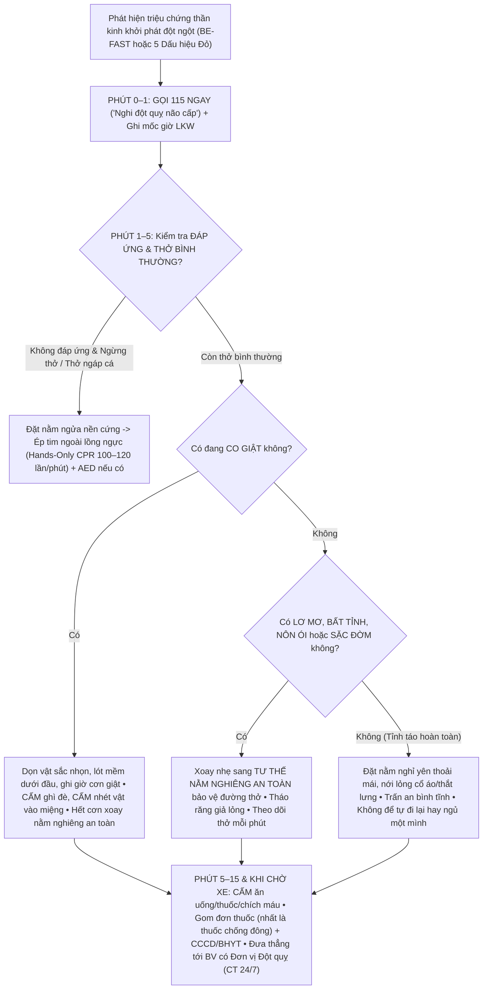

# Cẩm Nang Y Khoa Tổng Hợp & Kiểm Toán Bằng Chứng Về Đột Quỵ Não: Dự Báo, Nhận Diện Cực Sớm, Sơ Cứu Ngoại Viện, Điều Trị Hiện Đại Và Phòng Ngừa

> **Ngày chốt dữ liệu kiểm chứng:** 27/11/2026 (Múi giờ Việt Nam `UTC+7`).
> **Bản chất tài liệu:** Báo cáo tổng hợp, đối chiếu chéo và chắt lọc khoa học từ hai công trình nghiên cứu độc lập (`gemini.md` và `chatgpt.md`), tích hợp 16 góc nhìn chuyên ngành (cấp cứu ngoại viện, nội – ngoại thần kinh, can thiệp mạch thần kinh, chẩn đoán hình ảnh, tim mạch – huyết học, hồi sức tích cực thần kinh, sinh học phân tử, y học cổ truyền thực chứng, phục hồi chức năng, dịch tễ học lâm sàng và kiểm toán thông tin y tế). Tài liệu đóng vai trò **Cơ sở Tri thức Chuẩn (Master Knowledge Base)** phục vụ trực tiếp người dân, gia đình tại Việt Nam và hệ thống ứng dụng Website / Android hướng dẫn phòng chống – sơ cứu đột quỵ.
> **Tuyên bố minh bạch:** Đây là tổng hợp y học dựa trên bằng chứng độc lập từ các hướng dẫn chuyên môn chính thống (Bộ Y tế Việt Nam, AHA/ASA, ESO/EANS, WHO, WSO, ILCOR, USPSTF, ESC) và các thử nghiệm lâm sàng bình duyệt tính đến tháng 11/2026; không thay thế quyết định chẩn đoán – điều trị trực tiếp của bác sĩ tại bệnh viện.

---

## Mục Lục Tổng Quan

- [Phần 0. Báo cáo đối chiếu & hiệu đính chéo hai nguồn nghiên cứu](#phần-0-báo-cáo-đối-chiếu--hiệu-đính-chéo-hai-nguồn-nghiên-cứu)
- [Phần 1. Hướng dẫn sơ cứu khẩn cấp gia đình một trang (Tra cứu tức thì)](#phần-1-hướng-dẫn-sơ-cứu-khẩn-cấp-gia-đình-một-trang-tra-cứu-tức-thì)
- [Phần 2. Dịch tễ học toàn cầu & thực trạng cấp cứu đột quỵ tại Việt Nam (2024–2026)](#phần-2-dịch-tễ-học-toàn-cầu--thực-trạng-cấp-cứu-đột-quỵ-tại-việt-nam-20242026)
- [Phần 3. Bản chất định nghĩa hiện đại & cơ chế bệnh sinh 14 cấp độ](#phần-3-bản-chất-định-nghĩa-hiện-đại--cơ-chế-bệnh-sinh-14-cấp-độ)
- [Phần 4. Hệ thống phân loại toàn diện 4 trục (14 phân nhóm lâm sàng)](#phần-4-hệ-thống-phân-loại-toàn-diện-4-trục-14-phân-nhóm-lâm-sàng)
- [Phần 5. Nguyên nhân dài hạn & kiểm toán 14 yếu tố khởi phát ngắn hạn (Triggers)](#phần-5-nguyên-nhân-dài-hạn--kiểm-toán-14-yếu-tố-khởi-phát-ngắn-hạn-triggers)
- [Phần 6. Hệ thống nhận diện từ cực sớm đến muộn & ma trận 28 triệu chứng thần kinh](#phần-6-hệ-thống-nhận-diện-từ-cực-sớm-đến-muộn--ma-trận-28-triệu-chứng-thần-kinh)
- [Phần 7. Quy trình kiểm tra nhanh 60 giây, hiệu năng thang điểm, Stroke Mimics & giới hạn AI/Wearable](#phần-7-quy-trình-kiểm-tra-nhanh-60-giây-hiệu-năng-thang-điểm-stroke-mimics--giới-hạn-aiwearable)
- [Phần 8. Phác đồ sơ cứu ngoại viện chuẩn quốc tế cho 10 tình huống thực tế](#phần-8-phác-đồ-sơ-cứu-ngoại-viện-chuẩn-quốc-tế-cho-10-tình-huống-thực-tế)
- [Phần 9. Kiểm chứng khách quan Đông y ("Trúng phong"), 13 mẹo dân gian/TPCN & khung kiểm toán giai thoại](#phần-9-kiểm-chứng-khách-quan-đông-y-trúng-phong-13-mẹo-dân-giantpcn--khung-kiểm-toán-giai-thoại)
- [Phần 10. Chẩn đoán & điều trị hiện đại tại bệnh viện (Cập nhật đầy đủ đến tháng 11/2026)](#phần-10-chẩn-đoán--điều-trị-hiện-đại-tại-bệnh-viện-cập-nhật-đầy-đủ-đến-tháng-112026)
- [Phần 11. Tiên lượng sống sót, chống "lời tiên tri tự ứng nghiệm" & lộ trình phục hồi](#phần-11-tiên-lượng-sống-sót-chống-lời-tiên-tri-tự-ứng-nghiệm--lộ-trình-phục-hồi)
- [Phần 12. Kế hoạch phòng ngừa & tầm soát có đích theo 10 nhóm đối tượng](#phần-12-kế-hoạch-phòng-ngừa--tầm-soát-có-đích-theo-10-nhóm-đối-tượng)
- [Phần 13. Hồ sơ 13 ca lâm sàng thực tế đã kiểm chứng (Việt Nam & Quốc tế)](#phần-13-hồ-sơ-13-ca-lâm-sàng-thực-tế-đã-kiểm-chứng-việt-nam--quốc-tế)
- [Phần 14. 10 quan niệm sai lầm chết người & 8 khoảng trống khoa học chưa ngã ngũ](#phần-14-10-quan-niệm-sai-lầm-chết-người--8-khoảng-trống-khoa-học-chưa-ngã-ngũ)
- [Phần 15. Phụ lục kiểm toán khoa học: Phản biện 5 góc nhìn & Ma trận bằng chứng hợp nhất](#phần-15-phụ-lục-kiểm-toán-khoa-học-phản-biện-5-góc-nhìn--ma-trận-bằng-chứng-hợp-nhất)
- [Phần 16. Danh mục tài liệu tham khảo trọng yếu đã xác minh](#phần-16-danh-mục-tài-liệu-tham-khảo-trọng-yếu-đã-xác-minh)

---

## Phần 0. Báo Cáo Đối Chiếu & Hiệu Đính Chéo Hai Nguồn Nghiên Cứu

Qua quá trình đọc rà soát từng dòng, từng con số thống kê và từng mốc thời gian của hai tài liệu gốc (`gemini.md` và `chatgpt.md`), hai nguồn có sự **đồng thuận tuyệt đối trên các nguyên tắc an toàn sinh tử**, đồng thời **bổ khuyết hoàn hảo những khoảng trống chuyên môn của nhau**. Bảng dưới đây ghi nhận **12 điểm hiệu đính, hợp nhất và giải quyết khác biệt quan trọng nhất** đã được xử lý trong văn bản tổng hợp này:

| Hạng mục đối chiếu | Điểm mạnh / Ghi nhận từ `gemini.md` | Điểm bổ khuyết / Phản biện sắc bén từ `chatgpt.md` | Nguyên tắc hợp nhất chuẩn xác trong `gemini_merge.md` |
| :--- | :--- | :--- | :--- |
| **1. Văn bản pháp quy Bộ Y tế Việt Nam** | Cung cấp bức tranh dịch tễ cực kỳ chi tiết tại Việt Nam (222.000 ca/năm, RES-Q >121.700 ca, 124 bệnh viện đột quỵ), nhưng phần tài liệu pháp quy vẫn dẫn *Quyết định 5331/QĐ-BYT (2020)*. | Cập nhật chính xác rằng Bộ Y tế đã ban hành **Quyết định 3312/QĐ-BYT ngày 05/11/2024** thay thế QĐ 5331/QĐ-BYT (2020), chính thức hóa cửa sổ tưới máu 4,5–9 giờ tại Việt Nam. | Hợp nhất toàn bộ dữ liệu dịch tễ – mạng lưới 124 bệnh viện của `gemini.md` với mốc pháp lý hiện hành **3312/QĐ-BYT (2024)**, đồng thời đặt cạnh các mở rộng mới hơn của **AHA/ASA 2026**. |
| **2. Đính chính Hướng dẫn AHA/ASA 2026 & các RCT mới cuối năm 2026** | Phân tích sâu các thử nghiệm mở rộng cửa sổ và thuốc mới đến giữa năm 2026 (`OPTION` 04/2026, `OCEANIC-STROKE` 04/2026, `DISCOUNT` 07/2026, `HeadSOAR` 08/2026, `CATALYST` 2025). | Phát hiện bản **Correction chính thức ngày 27/07/2026** của AHA/ASA AIS 2026, cùng 3 RCT âm tính rất mới quý III–IV/2026: **`ATTENTION-LATE`** (*JAMA* 23/09/2026), **`BRETIS-TNK2`** (06/11/2026) và **`INSIST-IT`**. | Tích hợp đầy đủ cả hai nhóm thử nghiệm để thấy bức tranh toàn diện: mở rộng cửa sổ mô học là có thật (`OPTION`, `TRACE-III`), nhưng tiêm TNK bắc cầu trước EVT thân nền muộn (`ATTENTION-LATE`) hay TNK nội động mạch bổ trợ (`BRETIS-TNK2`, `INSIST-IT`) không mang lại thêm lợi ích. |
| **3. Giải quyết bài toán "Tư thế đầu bệnh nhân" (Nằm phẳng 0° hay nâng đầu 30°?)** | Dẫn `HeadPoST` (2017) kết hợp RCT mới **`ZODIAC`** (*JAMA Neurol* 09/2025: đầu 0° vượt trội 30° ở LVO chờ lấy huyết khối, HR 34,40) và **`HeadSOAR`** (*BMJ* 08/2026). | Nhấn mạnh `HeadPoST` (n=11.093) không thấy khác biệt mRS 90 ngày khi áp dụng thường quy 24h, cảnh báo không biến "chỉnh góc đầu" thành nghi thức gây chậm gọi 115. | Phân tách rạch ròi **Ngoại viện vs. Nội viện**: Ngoài bệnh viện (chưa có CT/CTA), **bảo vệ đường thở là tối thượng** (nằm nghiêng an toàn nếu lơ mơ/nôn; nằm phẳng/gối mỏng thoải mái nếu tỉnh táo, không dựng ngồi đột ngột, không tốn thời gian đo góc đầu). Tại viện khi đã xác nhận LVO chờ EVT, áp dụng đầu 0° theo `ZODIAC`. |
| **4. Hạ huyết áp ngoại viện trước khi chụp CT** | Dẫn chứng định lượng xuất sắc từ RCT **`INTERACT4`** (*NEJM* 2024, n=2.404) và **ESO 2025/2026**: hạ áp trên xe cứu thương có lợi cho xuất huyết não (OR 0,75) nhưng **gây hại rõ rệt cho nhồi máu não (OR 1,30)**. | Giải thích rõ cơ chế sinh lý đối lập giữa phản xạ tăng áp duy trì tưới máu penumbra trong AIS và nguy cơ lan rộng máu tụ trong ICH. | Củng cố thành **Lệnh cấm tuyệt đối số 1 về thuốc tại nhà**: Tuyệt đối không cho ngậm/uống bất kỳ viên thuốc hạ áp nào trước khi có phim CT sọ não. |
| **5. Dấu hiệu nhận diện cực sớm vùng vỏ não & thân não** | Xây dựng bảng 24 triệu chứng thần kinh chi tiết + 8 bẫy triệu chứng dễ nhầm nhất tại Việt Nam (tiền đình, CRAO, Wallenberg, SAH, bóc tách mạch cổ). | Bổ sung 4 biểu hiện khu trú tinh vi đã có ca lâm sàng xác nhận: **yếu đơn độc bàn tay/ngón tay (*cortical hand-knob*)**, **thay đổi chữ viết đột ngột (*dysgraphia*)**, **mất kỹ năng vận động quen thuộc (*apraxia*)**, và giải thích đúng vị trí của **nấc cụt bất thường** (chỉ có giá trị khi đi kèm cụm triệu chứng hành não). | Hợp nhất thành **Ma trận 28 triệu chứng thần kinh** qua 7 tiêu chí lâm sàng, không bỏ sót bất kỳ thể đột quỵ kín đáo nào. |
| **6. Yếu tố khởi phát ngắn hạn (Acute Triggers)** | Phân tích 11 yếu tố phổ biến (nhiệt độ cực đoan, tắm nóng/lạnh, tắm đêm, tức giận `INTERSTROKE`, gắng sức, rặn đại tiện `Vlak`, tình dục, mất nước, thiếu ngủ, ngồi lâu, bẻ cổ). | Bổ sung 2 trigger có bằng chứng dịch tễ rất mạnh thường bị người dân bỏ quên: **nhiễm trùng cấp trong 7 ngày trước (OR 2,91)** và **uống rượu nặng trong 24 giờ trước (OR 2,66)**, kèm dữ liệu Sổ bộ Nhật Bản 2026 (n=14.772) về đột quỵ khi tắm và làm việc ca đêm (RR 1,08). | Nâng cấp thành **Bảng kiểm toán 14 yếu tố khởi phát ngắn hạn**, tách bạch rõ *quan hệ nhân quả*, *tương quan quan sát* và *rủi ro quy kết sai cho cá nhân*. |
| **7. Khác biệt con số thống kê về Giấc ngủ & Nhiệt độ** | Dẫn meta-analysis giấc ngủ ngắn tăng nguy cơ đột quỵ `HR 1,13`, ngủ dài ≥9h tăng tử vong `HR 1,34–1,35`. | Dẫn meta-analysis 43 đoàn hệ cho ngủ ngắn ≤5–6h `HR 1,29` (95% CI 1,19–1,40), ngủ dài >8–9h `HR 1,46` (độ không đồng nhất cao `I² = 74–75%`), và cảnh báo không diễn giải máy móc thành xác suất của 1 đêm thức khuya hay 1°C giảm nhiệt. | Ghi nhận khoảng ước tính từ cả hai phân tích gộp (`HR 1,13–1,29` cho ngủ ngắn mạn tính) kèm cảnh báo chuẩn dịch tễ học: phân biệt **nguy cơ tương đối (RR/HR) quần thể** với **nguy cơ tuyệt đối cá nhân**. |
| **8. Hiệu năng FAST vs. BE-FAST & Bẫy tỷ lệ hiện mắc (PPV/NPV)** | Trình bày chi tiết dữ liệu gộp `Meyran 2020`, `Chen 2022`, `Aroor 2017` (BE-FAST giảm bỏ sót từ 14,1% xuống 2,5%), báo cáo `ISC 2025` (FAST dễ nhớ hơn sau 30 ngày) và cảnh báo **FAST kém nhạy ở trẻ em**. | Chỉ rõ trong đột quỵ tuần hoàn sau, FAST chỉ nhạy `58,7%` so với BE-FAST `97,8%` nhưng đổi lại độ đặc hiệu thấp; đặc biệt cảnh báo **không áp dụng máy móc PPV/NPV từ bệnh viện ra cộng đồng** và **FAST âm tính không phải giấy phép ở nhà**. | Thiết lập quy tắc kép: dùng **BE-FAST + Dấu hiệu Đỏ** để mở rộng lưới nhận diện, nhưng khẳng định **mọi khiếm khuyết thần kinh khu trú đột ngột đều phải gọi 115 kể cả khi BE-FAST = 0**. |
| **9. Sàng lọc Rung nhĩ (AF) bằng Smartwatch & Khám định kỳ** | Dẫn `Apple Heart Study` (PPV đồng thời 0,84), `FIND AF 2` (10/2026) và khuyến cáo `USPSTF 2022 Grade I` (chưa đủ bằng chứng sàng lọc đại trà người không triệu chứng). | Bổ sung hướng dẫn **ESC 2024**: khuyến nghị đánh giá nhịp tim cơ hội (*opportunistic rhythm assessment*) mỗi khi tiếp xúc y tế ở người **≥65 tuổi**. | Kết hợp hài hòa: Không lạm dụng sàng lọc tràn lan ở người trẻ khỏe, nhưng chủ động bắt mạch/đo ECG cơ hội khi khám bệnh ở người **≥65 tuổi** (ESC 2024) và luôn xác nhận cảnh báo đồng hồ thông minh bằng ECG chuẩn. |
| **10. Kiểm chứng Đông y, Dược liệu & Lời đồn mạng xã hội** | Phân tích cực sâu 12 phương pháp (nguồn gốc tin giả chích máu năm 2003 trên Snopes, xoa xoang cảnh gây ngừng tim/bung mảng xơ vữa, `ANGONG TRIAL` âm tính + thủy ngân/asen + Bộ Y tế gỡ Shopee 10/2026, `Xuesaitong` vs tam thất thô, `NAPS` bác bỏ Nattokinase) + nghiên cứu TikTok 2025 (31% sai lệch). | Bổ sung dược liệu **Đan sâm (*Salvia miltiorrhiza* / Tanshinone)** và xây dựng **Khung 5 câu hỏi kiểm toán giai thoại** giải thích tại sao nhiều người tin "chích máu/uống An Cung xong tỉnh lại". | Hợp nhất thành **Bảng kiểm chứng 13 phương pháp Đông y – Dân gian – TPCN** kèm **Khung giải mã tâm lý & sai số giai thoại** (thiên lệch sống sót, TIA tự hồi phục). |
| **11. AI, Thiết bị đeo & Biomarker máu (GFAP, D-dimer)** | Nêu tiềm năng AI video/giọng nói (`Pedroso 10/2025`) và độ đặc hiệu cao `95%` của **GFAP** phân biệt ICH với AIS. | Cảnh báo tổng quan hệ thống 2026 (`PMID 41731797`) mới có 3 nghiên cứu gia tốc kế đạt chuẩn nhưng báo động giả cao; nghiên cứu smartphone đa phương thức `ESOC 2026` mới thử trên 30 người khỏe mạnh; tổ hợp D-dimer đặc hiệu 98% nhưng nhạy chỉ 17% (nguy hiểm nếu dùng loại trừ). | Khẳng định chuẩn xác vị thế năm 2026: AI/wearable/biomarker mới ở tầng **nghiên cứu hoặc hỗ trợ phân luồng chuyên môn**, tuyệt đối không dùng để tự "test âm tính rồi yên tâm ở nhà". |
| **12. Ca bệnh thực tế minh họa** | 5 ca bệnh phân tích sâu (trong đó có **3 ca thực tế tại các bệnh viện Việt Nam**: BV TWQĐ 108, BVĐK Hùng Vương – Bạch Mai, BV Nhân dân 115). | 10 ca lâm sàng quốc tế ngắn gọn minh họa đặc sắc các bẫy chẩn đoán hiếm và dễ nhầm (hand-knob, đơn độc khó nuốt, phình mạch scan đầu âm tính, ROSIER=0). | Tuyển chọn, loại trừ trùng lặp và hợp nhất thành **13 hồ sơ ca bệnh thực chứng** bao phủ cả sai lầm sơ cứu tại Việt Nam lẫn bẫy lâm sàng tinh vi. |

---

## Phần 1. Hướng Dẫn Sơ Cứu Khẩn Cấp Gia Đình Một Trang (Tra Cứu Tức Thì)

*(Thiết kế tối ưu để in khổ A4 dán tại nhà hoặc hiển thị ở chế độ "Sơ cứu 0 giây" trên Website / App Android).*

### 1.1. Quy Tắc Quyết Định Tối Thượng

> **BẤT KỲ triệu chứng thần kinh mới nào xuất hiện ĐỘT NGỘT và có tính chất khu trú — dù rất nhẹ, không gây đau, người bệnh vẫn tỉnh táo nói chuyện được, không méo miệng, không liệt tay chân (FAST âm tính), hoặc triệu chứng ĐÃ TỰ HẾT sau vài phút — đều phải được xử trí ngay lập tức như CẤP CỨU ĐỘT QUỴ / TIA cho đến khi được bác sĩ và chẩn đoán hình ảnh loại trừ.**
>
> - **Tại Việt Nam:** Gọi ngay **115** (hoặc hotline cấp cứu bệnh viện có Đơn vị Đột quỵ gần nhất) và nói rõ ngay câu đầu tiên: **"Nghi ngờ đột quỵ não cấp"**.
> - **Tuyệt đối không tự lái xe** nếu chính bản thân đang có triệu chứng; **tuyệt đối không chở người bệnh bằng xe máy**.

### 1.2. Nhận Diện Tức Thì: Quy Tắc BE-FAST & 5 Dấu Hiệu Đỏ Ngoài BE-FAST

| Nhóm dấu hiệu | Cách kiểm tra nhanh (tối đa 30–60 giây) | Biểu hiện báo động đỏ (Chỉ cần CÓ 1 dấu hiệu → Gọi 115 ngay!) |
| :--- | :--- | :--- |
| **B — Balance** *(Thăng bằng)* | Quan sát dáng ngồi, đứng hoặc bước đi (chỉ thử khi tỉnh táo, luôn đứng sát đỡ) | Đột ngột chóng mặt dữ dội, đi loạng choạng như say rượu, ngồi/đứng nghiêng đổ hoặc mất phối hợp tay chân. |
| **E — Eyes** *(Thị giác)* | Hỏi khả năng nhìn rõ ở từng mắt và cả hai mắt | Đột ngột mờ mắt, nhìn một thành hai (*song thị*), mất một nửa tầm nhìn hoặc **mù không đau một mắt** như rèm sập xuống. |
| **F — Face** *(Khuôn mặt)* | Yêu cầu cười tươi hoặc nhe răng | Một bên khóe miệng trễ/xệ xuống, nhân trung lệch, nếp mũi – má mờ hoặc tê cứng nửa mặt. |
| **A — Arms** *(Tay / Chân)* | Yêu cầu nhắm mắt, giơ thẳng đều hai tay ra trước mặt (lòng bàn tay ngửa) đếm 10 giây | Một tay không nâng lên được, tự rơi thấp dần hoặc xoay sấp; đột nhiên cầm rơi đũa/cốc; tê hoặc yếu một bên chân. |
| **S — Speech** *(Lời nói)* | Yêu cầu lặp lại câu đơn giản: *"Hôm nay trời rất trong xanh"* | Nói ngọng, nói đớ, lắp bắp, khó tìm từ gọi tên đồ vật, nói câu trôi chảy nhưng vô nghĩa hoặc không hiểu lời nói. |
| **T — Time** *(Thời gian)* | Hành động tức khắc — Không chờ xem có tự hết không | **GỌI 115 NGAY!** Ghi lại chính xác **giờ khởi phát** và **giờ cuối cùng còn thấy bình thường hoàn toàn (*Last Known Well — LKW*)**. |
| **5 Dấu hiệu Đỏ ngoài BE-FAST** *(Cực dễ bỏ sót)* | Quan sát khi bệnh nhân không liệt nửa người, không méo miệng | **(1)** Đau đầu dữ dội như **"sét đánh"** đạt đỉnh tức thì; **(2)** Đột ngột **khó nuốt, uống sặc, khàn tiếng**; **(3)** Đột ngột **vụng về 1 bàn tay/ngón tay, chữ viết biến dạng** hoặc không làm được thao tác quen thuộc; **(4)** Đột ngột **lú lẫn, thay đổi hành vi hoặc ngủ gà khó đánh thức**; **(5)** Đau một bên cổ/gáy mới xuất hiện sau vận động/vặn cổ kèm chóng mặt, sụp mi. |

### 1.3. Quy Trình Hành Động Theo Từng Mốc Phút (`0–1 Phút` • `1–5 Phút` • `5–15 Phút`)

| Khung thời gian | Hành động ưu tiên bắt buộc | Lý do y khoa cốt lõi |
| :--- | :--- | :--- |
| **0 – 1 phút** | Nhận diện dấu hiệu, **bấm gọi 115 ngay lập tức**, ghi lại mốc giờ **Last Known Well (LKW)** (lần cuối thấy người bệnh hoàn toàn bình thường) và giờ phát hiện triệu chứng. | Mỗi phút tắc mạch lớn làm mất trung bình **1,9 triệu tế bào thần kinh**; mốc LKW quyết định trực tiếp chỉ định tiêu sợi huyết và lấy huyết khối. |
| **1 – 5 phút** | Đánh giá ý thức và nhịp thở (**ABC**): (1) Nếu ngừng thở hoặc chỉ thở ngáp cá → đặt nằm ngửa, **ép tim ngoài lồng ngực (CPR)** ngay; (2) Nếu lơ mơ, nôn ói, sặc đờm dãi nhưng còn thở đều → đặt **tư thế nằm nghiêng an toàn**; (3) Nếu tỉnh táo → nằm nghỉ yên, nới lỏng quần áo; **nhịn ăn uống hoàn toàn (NPO)**. | Ngăn ngừa tử vong tức thì do ngừng tuần hoàn hoặc tắc nghẽn đường thở/viêm phổi hít do liệt cơ nuốt (*dysphagia*). |
| **5 – 15 phút** | Gom toàn bộ vỏ thuốc/đơn thuốc đang dùng (**đặc biệt thuốc chống đông máu**, kháng tiểu cầu, tiểu đường, huyết áp), CCCD/BHYT, số điện thoại người chứng kiến; mở rộng cửa, dọn lối đón kíp cấp cứu. | Giúp bác sĩ cấp cứu quyết định dùng thuốc hóa giải chống đông tức thì (nếu xuất huyết não) hoặc tiêm tiêu sợi huyết an toàn (nếu nhồi máu não). |
| **Trong lúc chờ xe** | Ở sát cạnh theo dõi ý thức, nhịp thở, nôn, co giật từng phút. Chỉ đo huyết áp hoặc đường huyết mao mạch (ở người tiểu đường) **nếu máy có sẵn ngay cạnh và không làm chậm vận chuyển dù chỉ 1 phút**. | Ngăn diễn tiến xấu đột ngột không ai biết; có thêm thông số đường huyết/HA ban đầu báo cho kíp cấp cứu mà không tự ý dùng thuốc. |

### 1.4. Mười Điều TUYỆT ĐỐI CẤM Tại Nhà Trước Khi Chụp CT Sọ Não

1. **KHÔNG tự cho uống Aspirin** (chưa chụp CT không thể biết là tắc mạch hay vỡ mạch; uống aspirin khi đang xuất huyết não làm máu chảy lan rộng chí mạng).
2. **KHÔNG tự cho uống thuốc hạ huyết áp** (kể cả khi đo thấy HA 190–200 mmHg; thử nghiệm `INTERACT4` chứng minh hạ áp mù trước chụp CT làm nặng thêm nhồi máu não).
3. **KHÔNG cho uống An Cung Ngưu Hoàng Hoàn**, tam thất, đan sâm, thuốc hoạt huyết, Nattokinase hay bất kỳ viên thuốc "tan cục máu đông" nào.
4. **KHÔNG cho ăn hoặc uống bất cứ thứ gì** (kể cả nước lọc, nước đường, nước chanh hay nước gừng) vì nguy cơ sặc thẳng vào phổi gây ngạt thở cấp.
5. **KHÔNG chích máu 10 đầu ngón tay hay dái tai**, không bấm nhân trung thay cho kiểm tra nhịp thở.
6. **KHÔNG cạo gió, giác hơi, bôi dầu nóng**, không châm cứu tại nhà khi đang khởi phát.
7. **KHÔNG xoa bóp, ấn nắn hay bẻ vùng cổ – gáy** (có thể làm bung mảng xơ vữa động mạch cảnh hoặc làm rách rộng động mạch đốt sống đang bóc tách).
8. **KHÔNG nhét đũa, muỗng, khăn, lát chanh hay ngón tay vào miệng** và không ghì chặt tay chân nếu người bệnh lên cơn co giật.
9. **KHÔNG chở người bệnh bằng xe máy** và không chạy lòng vòng qua phòng khám/trạm y tế không có máy chụp CT sọ não.
10. **KHÔNG nằm chờ "xem có tự đỡ không"**, không để bệnh nhân ngủ một mình không giám sát, và **không ở nhà dù triệu chứng đã tự biến mất hoàn toàn**.

### 1.5. Mẫu "Thẻ Báo Bác Sĩ & Giờ Vàng" Chuẩn Bị Sẵn Cho Gia Đình

| Trường thông tin sống còn | Nội dung chuẩn bị sẵn (Điền trên giấy dán tủ lạnh hoặc lưu trong Thẻ Y Tế trên App) |
| :--- | :--- |
| **Tổng đài cấp cứu & Bệnh viện Đột quỵ gần nhất** | Gọi **115** \| Bệnh viện đích (có CT/Đơn vị Đột quỵ 24/7): ................................ \| Hotline BV: .................... |
| **Thông tin người bệnh** | Họ tên: ........................................ \| Năm sinh: ............ \| Cân nặng ước tính (để tính liều thuốc): ........ kg |
| **Hai mốc thời gian vàng (ghi ngay khi xảy ra)** | **1. Giờ bình thường cuối cùng (LKW):** .... giờ .... phút \| **2. Giờ phát hiện triệu chứng:** .... giờ .... phút |
| **Thuốc tối quan trọng đang dùng** | ☐ Chống đông (*Warfarin / Rivaroxaban / Apixaban / Dabigatran / Edoxaban*) — Giờ uống liều cuối: ............ ☐ Kháng tiểu cầu (*Aspirin / Clopidogrel*) \| ☐ Thuốc tiểu đường / Insulin \| ☐ Thuốc huyết áp |
| **Bệnh nền & Cảnh báo đặc biệt** | ☐ Tăng HA ☐ Đái tháo đường ☐ Rung nhĩ/Van tim ☐ Đột quỵ/TIA cũ ☐ Phẫu thuật/chảy máu gần đây ☐ Dị ứng thuốc |

---

## Phần 2. Dịch Tễ Học Toàn Cầu & Thực Trạng Cấp Cứu Đột Quỵ Tại Việt Nam (2024–2026)

### 2.1. Gánh Nặng Toàn Cầu (WSO 2025 & WHO 12/2025)
- Theo Báo cáo Thực trạng Đột quỵ Toàn cầu năm 2025 của Tổ chức Đột quỵ Thế giới (**WSO Global Stroke Fact Sheet 2025**) và Tổ chức Y tế Thế giới (**WHO**, cập nhật tháng 12/2025), đột quỵ là **nguyên nhân tử vong đứng thứ 2** (~7 triệu ca tử vong/năm) và **nguyên nhân đứng thứ 3 gây tử vong kết hợp tàn tật** trên toàn thế giới, với **11,9 triệu ca mắc mới/năm**, **93,8 triệu người đang sống chung với hậu quả đột quỵ** và **160,5 triệu năm sống khỏe mạnh bị mất đi (DALYs)**.
- Cứ **4 người trưởng thành trên 25 tuổi thì có 1 người** sẽ mắc đột quỵ trong đời. Các quốc gia thu nhập thấp và trung bình (LMICs) gánh tới **87,0% tổng số ca tử vong** và **89,0% tổng gánh nặng DALYs**, với xu hướng trẻ hóa và gia tăng liên tục tại khu vực Đông Nam Á.

### 2.2. Bức Tranh Dịch Tễ Học & Khoảng Trống Giờ Vàng Tại Việt Nam

| Chỉ số dịch tễ & Hệ thống cấp cứu tại Việt Nam | Số liệu thực tế đã công bố | Nguồn dữ liệu kiểm chứng |
| :--- | :--- | :--- |
| **Số ca mắc mới hằng năm** | Khoảng **222.000 ca/năm** (tỷ suất ~222 ca/100.000 dân — thuộc nhóm cao trên thế giới) | Bộ Y tế Việt Nam (03/2026); Tran và cs. (*Global Epidemiology* 2025) |
| **Số ca tử vong hằng năm** | **135.999 ca tử vong/năm** (~170 ca/100.000 dân; đứng đầu nhóm bệnh lý tim mạch tại Việt Nam; nam giới có nguy cơ tử vong cao hơn nữ ~58%) | Phân tích GBD tại Việt Nam (*Global Epidemiology* 2025) |
| **Cơ cấu thể bệnh nội viện tại Việt Nam** | **Nhồi máu não (AIS): 77,0%** (95.696 ca) • **Xuất huyết não nội sọ (ICH): 18,0%** (23.203 ca) • **Xuất huyết dưới nhện (SAH): 2,0%** (2.816 ca) • Khác/chưa phân loại: 3,0% *(so với trung bình toàn cầu: AIS 65,3%, ICH 28,8%, SAH 5,8%)* | Sổ bộ chất lượng chăm sóc đột quỵ quốc gia **RES-Q** (>121.700 bệnh nhân nhập viện tại Việt Nam) |
| **Độ tuổi khởi phát trung vị** | **Nam: 60–64 tuổi** • **Nữ: 65–69 tuổi** — **trẻ hơn khoảng 10 năm** so với các quốc gia phát triển | Dữ liệu RES-Q Việt Nam (PGS.TS Nguyễn Huy Thắng công bố) |
| **4 yếu tố nguy cơ gây tử vong hàng đầu tại VN** | **(1)** Tăng huyết áp tâm thu (**79.000** ca tử vong/năm); **(2)** Chế độ ăn không lành mạnh (**43.000** ca); **(3)** Đường huyết đói cao (**35.000** ca); **(4)** Ô nhiễm không khí (**33.000** ca) | Tran và cs. (*Global Epidemiology* 2025) |
| **Tỷ lệ đến viện trong "Giờ Vàng" (≤4,5 giờ)** | Chỉ đạt **23,2%** (hơn 3/4 số bệnh nhân đến muộn sau 4,5 giờ do nhận biết trễ, tự sơ cứu mẹo dân gian hoặc chuyển tuyến lòng vòng) | Bộ Y tế Việt Nam (03/2026) |
| **Tỷ lệ tiếp cận xe cấp cứu chuyên nghiệp 115** | Chỉ khoảng **~20%** tổng số ca nhập viện | Bộ Y tế Việt Nam (2025–2026) |

### 2.3. Năng Lực Điều Trị Nội Viện & Hành Lang Pháp Lý Hiện Hành Tại Việt Nam
- **Sự trưởng thành vượt bậc của mạng lưới Đơn vị Đột quỵ:** Từ vỏn vẹn 12 đơn vị vào năm 2016, Việt Nam đã phát triển lên **124 bệnh viện sẵn sàng cấp cứu đột quỵ** (theo danh sách Hội Đột quỵ Việt Nam — VNSA 2024), hình thành **5 Vùng Angels tiên phong** (Hà Nội 1, Đà Nẵng, TP.HCM 1, Cần Thơ, An Giang). Ngày **23/10/2026** tại Hội nghị Đột quỵ Thế giới lần thứ 18 (Seoul), **Bệnh viện Bạch Mai** chính thức trở thành cơ sở đầu tiên tại Việt Nam đạt chứng nhận cao nhất của WSO — **Trung tâm Đột quỵ Chuyên sâu (Advanced Stroke Center)**; nhiều trung tâm lớn khác tại Hà Nội (BV TWQĐ 108, ĐH Y Hà Nội, Xanh Pôn, Thanh Nhàn, Việt Đức, 103...), TP.HCM (BV Nhân dân 115, ĐH Y Dược TP.HCM, Gia An 115, Nhân dân Gia Định, Thống Nhất, Quân y 175...), Đà Nẵng, Huế, Cần Thơ (BVĐK TW Cần Thơ, S.I.S Cần Thơ) làm chủ hoàn toàn cả tiêu sợi huyết và lấy huyết khối cơ học 24/7.
- **Khung hướng dẫn chuyên môn của Bộ Y tế và đối chiếu quốc tế:**
  - Tại Việt Nam, **Quyết định số 3312/QĐ-BYT ngày 05/11/2024** của Bộ Y tế là tài liệu hướng dẫn chẩn đoán và xử trí đột quỵ não hiện hành đang áp dụng cho các cơ sở khám chữa bệnh trong nước (thay thế *Quyết định 5331/QĐ-BYT ngày 23/12/2020*). Hướng dẫn 2024 của Bộ Y tế đã cập nhật chọn lọc tiêu sợi huyết tĩnh mạch trong cửa sổ mở rộng **4,5–9 giờ** dựa trên hình ảnh học tưới máu (ví dụ: thể tích lõi nhồi máu `<70 mL`, tỷ số bất tương xứng `>1,2` và vùng tranh tối tranh sáng `>10 mL`).
  - Trong giai đoạn 2025–2026, các hướng dẫn quốc tế mới hơn — đặc biệt là **AHA/ASA AIS 2026** (công bố 26/01/2026, kèm bản đính chính *Correction* ngày 27/07/2026), **ESO BP Guideline 2025/2026** và **ESO/EANS ICH Guideline 2025** — đã mở rộng thêm biên độ cho **tenecteplase**, **lấy huyết khối ở lõi nhồi máu lớn**, **tắc động mạch thân nền đến 24 giờ** và **đột quỵ nhi khoa**. Trong thực hành tại Việt Nam, bác sĩ điều trị kết hợp chặt chẽ pháp quy Bộ Y tế, danh mục thuốc/vật tư được cấp phép tại cơ sở và bằng chứng quốc tế mới nhất.

---

## Phần 3. Bản Chất Định Nghĩa Hiện Đại & Cơ Chế Bệnh Sinh 14 Cấp Độ

### 3.1. Định Nghĩa Mô Học Thế Kỷ 21 & Phân Biệt Thuật Ngữ
- **Đột quỵ (*Stroke*) vs. "Tai biến mạch máu não" (*CVA*):** Y văn hiện đại chuẩn hóa thuật ngữ **đột quỵ (*stroke*)** và loại bỏ dần chữ *"tai biến / accident"* để khẳng định đây không phải một "tai nạn ngẫu nhiên trời kêu ai nấy dạ", mà là biến cố mạch máu có căn nguyên bệnh học rõ ràng, dự phòng được tới 84%–90,7% và can thiệp tái thông được.
- **Bước ngoặt từ "định nghĩa thời gian 24 giờ" sang "định nghĩa mô học":** Định nghĩa WHO năm 1970 đòi hỏi triệu chứng kéo dài `>24 giờ`. Tuy nhiên, Tuyên bố Khoa học của **AHA/ASA (Sacco và cs., *Stroke* 2013)** định nghĩa đột quỵ dựa trên **bằng chứng khách quan (hình ảnh học hoặc giải phẫu bệnh) của chết tế bào thần kinh vĩnh viễn tại não, tủy sống hoặc võng mạc do nguyên nhân mạch máu** (hoặc triệu chứng lâm sàng kéo dài ≥24 giờ/tử vong khi không có hình ảnh học), bao gồm nhồi máu hệ thần kinh trung ương, xuất huyết nhu mô não (ICH), xuất huyết dưới nhện (SAH) và huyết khối tĩnh mạch não (CVT). *(Lưu ý học thuật: WHO/ICD-11 vẫn giữ tiêu chuẩn lâm sàng cho thống kê dịch tễ để tách riêng tổn thương câm không triệu chứng).*
- **Phân biệt rạch ròi TIA và Nhồi máu não âm thầm (SBI):**
  - **Cơn thiếu máu não thoáng qua (*Transient Ischemic Attack — TIA*):** Theo định nghĩa mô học hiện đại (AHA/ASA 2009), TIA là đợt rối loạn chức năng thần kinh khu trú thoáng qua do thiếu máu não, tủy sống hoặc võng mạc **nhưng KHÔNG có ổ nhồi máu cấp tính trên phim MRI khuếch tán (DWI)** (triệu chứng thường chỉ kéo dài 2–15 phút, hiếm khi quá 1 giờ). Nếu triệu chứng đã hết hoàn toàn sau 10 phút nhưng chụp MRI-DWI có ổ nhồi máu mới → chẩn đoán chính xác là **đột quỵ thiếu máu não nhẹ (*minor ischemic stroke*)**, không phải TIA.
  - **Nhồi máu não âm thầm (*Silent Brain Infarction — SBI*):** Là ổ nhồi máu mạn tính thấy tình cờ trên MRI/CT ở người chưa từng có hội chứng đột quỵ cấp được nhận ra (gặp ở **10%–30%** người lớn tuổi khỏe mạnh; tăng **2–4 lần** nguy cơ đột quỵ lâm sàng tương lai và sa sút trí tuệ mạch máu).

### 3.2. Phân Biệt Đột Quỵ Với 4 Cấp Cứu Tim Mạch – Thần Kinh Dễ Nhầm Lẫn Nhất

| Đặc điểm đối chiếu | Đột quỵ não (*Stroke*) | Ngất (*Syncope*) | Cơn động kinh (*Seizure*) | Nhồi máu cơ tim cấp (*Acute MI*) | Ngừng tuần hoàn (*Cardiac Arrest*) |
| :--- | :--- | :--- | :--- | :--- | :--- |
| **Cơ chế gốc** | Tắc hoặc vỡ mạch máu nuôi **khu trú** tại não, tủy sống, võng mạc. | Giảm tưới máu não **toàn thể** thoáng qua (tụt áp, phản xạ phế vị, loạn nhịp). | Phóng điện đồng bộ quá mức của mạng lưới neuron vỏ não. | Tắc cấp tính động mạch vành gây hoại tử cơ tim. | Tim ngừng bơm máu hiệu quả (rung thất, vô tâm thu, phân ly điện cơ). |
| **Biểu hiện điển hình** | Khởi phát đột ngột **khiếm khuyết khu trú** (méo miệng, yếu/tê 1 bên, nói khó, mờ mắt, thất điều); đa số giai đoạn đầu **vẫn tỉnh táo**. | Tối sầm mắt, choáng, vã mồ hôi, mất ý thức ngắn rồi **tỉnh lại nhanh hoàn toàn** khi nằm phẳng. | Co cứng – co giật, cắn lưỡi, trợn mắt; sau cơn thường lú lẫn hoặc **liệt tạm thời 1 bên (*liệt Todd*)**. | Đau thắt/đè ép ngực lan hàm/vai/tay trái, khó thở, vã mồ hôi lạnh. | Gục ngã tức thì, **không đáp ứng** khi gọi lay, **ngừng thở hoặc thở ngáp cá**. |
| **Bẫy lâm sàng giao thoa** | Tắc thân nền/xuất huyết lớn gây hôn mê ngay; 2%–23% AIS có co giật sớm. | Tắc động mạch thân nền hoặc SAH vỡ lớn có thể khởi đầu bằng ngất. | Cơn giật ban đêm không ai thấy để lại liệt Todd sáng hôm sau giống hệt Wake-up stroke. | Có thể xảy ra đồng thời với đột quỵ (troponin tăng ở nhiều ca AIS). | Xuất huyết não/SAH diện rộng có thể gây ngừng tim thứ phát do thần kinh. |
| **Khác biệt sống còn khi sơ cứu** | Gọi 115, ghi LKW, bảo vệ đường thở, **TUYỆT ĐỐI CẤM UỐNG ASPIRIN**. | Đặt nằm ngang, nâng nhẹ chân, nới rộng cổ áo; khám tim mạch nếu ngất khi gắng sức. | Lót mềm đầu, dọn vật cứng, **cấm nhét vật vào miệng**; hết cơn xoay nằm nghiêng. | Gọi 115; nếu tỉnh táo & không chống chỉ định, **có thể nhai Aspirin 162–325 mg** (AHA First Aid 2024). | Gọi 115, đặt nằm ngửa nền cứng, **ép tim ngoài lồng ngực (CPR) ngay** + máy AED. |

### 3.3. Cơ Chế Bệnh Sinh Qua 14 Cấp Độ (Từ Hệ Tuần Hoàn Đến Sinh Học Phân Tử)

1. **Hệ tuần hoàn não (*Cerebral Circulation*):** Gồm **tuần hoàn trước** (động mạch cảnh trong → ACA, MCA cấp máu đại bộ phận bán cầu đại não trước) và **tuần hoàn sau** (động mạch đốt sống → động mạch thân nền \[BA\] → các nhánh tiểu não PICA/AICA/SCA và PCA cấp máu thân não, tiểu não, đồi thị, thùy chẩm), nối thông qua đa giác Willis và mạng bàng hệ màng mềm. Do thân não chứa dày đặc đường dẫn truyền và trung tâm hô hấp – tuần hoàn trong không gian hẹp, một ổ nhồi máu rất nhỏ ở tuần hoàn sau vẫn có thể đe dọa tính mạng dù điểm NIHSS thấp hoặc FAST âm tính.
2. **Tổn thương thành mạch & Lòng mạch (*Cerebral Vasculature*):** Bít tắc lòng mạch do huyết khối tại mảng xơ vữa, cục thuyên tắc từ tim, thoái hóa kính – mỡ (*lipohyalinosis*) tiểu động mạch xuyên (trong AIS); hoặc đứt vỡ thành mạch suy yếu do tăng huyết áp mạn, bệnh mạch máu dạng bột (*CAA*), vỡ túi phình/AVM (trong ICH/SAH).
3. **Suy sụp ngưỡng tưới máu neuron (*Neuronal Perfusion Thresholds*):** Não không có dự trữ glycogen/oxy đáng kể. Khi lưu lượng máu não (*CBF*) giảm từ mức bình thường (~50 mL/100g/phút) xuống `<20 mL/100g/phút`, neuron tê liệt dẫn truyền điện học (gây liệt lâm sàng nhưng mô còn sống); khi tụt xuống `<10 mL/100g/phút`, màng tế bào sụp đổ không hồi phục trong vài phút.
4. **Sụp đổ ty thể (*Mitochondrial Dysfunction*):** Ngừng cung cấp oxy làm đình trệ chuỗi chuyền điện tử ty thể, sụp đổ điện thế màng trong, mở lỗ chuyển tiếp tính thấm ty thể (*MPTP*), giải phóng *cytochrome c* kích hoạt caspase và con đường tự thực ty thể (*PINK1/Parkin*).
5. **Cạn kiệt ATP & Toan hóa (*ATP Depletion*):** Ngừng phosphoryl hóa oxy hóa làm cạn kiệt ATP, chuyển sang đường phân yếm khí sinh acid lactic gây toan hóa nội bào và tích tụ *hypoxanthine / xanthine*.
6. **Tê liệt bơm ion màng (*Ion Pump Failure & Anoxic Depolarization*):** Bơm `Na⁺/K⁺-ATPase` và `Ca²⁺-ATPase` ngừng chạy gây khử cực thiếu oxy: `K⁺` thoát ồ ạt ra ngoại bào, trong khi `Na⁺`, `Cl⁻` và nước kéo ồ ạt vào nội bào.
7. **Thiếu oxy mô & Stress lưới nội chất (*Tissue Hypoxia & ER Stress*):** Đình trệ tổng hợp protein, tích tụ protein gấp cuộn sai kích hoạt đáp ứng protein không gấp cuộn (*UPR*).
8. **Độc tính kích thích Glutamate (*Glutamate Excitotoxicity*):** Khử cực màng làm giải phóng ồ ạt **glutamate** từ túi synap đồng thời đảo chiều bơm tái thu hồi glutamate (*EAATs*), kích thích quá mức các thụ thể hậu synap **NMDA** và AMPA.
9. **Quá tải Canxi nội bào & Bão gốc tự do (*Intracellular Ca²⁺ Overload & ROS*):** `Ca²⁺` tràn vào tế bào hoạt hóa hàng loạt enzyme tự tiêu (*calpain/protease, phospholipase, endonuclease*) phá hủy khung xương và DNA, đồng thời kích hoạt *NADPH oxidase (NOX2)*, *xanthine oxidase* và *nNOS* sinh ồ ạt gốc tự do (*ROS/RNS*) gây peroxy hóa màng lipid giàu acid béo không bão hòa của neuron.
10. **Phản ứng viêm thần kinh (*Neuroinflammation*):** Tế bào chết phóng thích DAMPs hoạt hóa *microglia*, tế bào hình sao và pericyte tại chỗ, thu hút bạch cầu đa nhân trung tính xâm nhập và giải phóng bão cytokine tiền viêm (*IL-1β, IL-6, IL-8, TNF-α*) khuếch đại tổn thương thứ phát trong nhiều ngày.
11. **Phù não hai pha (*Biphasic Cerebral Edema*):**
    - *Pha 1 — Phù độc tế bào (Cytotoxic edema):* Xảy ra ngay trong **vài phút đầu** do nước tràn vào nội bào làm hẹp khoang ngoại bào, hạn chế chuyển động Brown của phân tử nước → tạo tín hiệu sáng tức thì trên phim **MRI-DWI** (độ nhạy 88%–100%).
    - *Pha 2 — Phù vận mạch (Vasogenic edema):* Khởi phát rõ từ **18–24 giờ**, đạt **đỉnh nguy hiểm nhất vào 48–72 giờ** do dịch huyết tương rò rỉ qua hàng rào máu não bị vỡ, gây hiệu ứng choán chỗ, tăng áp lực nội sọ và tụt kẹt (thoát vị) não.
12. **Đa cơ chế chết tế bào (*Regulated & Unregulated Cell Death*):** Vùng lõi chết nhanh kiểu **hoại tử (*necrosis*)**; vùng rìa penumbra chết dần qua các chương trình điều hòa gồm **apoptosis** (phụ thuộc caspase), **necroptosis** (qua RIPK1/RIPK3/MLKL), **pyroptosis** (qua inflammasome NLRP3/gasdermin D) và **ferroptosis** (phụ thuộc sắt và peroxy hóa lipid).
13. **Phá vỡ hàng rào máu não (*BBB Disruption*):** ROS và cytokine kích hoạt mạnh enzyme **MMP-9** cắt đứt các protein liên kết chặt (*tight junctions*) của nội mô mạch não và tổn thương chu bào (*pericytes*), dẫn đến **nhồi máu chuyển dạng xuất huyết (*hemorrhagic transformation*)**.
14. **Tổn thương tái tưới máu & Tắc nghẽn vi mạch (*Ischemia-Reperfusion Injury & Microvascular No-Reflow*):** Khi tái thông động mạch lớn, dòng oxy ồ ạt gặp mô cạn chất chống oxy hóa có thể kích phát đợt ROS mới và phù nề chu bào/bạch cầu làm bít tắc giường mao mạch (*no-reflow*). **Lưu ý phản biện quan trọng:** Dù cơ chế sinh học phân tử rất rõ ràng, hàng trăm hoạt chất chống oxy hóa/bảo vệ thần kinh thành công trên chuột đã thất bại khi thử nghiệm lâm sàng trên người; do đó **tuyệt đối không dùng lý luận "chống gốc tự do in vitro" để quảng cáo thảo dược hay thực phẩm chức năng chữa đột quỵ cấp**.

### 3.4. Lõi Nhồi Máu, Vùng Tranh Tối Tranh Sáng & Nghịch Lý Tốc Độ Tiến Triển (*Fast vs. Slow Progressors*)
- **Định lượng "Thời gian là Não" (Saver, *Stroke* 2006):** Trong một ca tắc mạch não lớn điển hình không được điều trị, trung bình:
  - **1 giây** trôi qua mất **32.000 neuron** và **230 triệu synap**.
  - **1 phút** mất **1,9 triệu neuron**, **14 tỷ synap** và **12 km sợi trục có myelin** (~3,1 tuần lão hóa não).
  - **1 giờ** mất **120 triệu neuron** (~3,6 năm lão hóa não sinh lý).
- **Đồng hồ sinh học mô (*Tissue Clock*) và vai trò của Tuần hoàn bàng hệ (*Collaterals*):** Tốc độ vùng tranh tối tranh sáng (*penumbra* — `Tmax >6s`) biến thành lõi hoại tử vĩnh viễn (*core* — `rCBF <30%`) phụ thuộc quyết định vào mạng lưới mạch máu bàng hệ màng mềm (đo gián tiếp qua chỉ số cường độ giảm tưới máu `HIR = Tmax>10s / Tmax>6s`):
  - **Nhóm tiến triển nhanh (*Fast / Ultrafast Progressors*, bàng hệ nghèo nàn, `HIR >0,4–0,5`):** Lõi hoại tử nuốt trọn vùng penumbra chỉ trong **1–4,5 giờ đầu**.
  - **Nhóm tiến triển chậm (*Slow Progressors*, bàng hệ dồi dào, `HIR <0,4`, tốc độ nở lõi `≤5,1 mL/giờ`):** Duy trì vùng penumbra còn sống tới **16–24 giờ** (khi tái thông hoàn toàn nhánh M1, tỷ lệ tự lập 90 ngày đạt **71,9%** so với **38,9%** ở nhóm tiến triển nhanh).
  - **Ý nghĩa thực hành kép:** (1) Tại nhà không ai biết người bệnh thuộc nhóm nhanh hay chậm → **phải chạy đua từng giây ngay từ phút 0**; (2) Nếu phát hiện muộn 6–24 giờ hoặc thức dậy mới thấy liệt → **vẫn phải gọi 115 cấp cứu ngay** vì nếu là *Slow Progressor*, bệnh nhân vẫn còn nguyên cơ hội cứu não tại bệnh viện!

---

## Phần 4. Hệ Thống Phân Loại Toàn Diện 4 Trục (14 Phân Nhóm Lâm Sàng)

Trong y khoa hiện đại, các tên gọi đột quỵ không loại trừ nhau mà nằm trên **4 trục phân loại bổ sung**:
1. **Trục Căn nguyên & Bệnh học:** Nhồi máu não theo **TOAST** (Xơ vữa mạch lớn \[LAA\], Thuyên tắc tim \[CE\], Tắc mạch nhỏ/ổ khuyết \[SVO\], Nguyên nhân xác định khác, Chưa rõ căn nguyên), Xuất huyết nhu mô (ICH), Xuất huyết dưới nhện (aSAH), Huyết khối tĩnh mạch não (CVT).
2. **Trục Giải phẫu & Khẩu kính mạch:** Tuần hoàn trước vs. Tuần hoàn sau (**OCSP**: TACI, PACI, POCI, LACI); Tắc mạch lớn (**LVO**: ICA, M1, thân nền) vs. Tắc mạch trung bình/xa (**MeVO**: M2/M3, A2/A3, P2/P3).
3. **Trục Hoàn cảnh khởi phát:** Đột quỵ khi ngủ / thức dậy (*Wake-up / Unknown-onset stroke*).
4. **Trục Tình trạng mạch máu liên quan:** Cơn thiếu máu não thoáng qua (*TIA*) và Nhồi máu não âm thầm (*SBI*).

### Bảng Tổng Hợp 14 Phân Nhóm Lâm Sàng Cốt Lõi

| Phân nhóm & Trục | Cơ chế & Nguyên nhân chính | Biểu hiện điển hình & Bẫy dễ bỏ sót | Chẩn đoán xác định | Điều trị chuẩn hiện đại (2024–2026) | Tiên lượng & Nguy cơ tái phát |
| :--- | :--- | :--- | :--- | :--- | :--- |
| **1. Nhồi máu xơ vữa mạch lớn (*LAA — TOAST*)** | Mảng xơ vữa động mạch cảnh ngoài sọ hoặc nội sọ (rất phổ biến ở người Châu Á) nứt vỡ tạo huyết khối tại chỗ hoặc bắn cục tắc hạ lưu. | Liệt/tê nửa người, thất ngôn, mù 1 mắt thoáng qua (*amaurosis fugax*); diễn tiến đột ngột hoặc nặng từng nấc khi tụt áp/mất nước. | NCCT + **CTA** (hoặc MRA/Doppler cảnh) + CTP/MRI. | IVT (≤4,5h hoặc mở rộng), EVT nếu LVO; DAPT ngắn hạn + Statin cường độ cao (`LDL <70 mg/dL`); tái thông hẹp cảnh 70–99% có triệu chứng sớm. | Tái phát rất cao trong **14 ngày đầu (10%–15%)** nếu hẹp cảnh nặng có triệu chứng không được xử trí sớm. |
| **2. Nhồi máu thuyên tắc từ tim (*Cardioembolic — TOAST*)** | Cục máu đông từ tiểu nhĩ trái (rung nhĩ), huyết khối thất trái, van tim, PFO trôi lên bít đột ngột mạch não. | **Nặng tối đa ngay giây đầu**; hay gặp thiếu sót vỏ não lớn (thất ngôn, bán manh, quay mắt – đầu) hoặc nhồi máu đa vùng 2 bán cầu; dễ chuyển dạng xuất huyết. | CT/CTA/MRI + ECG 12 chuyển đạo, **Holter ECG kéo dài**, siêu âm tim. | IVT, EVT nếu LVO; dự phòng thứ phát bằng **thuốc chống đông (ưu tiên DOAC)** khởi trị sớm **≤4 ngày** ở AIS nhẹ–vừa (`CATALYST 2025`). | Tử vong cao nhất trong các phân nhóm TOAST nếu không tái thông kịp; tái phát 2 năm ~22% nếu không dùng chống đông. |
| **3. Nhồi máu mạch nhỏ / Ổ khuyết (*Lacunar / SVO — TOAST*)** | Thoái hóa kính – mỡ (*lipohyalinosis*) hoặc vi xơ vữa động mạch xuyên sâu do tăng huyết áp mạn, đái tháo đường. | Liệt vận động đơn thuần, tê cảm giác đơn thuần, bàn tay vụng – nói đớ, liệt thất điều; **không có** dấu vỏ não (không thất ngôn/bán manh). Hay nhầm "tê mỏi tuổi già". | **MRI-DWI** nhạy vượt trội (CT giờ đầu thường âm tính). | IVT nếu gây khiếm khuyết tàn tật ≤4,5h; DAPT 21 ngày nếu nhẹ không tàn tật; kiểm soát chặt HA, đường huyết, statin. | Tử vong cấp thấp nhất (sống 2 năm ~85%), nhưng tích lũy đa ổ dẫn tới **sa sút trí tuệ mạch máu**. |
| **4. Nhồi máu căn nguyên xác định khác & Chưa rõ (*TOAST 4 & 5*)** | **Bóc tách động mạch cảnh/đốt sống** (hàng đầu ở người trẻ), viêm mạch, APS, bệnh hồng cầu liềm, CADASIL, Moyamoya; hoặc *cryptogenic/ESUS*. | Đau một bên cổ/đầu kèm hội chứng Horner rồi liệt/chóng mặt (bóc tách mạch); cần tầm soát kỹ rung nhĩ ẩn và PFO ở nhóm chưa rõ căn nguyên. | CTA/MRA cổ – sọ (xung T1 xóa mỡ tìm máu tụ thành mạch), xét nghiệm tăng đông/tự miễn, siêu âm tim cản âm, Holter dài ngày. | Điều trị đặc hiệu theo căn nguyên (chống tiểu cầu/chống đông trong bóc tách mạch; bít PFO chọn lọc ở tuổi 18–60). | Không gán bừa thuốc khi chưa tìm hết căn nguyên (đặc biệt tránh bỏ sót rung nhĩ ẩn). |
| **5. Xuất huyết não nội sọ (*ICH — Nhu mô & Não thất IVH*)** | Vỡ mạch sâu (nhân bèo, đồi thị, cầu não, tiểu não) do tăng HA, hoặc mạch thùy não do bệnh mạch dạng bột (*CAA*), thuốc chống đông, AVM. | Đau đầu dữ dội, nôn vọt, HA tăng vọt, lơ mơ nhanh; **nhưng ổ xuất huyết nhỏ có triệu chứng hệt nhồi máu não — bắt buộc chụp CT mới biết!** | **CT sọ não không cản quang** (tiêu chuẩn vàng tức thì); CTA/MRA/DSA tìm dị dạng mạch. | Gói **INTERACT3** (<2–6h): hạ êm SBP về `130–140 mmHg` (tránh `<130`), **hóa giải chống đông tức thì** (4F-PCC+Vit K / Idarucizumab / Andexanet alfa), dẫn lưu não thất (EVD) nếu IVH/giãn não thất, MIS chọn lọc xuất huyết thùy (`ENRICH`) hoặc giải áp tiểu não `>15 mL`. | Chiếm 18% ca đột quỵ tại VN nhưng gây tới ~50% tử vong (30 ngày: 20%–50%); nhiều bệnh nhân vẫn tiếp tục phục hồi sau 6–12 tháng. |
| **6. Xuất huyết dưới nhện (*aSAH*)** | Chủ yếu do vỡ túi phình động mạch vòng đa giác Willis làm máu ngập khoang dưới nhện. | **Đau đầu sét đánh** ("đau nhất trong đời" đạt đỉnh tức thì), cứng gáy, nôn, sợ ánh sáng, sụp mi giãn đồng tử (dây III). **10%–43% có đau đầu cảnh báo (*sentinel headache*) trước đó vài ngày–tuần.** | CT không cản quang (cực nhạy trong 6h đầu) ± chọc dò dịch não tủy nếu CT âm tính mà lâm sàng nghi cao; **CTA/DSA**. | **Nút mạch (*coiling*) hoặc kẹp cổ túi phình (*clipping*) sớm trong 24h**, uống **nimodipine** phòng co thắt mạch/thiếu máu muộn (*DCI*), hồi sức thần kinh. | Tử vong nội viện 18%–41%; nguy cơ tái vỡ tử vong cực cao trong 24–72h đầu nếu bỏ sót. |
| **7. Huyết khối tĩnh mạch não (*CVT*)** | Cục máu đông bít xoang tĩnh mạch màng cứng/tĩnh mạch vỏ não (thai kỳ, hậu sản, thuốc tránh thai nội tiết, tăng đông, nhiễm trùng đầu mặt). | Gặp nhiều ở **phụ nữ trẻ**: đau đầu âm ỉ tăng dần nhiều ngày, nhìn mờ (phù gai thị), **co giật rất hay gặp**, liệt dao động. | **MRI + MRV** hoặc **CT + CTV** (CT thường không cản quang rất dễ bỏ sót!). | **Khởi trị chống đông ngay lập tức** (LMWH/UFH rồi chuyển thuốc uống) — **kể cả khi đã có xuất huyết tĩnh mạch thứ phát trên phim** (`AHA 2024 CVT`). | Tử vong/phụ thuộc ~10%–15%; hồi phục rất tốt nếu phát hiện sớm. |
| **8. Tắc mạch máu lớn (*LVO*) vs. Mạch trung bình (*MeVO*)** | LVO: tắc ICA, M1 MCA, thân nền đe dọa vùng mô lớn. MeVO: tắc nhánh M2/M3, A2/A3, P2/P3. | LVO thường NIHSS cao, quay mắt – đầu, nhưng lúc đầu có thể nhẹ nếu bàng hệ tốt rồi sập đột ngột. | **CTA / MRA** xác định vị trí tắc; CTP đánh giá core/penumbra. | **LVO:** IVT + **EVT (0–24h, gồm cả lõi lớn ASPECTS 3–5)**. **MeVO:** ưu tiên IVT + nội khoa chuẩn (EVT thường quy không có lợi trong `ESCAPE-MeVO`, `DISTAL`, `DISCOUNT 2026`). | LVO không tái thông ở MCA ác tính tử vong tới 70%–80%; tái thông sớm đạt mRS 0–2 tới 45%–72%. |
| **9. Đột quỵ tuần hoàn trước (*TACI / PACI*)** | Tổn thương lãnh thổ cảnh trong – ACA – MCA (~75% tổng ca nhồi máu). | TACI: liệt nửa người + bán manh + thất ngôn/thờ ơ nửa không gian. PACI: thiếu sót khu trú từng phần (ví dụ chỉ thất ngôn hoặc yếu 1 tay). | CT/CTA/MRI; thang FAST nhận diện rất nhạy (~97,5%). | IVT, EVT; mở nắp sọ giải áp sớm trong 48h nếu nhồi máu MCA diện rộng phù ác tính (`NNT = 2`). | TACI dễ tàn phế nặng; **PACI có nguy cơ tái phát sớm cao nhất** nên cần tầm soát mạch cảnh/tim khẩn. |
| **10. Đột quỵ tuần hoàn sau (*POCI*)** | Tổn thương hệ đốt sống – thân nền – não sau (~25% tổng đột quỵ). | Chóng mặt, thất điều dáng đi, song thị, bán manh, khó nuốt, khàn tiếng. **Bị bỏ sót cao gấp 2 lần tuần hoàn trước; FAST bỏ sót ~40%!** | **MRI-DWI** + CTA/MRA; bác sĩ được đào tạo khám **HINTS** trong hội chứng tiền đình cấp (*lưu ý MRI 24–48h đầu vẫn âm tính giả ~15%*). | IVT, EVT chọn lọc theo mạch tắc, chăm sóc Đơn vị Đột quỵ. | Nguy hiểm dù điểm NIHSS thấp vì sát trung tâm sinh tồn. |
| **11. Đột quỵ thân não (*Brainstem / Tắc động mạch thân nền BAO*)** | Tắc thân nền hoặc nhánh xuyên cầu – hành não (xơ vữa nội sọ Châu Á, thuyên tắc, bóc tách đốt sống). | Nhẹ: hội chứng **Wallenberg** (chỉ sặc, khàn tiếng, nấc, chóng mặt, Horner mà không liệt tay chân). Nặng (BAO): liệt tứ chi, hội chứng khóa trong (*locked-in*), hôn mê sâu. | CTA/MRA cấp cứu tìm tắc thân nền + MRI thân não. | **EVT khuyến cáo mạnh đến 24 giờ** cho BAO có `NIHSS ≥10`, `PC-ASPECTS ≥6` (`AHA 2026`); không tiêm thêm TNK bắc cầu ngoài chỉ định nếu vào thẳng trung tâm EVT trong 4,5–24h (`ATTENTION-LATE 09/2026`). | BAO không tái thông tử vong 55%–73%; EVT tăng gấp đôi tỷ lệ tự đi lại bền vững đến 3 năm (38,4% vs 18,3%). |
| **12. Đột quỵ tiểu não (*Cerebellar AIS / ICH*)** | Nhồi máu hoặc xuất huyết vùng hố sau chật hẹp. | Chóng mặt dữ dội, nôn liên tục, **không thể tự ngồi hoặc đứng vững** dù nằm trên giường co duỗi tay chân bình thường! | CT cấp cứu (loại trừ máu tụ hố sau) + **MRI** + khám dáng đi. | Hồi sức sát; **mở sọ giải áp dưới chẩm ± dẫn lưu não thất khẩn cấp** khi phù tiểu não hoặc máu tụ `>15 mL` chèn ép thân não. | Tử vong nhanh do tụt kẹt hạnh nhân tiểu não nếu cho về vì nhầm "rối loạn tiền đình"; phục hồi rất tốt nếu giải áp kịp. |
| **13. Đột quỵ khi thức dậy (*Wake-Up / Unknown Onset*)** | Chiếm **14%–27%** tổng ca AIS; thường xảy ra gần sáng nhưng LKW phải tính từ giờ đi ngủ tối hôm trước. | Ngủ dậy thấy méo miệng, tê yếu nửa người, nói đớ. Hay bị trì hoãn vì tưởng "ngủ đè cấn tay". | **MRI (bất tương xứng DWI dương – FLAIR âm)** hoặc **CTP/PWI mismatch** xác định mô não còn cứu được. | **IVT dẫn đường bằng hình ảnh học** (`WAKE-UP`, `EXTEND`, `AHA 2026`) và/hoặc **EVT đến 24 giờ** (`DAWN`, `DEFUSE-3`). | Kết cục tương đương đột quỵ biết rõ giờ nếu đến ngay bệnh viện có MRI/CTP (`WAKE-UP`: mRS 0–1 đạt 53,3% vs 41,8%). |
| **14. TIA & Nhồi máu âm thầm (*SBI*)** | TIA: thiếu máu khu trú tự tái thông chưa hoại tử DWI. SBI: ổ khuyết câm tích lũy mạn tính. | TIA: triệu chứng hệt đột quỵ nhưng tự hết sau vài phút. SBI: không triệu chứng cấp, giảm nhận thức từ từ. | TIA: khám cấp cứu **ngay lập tức**, chụp MRI-DWI, CTA cảnh, ECG. SBI: phát hiện tình cờ trên MRI. | **TIA là cấp cứu tối khẩn:** xử trí dự phòng tức thì (`EXPRESS` giảm 80% đột quỵ 90 ngày từ 10,3% xuống 2,1%; DAPT 21 ngày `CHANCE/POINT`). | Sau TIA, nguy cơ đột quỵ thật lên tới **5%–10% ngay trong 48h đầu** (và tới 17,8% trong 90 ngày nếu bỏ mặc). |

---

## Phần 5. Nguyên Nhân Dài Hạn & Kiểm Toán 14 Yếu Tố Khởi Phát Ngắn Hạn (Triggers)

### 5.1. Nguyên Nhân Dài Hạn Có Thể Điều Chỉnh (Chiếm 84% – 90,7% Gánh Nặng Đột Quỵ)
Nghiên cứu **INTERSTROKE** (32 quốc gia) và **WSO/GBD 2025** khẳng định **10 yếu tố nguy cơ có thể thay đổi giải thích tới 90,7% nguy cơ quy thuộc quần thể (PAR)** của đột quỵ:
1. **Tăng huyết áp (*Hypertension* — Thủ phạm số 1):** Chiếm **47,9% PAR toàn cầu** (**~60% tại Đông Nam Á**) và **56,8% DALYs toàn cầu**. Mỗi mức giảm **5 mmHg huyết áp tâm thu** bằng điều trị giảm **22% nguy cơ đột quỵ** (`RR 0,78`); giảm **10 mmHg** giảm **27%**.
2. **Rối loạn lipid máu & Xơ vữa động mạch:** Tỷ số `ApoB/ApoA1` bất thường chiếm tới **67,6% PAR tại Đông Nam Á** trong INTERSTROKE. Mỗi mức giảm **1,0 mmol/L (39 mg/dL) LDL-C** bằng statin giảm **21%–24%** đột quỵ thiếu máu não.
3. **Rung nhĩ (*Atrial Fibrillation*) & Bệnh tim cấu trúc:** Tăng gấp ~5 lần nguy cơ đột quỵ; khoảng **20% bệnh nhân chỉ mới biết mình bị rung nhĩ lần đầu khi đã nằm trên giường cấp cứu đột quỵ**. Nguy cơ tuyệt đối tăng theo thang `CHA₂DS₂-VASc / CHA₂DS₂-VA` (từ <0,5%/năm ở điểm 0 lên >15%/năm ở điểm cao).
4. **Đái tháo đường:** Liên quan 35.000 ca tử vong đột quỵ/năm tại Việt Nam. Phân tích gộp 64 đoàn hệ (775.385 người) chứng minh **phụ nữ mắc đái tháo đường chịu mức tăng nguy cơ đột quỵ cao hơn nam giới 27%** (`RR 2,28` ở nữ so với `RR 1,83` ở nam).
5. **Hút thuốc lá & Thuốc lá điện tử / Hút thụ động:** Tăng gần **2 lần** nhồi máu não và **2,9 lần** xuất huyết dưới nhện; hút thuốc thụ động trong gia đình tăng **30%–60%** nguy cơ (`RR 1,3–1,6`). Cai thuốc lá sau 10–15 năm đưa nguy cơ tử vong đột quỵ giảm 35%–49% về gần người chưa hút.
6. **Chế độ ăn nhiều muối Natri / ít Kali & Béo phì trung tâm:** Tỷ số vòng eo/vòng hông cao chiếm 18,6% PAR; gánh nặng DALYs toàn cầu do BMI cao đã tăng **+88,2%** trong 3 thập kỷ qua.
7. **Ít vận động thể lực & Ngồi tĩnh tại kéo dài:** Ít vận động chiếm 35,8% PAR; người ≤60 tuổi ngồi giải trí `≥8 giờ/ngày` kèm ít vận động có nguy cơ đột quỵ cao gấp **4,2–7 lần** so với người ngồi `<4 giờ/ngày` và năng vận động.
8. **Lạm dụng rượu bia:** Uống nhiều rượu mạn tính tăng cả nhồi máu não (`RR 1,14`), xuất huyết não (`RR 1,67`) và xuất huyết dưới nhện (`RR 1,82`).
9. **Ô nhiễm không khí (Bụi mịn PM2.5):** Đóng góp **16,6% tổng DALYs đột quỵ toàn cầu** và liên quan 33.000 ca tử vong đột quỵ/năm tại Việt Nam.
10. **Ngưng thở khi ngủ do tắc nghẽn (*OSA*), Bệnh thận mạn (*CKD*) & Stress tâm lý xã hội mạn tính:** Đều là các yếu tố nguy cơ mạch máu độc lập trong hướng dẫn **AHA/ASA 2024**.
11. **Nhóm căn nguyên đặc thù ở Người trẻ (`<50 tuổi`, chiếm 10%–15% tổng ca đột quỵ) & Phụ nữ:**
    - *Người trẻ:* Bóc tách động mạch cảnh/đốt sống (~15%), lỗ bầu dục thông PFO (hiện diện tới 45% ở ESUS người trẻ), hội chứng kháng phospholipid (APS), lupus (SLE), bệnh Moyamoya, ma túy kích thích (*cocaine, amphetamine* — chiếm 9,4% AIS tuổi 18–44), nhiễm trùng cấp (**COVID-19** tăng OR 7,5 so với cúm; **Zona mắt** tăng RR 2,05 trong tháng đầu; các bệnh nhiệt đới như lao màng não, sốt xuất huyết nặng).
    - *Phụ nữ:* Tiền sản giật/tăng HA thai kỳ và **6 tuần hậu sản** (nguy cơ xuất huyết não tử vong cao nếu `HA ≥160/110 mmHg`), suy buồng trứng sớm (`<40 tuổi`), mãn kinh sớm (`<45 tuổi`), lạc nội mạc tử cung, và tổ hợp nguy hiểm **Migraine có aura + Thuốc tránh thai chứa estrogen liều cao + Hút thuốc lá**.

### 5.2. Bảng Kiểm Toán Khoa Học 14 Yếu Tố Khởi Phát Ngắn Hạn (Triggers) & Lời Đồn Thường Gặp

> **Nguyên tắc đọc hiểu thống kê bắt buộc:** Một yếu tố có `RR = 1,33` hay `OR = 2,0` phản ánh **mức tăng nguy cơ tương đối trong cửa sổ phơi nhiễm ngắn trên nền bệnh lý mạch máu sẵn có**, tuyệt đối **KHÔNG** có nghĩa "33% số người gặp yếu tố đó sẽ bị đột quỵ" và không có công thức tuyến tính kiểu *"nhiệt độ giảm 1°C = tăng X% đột quỵ cho cá nhân"*.

| STT & Yếu tố được nhắc đến | Bản chất khoa học | Cơ chế sinh học hợp lý | Bằng chứng dịch tễ & Số liệu kiểm chứng | Khuyến nghị thực hành chuẩn |
| :--- | :--- | :--- | :--- | :--- |
| **1. Nhiễm trùng cấp tính gần đây (Hô hấp, tiết niệu, cúm, COVID, Zona)** | **Trigger ngắn hạn có bằng chứng mạnh** *(thường bị người dân bỏ qua)* | Hoạt hóa viêm hệ thống, bão cytokine, tăng fibrinogen/tiểu cầu gây trạng thái tăng đông và mất ổn định mảng xơ vữa. | Tổng quan hệ thống về trigger cổ điển: nhiễm trùng trong **7 ngày trước** tăng **OR 2,91** (95% CI 1,41–6,00); COVID-19 cấp tăng mạnh huyết khối; Zona mắt tăng **RR 2,05** trong 30 ngày đầu. | Người cao tuổi/có bệnh nền khi sốt nhiễm trùng cần uống đủ nước, **không tự ý ngừng thuốc chống tiểu cầu/chống đông/huyết áp** và tiêm vắc-xin cúm/zona đầy đủ. |
| **2. Uống rượu bia lượng lớn cấp tính (trong 24 giờ)** | **Trigger ngắn hạn có bằng chứng mạnh** | Dao động vọt huyết áp, kích phát cơn rung nhĩ kịch phát (*holiday heart*), cô đặc máu do lợi tiểu và rối loạn đông máu. | Phân tích trigger cấp tính: uống nhiều rượu trong **24 giờ trước** tăng **OR 2,66** (95% CI 1,54–4,61) đối với khởi phát đột quỵ. | Tránh tuyệt đối các cuộc nhậu quá chén (*binge drinking*), đặc biệt khi trời lạnh hoặc kèm tắm khuya. |
| **3. Tức giận hoặc cú sốc cảm xúc mạnh** | **Trigger ngắn hạn thực thụ** | Phóng thích ồ ạt catecholamine làm vọt huyết áp tâm thu, co mạch vành/não và kết tập tiểu cầu trong vòng 1 giờ. | Nghiên cứu **INTERSTROKE** (*Eur Heart J* 2022, n=13.462): tức giận/xúc động trong 1h trước tăng **OR 1,37** cho mọi đột quỵ và **OR 2,05** (99% CI 1,40–2,99) cho **xuất huyết não**; tăng vỡ phình mạch (`Vlak 2011`). | Kiểm soát huyết áp nền thật tốt (thuốc hạ áp đều đặn giúp giảm biên độ vọt áp khi xúc động) và quản lý căng thẳng. |
| **4. Lạnh cực đoan / Thay đổi nhiệt độ đột ngột** | **Tương quan dịch tễ & Trigger môi trường** | Lạnh kích thích giao cảm gây co mạch ngoại vi, tăng huyết áp phản xạ, tăng độ nhớt máu và fibrinogen; nắng nóng cực đoan gây mất nước. | Meta-analysis 20 nghiên cứu: lạnh cực đoan liên quan tăng mắc đột quỵ **RR 1,33** (95% CI 1,17–1,51), nóng cực đoan **RR 1,10** (1,02–1,18). WSO 2026 lưu ý phần lớn là dữ liệu sinh thái/quan sát. | Giữ ấm phòng ngủ – nhà vệ sinh mùa lạnh cho người già/tăng HA; mặc ấm và cử động nhẹ trên giường vài phút trước khi bước ra ngoài trời lạnh sáng sớm. |
| **5. Tắm nước quá lạnh / quá nóng** | **Trigger huyết động trên nền xơ vữa/tăng HA** | Nước lạnh dội đột ngột gây co mạch tăng vọt HA; nước quá nóng (>41–42°C) gây giãn mạch tụt áp tư thế làm thiếu máu qua đoạn mạch hẹp. | Đoàn hệ Ishikawa (2024, n=1.753): 3% AIS khởi phát quanh lúc tắm, gắn chặt với hẹp xơ vữa mạch lớn (`PR 2,07`). **Sổ bộ Nhật Bản 2026 (n=14.772 ca đột quỵ, 431 ca khi tắm):** quý nhiệt độ phòng lạnh nhất có `adj OR 1,65` (giảm ý nghĩa khi hiệu chỉnh mùa). | Nước tắm không tự gây đột quỵ ở mạch khỏe; người có bệnh nền cần **làm ấm phòng tắm trước, dùng nước ấm vừa (~37–39°C), tắm từ chân tay lên, không dội thẳng nước lạnh lên đầu**. |
| **6. "Tắm đêm"** | **Chưa có bằng chứng nhân quả độc lập cho "giờ tắm"** | Bản thân chiếc đồng hồ chỉ 22h đêm không làm tắc/vỡ mạch; nguy cơ thực chất nằm ở **nhiệt độ đêm lạnh, tắm ngay sau uống rượu bia, mệt mỏi tụt áp và phòng tắm khóa kín không ai cứu kịp**. | Không có bất kỳ RCT hay phân tích gộp nào chứng minh tắm nước ấm vừa trong phòng kín gió vào buổi tối là nguyên nhân độc lập gây đột quỵ. | Không hoang mang cực đoan nhưng người già/bệnh tim mạch nên tắm sớm bằng nước ấm, phòng kín gió, **không cài chốt trong phòng tắm** và tuyệt đối **không tắm sau khi uống rượu bia**. |
| **7. Gắng sức thể lực cực độ đột ngột** | **Trigger ngắn hạn cho Xuất huyết não / Vỡ phình mạch** *(ngược hẳn với lợi ích tập đều)* | Nín thở gồng tạ/gắng sức tối đa ở người không quen làm vọt huyết áp tâm thu lên >220–250 mmHg nhất thời. | **INTERSTROKE (2022):** gắng sức nặng trong 1h trước **không** tăng nhồi máu não (`OR 0,89`) nhưng **tăng xuất huyết não**; nghiên cứu `Vlak 2011` ghi nhận tăng nguy cơ vỡ phình mạch ở người >60 tuổi (`RR 13`). | Tập thể dục vừa phải đều đặn mỗi ngày bảo vệ mạch máu cực tốt; chỉ tránh gắng sức bùng nổ đột ngột khi huyết áp chưa kiểm soát. |
| **8. Rặn mạnh khi đại tiện (Táo bón)** | **Trigger ngắn hạn cho vỡ phình mạch / xuất huyết** | Nghiệm pháp Valsalva làm dao động mạnh áp lực nội sọ và huyết áp động mạch; tư thế ngồi xổm làm tăng áp lực ổ bụng. | Nghiên cứu case-crossover `Vlak` (*Stroke* 2011): rặn mạnh làm tăng nguy cơ tương đối vỡ túi phình mạch **RR 7,3** (lên tới **RR 23** ở người >60 tuổi). | Phòng và trị táo bón chủ động cho người cao tuổi/tăng HA (ăn đủ chất xơ, uống đủ nước, dùng bồn cầu bệt, thuốc làm mềm phân khi cần). |
| **9. Hoạt động tình dục** | **Trigger tương đối hiếm trên người mang sẵn túi phình** | Tăng nhịp tim và huyết áp sinh lý thoáng qua tương đương leo 2 tầng cầu thang. | Tăng nguy cơ tương đối vỡ túi phình trong 1 giờ đầu ở người có sẵn phình mạch, nhưng **nguy cơ tuyệt đối cho mỗi lần là cực thấp**. | Hoàn toàn không cần kiêng khem vô lý ở người bệnh tim mạch/huyết áp đã điều trị ổn định; tránh tự dùng thuốc kích dục không rõ nguồn gốc. |
| **10. Mất nước (*Dehydration*)** | **Yếu tố thúc đẩy huyết khối & làm nặng sớm AIS** *(bằng chứng nhân quả độc lập còn hạn chế)* | Cô đặc máu (*hemoconcentration*), tăng độ nhớt và giảm dòng chảy qua đoạn hẹp động mạch hoặc tuần hoàn bàng hệ. | Nghiên cứu cơ sở dữ liệu 2025 ở người ≥80 tuổi ghi nhận `OR 1,98` (còn nhiễu tiềm ẩn); ở bệnh nhân đã bị AIS, mất nước (`BUN/Cr ≥15`) làm tăng gần **4 lần nguy cơ xấu đi thần kinh sớm (`OR 3,91`)**. | Nhắc người cao tuổi uống nước ấm chia nhỏ đều trong ngày (do người già giảm phản xạ khát), đặc biệt mùa nóng hoặc khi sốt/tiêu chảy. |
| **11. Thiếu ngủ mạn tính, Ngủ quá dài & Làm ca đêm** | **Yếu tố nguy cơ dài hạn** *(không phải trigger định lượng sau 1 đêm thức)* | Rối loạn nhịp sinh học cortisol – giao cảm, mất trũng huyết áp ban đêm (*non-dipping BP*) và đề kháng insulin. | Đường cong chữ U qua các phân tích gộp (43 đoàn hệ): ngủ ngắn mạn tính ≤5–6h tăng **HR 1,13–1,29**; ngủ dài >8–9h liên quan **HR 1,34–1,46** (thường phản ánh bệnh nền/OSA/suy nhược); làm ca đêm tăng nhẹ **RR 1,08** (1,05–1,10). | Duy trì giấc ngủ chất lượng **7–8 giờ/đêm** (trụ cột thứ 8 của *Life's Essential 8*); không suy diễn máy móc "mất ngủ 1 đêm tăng 29% đột quỵ". |
| **12. Dùng điện thoại / máy tính kéo dài** | **Tương quan gián tiếp qua hành vi tĩnh tại & mất ngủ** | Không có bằng chứng sóng điện thoại/màn hình gây tắc hay vỡ mạch não; tác hại đến từ ngồi bất động nhiều giờ và thức khuya. | Ngồi giải trí tĩnh tại `≥8 giờ/ngày` kết hợp ít vận động tăng **4,2–7 lần** nguy cơ đột quỵ ở người ≤60 tuổi. | Đứng dậy đi lại, vươn vai mỗi 45–60 phút làm việc; cất thiết bị điện tử trước giờ ngủ. |
| **13. Bẻ cổ, giật cổ, nắn chỉnh cột sống cổ lực mạnh (*CMT*)** | **Liên hệ với Bóc tách động mạch đốt sống / cảnh** | Lực xoay – ngửa cổ tốc độ cao làm rách lớp nội mạc đoạn V3 động mạch đốt sống (quanh đốt sống C1–C2), hình thành huyết khối lấp mạch thân nền/tiểu não. | Tuyên bố AHA/ASA (`Biller 2014`) và phân tích gộp 2025 xác nhận mối liên hệ giữa chấn thương cổ nhẹ/thao tác cổ với bóc tách mạch ở người `<45 tuổi` (dù có một phần *nhân quả ngược*: người đã bắt đầu rách mạch thấy đau gáy nên đi bẻ cổ). | **Tuyệt đối không bẻ cổ kêu "rắc rắc"** tại tiệm cắt tóc/massage; người có cơn đau một bên cổ/gáy mới xuất hiện kèm chóng mặt phải đi khám thần kinh, **cấm xoa nắn cổ**. |
| **14. Căng thẳng công việc / Stress cấp & mạn** | **Yếu tố nguy cơ hỗn hợp** | Hoạt hóa trục hạ đồi – tuyến yên – thượng thận, viêm nội mô mạch máu và hành vi xấu đi kèm (hút thuốc, bỏ thuốc huyết áp). | INTERSTROKE ghi nhận stress tâm lý mạn tính đóng góp ~5,8% PAR toàn cầu. | Kết hợp nghỉ ngơi, vận động thể chất và tuân thủ điều trị huyết áp ở người làm việc cường độ cao. |

---

## Phần 6. Hệ Thống Nhận Diện Từ Cực Sớm Đến Muộn & Ma Trận 28 Triệu Chứng Thần Kinh

### 6.1. Nguyên Tắc Khoa Học Về "Nhận Diện Sớm" & Ánh Xạ Sang Mô Hình 4 Mức Thực Hành

> **Khẳng định khoa học bắt buộc:** Tính đến cuối năm 2026, **y học KHÔNG có bất kỳ bộ dấu hiệu lâm sàng, đồng hồ thông minh hay xét nghiệm máu nào dự báo chính xác cho người dân rằng "cơn đột quỵ sẽ xảy ra sau 7 ngày hay 30 ngày nữa"**. Rất nhiều ca thuyên tắc từ tim hoặc xuất huyết não khởi phát trong tích tắc mà không hề có dấu hiệu báo trước. Do đó, các cấp độ dưới đây **KHÔNG phải bậc thang tuần tự để chờ đợi**, mà là hệ thống phân tầng để **hành động đúng ngay lập tức** (đặc biệt phục vụ thiết kế Bài Test Nhanh 4 Giai đoạn trên Website/App):

| Khung phân tầng ứng dụng (4 Mức) | Tương ứng 5 Khung Thời Gian Y Khoa (A → E) | Bản chất sinh lý bệnh thực sự | Hành động y tế bắt buộc |
| :--- | :--- | :--- | :--- |
| **🟢 Mức 1: BÌNH THƯỜNG / NGUY CƠ NỀN THẤP** | Chưa có bệnh lý mạch máu đáng kể, không triệu chứng thần kinh | Tuần hoàn não và thành mạch ổn định. | Duy trì 8 trụ cột *Life's Essential 8*, đo huyết áp định kỳ hằng năm. |
| **🟡 Mức 2: GIAI ĐOẠN RẤT SỚM (Tiền đề nguy cơ tích tụ & Dấu hiệu không đặc hiệu cần tầm soát)** | **Khung A (Trước nhiều tháng/năm — Trạng thái nguy cơ):** Tăng HA âm thầm, rung nhĩ cơn đánh trống ngực, đái tháo đường, OSA, ổ nhồi máu âm thầm (SBI) trên MRI. *(Phân biệt với triệu chứng mơ hồ mạng xã hội hay thổi phồng như ngáp vặt, mỏi gáy mạn, tê đầu ngón 2 tay).* | Tổn thương nội mô, mảng xơ vữa hoặc nguồn huyết khối buồng tim đang hình thành nhưng chưa gây tắc mạch cấp. | Khám chuyên khoa Tim mạch / Nội thần kinh theo lịch sớm để kiểm soát HA, mỡ máu, đường huyết và bắt nhịp ECG (nếu đánh trống ngực / tuổi ≥65). |
| **🟠 Mức 3: GIAI ĐOẠN SỚM — BÁO ĐỘNG ĐỎ TRONG "GIỜ VÀNG" (TIA, Đau đầu cảnh báo & Đột quỵ vừa khởi phát)** | **Khung B (Vài ngày/giờ trước):** **TIA** (yếu/tê/nói khó/mù 1 mắt vài phút rồi tự hết) hoặc **Đau đầu cảnh báo (*sentinel headache*)** / Đau cổ bóc tách mạch. **Khung C & D (Vài phút đầu — Đột quỵ vừa khởi phát):** Biểu hiện tinh vi (rơi đũa, chữ viết xấu hẳn, nói hơi vấp, trễ nhẹ khóe miệng, đi chao đảo, nhìn mờ) hoặc BE-FAST dương tính trong cửa sổ vàng. | Cục máu đông đã làm tắc mạch (tạm thời trong TIA hoặc đang mở rộng lõi nhồi máu từ vùng penumbra trong AIS) hoặc túi phình đang rỉ máu dọa vỡ lớn. | **CẤP CỨU NGAY LẬP TỨC (GỌI 115)!** Ghi giờ LKW, nhịn ăn uống, không dùng thuốc tại nhà, đưa thẳng tới bệnh viện có Đơn vị Đột quỵ — **kể cả khi triệu chứng TIA vừa tự biến mất 100%!** |
| **🔴 Mức 4: GIAI ĐOẠN MUỘN / NGUY KỊCH ĐE DỌA TÍNH MẠNG** | **Khung E (Đột quỵ diễn tiến nặng hoặc đến muộn):** Liệt hoàn toàn, lơ mơ/ngủ gà/hôn mê, nôn vọt, nuốt sặc đờm dãi, co giật, rối loạn nhịp thở, phù não ác tính (24–72h) hoặc quá cửa sổ giờ vàng cổ điển. | Lõi nhồi máu/khối máu tụ lớn chèn ép thân não, tăng áp lực nội sọ, nguy cơ tụt kẹt não hoặc hít sặc ngạt thở; *nhưng nhóm Slow Progressor / BAO ≤24h vẫn còn cơ hội can thiệp nội viện!* | **GỌI 115 TỐI KHẨN!** Ưu tiên số 1 là **bảo vệ đường thở** (nằm nghiêng an toàn hoặc CPR nếu ngừng thở) và chuyển viện có hồi sức thần kinh / can thiệp mạch 24/7. |

### 6.2. Ma Trận Phân Tích Chuyên Sâu 28 Triệu Chứng Thần Kinh (Hợp Nhất Đầy Đủ Từ 2 Nguồn)

*(Lưu ý: Độ nhạy/độ đặc hiệu của từng triệu chứng riêng lẻ phụ thuộc bối cảnh nghiên cứu; `ND` = chưa có chỉ số chẩn đoán độc lập chuẩn hóa ngoài cộng đồng — mọi triệu chứng khu trú khởi phát đột ngột đều phải kích hoạt cấp cứu).*

| STT & Triệu chứng | Cơ chế / Vùng giải phẫu gợi ý | Thể đột quỵ liên quan | Đặc điểm nhận diện & Giá trị lâm sàng | Bệnh lý giả đột quỵ (*Mimics*) thường gặp | Hành động & Sai lầm chết người cần tránh |
| :--- | :--- | :--- | :--- | :--- | :--- |
| **1. Méo miệng nhẹ / Xệ một bên mặt** | Tổn thương đường vỏ – hành đối bên (liệt mặt trung ương: chủ yếu 1/4 dưới mặt). | AIS tuần hoàn trước, ổ khuyết, TIA, ICH. | Thành phần **F** trong FAST; độ đặc hiệu rất cao khi khởi phát tức thì. | Liệt dây VII ngoại biên (*Bell's palsy* — liệt cả nhăn trán/nhắm mắt, đau sau tai; nhưng người dân **không** tự dùng dấu nhăn trán để ở nhà!). | **Gọi 115 ngay.** *Sai lầm:* Tự đi châm cứu, bôi dầu vì tưởng "trúng gió méo miệng". |
| **2. Yếu hoặc liệt một bên tay / chân** | Tổn thương bó tháp vỏ – tủy đối bên (MCA ưu thế mặt–tay; ACA ưu thế chân). | AIS, ICH, TIA. | Thành phần **A** trong FAST; kiểm tra nhắm mắt giơ 2 tay ngửa lòng bàn tay 10 giây thấy 1 tay rơi/xoay sấp. | Liệt Todd sau động kinh, hạ đường huyết, migraine liệt nửa người, chèn ép tủy cổ. | **Gọi 115 ngay.** *Sai lầm:* Xoa bóp dầu nóng, chích máu đầu ngón tay bên liệt. |
| **3. Yếu cơ thoáng qua rồi tự hết** | Thiếu máu tạm thời bó tháp tự tái thông trước khi hoại tử mô (hoặc ổ nhồi máu rất nhỏ). | **TIA** hoặc *minor AIS* (nếu DWI dương tính), hẹp cảnh nặng. | Chiếm 2 điểm trong thang `ABCD2`; nguy cơ đột quỵ lớn cao nhất trong **48 giờ đầu**. | Hạ đường huyết thoáng qua, cơn động kinh cục bộ, nhược cơ. | **Cấp cứu ngay trong ngày dù đã cử động bình thường lại.** *Sai lầm:* Mừng vì "tự khỏi" nên bỏ qua. |
| **4. Yếu đơn độc bàn tay / ngón tay, cầm đồ tự rơi** | Nhồi máu khu trú vùng **"hand knob"** hồi trước trung tâm vỏ não vận động hoặc tiểu não. | Nhồi máu vỏ não nhỏ (thuyên tắc/xơ vữa), ổ khuyết *clumsy hand*. | Dễ bị chính nhân viên y tế nhầm với tổn thương thần kinh ngoại biên (*quay, trụ, giữa*) nếu không chú ý khởi phát đột ngột! | Hội chứng ống cổ tay, chèn ép rễ cổ C6–C8, liệt dây thần kinh quay ("rủ cổ tay"). | **Khởi phát đột ngột → Cấp cứu chụp MRI-DWI.** *Sai lầm:* Nghĩ cầm trượt tay hoặc đi bó thuốc khớp. |
| **5. Biến đổi chữ viết đột ngột (*Dysgraphia*)** | Tổn thương mạng lưới thùy đỉnh bán cầu ưu thế hoặc đường phối hợp tiểu não. | AIS vỏ não đỉnh hoặc tuần hoàn sau (tiểu não). | Đột nhiên viết nguệch ngoạc, thiếu nét, không viết nổi chữ quen dù sức cơ cánh tay có vẻ còn. | Run vô căn, chấn thương bàn tay, mê sảng. | **Đột ngột → Cấp cứu.** Đã có ca lâm sàng tắc mạch tuần hoàn sau khởi đầu bằng mất khả năng viết chữ. |
| **6. Mất kỹ năng thao tác quen thuộc (*Apraxia*)** | Tổn thương vùng tiền vận động hoặc thùy đỉnh bán cầu ưu thế. | Nhồi máu nhánh vỏ MCA bán cầu ưu thế. | Tay không liệt nhưng đột nhiên không biết cách cầm bàn chải đánh răng, cài cúc áo hay dùng điều khiển TV. | Sa sút trí tuệ (diễn tiến chậm nhiều tháng/năm), mê sảng cấp. | **Mới xuất hiện đột ngột → Gọi 115.** |
| **7. Tê bì một bên mặt, tay hoặc chân** | Tổn thương đồi thị (nhân bụng sau) hoặc vỏ não cảm giác thùy đỉnh đối bên. | Ổ khuyết cảm giác đơn thuần, TIA, xuất huyết đồi thị, PACI. | Giá trị báo động cao khi tê sắc gọn nửa người hoặc đồng thời mặt – tay cùng bên khởi phát đột ngột. | Thoái hóa cột sống, hội chứng ống cổ tay (tê 2 tay về đêm), migraine aura (lan từ từ 5–20 phút). | **Đột ngột 1 bên → Cấp cứu.** *Sai lầm:* Nghĩ "nằm ngủ đè tay" rồi đợi tới chiều. |
| **8. Mất phối hợp động tác (*Thất điều / Ataxia*)** | Tổn thương bán cầu tiểu não cùng bên hoặc bó tiểu não – cầu – đồi thị. | Đột quỵ tiểu não, thân não (POCI), ổ khuyết thất điều. | Đưa tay chỉ mũi hoặc cầm chén nước run lắc lệch đích rõ rệt dù tay vẫn khỏe. | Ngộ độc rượu/thuốc an thần, bệnh thần kinh cảm giác sâu. | **Gọi 115 ngay.** |
| **9. Nói ngọng, nói đớ, dính chữ (*Dysarthria*)** | Yếu hoặc mất điều phối cơ môi – lưỡi – màn hầu (bó vỏ – hành, cầu não, tiểu não). | AIS/ICH tuần hoàn trước, tuần hoàn sau, ổ khuyết. | Thành phần **S** trong FAST; lời nói líu nhíu như ngậm hột thị nhưng cấu trúc câu và hiểu lời vẫn đúng. | Say rượu, hạ đường huyết, ngộ độc thuốc ngủ, răng giả tuột. | **Gọi 115 ngay.** *Sai lầm:* Nghĩ mệt hoặc say rượu cho ngủ tiếp. |
| **10. Nói khó / Thất ngôn vận động (*Broca*)** | Tổn thương vùng Broca (hồi trán dưới bán cầu ưu thế — thường bên trái). | Tắc nhánh trên MCA trái, ICH nhân bèo – trán trái. | Hiểu lời người khác nhưng chỉ ú ớ, nói từng từ rời rạc đầy gắng sức; thường kèm yếu tay – mặt phải. | Cơn động kinh cục bộ, migraine có aura ngôn ngữ, hạ đường huyết. | **Gọi 115 ngay.** *Sai lầm:* Đút nước cho "thông cổ" gây sặc. |
| **11. Không hiểu lời nói / Nói vô nghĩa (*Wernicke*)** | Tổn thương vùng Wernicke (hồi thái dương trên bán cầu ưu thế). | Tắc nhánh dưới MCA trái (thường do thuyên tắc từ rung nhĩ, không kèm liệt tay chân!). | Nói trôi chảy nhưng dùng từ sai/vô nghĩa ("salad ngôn từ"), hỏi một đằng trả lời một nẻo, không làm theo lệnh đơn giản. | Loạn thần cấp, mê sảng nhiễm trùng/chuyển hóa, chấn thương đầu. | **Gọi 115 ngay.** *Sai lầm:* Tưởng "phát điên/lẫn đột ngột" đưa đi cúng hoặc khám tâm thần. |
| **12. Khó tìm từ gọi tên (*Anomia*)** | Tổn thương mạng ngôn ngữ thái dương – đỉnh bán cầu ưu thế. | Đột quỵ nhẹ (*minor AIS*), PACI, TIA. | Nhìn chiếc đồng hồ, cây bút quen thuộc biết dùng để làm gì nhưng đột ngột không sao bật ra tên gọi. | Mệt mỏi/thiếu ngủ (nhẹ), sa sút trí tuệ (mạn tính), migraine. | **Khởi phát đột ngột → Cấp cứu ngay** (dù NIHSS chỉ 1–2 điểm vẫn là *disabling deficit*). |
| **13. Mất thị lực một mắt thoáng qua (*Amaurosis fugax*)** | Mảnh huyết khối/cholesterol từ động mạch cảnh trong hoặc tim bít tạm động mạch mắt. | **TIA võng mạc**, hẹp khít động mạch cảnh trong cùng bên. | Mất thị lực không đau 1 mắt kiểu **"tấm rèm đen kéo sập từ trên xuống"** trong vài phút rồi sáng lại. | Migraine thị giác (thường chớp sáng lấp lánh cả 2 mắt), khô mắt, bong dịch kính. | **Cấp cứu khẩn cấp dù mắt đã sáng hoàn toàn!** Cảnh báo trực tiếp nhồi máu bán cầu lớn sắp xảy ra. |
| **14. Mù đột ngột không đau một mắt (*CRAO*)** | Tắc động mạch trung tâm võng mạc (*"Đột quỵ mắt"*). | **CRAO** (nhồi máu võng mạc thuộc định nghĩa đột quỵ AHA/ASA). | Mất thị lực sâu, đột ngột, không đỏ không đau ở 1 mắt. | Xuất huyết dịch kính, bong võng mạc, viêm thị thần kinh, glôcôm góc đóng (đau nhức dữ dội). | **Đi thẳng tới Bệnh viện có Đơn vị Đột quỵ ngay** (không chờ khám phòng kính mắt hôm sau!). |
| **15. Mất một phần trường nhìn (*Bán manh — Hemianopia*)** | Tổn thương tia thị hoặc vỏ não thị giác thùy chẩm (động mạch não sau — PCA). | Đột quỵ PCA / POCI / TACI. | Đột nhiên không thấy nửa bên trái hoặc phải của không gian, đi hay va vào cạnh bàn/khung cửa một bên; **FAST thường bỏ sót!** | Migraine aura, tổn thương giao thoa thị giác. | **Gọi 115 ngay.** |
| **16. Nhìn đôi (*Song thị — Diplopia*)** | Liệt nhân hoặc dây vận nhãn III, IV, VI hay bó dọc giữa (*MLF*) tại thân não. | **Đột quỵ thân não (POCI)**, huyết khối xoang hang, **phình mạch thông sau chèn dây III**. | Nhìn 1 vật thành 2 hình (mất đi khi che 1 mắt); cực kỳ nguy hiểm nếu kèm chóng mặt, sụp mi hoặc giãn đồng tử. | Nhược cơ mắt, liệt vận nhãn do đái tháo đường, bệnh mắt tuyến giáp. | **Khởi phát cấp → Gọi 115 ngay.** |
| **17. Chóng mặt xoay tròn cấp tính (*Acute Vertigo*)** | Thiếu máu nhân tiền đình thân não hoặc tiểu não (nhánh PICA/AICA). | **Đột quỵ tuần hoàn sau / tiểu não** (chiếm 38,8% triệu chứng vào viện của POCI). | Đơn độc có độ đặc hiệu thấp, nhưng nếu **chóng mặt liên tục kéo dài + không đứng vững / nôn dữ / tuổi cao / bệnh mạch máu** thì nguy cơ đột quỵ rất cao. | Chóng mặt tư thế kịch phát lành tính (*BPPV* — chỉ xoay vài chục giây khi trở mình), viêm dây tiền đình, Meniere. | **Không tự làm HINTS ở nhà, không tự uống thuốc tiền đình nằm chờ** khi chóng mặt liên tục mới xuất hiện hoặc đi kèm mất thăng bằng! |
| **18. Mất thăng bằng / Không tự ngồi hoặc đứng vững** | Tổn thương thùy nhộng tiểu não hoặc đường tiền đình – tủy. | **Đột quỵ tiểu não / thân não.** | Không thể tự ngồi thẳng hoặc đứng vững (*severe truncal/gait ataxia*) là dấu chỉ điểm cực mạnh của đột quỵ hố sau trong hội chứng tiền đình cấp! | Tụt huyết áp tư thế, ngộ độc rượu/thuốc. | **Gọi 115 ngay.** |
| **19. Đi loạng choạng / Lệch sang một bên** | Tổn thương bán cầu tiểu não hoặc yếu kín đáo chân (ACA/ổ khuyết). | POCI, tiểu não, ACA. | Đi siêu vẹo như người say rượu dù tỉnh táo hoàn toàn, kéo lê một bên dép. | Say rượu, bệnh tủy cổ, đa dây thần kinh đái tháo đường. | **Gọi 115 ngay.** |
| **20. Đột ngột khó nuốt, uống sặc (*Dysphagia*)** | Tổn thương nhân mơ hồ (*nucleus ambiguus*) hành não hoặc bó vỏ – hành 2 bên. | **Hội chứng hành não bên (Wallenberg)**, đột quỵ bán cầu lớn. | Có những ca nhồi máu hành não **chỉ biểu hiện duy nhất sặc nước/nghẹn cấp tính** mà không liệt tay chân hay chóng mặt! | Dị vật thực quản, viêm nắp thanh môn, nhược cơ. | **Cấm ăn uống tuyệt đối (NPO) & Gọi 115 ngay.** |
| **21. Khàn tiếng đột ngột (không viêm họng)** | Liệt dây thanh âm cùng bên do tổn thương nhân dây X tại hành não. | **Hội chứng Wallenberg (POCI).** | Giọng đột nhiên khàn đặc/giọng đôi kèm sặc nước, tê mặt hoặc sụp mi nhẹ (*Horner*). | Viêm thanh quản cấp do virus, trào ngược. | **Khi kèm sặc/chóng mặt/dấu thần kinh → Cấp cứu ngay.** |
| **22. Nấc cụt bất thường kéo dài (*Intractable Hiccups*)** | Kích thích trung tâm phản xạ nấc tại hành não lưng bên. | Nhồi máu/xuất huyết hành não bên (Wallenberg). | Đơn độc đa số do dạ dày – thực quản (không dùng để tự chẩn đoán đột quỵ); **nhưng khi đi kèm khó nuốt, khàn tiếng, chóng mặt là cụm chỉ điểm hành não!** | Trào ngược dạ dày, kích thích cơ hoành, tăng ure máu. | Đi cấp cứu ngay nếu nấc mới xuất hiện kèm bất kỳ dấu hiệu thân não nào. |
| **23. Điếc đột ngột một tai kèm chóng mặt** | Tắc động mạch tiểu não trước dưới (**AICA** — nhánh nuôi tai trong qua động mạch mê đạo). | Nhồi máu vùng AICA (cầu – tiểu não). | Ù tai, mất thính lực cấp 1 bên đi kèm chóng mặt dữ dội, thất điều hoặc liệt mặt. | Điếc đột ngột vô căn, viêm mê đạo cấp. | **Khám cấp cứu thần kinh ngay** (không chỉ khám tai đơn thuần). |
| **24. Buồn nôn & Nôn / Nôn vọt** | Kích thích vùng sàn não thất IV (*area postrema*), tiểu não hoặc tăng áp lực nội sọ cấp. | **ICH**, **aSAH**, đột quỵ tiểu não/thân não. | Không đặc hiệu nếu đơn độc; **báo động đỏ rất mạnh** khi nôn vọt kèm đau đầu sét đánh, chóng mặt không đứng vững hoặc tăng HA vọt. | Ngộ độc thức ăn, viêm dạ dày ruột cấp, cơn đau quặn thận. | **Đặt nằm nghiêng an toàn chống sặc & Gọi 115.** *Sai lầm:* Cạo gió, ép uống nước gừng ấm. |
| **25. Đau đầu "sét đánh" (*Thunderclap Headache*)** | Máu động mạch phun vào khoang dưới nhện kích thích màng não & tăng áp nội sọ tức thì. | **Xuất huyết dưới nhện (aSAH)** do vỡ phình mạch, RCVS, CVT, bóc tách mạch, ngập máu tuyến yên. | Đau đạt cường độ cực đại trong vài giây đến `<1 giờ` (*"cơn đau đầu khủng khiếp nhất đời"*); Quy tắc Ottawa SAH nhạy **100%**. | Đau đầu gắng sức lành tính, migraine nặng (nhưng chỉ được chẩn đoán sau khi loại trừ SAH!). | **GỌI 115 TỐI KHẨN!** Kể cả khi người bệnh đã bớt đau một chút hoặc phim CT chụp muộn âm tính giả vẫn cần đánh giá chuyên sâu. |
| **26. Đau đầu mới xuất hiện tăng dần / Đau một bên cổ – gáy cấp** | Căng xoang tĩnh mạch/tăng áp nội sọ (CVT) hoặc máu tụ bóc tách trong thành động mạch cảnh/đốt sống. | **CVT**, **Bóc tách động mạch cổ**, ICH. | Đau cổ/sau tai một bên ở người trẻ sau chấn thương nhẹ/bẻ cổ, hoặc đau đầu tăng dần ở phụ nữ mang thai/hậu sản/uống thuốc tránh thai. | Đau cơ vai gáy, migraine, viêm xoang. | **Cấm nắn bóp cổ, không tự uống giảm đau che triệu chứng → Khám thần kinh chụp CTA/MRV.** |
| **27. Lú lẫn cấp tính / Thay đổi hành vi đột ngột / Thờ ơ nửa không gian** | Tổn thương đồi thị, thùy trán (ACA) hoặc thùy đỉnh bán cầu không ưu thế (phải). | AIS bán cầu phải (bỏ quên nửa người/không gian bên trái), nhồi máu đồi thị, thuyên tắc đa ổ, CVT. | Đột ngột mất định hướng, vô cảm/kích động lạ thường, hoặc chỉ ăn nửa đĩa cơm bên phải / cạo râu một bên mặt. | Hạ đường huyết, hạ natri máu, nhiễm trùng tiết niệu/phổi ở người già (*delirium*). | **Khởi phát tức thì → Gọi 115 ngay.** |
| **28. Ngủ gà bất thường / Li bì / Hôn mê (*Somnolence / Coma*)** | Tổn thương hệ lưới hoạt hóa hướng lên (*ARAS*) ở thân não – đồi thị hai bên hoặc máu tụ/phù não chèn ép. | **Tắc động mạch thân nền (BAO)**, **ICH lớn**, **aSAH nặng**, nhồi máu MCA phù ác tính. | Đột ngột ngáp ngủ gục, gọi lay khó tỉnh hoặc mở mắt rồi thiếp đi ngay. | Hạ đường huyết sâu, quá liều thuốc an thần/opioid, hôn mê chuyển hóa. | **GỌI 115 TỐI KHẨN & Bảo vệ đường thở ngay!** *Sai lầm:* Thấy người nhà mệt nên "đắp chăn cho ngủ lấy sức". |

### 6.3. Tám "Cái Bẫy" Nhận Diện Khiến Bệnh Nhân Việt Nam Mất Giờ Vàng Nhiều Nhất

1. **Bẫy "Rối loạn tiền đình":** Chóng mặt xoay tròn liên tục + nôn ói + không đứng vững nhưng tay chân không liệt → Tự uống hoạt huyết/thuốc tiền đình ở nhà, thực chất là **đột quỵ tiểu não/thân não** có nguy cơ tụt kẹt não tử vong sau 24–72h.
2. **Bẫy "Trúng gió đã tự khỏi" (TIA):** Tê nửa người, méo miệng nhẹ hoặc mù một mắt rèm che chỉ 5–10 phút rồi hồi phục hoàn toàn → Ở nhà không đi viện, để rồi 24–48h sau đột quỵ thật gây liệt hoàn toàn.
3. **Bẫy "Ngủ dậy tê tay do nằm đè" (Wake-up Stroke):** Thức giấc thấy tê yếu nửa người hoặc nói đớ → Chờ ăn sáng, xoa dầu tập vận động làm sặc thức ăn và lỡ cơ hội tiêu sợi huyết theo cửa sổ MRI `DWI–FLAIR`.
4. **Bẫy "Viêm họng / Trào ngược":** Đột ngột uống nước sặc lên mũi, khàn tiếng, nấc cụt không liệt tay chân → Đi khám tai mũi họng/nội soi dạ dày nhiều ngày, bỏ lỡ **hội chứng hành não bên Wallenberg**.
5. **Bẫy "Mỏi mắt tuổi già":** Đột ngột tối sầm một bên mắt không đau → Đợi vài hôm đi cắt kính, mất cơ hội xử trí **tắc động mạch trung tâm võng mạc (CRAO)** và hẹp khít động mạch cảnh.
6. **Bẫy "Đau nửa đầu kinh niên":** Cơn đau đầu sét đánh dữ dội chưa từng có kèm mỏi cứng gáy → Uống giảm đau đi ngủ, đối mặt nguy cơ **vỡ lại túi phình mạch não (aSAH)** tử vong.
7. **Bẫy "Đau vai gáy đi bẻ cổ ở người trẻ":** Đau chói một bên cổ/gáy mới xuất hiện (thực chất là **bóc tách động mạch đốt sống** khởi đầu) → Đi massage vặn cổ làm cục máu đông bắn thẳng lên tắc động mạch thân nền.
8. **Bẫy "Vẫn tỉnh táo, FAST âm tính và phim CT đầu tiên bình thường":** Cả gia đình lẫn tuyến cơ sở chủ quan cho về mà quên rằng **CT không cản quang giờ đầu bỏ sót đa số nhồi máu não sớm và ~75% nhồi máu hố sau nhỏ**.

---

## Phần 7. Quy Trình Kiểm Tra Nhanh 60 Giây, Hiệu Năng Thang Điểm, Stroke Mimics & Giới Hạn AI/Wearable

### 7.1. So Sánh Khoa Học Các Thang Điểm Sàng Lọc & Quy Tắc "Không Đợi Đủ Điểm"

| Công cụ / Thang điểm | Đối tượng sử dụng | Hiệu năng chẩn đoán đã kiểm chứng | Ưu điểm cốt lõi | Giới hạn & Cảnh báo sai số bắt buộc |
| :--- | :--- | :--- | :--- | :--- |
| **FAST** *(Face – Arm – Speech – Time)* | **Người dân cộng đồng** (AHA/Red Cross First Aid 2024; ILCOR 2025) | `Meyran 2020`: Nhạy gộp **86%** (69–94%), Đặc hiệu **38%**. `Chen 2022` (n=6.151): Nhạy **77%**, Đặc hiệu **60%**. Riêng ở đột quỵ tuần hoàn sau (PCS): nhạy chỉ **58,7%**. | Dễ thuộc lòng nhất trong lúc hoảng loạn (`ISC 2025`: người dân nhớ đúng F–A–S sau 30 ngày cao hơn BE-FAST: 50% vs 40%). | Bỏ sót **~14,1%** tổng AIS và tới **~40% đột quỵ tuần hoàn sau**. **Kém nhạy ở trẻ em** (AHA 2024 & 2026 cấm dùng đơn độc để loại trừ đột quỵ nhi khoa). |
| **BE-FAST** *(Balance – Eyes – Face – Arm – Speech – Time)* | **Người dân cộng đồng & Điều phối 115** (BV Bạch Mai hiện khuyến nghị truyền thông rộng rãi) | `Aroor 2017` (n=736): Giảm tỷ lệ bỏ sót nội viện từ **14,1% xuống 2,5%**; PCS cohort: nhạy **97,8%** nhưng đặc hiệu rất thấp. `Chen 2022`: Nhạy gộp ngoại viện **68%** (CI rộng 23–93%), Đặc hiệu **85%**. | Bịt khoảng trống nguy hiểm ở đột quỵ tiểu não, thân não và thùy chẩm/võng mạc. | **BE-FAST âm tính vẫn KHÔNG phải giấy phép ở nhà** (vẫn có thể sót khó nuốt đơn độc, đau đầu sét đánh, thất dụng/mất viết). Không áp dụng máy móc PPV nội viện ra cộng đồng. |
| **CPSS / LAPSS / MASS** | **Nhân viên cấp cứu ngoại viện (EMS)** | `CPSS`: Nhạy **81%**, Đặc hiệu **55%**. `LAPSS` *(có đo đường huyết)*: Nhạy **78%**, Đặc hiệu vọt lên **86%**. `MASS` *(có đo đường huyết)*: Nhạy **85%**, Đặc hiệu **82%**. | Việc tích hợp đo **glucose mao mạch** giúp nâng mạnh độ đặc hiệu lên >82% nhờ loại trừ hạ đường huyết giả đột quỵ. | Chỉ dành cho nhân viên y tế được huấn luyện; đo đường huyết không bao giờ được làm chậm vận chuyển. |
| **RACE / LAMS / G-FAST / FAST-ED** | **Nhân viên EMS phân luồng Tắc mạch lớn (LVO)** | Đối đầu quy mô lớn `Dekker 2025` (*Neurology*): **RACE** (`AUROC 0,81`), **LAMS** (`0,80`), **G-FAST** (`0,80`) dẫn đầu. Meta-analysis 2026: `RACE ≥5` nhạy **75%** / đặc hiệu **76%**; `FAST-ED ≥4` nhạy **71%** / đặc hiệu **75%**. | Giúp EMS định tuyến đưa thẳng ca nghi LVO tới Trung tâm có Lấy huyết khối cơ học (EVT). | Độ chính xác chỉ ở mức trung bình – khá; **điểm thấp không bao giờ loại trừ hoàn toàn LVO**. |
| **Nghiệm pháp HINTS** *(Head Impulse – Nystagmus – Test of Skew)* | **Chỉ dành cho Bác sĩ được đào tạo chuyên biệt** trong Hội chứng tiền đình cấp (*AVS*) | Meta-analysis 10 đoàn hệ (n=800, `PMID 37038843`): Nhạy **95,3%–95,5%**, Đặc hiệu **71,2%–92,6%** *(nhạy hơn cả MRI-DWI 24–48h đầu vốn chỉ nhạy ~85,1%, tức âm tính giả ~15%!)*. | Phát hiện cực nhạy đột quỵ hố sau ở bệnh nhân chóng mặt liên tục cấp tính tại khoa Cấp cứu. | **CẤM người dân tự làm ở nhà để tự trấn an!** Khám sai đối tượng (ví dụ BPPV không phải AVS liên tục) hoặc sai kỹ thuật sẽ cho kết quả sai lệch hoàn toàn. |

### 7.2. Quy Trình Kiểm Tra Thực Hành 60 Giây Tại Nhà (Cơ Chế "Cắt Mạch Cấp Cứu")

> **Nguyên tắc "Cắt mạch":** Không biến 4 bước dưới đây thành bài thi phải làm hết mới gọi xe! Nếu thấy bất thường ngay ở **giây thứ 5 của Bước 1**, **DỪNG NGAY VIỆC TEST VÀ BẤM GỌI 115 LẬP TỨC**.

1. **Bước 1 — Nhìn Khuôn mặt & Hỏi Thị giác (`10 giây`):**
   - Nhờ người bệnh **cười to hoặc nhe răng** → Quan sát khóe miệng có trễ lệch một bên không.
   - Hỏi ngay: *"Có đang nhìn mờ, nhìn một thành hai, hay tối sầm một bên mắt không?"*
2. **Bước 2 — Đếm 10 Giây Giơ Hai Tay & Kiểm tra Chân (`15 giây`):**
   - Nhờ người bệnh **nhắm mắt, giơ thẳng đều 2 cánh tay ra phía trước ngang vai (lòng bàn tay ngửa lên) trong đúng 10 giây** → Xem có một tay không nâng nổi, từ từ rơi thõng xuống hoặc tự xoay úp lòng bàn tay không; hỏi xem một bên chân/tay có tê bì hay vụng về rơi đồ không.
3. **Bước 3 — Nghe Lặp Lại Một Câu Chuẩn (`15 giây`):**
   - Nhờ đọc to, rõ câu: *"Hôm nay trời nắng đẹp, gia đình tôi ăn cơm rồi"* → Lắng nghe xem giọng có đớ, ngọng, lắp bắp, tìm từ khó hoặc trả lời lạc đề vô nghĩa không.
4. **Bước 4 — Rà soát Thăng bằng, Khó nuốt & Đau đầu Sét đánh (`20 giây`):**
   - Hỏi có cơn **đau đầu dữ dội đột ngột**, **chóng mặt quay cuồng**, hay **sặc nước bọt / khàn tiếng** không. *(Chỉ kiểm tra khả năng tự ngồi/đứng vững khi người bệnh hoàn toàn tỉnh táo, không liệt chân và có người đứng sát bên đỡ tránh ngã).*

### 7.3. Bệnh Lý Giả Đột Quỵ (*Stroke Mimics*) & Lý Do Cấm Tự Loại Trừ Tại Nhà
Khoảng **20% đến 50%** bệnh nhân nhập viện cấp cứu vì nghi đột quỵ cuối cùng được xác định là **bệnh lý giả đột quỵ (*stroke mimics*)** (24,9% trong tổng quan y văn lớn; 45,75% tại Đơn vị Đột quỵ Siêu cấp Sheffield):

| Bệnh lý giả đột quỵ (*Mimic*) | Đặc điểm thường gặp gợi ý Mimic | Tại sao KHÔNG ĐƯỢC tự kết luận là Mimic để ở nhà? |
| :--- | :--- | :--- |
| **1. Hạ đường huyết cấp (`<60 mg/dL`)** | Vã mồ hôi lạnh, run tay, tim đập nhanh trên người dùng insulin/thuốc hạ đường huyết. | Hạ đường huyết nặng **gây liệt nửa người, thất ngôn, thậm chí tăng tín hiệu trên MRI-DWI hệt nhồi máu não** và cũng gây chết não nếu không cấp cứu ngay! |
| **2. Động kinh & Liệt Todd sau cơn** *(13%–28,5% mimics)* | Có người chứng kiến cơn co giật trước đó, cắn lưỡi, lú lẫn sau cơn rồi yếu 1 bên tay chân. | Đột quỵ cấp (nhất là CVT, xuất huyết vỏ não, thuyên tắc) **chính nó gây ra co giật (2%–23%)**; liệt sau co giật bắt buộc phải chụp CT/MRI loại trừ đột quỵ. |
| **3. Đau nửa đầu Migraine có tiền triệu (*Aura*)** *(7,8%–14,7% mimics)* | Người trẻ có tiền sử nhiều cơn giống hệt; chớp sáng ngoằn ngoèo lan dần từ từ 5–20 phút rồi đau đầu. | Cơn aura lần đầu, aura kéo dài bất thường hoặc aura âm tính (mất thị lực/liệt tức thì) không thể phân biệt với TIA/nhồi máu nếu không khám chuyên khoa. |
| **4. Rối loạn tiền đình ngoại biên (*BPPV, viêm dây tiền đình*)** *(~23% mimics)* | Chóng mặt xoay tròn thuần túy theo tư thế đầu, không có dấu thần kinh khu trú khi bác sĩ khám HINTS chuẩn. | Nhồi máu tiểu não/PICA giai đoạn đầu biểu hiện **chóng mặt + nôn hệt tiền đình ngoại biên** và phim CT giờ đầu thường âm tính! |
| **5. Liệt dây thần kinh VII ngoại biên (*Bell's Palsy*)** | Liệt toàn bộ nửa mặt trên và dưới (mắt nhắm không kín — dấu Charles Bell, mất nếp nhăn trán), đau sau tai. | Đột quỵ cầu não thấp đôi khi gây liệt mặt kiểu ngoại biên; người dân tự nhìn nếp nhăn trán cực dễ nhầm lẫn. |
| **6. Ngất (*Syncope*), Ngộ độc rượu/thuốc, Nhiễm trùng/Rối loạn điện giải** | Mất ý thức toàn thể thoáng qua (ngất); hơi thở mùi cồn; sốt nhiễm trùng hoặc hạ natri máu ở người già. | Người say rượu ngã hoặc người già nhiễm trùng **vẫn có thể đồng thời bị xuất huyết não/nhồi máu não cấp** (nhiễm trùng chính là trigger tăng OR 2,91!). |
| **7. Tái hiện di chứng đột quỵ cũ (*Post-stroke Recrudescence*) & Rối loạn thần kinh chức năng (*FND*)** | Triệu chứng liệt/nói khó cũ nặng lại tạm thời khi sốt, mất nước, dùng thuốc an thần; hoặc yếu cơ dao động không khớp giải phẫu (FND). | Chỉ được phép chẩn đoán *recrudescence* hoặc *FND* tại bệnh viện **sau khi chụp MRI-DWI khẳng định không có ổ nhồi máu mới**! |

> **Kết luận an toàn vàng:** Đưa nhầm một ca hạ đường huyết hay migraine vào bệnh viện là **hoàn toàn đúng đắn và an toàn** (ngay cả khi vô tình truyền thuốc tiêu sợi huyết trên ca giả đột quỵ, tỷ lệ xuất huyết não triệu chứng cũng cực thấp ~0%–0,5%), trong khi tự giữ một ca đột quỵ thật ở nhà vì tưởng "tụt đường / trúng gió / tiền đình" sẽ dẫn đến **liệt vĩnh viễn hoặc tử vong**.

### 7.4. Kiểm Toán Công Nghệ AI, Thiết Bị Đeo (*Wearables*) & Dấu Ấn Sinh Học Máu (*Biomarkers*) Năm 2026
- **AI trên điện thoại & Thiết bị đeo phát hiện đột quỵ cấp:** Tổng quan chuyên sâu trên *Stroke* (10/2025) và tổng quan hệ thống năm 2026 (`PMID 41731797`) ghi nhận các mô hình thị giác máy tính (quét méo mặt), phân tích giọng nói và gia tốc kế cổ tay phát hiện bất đối xứng vận động cấp đạt `AUROC 0,81–0,99` trong điều kiện thử nghiệm; tuy nhiên mới chỉ có **3 nghiên cứu wearable đạt chuẩn tuyển chọn** với **tỷ lệ báo động giả cao**, và một báo cáo đa phương thức smartphone tại `ESOC 2026` mới thử tính khả thi trên **30 tình nguyện viên khỏe mạnh**. Do đó, tính đến 27/11/2026, **chưa có app hay đồng hồ nào được phép dùng để "kiểm tra âm tính rồi không gọi 115"**.
- **Vai trò thực sự của Smartwatch hiện nay:** Hữu ích nhất ở tầng **phát hiện yếu tố nguy cơ rung nhĩ (AF)** thông qua cảm biến quang học PPG và ECG 1 chuyển đạo (`Apple Heart Study` n=419.297 đạt PPV đồng thời 0,84; `FIND AF 2` báo cáo 10/2026), nhưng mọi cảnh báo đều phải xác nhận lại bằng ECG y tế chuẩn.
- **Dấu ấn sinh học máu (*GFAP, D-dimer*):** **GFAP** giải phóng khi vỡ tế bào hình sao trong xuất huyết não đạt độ đặc hiệu **95%** và độ nhạy **75%–78%** (`AUC 0,90–0,93`); tổ hợp `NIHSS ≥10 + AF + D-dimer` có độ đặc hiệu 98% cho LVO nhưng **độ nhạy chỉ 17%**. Do biến thiên máy xét nghiệm, ngưỡng cắt và độ nhạy thấp, chúng chỉ là công cụ nghiên cứu bổ trợ tiền viện, **hoàn toàn chưa thể thay thế chụp CT/CTA**.

---

## Phần 8. Phác Đồ Sơ Cứu Ngoại Viện Chuẩn Quốc Tế Cho 10 Tình Huống Thực Tế

*(Tích hợp chuẩn **AHA/Red Cross First Aid 2024**, **ILCOR CoSTR 2025**, **AHA CPR 2025**, **ESO BP Guideline 2025/2026** và **AHA/ASA AIS 2026**).*

### 8.1. Bảng Xử Trí Sơ Cứu Chi Tiết Cho 10 Kịch Bản Lâm Sàng Tại Nhà

| Kịch bản thực tế | Các bước hành động chuẩn (Theo thứ tự ưu tiên) | Điều CẤM đặc thù trong kịch bản này |
| :--- | :--- | :--- |
| **1. Người bệnh hoàn toàn tỉnh táo, yếu nhẹ hoặc méo miệng** | (1) Bấm gọi **115 ngay**, ghi mốc giờ **LKW**; (2) Đỡ nằm nghỉ yên nơi thoáng mát, nới lỏng cổ áo, cà vạt, thắt lưng; (3) Trấn an nhẹ nhàng để tránh hoảng loạn làm vọt huyết áp; (4) Gom đơn thuốc (nhất là chống đông) và giấy tờ chờ xe. | Không để tự đứng dậy đi vệ sinh/lái xe; **không chiều theo lời người bệnh xin "nằm nghỉ 30 phút xem đỡ không"**; cấm uống nước/thuốc. |
| **2. Thất ngôn / Nói khó nhưng vẫn tỉnh và hiểu lời** | (1) Gọi 115 ngay; (2) Nhìn vào mắt người bệnh nói rõ: *"Gia đình biết bác/anh đang khó nói, xe cấp cứu đang tới rồi"*; (3) Chỉ hỏi câu **Có / Không** để người bệnh gật đầu hoặc chớp mắt trả lời; (4) Kiểm tra điện thoại người bệnh tìm cuộc gọi/tin nhắn cuối để xác định LKW. | Không bắt người bệnh cố lặp đi lặp lại nhiều câu gây kích động vọt huyết áp; không đút nước vì tưởng khát/khô họng. |
| **3. Liệt rõ một bên tay chân** | (1) Gọi 115 ngay; (2) Đỡ nằm nhẹ nhàng xuống mặt phẳng an toàn, kê gối mỏng nâng đỡ tự nhiên dưới bả vai và cánh tay liệt; (3) Khi khiêng/đỡ lên cáng hoặc ô tô, phải **ôm đỡ trọn thân người và khớp vai bên liệt**. | **Cấm nắm kéo giật cánh tay bên liệt** (cơ liệt mất trương lực rất dễ gây bán trật khớp vai đau đớn kéo dài); cấm chích máu đầu ngón tay liệt. |
| **4. Chóng mặt dữ dội, buồn nôn và nôn ói liên tục** | (1) Gọi 115 ngay; (2) Xoay nhẹ nhàng toàn thân người bệnh sang **tư thế nằm nghiêng an toàn (*recovery position*)** để dịch nôn thoát hoàn toàn ra ngoài miệng; (3) Dùng khăn sạch quấn ngón tay lau đờm dãi ở khoang miệng ngoài; theo dõi nhịp thở liên tục. | **CẤM ĐỂ NẰM NGỬA** (hít sặc dịch dạ dày vào phổi gây ngạt thở và viêm phổi hóa học tử vong); cấm pha nước gừng hay nhét thuốc chống nôn/tiền đình. |
| **5. Lơ mơ, ngủ gà (gọi mở mắt chậm rồi thiếp đi)** | (1) Gọi 115 khẩn, báo rõ *"nghi đột quỵ có suy giảm ý thức"*; (2) Đặt ngay **tư thế nằm nghiêng an toàn**, tháo răng giả lỏng (nếu dễ lấy); (3) Đếm và quan sát lồng ngực nhấp nhô mỗi phút để phát hiện sớm ngừng thở. | Tuyệt đối không vắt chanh, không đổ nước đường hay cạy miệng đút thuốc; không tát mặt hay lay lắc mạnh vùng đầu – cổ. |
| **6. Bất tỉnh hoàn toàn nhưng VẪN THỞ BÌNH THƯỜNG** | (1) Gọi 115 ngay, báo *"bất tỉnh còn thở"*; (2) Đặt **tư thế nằm nghiêng an toàn** nâng nhẹ cằm giữ mở đường thở (nếu không nghi chấn thương cột sống cổ do ngã cao); (3) Đặt tay theo dõi nhịp thở liên tục từng phút (cảnh giác chuyển sang thở ngáp cá). | Không để nằm ngửa làm gốc lưỡi tụt bít khí quản; không mất thời gian bấm nhân trung hay chích máu ngón tay thay vì giữ đường thở. |
| **7. Đang lên cơn co giật** | Theo **AHA/Red Cross 2024**: (1) Gọi 115 ngay (co giật khởi phát mới, kèm dấu thần kinh, khó thở hoặc kéo dài `>5 phút`); (2) Dọn hết bàn ghế/vật sắc nhọn xung quanh, kê áo/gối mềm dưới đầu; (3) Bấm giờ theo dõi độ dài cơn giật; (4) **Ngay khi vừa dứt giật**, xoay sang **tư thế nằm nghiêng an toàn** và kiểm tra nhịp thở. | **CẤM TUYỆT ĐỐI (*Class 3: Harm — AHA 2024*):** Không đè ghì tay chân (gãy xương/trật khớp); **không nhét đũa, muỗng, khăn hay ngón tay vào miệng** (gãy răng rơi vào khí quản!). |
| **8. Không đáp ứng và KHÔNG thở bình thường (Ngừng thở hoặc chỉ thở ngáp cá)** | Theo **AHA CPR 2025 (Quy tắc *"No – No – Go"*: Không đáp ứng – Không thở bình thường – Ép tim ngay)**: (1) Gọi 115 bật loa ngoài + nhờ tìm máy sốc tim tự động (**AED**); (2) Đặt **nằm ngửa trên nền cứng phẳng**; (3) **Ép tim ngoài lồng ngực liên tục (*Hands-Only CPR*)** giữa xương ức với tần số **100–120 lần/phút**, sâu 5–6 cm (trẻ em kết hợp thổi ngạt theo hướng dẫn); (4) Dán AED ngay khi có. | Không tốn thời gian mò bắt mạch cảnh nếu không phải nhân viên y tế; **không nhầm tiếng thở ngáp cá rời rạc (*agonal gasps*) là còn thở bình thường!** |
| **9. Phát hiện khi vừa thức dậy (*Wake-up Stroke*) hoặc không rõ giờ bị** | (1) **Vẫn gọi 115 khẩn cấp ngay lập tức!** Tuyệt đối không bỏ cuộc vì nghĩ "quá giờ vàng"; (2) Xác định chính xác **2 mốc giờ**: giờ đi ngủ/bình thường cuối cùng (**LKW**) và giờ thức dậy phát hiện; (3) Yêu cầu đưa thẳng tới bệnh viện có máy **MRI hoặc CT tưới máu (CTP)**. | Không ăn sáng, không uống thuốc huyết áp buổi sáng trước khi chụp CT; không nằm chờ tới giờ hành chính. |
| **10. Triệu chứng vừa xuất hiện vài phút rồi TỰ HẾT HOÀN TOÀN (Nghi TIA)** | (1) Xem như **báo động đỏ cấp cứu**, gọi 115 hoặc đi ô tô thẳng tới khoa Cấp cứu / Đơn vị Đột quỵ ngay lập tức (tối ưu trong vài giờ đầu, bắt buộc `<24h`); (2) Ghi chép rõ triệu chứng gì đã xảy ra, bên nào, kéo dài bao nhiêu phút. | **Không tự uống Aspirin ở nhà trước khi chụp CT/MRI**; không hẹn khám phòng khám thường vào cuối tuần (nguy cơ đột quỵ thật cực cao trong 48h đầu!). |

### 8.2. Giải Đáp 4 Quyết Định Sống Còn Trước Khi Tới Bệnh Viện
1. **5 thông tin chuẩn cần đọc rõ trong 30 giây đầu khi gọi 115:**
   - *(1)* Địa chỉ số nhà/ngõ/điểm mốc dễ nhận biết nhất + số điện thoại người gọi;
   - *(2)* Nói rõ cụm từ khóa **"Nghi đột quỵ não cấp"** để tổng đài kích hoạt điều phối ưu tiên và thông báo trước (*prenotification* giúp giảm tới 30 phút chờ tại viện);
   - *(3)* Tuổi, giới tính và **mốc giờ Last Known Well (LKW)**;
   - *(4)* Triệu chứng chính + Tình trạng ý thức/nhịp thở hiện tại (*tỉnh / lơ mơ / co giật / ngừng thở đang ép tim*);
   - *(5)* Có đang uống **thuốc chống đông máu** hay tiểu đường không.
2. **Nằm phẳng `0°`, kê cao đầu `30°` hay nằm nghiêng? (Hợp nhất `HeadPoST` + `ZODIAC` + `HeadSOAR`):**
   - Thử nghiệm lớn `HeadPoST` (*NEJM* 2017, n=11.093, đa số đột quỵ nhẹ nhập viện muộn) cho thấy nằm phẳng 24h thường quy không khác biệt mRS 90 ngày so với đầu ≥30°. Tuy nhiên, RCT mới **`ZODIAC`** (*JAMA Neurol* 09/2025) chứng minh ở bệnh nhân **tắc mạch lớn (LVO) đã chẩn đoán tại viện đang chờ lấy huyết khối**, đặt đầu phẳng `0°` giữ dòng máu bàng hệ tốt hơn hẳn `30°` (giảm mạnh xấu đi thần kinh sớm, `HR 34,40`).
   - **Quy tắc thực hành tối giản cho gia đình tại nhà:** Không mất dù chỉ 10 giây để đo góc gối! Nếu người bệnh **lơ mơ, nôn ói, sặc đờm dãi → BẮT BUỘC nằm nghiêng an toàn** bảo vệ đường thở; nếu **hoàn toàn tỉnh táo, thở êm, không nôn → cho nằm nghỉ phẳng hoặc gối mỏng nhẹ thoải mái**, tránh xốc dựng ngồi thẳng đứng đột ngột (dễ làm tụt áp tưới máu vùng penumbra).
3. **Có nên đo huyết áp và bấm đường huyết tại nhà không?**
   - **Chỉ làm nếu máy để sẵn ngay tầm tay, biết thao tác thành thạo và hoàn thành trong `<30–60 giây` sau khi đã bấm gọi 115.**
   - *Đường huyết mao mạch (ở người tiểu đường):* Rất hữu ích để báo cho nhân viên 115 biết nếu hạ đường huyết `<60 mg/dL` (nhưng nếu người bệnh lơ mơ/khó nuốt thì **cấm đổ nước đường**, phải chờ 115 tiêm tĩnh mạch).
   - *Huyết áp:* Chỉ ghi con số ra giấy báo bác sĩ; **dù máy hiện 200/110 mmHg cũng TUYỆT ĐỐI CẤM tự cho ngậm/uống thuốc hạ áp** (`INTERACT4` *NEJM* 2024: hạ áp trước CT làm tăng tàn phế ở nhồi máu não `OR 1,30`).
4. **Chọn phương tiện và bệnh viện đích tại Việt Nam:**
   - Ưu tiên số 1 luôn là **xe cấp cứu 115** (tăng khả năng được tiêm tiêu sợi huyết kịp thời gấp **1,61–2,58 lần** nhờ đi thẳng đúng tuyến và báo trước Code Stroke).
   - Nếu khu vực xa chưa có xe 115 đáp ứng ngay: dùng **ô tô cá nhân hoặc taxi** (đặt người bệnh nằm ghế sau ở tư thế bảo vệ đường thở, có 1 người ngồi sát giữ đầu/theo dõi thở), gọi trước hotline bệnh viện đích và **đi thẳng tới bệnh viện gần nhất có chụp CT sọ não & Đơn vị Đột quỵ 24/7** (bỏ qua trạm y tế xã/phòng khám không có CT; nhưng nếu đường lên tuyến trung ương mất nhiều giờ trong khi bệnh viện tỉnh gần đó đã nằm trong 124 Đơn vị Đột quỵ có CT/tiêu sợi huyết thì vào bệnh viện tỉnh để cấp cứu ổn định và tiêm tiêu sợi huyết sớm trước khi chuyển tuyến lấy huyết khối theo hệ thống *drip-and-ship*).

### 8.3. Bảng Phân Vai Minh Bạch: Người Dân vs. Nhân Viên Y Tế

| Lĩnh vực | Việc NGƯỜI DÂN làm ngay tại nhà | Việc TUYỆT ĐỐI CẤM tại nhà | Việc CHỈ NHÂN VIÊN Y TẾ (115 / Bệnh viện) thực hiện |
| :--- | :--- | :--- | :--- |
| **Nhận diện & Vận chuyển** | Sàng lọc BE-FAST + Dấu hiệu Đỏ; gọi 115; ghi giờ LKW; mở cửa đón xe; đi thẳng BV có Đơn vị Đột quỵ. | Chờ tự khỏi; bỏ qua TIA; đi xe máy; ghé phòng khám không có CT. | Chấm điểm LVO (`RACE/LAMS`), báo trước *Code Stroke*, điều phối tuyến EVT. |
| **Hô hấp & Tuần hoàn** | Nằm nghiêng an toàn nếu nôn/lơ mơ; ép tim *Hands-Only CPR* + AED nếu ngừng thở/thở ngáp cá. | Để nằm ngửa khi nôn; nhét đũa vào miệng khi giật; bấm nhân trung thay CPR. | Hút đờm, đặt nội khí quản, thở oxy **chỉ khi `SpO₂ <94%`** (không thở oxy thường quy khi SpO₂ bình thường). |
| **Thuốc & Dinh dưỡng** | Giữ nhịn ăn uống tuyệt đối (**NPO**); gom vỏ thuốc chống đông/huyết áp/tiểu đường đang dùng. | Cho uống nước, sữa, nước gừng, nước chanh, Aspirin, hạ áp, An Cung, tam thất, Nattokinase. | Truyền Glucose tĩnh mạch nếu hạ đường huyết; tiêm tiêu sợi huyết / hạ áp tĩnh mạch / hóa giải chống đông **sau khi có phim CT**. |

---

## Phần 9. Kiểm Chứng Khách Quan Đông Y ("Trúng Phong"), 13 Mẹo Dân Gian/TPCN & Khung Kiểm Toán Giai Thoại

### 9.1. Đối Chiếu Hệ Quy Chiếu "Trúng Phong" Đông Y Với Sinh Lý Bệnh Hiện Đại
- Trong Y học cổ truyền, **Trúng phong (*Zhongfeng*)** được mô tả qua 6 chứng hậu nền tảng (*Phong, Đàm thấp, Huyết ứ, Hỏa nhiệt, Khí hư, Âm hư dương cang*) và phân tầng độ nặng thành **Trúng kinh lạc** (tỉnh táo, liệt/méo miệng) và **Trúng tạng phủ** (hôn mê — chia làm *Nhiệt bế, Hàn bế* và *Thoát chứng*).
- **Giá trị và giới hạn khách quan:** Các khái niệm *Đàm thấp – Huyết ứ* có tương quan thống kê với hội chứng chuyển hóa mạn tính (tăng HA, rối loạn lipid, béo phì). Tuy nhiên, trong **cấp cứu đột quỵ giờ đầu**, tứ chẩn (*vọng sắc mặt, xem lưỡi/tĩnh mạch dưới lưỡi, bắt mạch*) **hoàn toàn mù trước câu hỏi sinh tử: đây là tắc mạch thiếu máu (77%) hay vỡ mạch xuất huyết (18%)?** Mọi sự trì hoãn chụp CT/CTA để bắt mạch, châm chích hay uống hoàn tán đều đánh cược trực tiếp mạng sống người bệnh.
- **Cảnh báo dịch tễ tin giả mạng xã hội (2025–2026):** Nghiên cứu bình duyệt trên *Scientific Reports* (12/2025) kiểm toán 100 video đột quỵ nhiều lượt thích nhất trên TikTok phát hiện **31% chứa thông tin sai lệch** (ở người sáng tạo nội dung không chuyên môn, tỷ lệ sai lên tới **42,2%–42,9%**, gấp 5 lần bác sĩ), bao gồm hướng dẫn chích máu, cạo gió và quảng cáo viên uống tan máu đông. Lượt xem triệu view hoàn toàn không đại diện cho tính đúng đắn y khoa!

### 9.2. Bảng Kiểm Chứng Toàn Diện 13 Phương Pháp Đông Y, Mẹo Dân Gian & Thực Phẩm Chức Năng

*(Nguyên tắc an toàn tuyệt đối: Không trình bày kỹ thuật thực hiện các mẹo nguy hiểm tại nhà).*

| Phương pháp / Sản phẩm | Nguồn gốc & Lời đồn phổ biến | Tính hợp lý sinh học hiện đại | Bằng chứng lâm sàng trên người & Chất lượng chứng cứ (GRADE / RoB) | Tác hại trực tiếp & Tương tác nguy hiểm | Kết luận thực hành & Xếp loại |
| :--- | :--- | :--- | :--- | :--- | :--- |
| **1. Chích máu 10 đầu ngón tay (*Thập tuyên*)** | Y thư cổ châm tỉnh huyệt; nhưng mẹo sơ cứu tại nhà bùng phát từ **chuỗi email tin giả năm 2003** ("vị giáo sư Đài Loan", đã bị *Snopes* bác bỏ từ 2004). | **Phi lý về huyết động:** Nặn vài giọt máu mao mạch ngón tay không làm giảm áp lực nội sọ hay thông động mạch não giữa; ngược lại **đau nhói kích hoạt giao cảm làm vọt huyết áp cấp!** | Meta-analysis 17 RCT (`Kim & Han 2024`) và RCT n=360 chỉ làm **nội viện kèm Tây y chuẩn**, đo thang điểm trung gian ngắn hạn; **17/17 RCT nguy cơ sai lệch cao (RoB 2), GRADE Thấp/Rất thấp**, không chứng minh giảm tử vong/tàn tật và **0 có nghiên cứu sơ cứu tại nhà**. | Đau vọt HA (làm toác rộng ổ xuất huyết não), nhiễm trùng/uốn ván, chảy máu vết chích khó cầm khi tiêm tiêu sợi huyết, **mất Giờ Vàng**. | **CẤM TUYỆT ĐỐI KHI SƠ CỨU.** *(Không hiệu quả ngoại viện & Gây hại)*. |
| **2. Chích máu dái tai** | Đi kèm email tin giả năm 2003 ("kéo đỏ tai chích 2 giọt hết méo miệng"). | Liệt mặt đột quỵ nằm ở bó vỏ – hành trong não, hoàn toàn không liên quan tuần hoàn dái tai. | **Không có bất kỳ RCT chất lượng nào** trên người. | Viêm sụn vành tai biến dạng, đau tăng HA, chảy máu khi dùng IVT/chống đông, chậm gọi 115. | **CẤM TUYỆT ĐỐI.** *(Tin giả truyền miệng gây hại)*. |
| **3. Kéo tai, vỗ tai, giật tóc mai** | Clip truyền miệng mạng xã hội chữa "trúng gió". | Không tác động tới huyết khối hay máu tụ nội sọ. | Không có bằng chứng lâm sàng. | Bầm tụ máu vành tai, trì hoãn cấp cứu. | **KHÔNG DÙNG.** |
| **4. Bấm huyệt Nhân trung (*GV26*)** | Thủ pháp kích thích tỉnh thần Đông y. | Kích thích đau dây thần kinh V làm người ngất nhẹ nhăn mặt, **không thông mạch tắc, không cầm máu vỡ**. | Một số RCT nhỏ nội viện châm cứu Đốc mạch kèm Tây y chất lượng thấp; không có chứng cứ bấm tay sơ cứu ngoại viện giảm tử vong. | Rách/bầm môi trên, đau vọt HA; nguy hiểm nhất là **làm người nhà quên kiểm tra ngừng thở để ép tim CPR!** | **KHÔNG DÙNG SƠ CỨU.** |
| **5. Bấm huyệt / Xoa bóp mạnh tay chân lúc cấp** | "Thông kinh hoạt lạc" dân gian. | Không tái tưới máu vùng penumbra. | Văn헌 xoa bóp thuộc giai đoạn phục hồi chức năng muộn, không phải cấp cứu giờ đầu. | Kéo giật dễ gây trật khớp vai bên liệt; làm chậm giờ đến viện. | **KHÔNG DÙNG LÚC CẤP.** |
| **6. Xoa bóp, ấn miết cổ / Xoang cảnh** | Thói quen "vuốt cổ cho máu lên não, hạ áp". | **CỰC KỲ NGUY HIỂM:** (1) Ép vỡ mảng xơ vữa cảnh bắn cục tắc lên não; (2) Phản xạ xoang cảnh gây **ngừng xoang/vô tâm thu, tụt áp sâu → nhồi máu ranh giới (*watershed stroke*)**; (3) Làm rách rộng mạch đốt sống bóc tách. | Loạt ca tiến cứu 1.000 người cao tuổi (*Age Ageing* 2000) và nhiều báo cáo ca lâm sàng xác nhận đột quỵ liệt nửa người/ngừng tim ngay sau tự xoa cổ (`PMID 33618738`). | **Trực tiếp gây đột quỵ mới, ngừng tim thoáng qua, tụt huyết áp thảm khốc.** | **CẤM TUYỆT ĐỐI.** *(Bằng chứng gây hại trực tiếp)*. |
| **7. Cạo gió, giác hơi, bôi dầu nóng** | Nhầm tất cả đột quỵ với "trúng phong hàn / cảm gió". | Giãn mao mạch da ngoài lưng/cổ không giải quyết tắc/vỡ mạch não. | Không có bằng chứng lâm sàng trong đột quỵ. | Xuất huyết dưới da diện rộng (nhất là người uống chống đông/kháng tiểu cầu), bỏng rát tăng HA, **thủ phạm hàng đầu gây trễ Giờ Vàng tại VN**. | **CẤM TUYỆT ĐỐI KHI CẤP CỨU.** |
| **8. Cho uống nước gừng ấm / nước chanh / nước đường** | Mẹo làm ấm hoặc "tỉnh người". | Cơ hầu họng đang liệt do đột quỵ → chất lỏng chảy thẳng vào khí – phế quản; gừng liều cao còn ức chế nhẹ thromboxane A2/tiểu cầu. | Không có RCT đột quỵ cấp; ghi nhận tương tác tăng INR khi dùng chung *warfarin*. | **Sặc phổi ngạt thở cấp tính, viêm phổi hít tử vong**, tương tác thuốc chống đông. | **CẤM TUYỆT ĐỐI.** |
| **9. An Cung Ngưu Hoàng Hoàn (*AGNHW / ANP*)** | Bài thuốc cổ phương (chỉ định gốc cực hẹp cho *Nhiệt bế* nội viện), bị thổi phồng thành "thần dược phòng & cấp cứu mọi tai biến". | Chứa **Chu sa (~10% HgS — thủy ngân)** và **Hùng hoàng (~10% As₄S₄ — asen)** trong nhiều công thức truyền thống; ảnh hưởng đông máu; viên hoàn lớn cực dễ gây sặc. | **RCT mù đôi đa trung tâm `ANGONG TRIAL`** (*Chin Med J* 2024/2025, n=120/117 mITT AIS vừa–nặng nội viện): **KẾT CỤC CHÍNH ÂM TÍNH** — thể tích nhồi máu ngày 14 (`p=0,30`) và phù não (`p=0,15`) không khác giả dược! **0 có bằng chứng phòng ngừa hay sơ cứu tại nhà.** | **Chống chỉ định tuyệt đối trong Xuất huyết não** (ca thực tế BV TWQĐ 108 08/2024 nặng thêm sau uống); ngộ độc thủy ngân/asen suy thận cấp; hàng giả tràn lan (Bộ Y tế VN yêu cầu gỡ trên sàn TMĐT 02/10/2026). | **CẤM TỰ UỐNG SƠ CỨU & CẤM UỐNG ĐỊNH KỲ PHÒNG BỆNH.** |
| **10. Tam thất (*Panax notoginseng*) vs. Chế phẩm *Xuesaitong*** | Bột củ tam thất truyền miệng vừa "cầm máu" vừa "tan máu bầm". | Klaim tác dụng kép làm việc pha bột tam thất uống mù trước chụp CT trở nên cực kỳ phi lý và nguy hiểm! | **Cần phân biệt rạch ròi:** Bột tam thất thô tự pha cấp cứu **không có chứng cứ & nguy hiểm**. Riêng viên chuẩn hóa **Xuesaitong** uống ở giai đoạn bán cấp (≤14 ngày) **SAU KHI ĐÃ CHỤP PHIM LOẠI TRỪ XUẤT HUYẾT NÃO** ở AIS nhẹ–vừa tại TQ (`JAMA Netw Open` 2023, n=2.966) tăng mRS 0–2 tháng 3 (89,3% vs 82,4%), cần thêm kiểm chứng đa quốc gia. | Sặc bột tam thất; tăng nguy cơ chảy máu nếu là xuất huyết não hoặc cộng hưởng với thuốc chống đông/tiểu cầu. | **CẤM DÙNG CẤP CỨU TẠI NHÀ.** *(Chỉ bác sĩ cân nhắc chế phẩm chuẩn hóa sau khi loại trừ XHN)*. |
| **11. Đan sâm (*Salvia miltiorrhiza* / Tanshinone)** | Thuốc Đông y "hoạt huyết hóa ứ". | Có hoạt tính dược lý giãn mạch/ức chế kết tập tiểu cầu nhẹ in vitro nhưng không thể phá huyết khối cấp LVO. | Tổng quan Cochrane cũ và các meta-analysis bổ trợ có độ không đồng nhất rất cao, chất lượng chứng cứ thấp, thiếu kết cục cứng dài hạn độc lập. | Tương tác làm **tăng mạnh nguy cơ chảy máu khi dùng chung Warfarin / chống tiểu cầu**; chất lượng dược liệu dao động. | **KHÔNG DÙNG CẤP CỨU / KHÔNG THAY THUỐC CHUẨN.** |
| **12. Hoạt huyết dưỡng não / *Ginkgo biloba* uống / Citicoline** | Thực phẩm chức năng/thuốc không kê đơn phổ biến nhất tại Việt Nam. | Không làm tan cục máu đông động mạch não và không kiểm soát huyết áp hay mảng xơ vữa. | **Ginkgo đường uống:** Tổng quan **Cochrane (`CD003691`)** bác bỏ lợi ích thường quy trong AIS. **Citicoline:** RCT lớn **`ICTUS`** (*Lancet* 2012) khẳng định **vô hiệu** ở AIS vừa–nặng. *(Khác với dịch tiêm tĩnh mạch nội viện GDLM tại TQ `JAMA Netw Open` 2023).* | Người bệnh hay **tự bỏ thuốc huyết áp/statin để uống hoạt huyết** dẫn tới đột quỵ thật; Ginkgo tăng chảy máu khi phối hợp chống đông/aspirin/NSAID. | **KHÔNG DÙNG SƠ CỨU & KHÔNG THAY THUỐC PHÒNG NGỪA.** |
| **13. Nattokinase, Lumbrokinase & Viên quảng cáo "Tan cục máu đông"** | Quảng cáo mạng xã hội là "enzyme tiêu sợi huyết tự nhiên quét sạch huyết khối". | Enzyme protein đường uống bị dịch vị – protease tiêu hóa phân hủy phần lớn; không thể đạt nồng độ tiêu sợi huyết nội sọ như Alteplase/Tenecteplase tĩnh mạch. | **Nattokinase:** RCT mù đôi chuẩn vàng **`NAPS`** (*Hodis 2021*, n=265, theo dõi 3 năm) chứng minh **HOÀN TOÀN VÔ HIỆU** lên độ dày nội trung mạc cảnh (CIMT), huyết áp và đông máu so với giả dược. **Lumbrokinase:** Các RCT nhỏ chất lượng thấp, thiên lệch cao. | Nguy cơ xuất huyết nếu dùng chung thuốc chống đông/kháng tiểu cầu; thảm họa khi bệnh nhân rung nhĩ **bỏ DOAC chuyển sang uống Nattokinase!** | **CẤM DÙNG CẤP CỨU & CẤM THAY THUỐC CHỐNG ĐÔNG/STATIN.** |

### 9.3. Khung 5 Câu Hỏi "Kiểm Toán Giai Thoại": Tại Sao Hàng Xóm Kể "Chích Máu / Uống An Cung Xong Tỉnh Lại"?
Khi nghe câu chuyện truyền miệng *"Ông A méo miệng, chích 10 đầu ngón tay / uống viên An Cung xong 15 phút sau nói lại bình thường!"*, khoa học kiểm toán bằng 5 câu hỏi lật tẩy sai số nhận thức:
1. **Có phim MRI/CT xác nhận đột quỵ thật không, hay chính là cơn TIA / Hạ đường huyết / Ngất / Động kinh?** Theo sinh lý bệnh, **cơn TIA tự nó biến mất hoàn toàn sau 5–15 phút dù không làm bất cứ gì!** Nếu đúng lúc đó người nhà đang hì hụi chích máu hay pha thuốc, họ sẽ gán nhầm sự hồi phục tự nhiên của TIA cho cây kim/viên thuốc (*ngụy biện sau đó = do đó / post hoc fallacy*) — rồi chủ quan ở nhà để 2 ngày sau nhồi máu thật!
2. **Bệnh nhân có đồng thời được xe 115 đưa vào viện tiêm tiêu sợi huyết / lấy huyết khối không?** Rất nhiều câu chuyện kể công cho viên thuốc uống ở nhà nhưng quên nhắc chính bác sĩ bệnh viện đã hút cục máu đông ra!
3. **Dao động triệu chứng tự nhiên (*Symptom fluctuation*):** Đột quỵ tuần hoàn sau hoặc tắc mạch có bàng hệ tốt thường tốt lên – xấu đi từng đợt trong những giờ đầu.
4. **Thiên lệch sống sót (*Survivorship & Selection bias*):** Những người uống An Cung khi xuất huyết não rồi hôn mê tử vong (như các ca tại BV TWQĐ 108, BV Bạch Mai) không còn cơ hội lên mạng kể chuyện "thành công".
5. **Vai trò đúng đắn của Y học cổ truyền (Châm cứu) nằm ở đâu?**
   - **Giai đoạn cấp (0–72 giờ đầu):** Châm cứu **không có vai trò cấp cứu ngoại viện** và không thay thế tái tưới máu (`Cochrane 2018` trên 33 RCT / 3.946 ca cấp tính cho thấy khi đối chiếu giả châm *sham*, hiệu quả giảm tử vong/phụ thuộc không có ý nghĩa chắc chắn, `GRADE thấp/rất thấp`).
   - **Giai đoạn phục hồi chức năng ổn định (sau 2–4 tuần+):** Khi huyết động và tổn thương não đã ổn định, châm cứu tại cơ sở y tế hợp pháp (đảm bảo vô khuẩn, thận trọng ở người dùng chống đông) có thể cân nhắc như **liệu pháp bổ trợ song hành** cùng vật lý trị liệu – hoạt động trị liệu – âm ngữ trị liệu để hỗ trợ giảm đau khớp vai, co cứng cơ và sinh hoạt hàng ngày (`Cochrane CD004131`).

---

## Phần 10. Chẩn Đoán & Điều Trị Hiện Đại Tại Bệnh Viện (Cập Nhật Đầy Đủ Đến Tháng 11/2026)

*(Lưu ý bắt buộc: Toàn bộ phác đồ thuốc, liều lượng và thủ thuật dưới đây **chỉ thực hiện nội viện bởi bác sĩ chuyên khoa** sau khi có chẩn đoán hình ảnh; tuyệt đối không tự áp dụng ngoài bệnh viện).*

### 10.1. Tổ Chức "Code Stroke" Song Hành & Hệ Thống Hình Ảnh Học Đích
- **Mục tiêu thời gian nội viện (`AHA/ASA 2026`):** Đánh giá ABC + bấm đường huyết mao mạch tức thì + chấm điểm NIHSS song song đưa thẳng vào phòng chụp **CT sọ não không cản quang trong `≤25 phút`** từ lúc qua cửa viện; thời gian cửa – kim tiêm tiêu sợi huyết (**DTN**) phấn đấu **`≤45–60 phút`** (nhiều trung tâm Kim cương WSO tại Việt Nam đạt `<30 phút`).
- **Chiến lược hình ảnh học:**
  - **NCCT (CT không cản quang):** Phân biệt tức thì Xuất huyết não vs. Thiếu máu não, chấm điểm `ASPECTS (0–10)`. **Với bệnh nhân AIS gây tàn tật trong `≤4,5 giờ`, không được trì hoãn tiêm tiêu sợi huyết chỉ để chờ chụp tưới máu nâng cao hay chờ kết quả Troponin!**
  - **CTA (Chụp mạch CT):** Xác định ngay tắc mạch lớn (LVO), tắc mạch trung bình (MeVO), bóc tách mạch, túi phình và đánh giá tuần hoàn bàng hệ.
  - **CTP (CT tưới máu) & MRI (`DWI–FLAIR` / `PWI`):** Định lượng thể tích lõi hoại tử (*core*) và vùng mô còn cứu được (*penumbra*) để mở cửa sổ điều trị cho bệnh nhân đến muộn (`4,5–24 giờ`) hoặc đột quỵ khi thức dậy (*Wake-up stroke*).

### 10.2. Điều Trị Tái Tưới Máu Nhồi Máu Não Cấp (AIS) — Các Cột Mốc Bước Ngoặt 2024–11/2026

#### A. Tiêu sợi huyết đường tĩnh mạch (*Intravenous Thrombolysis — IVT*)
1. **Cửa sổ chuẩn `≤4,5 giờ` (`AHA/ASA 2026 — COR 1`):**
   - **Tenecteplase (`0,25 mg/kg`, tối đa `25 mg`, tiêm tĩnh mạch nhanh 1 liều duy nhất trong 5–10 giây)** chính thức được khuyến cáo **ngang hàng Alteplase (`0,9 mg/kg`, tối đa `90 mg`, bolus 10% + truyền 60 phút)** dựa trên chuỗi RCT lớn (`AcT`, `ATTEST-2` 2024 n=1.777, `ORIGINAL` 2024 n=1.465). Tenecteplase đặc biệt ưu việt về tốc độ triển khai và khi cần chuyển viện lấy huyết khối (*drip-and-ship*).
   - **Điểm nhấn quan trọng:** Quyết định IVT dựa trên **khiếm khuyết gây tàn tật (*disabling deficit*)** chứ không chỉ nhìn điểm số NIHSS (ví dụ thất ngôn đơn độc hoặc bán manh chỉ 2 điểm NIHSS vẫn gây tàn tật và cần IVT!). Ngược lại, ở **đột quỵ nhẹ KHÔNG gây tàn tật trong `≤4,5h`**, AHA/ASA 2026 **không khuyến cáo IVT** mà dùng **kháng tiểu cầu kép (DAPT)**.
2. **Cửa sổ mở rộng `4,5–9 giờ` & Đột quỵ khi thức dậy (`AHA/ASA 2026 — COR 2a` & `Bộ Y tế VN QĐ 3312/QĐ-BYT 2024`):**
   - Chỉ định IVT khi có bất tương xứng `DWI–FLAIR` trên MRI (`WAKE-UP`) hoặc bất tương xứng tưới máu trên CTP/PWI (`EXTEND`: tại QĐ 3312/QĐ-BYT nêu tiêu chuẩn lõi `<70 mL`, tỷ số mismatch `>1,2`, vùng penumbra `>10 mL`).
3. **Bằng chứng mở rộng `4,5–24 giờ` mới nhất (2024–2026):**
   - Ở bệnh nhân LVO `4,5–24h` còn mô cứu được nhưng **không tiếp cận được lấy huyết khối cơ học (EVT)**, thử nghiệm **`TRACE-III`** (*NEJM* 2024) cho thấy Tenecteplase cải thiện tỷ lệ hồi phục không tàn tật.
   - Ở bệnh nhân **không tắc mạch lớn (*non-LVO*) `4,5–24h`** còn vùng penumbra trên hình ảnh tưới máu, RCT **`OPTION`** (*JAMA* 07/04/2026, n=566) chứng minh Tenecteplase tăng tỷ lệ `mRS 0–1` lên **43,6% vs 34,2%** (`NNT = 11`), kèm tăng nhẹ xuất huyết nội sọ có triệu chứng (`2,8% vs 0%`, tử vong không khác biệt).
   - **Đối trọng quan trọng từ RCT `ATTENTION-LATE` (*JAMA* 23/09/2026, n=330):** Ở bệnh nhân tắc động mạch thân nền (BAO) đến viện từ `4,5–24h` **tại trung tâm có sẵn EVT**, việc tiêm thêm Tenecteplase tĩnh mạch trước EVT **không mang lại thêm lợi ích** tự lập chức năng so với làm EVT trực tiếp (`30% vs 30%`, `adj RR 0,92`), tương đồng với `TIMELESS` (2024) ở tuần hoàn trước.

#### B. Lấy huyết khối cơ học nội mạch (*Endovascular Thrombectomy — EVT*) & Giới hạn bằng chứng mới
1. **Tắc mạch lớn tuần hoàn trước (0–6h và mở rộng 6–24h theo mô học `DAWN / DEFUSE-3`):** Chuẩn vàng cứu sống não với hiệu quả vượt trội (`DEFUSE-3`: mRS 0–2 đạt 44,6% vs 16,7%).
2. **Mở rộng sang Lõi nhồi máu lớn (*Large Core* — `AHA/ASA 2026`):** Dựa trên 6 RCT lớn (n=1.887; `SELECT2, ANGEL-ASPECT, RESCUE-Japan LIMIT, TENSION, TESLA, LASTE`), EVT được khuyến cáo mạnh cho bệnh nhân có lõi nhồi máu lớn (`ASPECTS 3–5` trong 6–24h chọn lọc, và cả một số nhóm `ASPECTS 0–2` đến sớm), tăng gần gấp đôi khả năng tự đi lại (`mRS 0–3 RR 1,9`).
3. **Mở rộng sang Tắc động mạch thân nền (`BAO ≤24 giờ` — `AHA/ASA 2026 COR 1`):** Khuyến cáo mạnh cho BAO có `mRS nền 0–1`, `NIHSS ≥10` và `PC-ASPECTS ≥6` dựa trên `ATTENTION` và `BAOCHE` — hiệu quả duy trì bền vững suốt **3 năm theo dõi** (*JAMA Neurol* 02/2026: tự đi lại 38,4% vs 18,3%, giảm tử vong từ 73,1% xuống 55,7%).
4. **Đột quỵ Trẻ em (`AHA/ASA 2026` — Lần đầu tiên đưa vào hướng dẫn):** Cân nhắc IV Alteplase `≤4,5h` cho trẻ 28 ngày – 18 tuổi có khiếm khuyết tàn tật (`COR 2b`) và EVT cho trẻ `≥6 tuổi` bị LVO trong `6–24h` tại trung tâm có chuyên gia can thiệp mạch thần kinh nhi (`COR 2a`).
5. **Những chiến lược ĐÃ BỊ BÁC BỎ hoặc CHƯA ĐỦ CHỨNG CỨ thường quy tính đến tháng 11/2026:**
   - **Tắc mạch trung bình/xa (*MeVO*):** Ba RCT lớn **`ESCAPE-MeVO`** (02/2025), **`DISTAL`** (02/2025) và **`DISCOUNT`** (*JAMA* 22/07/2026 — dừng sớm do tăng sICH 11% vs 3%) **không thấy lợi ích của EVT thường quy** (chỉ 1 RCT tại Trung Quốc tháng 05/2026 trên nhóm MeVO nặng NIHSS trung vị 10 thấy tín hiệu có lợi).
   - **Tiêu sợi huyết nội động mạch bổ trợ trong EVT & Chống huyết khối bắc cầu:** RCT **`BRETIS-TNK2`** (công bố 06/11/2026) và **`INSIST-IT`** (dừng sớm ở BAO) không chứng minh được lợi ích mRS 0–2 khi bơm TNK nội động mạch trong lúc lấy huyết khối; `AHA/ASA 2026 (COR 3)` cũng khuyến cáo **không dùng thường quy** argatroban, eptifibatide hay tirofiban kèm IVT/EVT.

#### C. Quản lý Huyết áp, Đường huyết & Mở sọ giải áp trong AIS nội viện
- **Huyết áp nội viện (`ESO 2025/2026` — Độ chắc chắn CAO & `AHA/ASA 2026 — COR 3`):** Giữ `<185/110 mmHg` trước IVT và `<180/105 mmHg` trong 24h sau IVT/EVT; ở AIS không tái thông chỉ hạ áp khi `>220/120 mmHg`. **Khuyến cáo CHỐNG LẠI việc hạ huyết áp tâm thu tích cực xuống `<140 mmHg`** trong 24h đầu sau IVT hoặc sau EVT thành công vì gây hại tưới máu vi mạch!
- **Đường huyết (`AHA/ASA 2026 — COR 3`):** Tránh kiểm soát đường huyết quá chặt bằng truyền insulin tĩnh mạch về đích `80–130 mg/dL` (tăng nguy cơ hạ đường huyết nặng nguy hiểm; duy trì đích vừa phải ~140–180 mg/dL).
- **Mở nắp sọ giải áp sớm (*Decompressive Hemicraniectomy*):** Trong nhồi máu MCA diện rộng phù ác tính (đỉnh 48h), phẫu thuật giải áp sớm cứu sống ngoạn mục với **`NNT = 2`** (giảm tử vong từ ~75% xuống ~20%).

### 10.3. Điều Trị Xuất Huyết Não (ICH), Xuất Huyết Dưới Nhện (aSAH), CVT & Đơn Vị Đột Quỵ
- **Xuất huyết não nội sọ (`AHA 2022` & `ESO/EANS 2025`):**
  - **Gói chăm sóc tích cực `INTERACT3`** trong giờ đầu: Ở ICH nhẹ–vừa có SBP 150–220 mmHg (khối máu tụ `<30 mL`), hạ êm mượt SBP về đích **`130–140 mmHg`** (tránh tụt `<130 mmHg` gây hại), kiểm soát đường huyết và hạ sốt `≤37,5°C`.
  - **Hóa giải thuốc chống đông khẩn cấp:** *Warfarin* → Phức hợp prothrombin 4 yếu tố (**4F-PCC**) + Vitamin K tĩnh mạch; *Dabigatran* → **Idarucizumab**; *Thuốc ức chế yếu tố Xa (Rivaroxaban/Apixaban)* → **Andexanet alfa** (`ANNEXa-I` *NEJM* 05/2024 giảm mở rộng máu tụ tốt hơn chăm sóc thường quy).
  - **Ngoại khoa thần kinh:** Phẫu thuật lấy máu tụ xâm lấn tối thiểu (**MIS**) trong 24h cải thiện kết cục ở **xuất huyết thùy não** 30–80 mL (`ENRICH` *NEJM* 04/2024); giải áp khẩn cấp cho **xuất huyết tiểu não `>15 mL`**, chèn ép thân não hoặc giãn não thất cấp (đặt dẫn lưu não thất ngoài **EVD**).
- **Xuất huyết dưới nhện do vỡ phình mạch (`AHA/ASA 2023 aSAH`):** Xử trí triệt để túi phình càng sớm càng tốt (tối ưu `<24h`) bằng **can thiệp nút mạch nội mạch (*coiling* — ưu tiên khi phù hợp giải phẫu theo `ISAT`)** hoặc **vi phẫu kẹp cổ túi phình (*clipping*)**, kết hợp uống **Nimodipine** đường tiêu hóa dự phòng thiếu máu não muộn (*DCI*).
- **Huyết khối tĩnh mạch não (`AHA 2024 CVT`):** Điều trị nền tảng là **thuốc chống đông ngay lập tức** (kể cả khi có xuất huyết tĩnh mạch đi kèm); giải áp hoặc lấy huyết khối nội mạch ở ca diễn tiến nặng thất bại nội khoa.
- **Sức mạnh hệ thống của Đơn vị Đột quỵ (*Stroke Unit Care*):** Phân tích gộp **Cochrane (29 RCT, n=5.902)** khẳng định chăm sóc đa chuyên ngành tại Đơn vị Đột quỵ giảm **24% tử vong (`OR 0,76`)** và giảm **25% tử vong/phụ thuộc (`OR 0,75`)** cho mọi thể đột quỵ.
- **Khởi trị Dự phòng Thứ phát Sớm ngay tại viện:**
  - *AIS nhẹ / TIA nguy cơ cao không do tim:* Kháng tiểu cầu kép (**DAPT**: Aspirin + Clopidogrel) trong **21 ngày đầu** khởi trị sớm `<24h` (`CHANCE / POINT`: giảm 30% tái phát) hoặc đến `72h` ở căn nguyên xơ vữa (`INSPIRES` *NEJM* 12/2023), sau đó chuyển đơn trị dài hạn.
  - *AIS kèm Rung nhĩ:* Khởi trị sớm **DOAC trong `≤4 ngày`** cho AIS nhẹ–vừa (`CATALYST` *Lancet* 07/2025, n=5.429: giảm 34% tái phát sớm mà không tăng xuất huyết nội sọ `0,4% vs 0,4%`).
  - *Bước tiến mới 2026 — Ức chế yếu tố XIa:* Thử nghiệm **`OCEANIC-STROKE`** (*NEJM* 16/04/2026, n=12.327) cho thấy bổ sung **Asundexian 50 mg/ngày** trên nền kháng tiểu cầu ở đột quỵ không do tim/TIA nguy cơ cao giúp giảm thêm **26% nhồi máu não tái phát** (`6,2% vs 8,4%`) mà **không tăng chảy máu lớn** *(đang chờ FDA phê duyệt thương mại; lưu ý thuốc này không hiệu quả để thay thế DOAC trong rung nhĩ theo `OCEANIC-AF`)*.

---

## Phần 11. Tiên Lượng Sống Sót, Chống "Lời Tiên Tri Tự Ứng Nghiệm" & Lộ Trình Phục Hồi

### 11.1. Mười Một Biến Số Quyết Định Tiên Lượng & Đạo Đức Lâm Sàng Trong Hồi Sức
Tiên lượng của một bệnh nhân đột quỵ không bao giờ được phán xét qua một con số chung chung, mà được quyết định bởi **11 yếu tố**: (1) Thể bệnh (ổ khuyết nhẹ nhất; ICH và BAO nặng nhất); (2) Vị trí giải phẫu (thân não, bao trong, vùng ngôn ngữ); (3) Thể tích lõi nhồi máu hoặc máu tụ (`≥30 mL` trong ICH); (4) Điểm thần kinh đầu vào (`NIHSS`, `GCS`, `Hunt-Hess`); (5) Tuổi và mức độ tự lập trước đột quỵ (`premorbid mRS`); (6) Tuần hoàn bàng hệ; (7) Thời gian và mức độ tái thông (`eTICI 2b–3`); (8) Bệnh nền đa tạng; (9) Biến chứng cấp (viêm phổi hít do sặc, phù não, tái vỡ phình mạch); (10) Chăm sóc tại Đơn vị Đột quỵ; và (11) Cường độ phục hồi chức năng sớm.

> **Cảnh báo chống "Lời tiên tri tự ứng nghiệm" (*Self-Fulfilling Prophecy* — `ESO/EANS 2025` & `AHA 2022`):** Nghiên cứu tiến cứu của Morgenstern (*Neurology* 2015) chứng minh khi bác sĩ và gia đình **không vội vã buông xuôi / giới hạn điều trị (DNR / xin về) trong 5 ngày đầu** ở bệnh nhân xuất huyết não nặng, tỷ lệ tử vong 30 ngày thực tế chỉ là **20,2%** — thấp hơn gần **30%** so với mức tử vong 50% mà thang điểm `ICH Score` dự báo! Các thang điểm tiên lượng chỉ dùng để tham khảo phân tầng, **tuyệt đối không dùng đơn độc trong 24–72 giờ đầu để tước bỏ cơ hội hồi sức của người bệnh**.

### 11.2. Bảng Dữ Liệu Tiên Lượng Thực Chứng Theo Mức Độ Nặng & Can Thiệp

| Nhóm bệnh cảnh & Chỉ tiêu | Quần thể nghiên cứu chuẩn | Số liệu kết cục thực tế đã xác minh |
| :--- | :--- | :--- |
| **Tử vong 30 ngày trong Nhồi máu não (AIS) theo điểm NIHSS ban đầu** | Đoàn hệ Medicare GWTG-Stroke (n=33.102, tuổi TB 79) | Toàn bộ: **13,6%** (nội viện chung: **5%–7%**). Phân tầng rõ rệt theo NIHSS nền: • `NIHSS 0–7` (Nhẹ): **4,2%** • `NIHSS 8–13` (Vừa): **13,9%** • `NIHSS 14–21` (Nặng): **31,6%** • `NIHSS 22–42` (Rất nặng): **53,5%** *(cao gấp 12,7 lần nhóm nhẹ)* |
| **Tỷ lệ hồi phục chức năng tốt ở ngày 90 khi được tái tưới máu hiện đại** | Các RCT bước ngoặt giai đoạn 2018–2026 | • **IVT ≤4,5h (`ORIGINAL 2024`):** đạt mRS 0–1 tới **72,7% (TNK)** và **70,3% (Alteplase)**. • **Wake-up IVT (`WAKE-UP`):** mRS 0–1 đạt **53,3%** vs 41,8% giả dược. • **EVT 6–16h (`DEFUSE-3`):** tự lập mRS 0–2 đạt **44,6%** vs 16,7% nội khoa. • **EVT tắc thân nền (`ATTENTION` / `BAOCHE`):** tự đi lại mRS 0–3 đạt **46,0%** vs 23%–24%. • **IVT 4,5–24h non-LVO (`OPTION 2026`):** mRS 0–1 đạt **43,6%** vs 34,2%. |
| **Tử vong & Hồi phục trong Xuất huyết não (ICH) và Xuất huyết dưới nhện (aSAH)** | Quần thể ICH & aSAH quốc tế | • **ICH chung:** tử vong 30 ngày **20%–50%** (chỉ **20,2%** nếu hồi sức tích cực không DNR sớm); `<30%` độc lập ở tháng 6 nhưng **tiếp tục phục hồi kéo dài sang tháng 6–12+**. • **aSAH theo Hunt-Hess:** Độ 1–2 tử vong **1%–5%**; Độ 3: **9%–19%**; Độ 4: **23%–42%**; Độ 5: **70%–77%**. |
| **Di chứng dài hạn & Nguy cơ tái phát 1–10 năm** | Các phân tích gộp người sống sót sau đột quỵ | • **Thất ngôn kéo dài:** **21%–40%** (~1/3 bệnh nhân). • **Suy giảm nhận thức năm đầu:** **~40%** (tiến triển thành sa sút trí tuệ ~8%/năm). • **Trầm cảm / Lo âu sau đột quỵ:** **~50%** trong năm đầu (cần tầm soát và điều trị sớm để không cản trở tập luyện). • **Tái phát tích lũy:** Lịch sử 1 năm **11,1%**, 5 năm **26,4%**, 10 năm **39,2%** → Nhờ tuân thủ phác đồ dự phòng hiện đại, tái phát 1 năm giảm còn **5,7%–7,1%** và 5 năm còn **14,3%–16,2%**. |

### 11.3. Nguyên Tắc Vàng Trong Phục Hồi Chức Năng (*Neuroplasticity & Rehabilitation*)
- **Cửa sổ mềm dẻo thần kinh (*Neuroplasticity*):** Quá trình tái tổ chức synap diễn ra mạnh mẽ nhất trong **3 đến 6 tháng đầu**, nhưng các cải thiện về ngôn ngữ, thăng bằng, nuốt và thích nghi sinh hoạt vẫn tiếp tục tiến triển sau **1–2 năm** nếu kiên trì tập luyện đúng phương pháp. *(Lưu ý: Không tập vận động đứng dậy cường độ quá cao ngay trong 24 giờ đầu tiên theo bài học từ thử nghiệm `AVERT`, nhưng cần xoay trở, đánh giá nuốt trước mọi đường ăn uống và vận động sớm cá thể hóa ngay khi huyết động ổn định sau 24–48h).*
- **Tầm soát nuốt bắt buộc (*Dysphagia Screening*):** Mọi bệnh nhân đột quỵ trước khi được uống ngụm nước hay viên thuốc đầu tiên tại viện đều phải qua **test sàng lọc nuốt chuẩn** để ngăn chặn viêm phổi hít — sát thủ thầm lặng số 1 trong tháng đầu sau đột quỵ.

---

## Phần 12. Kế Hoạch Phòng Ngừa & Tầm Soát Có Đích Theo 10 Nhóm Đối Tượng

*(Tổng hợp theo **Hướng dẫn Phòng ngừa Tiên phát AHA/ASA 2024**, **Hướng dẫn Dự phòng Thứ phát AHA/ASA 2021**, **ESC 2024 AF Guideline** và **USPSTF**).*

### 12.1. Tám Trụ Cột *Life's Essential 8* & Nguyên Tắc "Tầm Soát Có Đích — Chống Tầm Soát Tràn Lan"
- Tám trụ cột sức khỏe tim mạch – não bộ cần duy trì suốt đời gồm: **(1)** Chế độ ăn kiểu Địa Trung Hải giàu rau quả, cá, các loại hạt, dầu thực vật tốt, giảm muối Natri (`PREDIMED` tái công bố *NEJM* 2018); **(2)** Hoạt động thể lực `≥150 phút/tuần` mức vừa (hoặc `75 phút` mức mạnh) kèm cắt đứt chuỗi ngồi lâu; **(3)** Không hút thuốc lá/thuốc lá điện tử và tránh khói thuốc thụ động; **(4)** Ngủ khỏe **7–8 giờ/đêm**; **(5)** Giữ cân nặng/vòng eo hợp lý; **(6)** Kiểm soát mỡ máu (LDL-C/ApoB); **(7)** Kiểm soát đường huyết (HbA1c); và **(8)** Kiểm soát huyết áp tối ưu.
- **Cảnh báo chống thương mại hóa "Gói tầm soát đột quỵ toàn thân":** Ở người trưởng thành hoàn toàn khỏe mạnh không triệu chứng, việc tự đi chụp **MRI/MRA não, CTA mạch não hoặc siêu âm Doppler động mạch cảnh hàng năm "cho yên tâm"** bị **USPSTF (Grade D)** và **AHA/ASA 2024 (COR 3: No Benefit)** khuyến cáo **KHÔNG thực hiện** vì tỷ lệ dương tính giả cao dẫn đến lo âu (*scanxiety*) và các thủ thuật can thiệp có tai biến vượt quá lợi ích!

### 12.2. Bảng Lộ Trình Phòng Ngừa & Tầm Soát Chuẩn Hóa Cho 10 Nhóm Nguy Cơ

| Nhóm đối tượng | Chiến lược lối sống & Theo dõi tại nhà | Khám & Xét nghiệm NÊN làm đúng chỉ định | Điều trị dự phòng chuẩn (Theo đơn bác sĩ) | Hành vi / Xét nghiệm CẤM lạm dụng |
| :--- | :--- | :--- | :--- | :--- |
| **1. Người `<40 tuổi` không triệu chứng** | Không thuốc lá/vaping, hạn chế rượu, vận động đều, đứng dậy mỗi 45–60 phút ngồi máy tính, ngủ 7–8h; tránh ma túy kích thích & tránh bẻ cổ. | Đo huyết áp ít nhất mỗi 1–2 năm (từ ≥18t); xét nghiệm đường huyết/mỡ máu nếu thừa cân hoặc có tiền sử gia đình sớm; ECG nếu hồi hộp đánh trống ngực/ngất. | Không dùng thuốc thường quy. Phụ nữ bị **Migraine có aura**: tránh thuốc tránh thai chứa estrogen liều cao & tuyệt đối không hút thuốc. | Không chụp MRI/CTA sọ não hay siêu âm cảnh định kỳ; không uống An Cung hay Aspirin phòng bệnh. |
| **2. Trung niên `40 – 59 tuổi`** | Ăn Địa Trung Hải giảm mặn, duy trì BMI & vòng eo chuẩn, tập aerobic + kháng lực đều đặn. | Đo HA hằng năm (`USPSTF A`), xác nhận bằng đo HA tại nhà trước khi khởi trị; bilan Lipid, HbA1c, ước tính nguy cơ tim mạch 10 năm; hỏi tiền sử thai kỳ (tiền sản giật, mãn kinh sớm `<45t`). | Thuốc hạ áp nếu tăng HA; **Statin** theo phân tầng nguy cơ tim mạch (`COR 1`). **Aspirin liều thấp (81 mg)** chỉ cân nhắc cá thể hóa rất chọn lọc (`USPSTF Grade C`) khi nguy cơ CVD 10 năm ≥10% và nguy cơ chảy máu thấp. | Không siêu âm động mạch cảnh đại trà (`USPSTF D`); **không uống Vitamin E** phòng đột quỵ (làm **tăng 22% xuất huyết não**!). |
| **3. Cao tuổi `≥60 – 65 tuổi`** | Giữ ấm mùa lạnh (quy tắc dậy từ từ buổi sáng), uống đủ nước ấm, chống táo bón, tập thăng bằng chống ngã, tiêm phòng cúm & zona. | Theo dõi HA bắp tay tại nhà; đường huyết, mỡ máu, chức năng thận; **bắt mạch / đánh giá nhịp tim cơ hội mỗi lần đi khám bệnh từ tuổi `≥65` (`ESC 2024`)**. *(Lưu ý: USPSTF vẫn xếp Grade I cho sàng lọc AF cộng đồng đại trà không triệu chứng).* | Kiểm soát HA bền vững (đa số cần phối hợp `≥2 thuốc`); Statin theo nguy cơ. | **CẤM tự ý bắt đầu uống Aspirin phòng ngừa tiên phát từ tuổi `≥60` (`USPSTF Grade D` — tăng chảy máu lớn `OR 1,44`)**; không mặc định cảnh báo đồng hồ thông minh = chẩn đoán AF khi chưa đo ECG chuẩn. |
| **4. Tăng huyết áp** | Ăn nhạt (`<5g muối/ngày`), tăng rau quả giàu Kali (nếu thận tốt), bỏ thuốc lá, tránh tức giận/gắng sức bùng nổ. | Nhật ký đo HA bắp tay sáng – tối tại nhà; ECG, siêu âm tim, creatinin/albumin niệu, soi đáy mắt khi cần. | **Uống thuốc hạ áp đều đặn mỗi ngày suốt đời** (mục tiêu chung `<130/80 mmHg`, hoặc SBP `<120 mmHg` ở nhóm nguy cơ cao theo `SPRINT`). Thai phụ/6 tuần hậu sản: **xử trí khẩn nếu `HA ≥160/110 mmHg`**. | **Cấm tự ngưng thuốc khi thấy HA đã về bình thường**; không tự tăng/giảm liều theo 1 lần đo đơn lẻ; không thay thuốc bằng thảo dược. |
| **5. Đái tháo đường** | Kiểm soát tinh bột tinh luyện & đồ uống ngọt, tập thể dục hằng ngày, giữ cân nặng. | HbA1c mỗi 3–6 tháng, HA mỗi lần khám, LDL-C, chức năng thận – đái đạm vi thể (đặc biệt lưu ý ở **phụ nữ ĐTĐ** vì nguy cơ đột quỵ cao hơn nam 27%). | Kiểm soát chặt HA + **Statin** + ưu tiên nhóm **đồng vận thụ thể GLP-1 (`GLP-1RA`)** ở ĐTĐ tuýp 2 có bệnh tim mạch hoặc nguy cơ cao (`AHA/ASA 2024 COR 1`). | Không chỉ chăm chăm hạ đường huyết mà bỏ quên Huyết áp và Statin; không dùng Aspirin đại trà (`ASCEND`). |
| **6. Rối loạn Lipid máu / Hẹp cảnh không triệu chứng** | Bỏ mỡ nội tạng, đồ chiên rán (trans-fat); tăng cá béo, hạt, dầu thực vật. | Bộ mỡ máu đầy đủ (`LDL-C, HDL-C, Triglyceride, ApoB`). Nếu đã tình cờ biết hẹp cảnh `>50%`, theo dõi theo chỉ định chuyên khoa. | **Statin** là nền tảng số 1 (± Ezetimibe; cân nhắc *Icosapent ethyl* nếu Triglyceride cao dai dẳng theo `REDUCE-IT`). Với hẹp cảnh không triệu chứng `≥70%`: nội khoa tối ưu là gốc; **đặt stent cảnh + nội khoa chuẩn giảm đột quỵ 4 năm (`2,8% vs 6,0%`, `CREST-2` *NEJM* 11/2025)** ở ca chọn lọc. | Không bỏ Statin để uống Nattokinase (`NAPS RCT` chứng minh Nattokinase vô hiệu lên xơ vữa cảnh), dầu cá thường hay nước tỏi. |
| **7. Rung nhĩ (*Atrial Fibrillation*)** | Giảm cân, bỏ rượu bia hoàn toàn (rượu kích cơn rung nhĩ), điều trị ngưng thở khi ngủ đi kèm. | Chấm điểm **`CHA₂DS₂-VASc / CHA₂DS₂-VA`** định kỳ, siêu âm tim, theo dõi độ thanh thải thận để chỉnh liều đúng. | **Thuốc chống đông đường uống** khi có chỉ định: **ưu tiên DOAC hơn Warfarin** (giảm thêm 19% đột quỵ, **giảm 52% xuất huyết nội sọ `RR 0,48`**, trừ van tim cơ học / hẹp van 2 lá vừa–nặng). | **Aspirin KHÔNG thay thế được thuốc chống đông trong rung nhĩ!** Cấm tự uống kèm gừng liều cao/Ginkgo/Nattokinase gây chảy máu. |
| **8. Ngưng thở khi ngủ (*OSA*)** | Giảm cân, nằm nghiêng khi ngủ, tránh rượu và thuốc an thần buổi tối. | Đo **Đa ký giấc ngủ (*Polysomnography*)** khi ngáy to, có cơn ngừng thở về đêm, mệt mỏi buồn ngủ ngày hoặc tăng HA kháng trị. | Thở máy áp lực dương liên tục (**CPAP**) theo chuyên khoa Hô hấp – Giấc ngủ + kiểm soát HA. | Không dùng "điểm chấm giấc ngủ" trên đồng hồ thông minh để tự loại trừ OSA. |
| **9. Tiền sử gia đình Phình mạch não / Bệnh thận đa nang** | Cai thuốc lá tuyệt đối (hút thuốc làm phình mạch lớn nhanh và tăng vỡ gấp ~3 lần); kiểm soát HA chặt. | **Chụp MRA hoặc CTA sọ não tầm soát túi phình (`ESO 2022 / AHA`):** CHỈ khi có **`≥2 người thân bậc 1`** (bố, mẹ, anh chị em ruột, con) bị phình mạch/SAH, hoặc bản thân mắc **thận đa nang di truyền (ADPKD)**. | Theo dõi định kỳ hoặc bít túi phình dự phòng qua hội chẩn Nội – Ngoại – Can thiệp thần kinh tùy kích thước/vị trí. | Không đi chụp CTA/MRA cả nhà nếu chỉ có 1 người thân lớn tuổi bị đột quỵ tăng huyết áp thông thường. |
| **10. Đã từng bị TIA hoặc Đột quỵ (*Dự phòng thứ phát*)** | **Phác đồ sau TIA và sau Đột quỵ khắt khe ngang nhau!** Bỏ thuốc lá, tập phục hồi chức năng, phá vỡ thói quen ngồi liệt giường `>10h/ngày`, sàng lọc trầm cảm. | Tầm soát căn nguyên toàn diện: CTA/MRA/Doppler mạch não – cảnh, siêu âm tim (qua thực quản/cản âm tìm PFO nếu trẻ), **Holter ECG dài ngày** tìm rung nhĩ ẩn. | Kháng tiểu cầu (DAPT ngắn hạn rồi đơn trị) hoặc DOAC (nếu AF); **Statin liều cao đưa `LDL-C <70 mg/dL` (`TST Trial`)**; đưa **HA `<130/80 mmHg`**; tái thông sớm hẹp cảnh 70–99% có triệu chứng. | **Tuyệt đối không tự ý ngưng thuốc chống huyết khối / Statin / Hạ áp khi thấy người đã khỏe mạnh lại!** |

---

## Phần 13. Hồ Sơ 13 Ca Lâm Sàng Thực Tế Đã Kiểm Chứng (Việt Nam & Quốc Tế)

*(Các ca bệnh thực tế đã công bố trên hệ thống bệnh viện tuyến cuối Việt Nam và y văn bình duyệt quốc tế — dùng để nhận diện quy luật lâm sàng và tránh lặp lại bi kịch).*

### A. Ba Ca Bệnh Thực Tế Cảnh Báo Sơ Cứu & Chuyển Tuyến Tại Việt Nam
1. **Ca 1 — Tự uống An Cung Ngưu Hoàng Hoàn khi đang Xuất huyết não (BV TWQĐ 108, 08/2024):** Nam 50 tuổi đột ngột đau đầu dữ dội, nôn vọt, nói khó, liệt nửa người trái, HA `200/120 mmHg`. Gia đình tự cho uống viên An Cung Ngưu Hoàng Hoàn mua sẵn tại nhà khiến bệnh cảnh diễn tiến xấu thêm. Chụp CTA tại BV TWQĐ 108 xác định **xuất huyết não nhân xám trung ương phải**. *Bài học:* Không có phim CT không ai phân biệt được tắc mạch hay vỡ mạch; uống An Cung trong xuất huyết não đối mặt nguy cơ chảy máu lan rộng tử vong.
2. **Ca 2 — Đánh mất Giờ Vàng vì chích máu 10 đầu ngón tay & xoa nước gừng (BVĐK Hùng Vương hội chẩn BV Bạch Mai):** Nam 66 tuổi yếu nửa người trái, nói ngọng. Gia đình không gọi 115 mà xoa nước gừng, lấy kim chích lể đầu ngón tay và dái tai nặn "máu độc" chờ tỉnh. Khi vào viện bệnh nhân đã nguy kịch và **vượt quá cửa sổ 4,5 giờ tiêu sợi huyết**, buộc phải chuyển sang can thiệp lấy huyết khối cơ học cấp cứu. *Bài học:* Mẹo chích máu trực tiếp cướp đi phương pháp điều trị đơn giản và an toàn nhất trong giờ vàng.
3. **Ca 3 — Bi kịch chuyển tuyến lòng vòng 24 giờ ở đột quỵ trẻ em (Báo cáo Bộ Y tế & BV Nhân dân 115, 04/2025):** Một bé gái khởi phát đột quỵ được đưa vào TTYT huyện (cách 2 km) → chuyển lên BV tỉnh (cách 5 km) chụp CT → mới chuyển tiếp lên BV Nhân dân 115 mất tổng cộng **24 giờ**; khi đến nơi trẻ đã **chết não**. *Bài học:* Trẻ em vẫn có thể bị đột quỵ (nay đã có phác đồ `AHA/ASA 2026`); phải đi thẳng tới cơ sở có năng lực can thiệp đột quỵ thực thụ.

### B. Mười Ca Bệnh Quốc Tế Minh Họa Các "Bẫy Chẩn Đoán" Tinh Vi & Hiện Đại
4. **Ca 4 — Tử vong do bóc tách hai động mạch đốt sống sau nắn vặn cổ ở người trẻ (`PMC6016850`):** Nữ 32 tuổi khỏe mạnh đi nắn chỉnh cột sống cổ vì mỏi gáy; ngay sau động tác vặn cổ, cô đau chói gáy, vã mồ hôi, ngừng tim thở. Chụp mạch xác nhận **bóc tách cả hai động mạch đốt sống đoạn C1–C2** gây huyết khối tắc đỉnh thân nền, phù tiểu não tụt kẹt tử vong. *Bài học:* Cấm vặn giật cổ mạnh; đau cổ mới xuất hiện tuyệt đối không đi nắn cổ.
5. **Ca 5 — Đột quỵ thân não khi thức dậy quá 9 giờ vẫn hồi phục hoàn toàn nhờ MRI `DWI–FLAIR` (`PMC9755624`):** Bệnh nhân đi ngủ lúc 01:00, thức dậy lúc 07:30 thấy chóng mặt và tê tay phải (không liệt mặt/chân), tới viện lúc 10:20 (>9h từ LKW). Nhờ MRI phát hiện nhồi máu cầu não/tắc thân nền còn **bất tương xứng DWI dương – FLAIR âm**, bệnh nhân được tiêu sợi huyết theo cửa sổ mô học và hồi phục hoàn toàn (`NIHSS 0, mRS 1` ngày thứ 15). *Bài học:* Không bao giờ bỏ cuộc khi thức dậy mới phát hiện triệu chứng.
6. **Ca 6 — Nhồi máu hành não chỉ biểu hiện Khó nuốt & Khàn tiếng suốt 10 ngày (*Pan Afr Med J* & y văn):** Cụ ông 68 tuổi và một ca khác chỉ bị **nuốt nghẹn sặc lên mũi đơn độc**, không chóng mặt, không liệt tay chân; đi nội soi thực quản – dạ dày bình thường trước khi MRI-DWI phát hiện **nhồi máu hành não lưng bên (Wallenberg)** kèm rung nhĩ ẩn. *Bài học:* Khó nuốt cấp tính không rõ nguyên nhân phải nghĩ ngay tới đột quỵ thân não và nhịn ăn uống hoàn toàn.
7. **Ca 7 — Chóng mặt dao động & Mất khả năng viết chữ báo trước tắc động mạch thân nền:** Nam 50 tuổi mờ mắt, mất thăng bằng, ù tai thoáng qua nhiều đợt, phim chụp đầu tiên chưa thấy ổ tổn thương; sau đó chóng mặt tăng kèm **đột ngột không viết được chữ (*dysgraphia*)** → CT/MRA xác nhận nhồi máu tiểu não hai bên do **tắc động mạch thân nền**. *Bài học:* Triệu chứng tuần hoàn sau dao động không được gán vội là "rối loạn tiền đình lành tính".
8. **Ca 8 — Nữ 24 tuổi đau tai, giảm thính lực cấp & FAST hoàn toàn âm tính:** Khởi phát đau tai/nghe kém cấp rồi chóng mặt, nhìn đôi, đau cổ; hoàn toàn không méo miệng, không nói ngọng, không yếu tay chân → MRI xác nhận **nhồi máu tiểu não + hành não phải do bóc tách động mạch đốt sống**. *Bài học:* Tuổi rất trẻ + FAST âm tính không loại trừ đột quỵ.
9. **Ca 9 — Chóng mặt + Nôn đơn độc với CT/CTA giờ đầu bình thường:** Nữ 58 tuổi vào viện vì chóng mặt và nôn ói, không liệt khu trú, CT/CTA ban đầu đọc bình thường nên chẩn đoán muộn đột quỵ thiếu máu tuần hoàn sau. *Bài học:* CT giờ đầu bỏ sót đa số nhồi máu hố sau; cần khám HINTS chuẩn và chụp MRI.
10. **Ca 10 — Liệt đơn độc bàn tay/ngón tay bị chẩn đoán nhầm liệt dây thần kinh ngoại biên:** Hai ca lâm sàng đột ngột yếu bàn tay đơn độc ban đầu bị chẩn đoán nhầm là tổn thương dây thần kinh ngoại biên cánh tay, sau đó MRI xác nhận **nhồi máu vỏ não vùng "hand knob"**. *Bài học:* Yếu bàn tay khởi phát tức thì là tổn thương não trung ương cho đến khi chứng minh ngược lại.
11. **Ca 11 — Triệu chứng tự giảm gần hết nhưng MRI vẫn là Nhồi máu não thật:** Nữ 65 tuổi yếu tay trái, méo mặt, nói đớ rồi tự thuyên giảm nhanh; chụp MRI vẫn ghi nhận ổ nhồi máu cấp vùng *hand knob*. *Bài học:* Triệu chứng đỡ nhanh không đồng nghĩa chưa có hoại tử não.
12. **Ca 12 — Đau nhức hốc mắt / Đau đầu dữ dội có phim chụp đầu tiên âm tính rồi vỡ phình mạch:** Nữ 79 tuổi đau nhức sau hốc mắt, nhìn mờ (chèn ép dây thần kinh sọ), phim đầu âm tính; sau đó hôn mê do **xuất huyết dưới nhện vỡ túi phình**. *Bài học:* Đau đầu sét đánh/bất thường kèm dấu dây sọ không được "đóng hồ sơ cho về" chỉ vì 1 phim CT đầu âm tính.
13. **Ca 13 — Điểm sàng lọc ROSIER = 0 và FAST = 0 vẫn là Nhồi máu thùy đỉnh:** Bệnh nhân chỉ có khuyết thị trường và rối loạn viết chữ, không liệt mặt/tay/nói ngọng (thang `ROSIER = 0`) → CT xác nhận **nhồi máu thùy đỉnh phải**. *Bài học:* Mọi thang sàng lọc đều chỉ là lưới hỗ trợ, không bao giờ là công cụ loại trừ tuyệt đối.

---

## Phần 14. 10 Quan Niệm Sai Lầm Chết Người & 8 Khoảng Trống Khoa Học Chưa Ngã Ngũ

### 14.1. Mười Quan Niệm Sai Lầm Phổ Biến Nhất Cần Xóa Bỏ Triệt Để
1. **"Chích máu 10 đầu ngón tay / dái tai giúp xả áp lực cứu người tai biến":** **SAI & GÂY HẠI** — Bắt nguồn từ email tin giả năm 2003; cơn đau làm vọt huyết áp khiến xuất huyết não chảy ồ ạt hơn và cướp mất Giờ Vàng.
2. **"Mua sẵn An Cung Ngưu Hoàng Hoàn uống mỗi 6 tháng phòng bệnh và uống ngay khi méo miệng":** **SAI & NGUY HIỂM TÍNH MẠNG** — `ANGONG TRIAL` âm tính trên kết cục chính; chứa nguy cơ độc thủy ngân/asen suy thận; chống chỉ định tuyệt đối nếu là xuất huyết não; gây sặc đường thở.
3. **"Huyết áp lên 200 mmHg lúc tai biến phải nhét thuốc hạ áp dưới lưỡi ngay":** **SAI & GÂY LIỆT NẶNG HƠN** — `INTERACT4` (*NEJM* 2024) chứng minh hạ áp mù trước chụp CT làm xấu đi kết cục nhồi máu não (`OR 1,30`).
4. **"Nghi tai biến thì cho nhai ngay viên Aspirin giống nhồi máu cơ tim":** **SAI HOÀN TOÀN** — Aspirin chỉ dùng sơ cứu đau ngực nghi nhồi máu cơ tim; trong đột quỵ chưa chụp CT, 18% là xuất huyết não nên uống Aspirin sẽ làm máu chảy không cầm được.
5. **"Triệu chứng tê yếu, mờ mắt 10 phút rồi tự hết nghĩa là chỉ trúng gió nhẹ, khỏi đi viện":** **SAI CHẾT NGƯỜI** — Đó là **TIA**, báo động nguy cơ nhồi máu não liệt thật cao nhất ngay trong 48 giờ tới.
6. **"Không méo miệng, không liệt tay chân, vẫn nói chuyện tỉnh táo thì không thể là đột quỵ":** **SAI** — Đột quỵ tiểu não, hành não (Wallenberg), thùy chẩm hay đột quỵ mắt (CRAO) hoàn toàn không cần có liệt tay chân hay méo miệng.
7. **"Chụp CT sọ não bình thường nghĩa là yên tâm 100% không bị đột quỵ":** **SAI** — CT giờ đầu chỉ loại trừ nhanh *xuất huyết*, còn ổ *nhồi máu não* giờ đầu và nhồi máu hố sau rất thường âm tính trên CT thường.
8. **"Người trẻ 20–35 tuổi và trẻ em không bao giờ bị đột quỵ":** **SAI** — 10%–15% đột quỵ toàn cầu xảy ra ở tuổi 15–49 và cả ở trẻ nhỏ (bóc tách mạch cổ, PFO, dị dạng mạch, bệnh tim/huyết học).
9. **"Tắm đêm tự nó chắc chắn gây đột quỵ":** **HIỂU SAI BẢN CHẤT** — Thủ phạm thực sự là sốc nhiệt (nước quá lạnh/phòng gió lùa), tắm ngay sau uống rượu bia và nền bệnh tăng huyết áp/xơ vữa không kiểm soát.
10. **"Uống Nattokinase, hoạt huyết dưỡng não, Vitamin E hàng ngày giúp tan sạch máu đông thay thuốc Tây":** **SAI** — `NAPS RCT` chứng minh Nattokinase vô hiệu lên xơ vữa cảnh; `Cochrane` bác bỏ Ginkgo uống thường quy trong AIS; Vitamin E làm tăng 22% xuất huyết não; tự bỏ thuốc hạ áp/DOAC/Statin là con đường ngắn nhất dẫn tới đột quỵ tái phát.

### 14.2. Tám Câu Hỏi Khoa Học Đang Mở (Chưa Đủ Bằng Chứng Kết Luận Dứt Khoát Tính Đến 11/2026)
1. **Tiêu chuẩn chọn bệnh nhân tối ưu cho lấy huyết khối ở tắc mạch trung bình/xa (*MeVO*):** Chờ phân tích gộp dữ liệu cá thể và `PEARL-MeVO` để giải quyết mâu thuẫn giữa 3 RCT âm tính (`ESCAPE-MeVO`, `DISTAL`, `DISCOUNT`) và 1 RCT dương tính ở nhóm NIHSS cao.
2. **Tiêu sợi huyết nội động mạch sau EVT & Bảo vệ thần kinh vi mạch (*No-reflow*):** Sau kết quả âm tính của `BRETIS-TNK2` (11/2026) và `INSIST-IT`, các thử nghiệm pha III chọn lọc hơn (`PEARL-TNK`) đang tiếp tục đánh giá liệu một phân nhóm nhỏ có hưởng lợi hay không.
3. **Vai trò chống viêm mạch máu bằng Colchicine liều thấp sau đột quỵ:** Thử nghiệm `CONVINCE` (*Lancet* 07/2024) chưa đạt ý nghĩa thống kê trên mục tiêu chính nên chưa thành phác đồ thường quy.
4. **Phẫu thuật xâm lấn tối thiểu (MIS) và mở sọ giải áp cho xuất huyết não nhân xám sâu:** Lợi ích `ENRICH` mới rõ ở xuất huyết thùy nông; xuất huyết sâu và `SWITCH` vẫn cần thêm chứng cứ.
5. **Hiệu quả giảm đột quỵ thực tế của sàng lọc rung nhĩ đại trà bằng Smartwatch ở người khỏe mạnh:** Vẫn cần RCT kết cục cứng chứng minh lợi ích vượt trội chi phí và dương tính giả (`USPSTF Grade I`).
6. **Xét nghiệm máu nhanh trên xe cứu thương (GFAP / D-dimer / EEG tiền viện):** Đang hoàn thiện độ nhạy và chuẩn hóa thiết bị cầm tay nhưng chưa thể thay thế CT sọ não hay xe cấp cứu đột quỵ lưu động (*Mobile Stroke Unit*).
7. **Tính khái quát hóa đa chủng tộc của các chế phẩm thảo dược chuẩn hóa (`Xuesaitong`, `GDLM` tiêm):** Cần RCT độc lập ngoài Trung Quốc trước khi đưa vào khuyến cáo quốc tế.
8. **Vị trí chính thức của thuốc ức chế yếu tố XIa (`Asundexian`, *Milvexian*):** Sau thành công pha III của `OCEANIC-STROKE` (04/2026), cần chờ phê duyệt của FDA/EMA và cập nhật hướng dẫn điều trị để xác định nhóm bệnh nhân tối ưu và chi phí – hiệu quả.

---

## Phần 15. Phụ Lục Kiểm Toán Khoa Học: Phản Biện 5 Góc Nhìn & Ma Trận Bằng Chứng Hợp Nhất

### 15.1. Năm Bộ Lọc Phản Biện Khoa Học Áp Dụng Xuyên Suốt Tài Liệu
1. **Bộ lọc Cơ chế (*Mechanistic Plausibility ≠ Clinical Efficacy*):** Một hoạt chất giảm gốc tự do ROS hay giảm nhồi máu trên chuột **không bao giờ** đương nhiên cải thiện tỷ lệ tự đi lại (`mRS 0–2`) ở người — hàng trăm thuốc bảo vệ thần kinh (như Citicoline trong `ICTUS`) đã chứng minh điều đó.
2. **Bộ lọc Lâm sàng (*Score ≠ Disability*):** Điểm `FAST = 0` hay `NIHSS = 1–2` không đồng nghĩa "bệnh nhẹ". Thất ngôn cô lập, mù một mắt hay thất điều tiểu não không đứng dậy được đều là khiếm khuyết gây tàn phế nặng (*disabling deficits*).
3. **Bộ lọc Thống kê (*Relative Risk ≠ Absolute Risk & Spectrum Bias*):** Không biến `HR 1,29` của thiếu ngủ mạn thành xác suất của 1 đêm thức trắng; không lấy giá trị dự báo dương (PPV) của BE-FAST tại trung tâm đột quỵ áp đặt cho người khỏe mạnh ngoài cộng đồng; không dùng xét nghiệm độ nhạy 17% để loại trừ bệnh.
4. **Bộ lọc Bằng chứng trái chiều (*Context & Formulation Specificity*):** Không gộp chung viên bột tam thất thô pha nước ở nhà với viên chuẩn hóa `Xuesaitong` dùng nội viện sau chụp CT; không suy diễn kết quả `TRACE-III` (nơi không có EVT) sang trung tâm có sẵn EVT (`ATTENTION-LATE` âm tính).
5. **Bộ lọc An toàn Cộng đồng (*Asymmetry of Error*):** Trong sơ cứu đột quỵ, sai lầm **"gọi 115 nhầm một ca giả đột quỵ"** có chi phí rủi ro gần bằng 0, nhưng sai lầm **"tự trấn an ở nhà / chích máu chờ đỡ trên ca đột quỵ thật"** có cái giá là mạng sống và liệt suốt đời.

### 15.2. Ma Trận Kiểm Toán Bằng Chứng Hợp Nhất (22 Luận Điểm Trọng Yếu)

| Mã | Luận điểm / Khuyến nghị lâm sàng | Thiết kế nghiên cứu & Cỡ mẫu cốt lõi | Chỉ số hiệu quả / Khoảng tin cậy chính | Xếp loại độ tin cậy (GRADE / COR–LOE) | Hàm ý thực hành chuẩn |
| :--- | :--- | :--- | :--- | :--- | :--- |
| **E01** | Kích hoạt 115 ngay khi có triệu chứng thần kinh khu trú cấp | AHA/Red Cross 2024; ILCOR CoSTR 2025; dữ liệu Paul Coverdell (n=500.829) | EMS tăng tỷ lệ tiêm IVT ≤60 phút gấp **1,61–2,58 lần** | **Cao cho hành động (`COR 1`)** | Gọi 115 ngay phút đầu tiên. |
| **E02** | FAST bỏ sót tuần hoàn sau; BE-FAST mở rộng độ nhạy nhưng âm tính vẫn không loại trừ | `Meyran 2020`, `Chen 2022` (n=6.151), `Aroor 2017` (n=736), PCS cohort | PCS: FAST nhạy **58,7%** vs BE-FAST **97,8%** (đặc hiệu thấp); Aroor giảm sót **14,1% → 2,5%** | **Trung bình** | Dùng BE-FAST + 5 Dấu hiệu Đỏ; âm tính vẫn đi viện nếu nghi ngờ. |
| **E03** | Nghiệm pháp HINTS phát hiện đột quỵ hố sau trong AVS | Meta-analysis 10 đoàn hệ (n=800, `PMID 37038843`) | HINTS nhạy **95,3%** / đặc hiệu **92,6%**; MRI-DWI sớm 24–48h nhạy **85,1%** | **Trung bình (QUADAS-2)** | Chỉ bác sĩ được đào tạo thực hiện; người dân cấm tự làm để ở nhà. |
| **E04** | Cấm hạ huyết áp mù ngoại viện trước khi chụp CT sọ não | RCT **`INTERACT4`** (*NEJM* 2024, n=2.404); `ESO BP 2025/2026` | Lợi ở ICH (`OR 0,75`) nhưng **gây hại ở AIS (`OR 1,30`)** | **Mạnh / Trung bình–Cao** | Tuyệt đối không uống thuốc hạ áp tại nhà trước CT. |
| **E05** | Tư thế đầu: nằm phẳng 24h thường quy không đổi mRS chung, nhưng 0° tốt cho LVO chờ EVT | `HeadPoST` (n=11.093) + **`ZODIAC`** (*JAMA Neurol* 2025, n=92) + `HeadSOAR` (2026) | `HeadPoST`: không khác biệt; `ZODIAC` (LVO trước EVT): 30° xấu đi sớm `HR 34,40` | **Cao theo từng bối cảnh** | Tại nhà ưu tiên số 1 bảo vệ đường thở (nằm nghiêng nếu nôn/lơ mơ). |
| **E06** | TIA cần cấp cứu tức thì dù triệu chứng đã hết hoàn toàn | AHA TIA Statement; `EXPRESS`; `CHANCE/POINT` (n=10.051); `INSPIRES` (n=6.100) | Nguy cơ 90 ngày tới 17,8%; xử trí khẩn giảm **10,3% → 2,1%** (`adj HR 0,20`); DAPT `HR 0,70` | **Mạnh (`COR 1`)** | Triệu chứng tự hết sau 5 phút vẫn phải đi cấp cứu ngay. |
| **E07** | Tenecteplase 0,25 mg/kg ngang hàng Alteplase 0,9 mg/kg trong ≤4,5h | `AHA/ASA 2026` (+ Correction 07/2026); `AcT`, `ATTEST-2` (n=1.777), `ORIGINAL` (n=1.465) | `ORIGINAL`: mRS 0–1 **72,7% vs 70,3%**, sICH 1,2% vs 1,2% | **Mạnh (`COR 1, LOE A`)** | Thuốc tiêm nội viện chuẩn vàng trong cửa sổ ≤4,5h. |
| **E08** | Mở rộng IVT sang 4,5–9h, Wake-up và non-LVO 4,5–24h chọn lọc theo hình ảnh | `WAKE-UP`, `EXTEND`, `QĐ 3312/QĐ-BYT 2024`, `TRACE-III`, **`OPTION`** (*JAMA* 04/2026, n=566) | `WAKE-UP`: 53,3% vs 41,8%; `OPTION` (4,5–24h non-LVO): **43,6% vs 34,2%** (`RR 1,28`) | **Mạnh (4,5–9h `COR 2a`) / Trung bình (4,5–24h)** | Đột quỵ khi thức dậy / đến muộn vẫn phải vào viện ngay. |
| **E09** | EVT cứu sống và phục hồi ở Lõi nhồi máu lớn (ASPECTS 3–5 & chọn lọc 0–2) | `AHA/ASA 2026`; Meta-analysis 6 RCT (`Liu 2025`, n=1.887) | mRS shift `GenOR 1,6` (1,4–1,8); tự đi lại mRS 0–3 **`RR 1,9`** | **Mạnh (`COR 1`)** | Chuyển thẳng tuyến có EVT cho ca nghi LVO. |
| **E10** | EVT trong Tắc động mạch thân nền (BAO ≤24h, NIHSS ≥10) | `AHA/ASA 2026`; `ATTENTION` (theo dõi 3 năm 02/2026) & `BAOCHE` | 90 ngày mRS 0–3: **46% vs 23–24%**; 3 năm: **38,4% vs 18,3%**, giảm tử vong `73,1% → 55,7%` | **Mạnh (`COR 1`)** | Nhận diện sớm triệu chứng thân não để can thiệp trong 24h. |
| **E11** | TNK trước EVT ở BAO muộn (4,5–24h tại trung tâm EVT) & TNK nội động mạch bổ trợ | **`ATTENTION-LATE`** (*JAMA* 09/2026, n=330); **`BRETIS-TNK2`** (11/2026); **`INSIST-IT`** | `ATTENTION-LATE`: độc lập chức năng **30% vs 30%** (`adj RR 0,92`); IA-TNK không tăng mRS 0–2 | **Cao (Bác bỏ lợi ích cộng thêm ở bối cảnh này)** | Không ngoại suy tiêm thêm TNK ngoài chỉ định chuẩn. |
| **E12** | EVT thường quy trong tắc mạch trung bình/xa (MeVO) | `ESCAPE-MeVO`, `DISTAL` (*NEJM* 02/2025), **`DISCOUNT`** (*JAMA* 07/2026) vs `Hu 05/2026` | `DISCOUNT`: dừng sớm do sICH **11% vs 3%**, mRS 0–2 62% vs 68% (`p=0,29`) | **Chưa đủ chứng cứ thường quy (Mâu thuẫn theo độ nặng)** | Không lạm dụng EVT thường quy cho MeVO nhẹ. |
| **E13** | Chống hạ huyết áp tích cực `<140 mmHg` trong 24h đầu sau tái thông AIS | `ESO BP Guideline 2025/2026`; `AHA/ASA 2026` (`ENCHANTED`, `OPTIMAL-BP`, `BEST-II`) | Không cải thiện mRS, tăng nguy cơ xấu đi thần kinh do giảm tưới máu | **Mạnh (`ESO Độ chắc chắn CAO`, `AHA COR 3`)** | Giữ đích an toàn `<180/105 mmHg` sau tái thông AIS. |
| **E14** | Gói kiểm soát sinh lý sớm `INTERACT3`, hóa giải chống đông & MIS xuất huyết thùy | `INTERACT3` (*Lancet* 2023), `ANNEXa-I` (2024), `ENRICH` (2024), `ESO/EANS 2025` | Giảm mở rộng máu tụ và cải thiện kết cục chức năng trong ICH | **Trung bình (Gói ICH / Hóa giải) • Thấp–TB (MIS thùy)** | Cấp cứu ICH tích cực, tránh đặt DNR sớm trong 5 ngày đầu. |
| **E15** | Chăm sóc tại Đơn vị Đột quỵ chuyên biệt (*Stroke Unit*) | `Cochrane` 29 RCT (n=5.902, `CD000197`) | Tử vong `OR 0,76` (0,66–0,88); Tử vong/phụ thuộc **`OR 0,75`** (0,66–0,85) | **GRADE Trung bình–Cao** | Đưa mọi bệnh nhân đột quỵ vào Đơn vị Đột quỵ chuyên biệt. |
| **E16** | Khởi trị sớm DOAC (`≤4 ngày`) sau AIS kèm rung nhĩ | **`CATALYST`** IPD Meta-analysis (*Lancet* 07/2025, n=5.429) | Giảm tái phát AIS 30 ngày (**1,7% vs 2,6%**, `OR 0,66`), sICH không tăng (`0,4% vs 0,4%`) | **Mạnh (`AHA 2026 COR 2a`)** | Khởi trị DOAC sớm an toàn ở AIS nhẹ–vừa do rung nhĩ. |
| **E17** | Ức chế yếu tố XIa (`Asundexian`) dự phòng thứ phát đột quỵ không do tim | **`OCEANIC-STROKE`** (*NEJM* 04/2026, n=12.327) | Giảm 26% tái phát AIS (**6,2% vs 8,4%**, `csHR 0,74`), chảy máu lớn `1,9% vs 1,7%` | **Trung bình–Cao (1 RCT lớn, chờ FDA duyệt)** | Hướng đột phá mới cho AIS không do tim (không dùng cho AF). |
| **E18** | Không siêu âm cảnh đại trà không triệu chứng & Không khởi trị Aspirin tiên phát `≥60 tuổi` | `USPSTF 2021 & 2022`; `AHA/ASA 2024`; `ASPREE/ASCEND` | Aspirin tiên phát ≥60t tăng chảy máu lớn `OR 1,44` vượt lợi ích | **Mạnh (`USPSTF Grade D`, `AHA COR 3`)** | Tầm soát có đích; chỉ dùng thuốc theo đơn bác sĩ. |
| **E19** | Chích máu ngón tay/dái tai, xoa cổ, cạo gió, nước gừng sơ cứu tại nhà | `Kim & Han 2024` (17 RCT nội viện RoB cao); `Snopes`; loạt ca xoa xoang cảnh | 0 chứng cứ ngoại viện; xoa cổ trực tiếp gây ngừng tim/nhồi máu não; gây sặc & trễ viện | **Không hiệu quả & Gây hại trực tiếp** | Cấm tuyệt đối trong mọi hướng dẫn sơ cứu gia đình. |
| **E20** | Tự uống An Cung Ngưu Hoàng Hoàn sơ cứu hoặc phòng ngừa định kỳ | **`ANGONG TRIAL`** (*Chin Med J* 2024/2025, mITT n=117); báo cáo độc tính Hg/As & BV 108 | Kết cục chính thể tích nhồi máu (`p=0,30`) và phù não (`p=0,15`) **âm tính** | **Trung bình cho vô hiệu kết cục chính & Rủi ro cao** | Cấm tự dùng sơ cứu tại nhà và cấm uống phòng bệnh. |
| **E21** | Nattokinase uống phòng xơ vữa / tan huyết khối & Vitamin E phòng đột quỵ | **`NAPS RCT`** (*Hodis 2021*, n=265, 3 năm); Meta-analysis Vitamin E (`PMID 21051774`) | Nattokinase vô hiệu hoàn toàn lên CIMT cảnh; Vitamin E **tăng 22% xuất huyết não** | **Trung bình–Mạnh cho không hiệu quả / gây hại** | Không dùng thay thế thuốc điều trị chuẩn. |
| **E22** | Thiết bị đeo / AI người tiêu dùng tự phát hiện đột quỵ cấp độc lập | Systematic review 2026 (`PMID 41731797`); *Stroke* review 10/2025 | Chỉ 3 nghiên cứu wearable đạt chuẩn, báo động giả cao, thiếu kiểm định cộng đồng | **Thấp** | Chỉ mang tính nghiên cứu bổ trợ; không thay thế gọi 115. |

---

## Phần 16. Danh Mục Tài Liệu Tham Khảo Trọng Yếu Đã Xác Minh

### A. Văn Bản Pháp Quy Việt Nam & Hướng Dẫn Chuyên Môn Quốc Tế (2020–2026)
1. **Bộ Y tế Việt Nam.** *Quyết định số 3312/QĐ-BYT ngày 05/11/2024 về việc ban hành tài liệu chuyên môn "Hướng dẫn chẩn đoán và xử trí đột quỵ não"* (thay thế Quyết định 5331/QĐ-BYT ngày 23/12/2020). Hà Nội, 2024.
2. **Prabhakaran S, Gonzalez NR, Zachrison KS, et al.** *2026 Guideline for the Early Management of Patients With Acute Ischemic Stroke: A Guideline From the AHA/ASA.* Stroke. 2026 (Published Jan 26, 2026; kèm bản *Correction* chính thức ngày 27/07/2026). DOI: `10.1161/STR.0000000000000513`.
3. **Sandset EC, Palaiodimou L, Jahr SH, ..., Tsivgoulis G.** *2025 update to European Stroke Organisation (ESO) guideline on blood pressure management in acute ischaemic stroke and intracerebral haemorrhage.* Eur Stroke J. 2026;11(5):1–56. DOI: `10.1093/esj/aakag004`, PMID: `42095756`.
4. **European Stroke Organisation (ESO) & EANS.** *Guideline on stroke due to spontaneous intracerebral haemorrhage.* Eur Stroke J. 2025;10(4):1007–1086. DOI: `10.1177/23969873251340815`, PMID: `40401775`.
5. **Bushnell C, Kernan WN, Sharrief AZ, et al.** *2024 Guideline for the Primary Prevention of Stroke: A Guideline From the AHA/ASA.* Stroke. 2024;55(12):e344–e424. DOI: `10.1161/STR.0000000000000475`, PMID: `39429201`.
6. **Hoh BL, Ko NU, Amin-Hanjani S, et al.** *2023 Guideline for the Management of Patients With Aneurysmal Subarachnoid Hemorrhage (AHA/ASA).* Stroke. 2023;54(7):e314–e370. DOI: `10.1161/STR.0000000000000436`, PMID: `37212182`.
7. **Greenberg SM, Ziai WC, Cordonnier C, et al.** *2022 Guideline for the Management of Patients With Spontaneous Intracerebral Hemorrhage (AHA/ASA).* Stroke. 2022;53(7):e282–e361. DOI: `10.1161/STR.0000000000000407`, PMID: `35579034`.
8. **Saposnik G, Bushnell C, Coutinho JM, et al.** *Diagnosis and Management of Cerebral Venous Thrombosis: A Scientific Statement From the AHA.* Stroke. 2024;55(3):e77–e90. DOI: `10.1161/STR.0000000000000456`, PMID: `38284265`.
9. **Kleindorfer DO, Towfighi A, Chaturvedi S, et al.** *2021 Guideline for the Prevention of Stroke in Patients With Stroke and Transient Ischemic Attack (AHA/ASA).* Stroke. 2021;52(7):e364–e467. PMID: `34024117`.
10. **AHA & American Red Cross.** *2024 Guidelines for First Aid* (Circulation 2024; DOI: `10.1161/CIR.0000000000001281`); **ILCOR First Aid Task Force** *2025 CoSTR* (Circulation 2025; PMID: `41122841`); **AHA** *2025 Guidelines for CPR and ECC* (Oct 2025).
11. **Van Gelder IC, et al. (ESC).** *2024 ESC Guidelines for the management of atrial fibrillation.* Eur Heart J. 2024; & **USPSTF** Recommendations on *Asymptomatic Carotid Stenosis* (`PMID: 33528528`), *AF Screening* (`PMID: 35076659`), *Aspirin in Primary Prevention* (`DOI: 10.1001/jama.2022.4983`).

### B. Dịch Tễ Học Toàn Cầu & Thực Tiễn Việt Nam
12. **Feigin VL, et al.** *World Stroke Organization: Global Stroke Fact Sheet 2025.* Int J Stroke. 2025. PMID: `39635884`, PMCID: `PMC11786524`; & **WHO** *Stroke Fact Sheet* (Dec 2025).
13. **Tran MC, Prisco L, Pham PM, ..., Mai TD, Farmery A.** *Stroke epidemiology and associated risk factors in Vietnam.* Global Epidemiology. 2025. DOI: `10.1016/j.gloepi.2025.100199`, PMCID: `PMC12019019`.
14. **Hội Đột quỵ Việt Nam (VNSA) & Chương trình WSO Angels Việt Nam.** *Danh sách 124 bệnh viện sẵn sàng cấp cứu đột quỵ & Dữ liệu sổ bộ quốc gia RES-Q (>121.700 bệnh nhân); Chứng nhận Trung tâm Đột quỵ Chuyên sâu WSO cho Bệnh viện Bạch Mai (23/10/2026).*

### C. Sinh Lý Bệnh, Nhận Diện Sớm, Thang Điểm & Công Nghệ Mới
15. **Sacco RL, et al.** *An Updated Definition of Stroke for the 21st Century.* Stroke. 2013;44(7):2064–2089. PMID: `23652265`; & **Saver JL.** *Time is brain—quantified.* Stroke. 2006;37(1):263–266. PMID: `16339467`.
16. **Salaudeen MA, et al.** *Molecular Pathophysiology of Ischemic Stroke.* Biomolecules. 2024;14(3):305. PMCID: `PMC10968326`; & **Rocha M, Jovin TG.** *Fast Versus Slow Progressors of Infarct Growth in LVO Stroke.* Stroke. 2017;48(9):2621–2627. PMID: `28794271`.
17. **O'Donnell MJ, et al. (INTERSTROKE).** *The Lancet.* 2016;388:761–775; **Smyth A, et al. (INTERSTROKE Triggers).** *Eur Heart J.* 2022;43(3):202–209 (`PMID: 34850877`); **Vlak MHM, et al.** *Trigger factors for rupture of intracranial aneurysms.* Stroke. 2011 (`PMID: 21546472`).
18. **Meyran D, et al.** *Stroke Recognition Scales for First Aid.* Cureus. 2020 (`PMCID: PMC7725197`); **Chen X, et al.** *FAST vs BE-FAST Meta-Analysis.* Front Neurol. 2022 (`PMCID: PMC8837419`); **Dekker L, et al.** *Comparison of Prehospital LVO Scales.* Neurology. 2025 (`PMCID: PMC11984832`); **Tarnutzer AA, et al.** *HINTS Meta-Analysis.* (`PMID: 37038843`).
19. **Pedroso AF, Schwamm LH, Khera R.** *AI and Consumer Digital Technologies for Stroke Detection.* Stroke. 2025 (`PMCID: PMC12616450`); & *2026 Systematic Review of Wearable Acute Stroke Detection* (`PMID: 41731797`).

### D. Các Thử Nghiệm Lâm Sàng Bước Ngoặt Giai Đoạn 2017–11/2026
20. **Tái tưới máu AIS & Cửa sổ mở rộng:** `WAKE-UP` (*NEJM* 2018); `DEFUSE-3` (*NEJM* 2018); `EXTEND` (*NEJM* 2019); `ATTEST-2` (*Lancet Neurol* 2024, `PMID: 39424558`); `ORIGINAL` (*JAMA* 2024, `PMID: 39264623`); `TRACE-III` (*NEJM* 2024); **`OPTION`** (Ma G, et al., *JAMA* Apr 2026, `PMID: 41642827`).
21. **Lõi lớn, Thân nền & Giới hạn MeVO / Adjunct TNK:** Meta-analysis 6 RCT Large Core (Liu C, et al., *Neurology* 2025, `PMID: 40245349`); `ATTENTION` 3-Year Outcomes (*JAMA Neurol* Feb 2026, `PMID: 41460644`); `BAOCHE` (*NEJM* 2022); **`ATTENTION-LATE`** (*JAMA* Sep 23, 2026, `DOI: 10.1001/jama.2026.15496`); **`BRETIS-TNK2`** (Nov 2026) & **`INSIST-IT`**; `ESCAPE-MeVO` (*NEJM* 2025, `PMID: 39908428`); **`DISCOUNT`** (*JAMA* Jul 2026, `PMID: 42485024`); Hu W, Nogueira RG, et al. (*NEJM* May 2026, `PMID: 42127389`).
22. **Huyết áp, Tư thế đầu, Xuất huyết não & Dự phòng thứ phát:** `HeadPoST` (*NEJM* 2017, `PMID: 28636854`); **`ZODIAC`** (*JAMA Neurol* Sep 2025); **`HeadSOAR`** (*BMJ* Aug 2026, `PMID: 42624516`); `INTERACT3` (*Lancet* 2023, `PMID: 37245517`); **`INTERACT4`** (*NEJM* May 2024); `ENRICH` (*NEJM* 2024, `PMID: 38598795`); `ANNEXa-I` (*NEJM* 2024, `PMID: 38749032`); `INSPIRES` (*NEJM* 2023, `PMID: 38157499`); **`CATALYST`** (*Lancet* Jul 2025, `PMID: 40570866`); **`CREST-2`** (*NEJM* Nov 2025/2026, `PMID: 41269206`); **`OCEANIC-STROKE`** (Sharma M, et al., *NEJM* Apr 2026, `PMID: 41985132`); `Stroke Unit Trialists' Collaboration` (*Cochrane* 2020, `CD000197`).

### E. Kiểm Chứng Đông Y, Dược Liệu & Thông Tin Mạng Xã Hội
23. **Li S, et al. (`ANGONG TRIAL`).** *Safety and efficacy of Angong Niuhuang Pills in moderate-to-severe AIS: double-blind RCT.* Chin Med J (Engl). 2025 (`PMID: 39501831`, `PMCID: PMC11882298`); Cảnh báo lâm sàng **BV TWQĐ 108** (08/2024) & **Cục ATTP – Bộ Y tế Việt Nam** (02/10/2026).
24. **Kim M, Han C.** *Bloodletting for Acute Stroke Recovery: Systematic Review and Meta-Analysis.* Healthcare. 2024 (`PMCID: PMC11507497`); **Cochrane Reviews** về *Acupuncture in Acute Stroke* (2018) & *Stroke Rehabilitation* (`CD004131`) & *Ginkgo biloba* (`CD003691`); **`ICTUS`** Citicoline (*Lancet* 2012); **`NAPS`** Nattokinase RCT (*Hodis 2021*, `PMID: 33843667`); **`Xuesaitong` RCT** (*JAMA Netw Open* 2023, `PMID: 37338907`).
25. **Wang Z, et al.** *Quality evaluation of stroke-related information on TikTok.* Sci Rep. Dec 2025 (`PMCID: PMC12804945`); **Shu H, et al.** *Digital Health.* Jan 2026 (`PMCID: PMC12827908`); & **Snopes Fact-Check Archive** (*Finger-pricking stroke hoax*).

---

*Khuyến cáo an toàn cuối cùng: Tài liệu tổng hợp y khoa chuẩn hóa này phục vụ giáo dục sức khỏe, tra cứu phòng ngừa và hướng dẫn sơ cứu an toàn trước viện. Trong bất kỳ trường hợp nào có triệu chứng thần kinh khu trú khởi phát đột ngột — hãy gọi ngay **115**, ghi nhớ mốc **Last Known Well**, bảo vệ đường thở, nhịn ăn uống hoàn toàn, không tự dùng thuốc hay mẹo dân gian và đưa thẳng tới bệnh viện có Đơn vị Đột quỵ gần nhất.*
