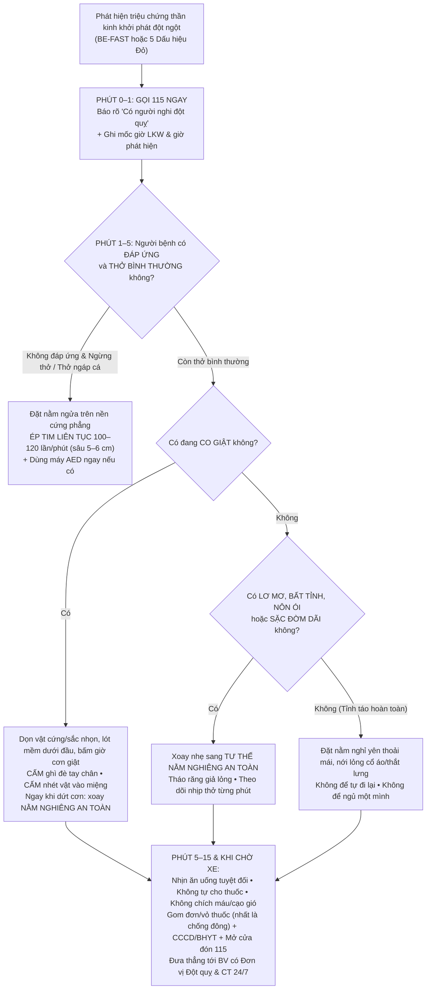

# Đột Quỵ Não: Cơ Sở Tri Thức Y Khoa Hợp Nhất & Kiểm Toán Bằng Chứng (Bản Tinh Chỉnh Cuối Cùng)

> **Tệp chuẩn:** `gemini_merge_final.md` · **Phiên bản:** `3.0 (Final Gold Master)` · **Ngày chốt & kiểm chứng:** 27/11/2026 (`UTC+7`)
> **Nguồn hợp nhất & thẩm định chéo:** Kết tinh từ hai tài liệu nghiên cứu gốc (`gemini.md`, `chatgpt.md`) và đối chiếu phản biện chéo hai mặt giữa `gemini_merge.md` và `claude_merge_final.md`, đồng thời **xác minh độc lập trực tiếp trên văn bản gốc Bộ Y tế Việt Nam, PubMed và các hướng dẫn quốc tế** đối với toàn bộ các điểm còn bỏ ngỏ.
> **Mục đích sử dụng:** Nguồn tri thức y khoa chuẩn hóa duy nhất làm nền tảng nội dung cho hệ sinh thái **Website** và **Ứng dụng Android (`.apk` offline)** về phòng chống, nhận diện sớm và sơ cứu đột quỵ não tại Việt Nam.
> **Tuyên bố y khoa & an toàn:** Tài liệu phục vụ giáo dục sức khỏe, tra cứu phòng ngừa và hướng dẫn sơ cứu an toàn trước viện; không thay thế chẩn đoán hay chỉ định điều trị trực tiếp của bác sĩ. Trước khi phát hành rộng rãi tới cộng đồng, nội dung hiển thị trên ứng dụng cần có bước ký duyệt chuyên môn của bác sĩ chuyên khoa Đột quỵ / Thần kinh / Cấp cứu. **Trong mọi tình huống nghi ngờ đột quỵ cấp: gọi ngay 115.**

---

## Mục Lục

- [0. Phương pháp hợp nhất và hệ thống nhãn truy xuất nguồn](#0-phương-pháp-hợp-nhất-và-hệ-thống-nhãn-truy-xuất-nguồn)
- [1. Mười nguyên tắc sinh tử cốt lõi](#1-mười-nguyên-tắc-sinh-tử-cốt-lõi)
- [2. Cẩm nang sơ cứu khẩn cấp gia đình và ngoại viện](#2-cẩm-nang-sơ-cứu-khẩn-cấp-gia-đình-và-ngoại-viện)
- [3. Kiến trúc phân tầng đa trục cho bài kiểm tra trên Website và App](#3-kiến-trúc-phân-tầng-đa-trục-cho-bài-kiểm-tra-trên-website-và-app)
- [4. Dịch tễ học toàn cầu và thực trạng đột quỵ tại Việt Nam](#4-dịch-tễ-học-toàn-cầu-và-thực-trạng-đột-quỵ-tại-việt-nam)
- [5. Bản chất định nghĩa hiện đại và cơ chế bệnh sinh 14 cấp độ](#5-bản-chất-định-nghĩa-hiện-đại-và-cơ-chế-bệnh-sinh-14-cấp-độ)
- [6. Hệ thống phân loại 4 trục và 15 phân nhóm lâm sàng](#6-hệ-thống-phân-loại-4-trục-và-15-phân-nhóm-lâm-sàng)
- [7. Nguyên nhân dài hạn, đặc thù người trẻ/phụ nữ và 14 yếu tố khởi phát ngắn hạn](#7-nguyên-nhân-dài-hạn-đặc-thù-người-trẻphụ-nữ-và-14-yếu-tố-khởi-phát-ngắn-hạn)
- [8. Hệ thống nhận biết từ cực sớm đến muộn, ma trận 28 triệu chứng và 8 bẫy mất giờ vàng](#8-hệ-thống-nhận-biết-từ-cực-sớm-đến-muộn-ma-trận-28-triệu-chứng-và-8-bẫy-mất-giờ-vàng)
- [9. Quy trình kiểm tra 60 giây, thang sàng lọc, bệnh giả đột quỵ và công nghệ mới](#9-quy-trình-kiểm-tra-60-giây-thang-sàng-lọc-bệnh-giả-đột-quỵ-và-công-nghệ-mới)
- [10. Kiểm chứng khách quan Đông y, mạng xã hội, 13 mẹo truyền miệng và khung kiểm toán giai thoại](#10-kiểm-chứng-khách-quan-đông-y-mạng-xã-hội-13-mẹo-truyền-miệng-và-khung-kiểm-toán-giai-thoại)
- [11. Chẩn đoán và điều trị hiện đại tại bệnh viện (Cập nhật đến 11/2026)](#11-chẩn-đoán-và-điều-trị-hiện-đại-tại-bệnh-viện-cập-nhật-đến-112026)
- [12. Tiên lượng sống sót, chống "lời tiên tri tự ứng nghiệm" và lộ trình phục hồi](#12-tiên-lượng-sống-sót-chống-lời-tiên-tri-tự-ứng-nghiệm-và-lộ-trình-phục-hồi)
- [13. Kế hoạch phòng ngừa và tầm soát có đích theo 10 nhóm nguy cơ](#13-kế-hoạch-phòng-ngừa-và-tầm-soát-có-đích-theo-10-nhóm-nguy-cơ)
- [14. Mười sáu ca bệnh thực tế đã kiểm chứng](#14-mười-sáu-ca-bệnh-thực-tế-đã-kiểm-chứng)
- [15. Mười hai quan niệm sai lầm chết người cần xóa bỏ](#15-mười-hai-quan-niệm-sai-lầm-chết-người-cần-xóa-bỏ)
- [16. Chín câu hỏi khoa học còn mở (tính đến tháng 11/2026)](#16-chín-câu-hỏi-khoa-học-còn-mở-tính-đến-tháng-112026)
- [17. Năm bộ lọc phản biện khoa học](#17-năm-bộ-lọc-phản-biện-khoa-học-c-hệ-thống-hóa-g)
- [18. Ma trận kiểm toán mức độ bằng chứng (28 luận điểm cốt lõi)](#18-ma-trận-kiểm-toán-mức-độ-bằng-chứng-28-luận-điểm-cốt-lõi)
- [19. Bảng đối chiếu 12 điểm khác biệt giữa hai tài liệu gốc (`gemini.md` vs. `chatgpt.md`)](#19-bảng-đối-chiếu-12-điểm-khác-biệt-giữa-hai-tài-liệu-gốc-geminimd-vs-chatgptmd)
- [20. Danh mục tài liệu tham khảo trọng yếu đã xác minh](#20-danh-mục-tài-liệu-tham-khảo-trọng-yếu-đã-xác-minh)
- [Phụ lục A. Báo cáo thẩm định chéo gemini_merge.md vs. claude_merge_final.md](#phụ-lục-a-báo-cáo-thẩm-định-chéo-gemini_mergemd-vs-claude_merge_finalmd)
- [Phụ lục B. Kiến trúc ánh xạ nội dung và quy tắc biên tập cho Website & Android App](#phụ-lục-b-kiến-trúc-ánh-xạ-nội-dung-và-quy-tắc-biên-tập-cho-website--android-app)

---

## 0. Phương Pháp Hợp Nhất Và Hệ Thống Nhãn Truy Xuất Nguồn

Để vừa giữ trọn độ sâu khoa học lâm sàng vừa đảm bảo khả năng truy xuất minh bạch tuyệt đối khi hội đồng bác sĩ thẩm định nội dung ứng dụng, tài liệu sử dụng hệ thống nhãn nguồn chuẩn hóa sau:

| Nhãn truy xuất | Ý nghĩa kiểm chứng |
| :--- | :--- |
| *(Không gắn nhãn)* hoặc **`[Cả hai]`** | Nội dung được cả hai tài liệu nghiên cứu gốc (`gemini.md` và `chatgpt.md`) thống nhất hoàn toàn. |
| **`[G]`** | Dữ liệu chi tiết từ `gemini.md` (đã có nguồn trích dẫn trong danh mục gốc). |
| **`[C]`** | Dữ liệu chi tiết hoặc góc nhìn phản biện từ `chatgpt.md` (đã có nguồn trích dẫn trong danh mục gốc). |
| **`[Lệch → Đã phân giải]`** | Hai tài liệu gốc nêu số liệu từ các phân tích gộp, quần thể hoặc thời kỳ khác nhau; đã được đối chiếu và giải thích rõ nguyên nhân tại Mục 19. |
| **`[Đã kiểm chứng ngoài]`** | Các chi tiết pháp lý hoặc y văn (như nguyên văn Điều 1–3 Quyết định `3312/QĐ-BYT`, độ sâu ép tim AHA CPR, `AVERT`, `Tsivgoulis 2015`, `HINTS Cochrane`) đã được tra cứu đối chiếu trực tiếp với văn bản gốc và PubMed ngày 27/11/2026 để loại bỏ hoàn toàn các thông tin chưa kiểm chứng. |

**Nguyên tắc biên tập xuyên suốt:** Văn phong trung tính, chính xác về mặt thống kê y sinh (không đánh đồng tỷ số chênh `OR` với phần trăm giảm nguy cơ tương đối `RRR`, không suy diễn nguy cơ tương đối quần thể thành xác suất cá nhân), và **không đưa bất kỳ lời khuyên truyền miệng thiếu chứng cứ nào vào quy trình hành động**.

---

## 1. Mười Nguyên Tắc Sinh Tử Cốt Lõi

Hai tài liệu nghiên cứu gốc và cả hai quy trình kiểm toán độc lập thống nhất tuyệt đối ở 10 nguyên tắc sống còn sau:

1. **Bất kỳ triệu chứng thần kinh khu trú mới nào khởi phát đột ngột** (méo miệng, yếu/tê một bên, nói khó, mất thăng bằng, mất thị lực, nhìn đôi, đau đầu sét đánh, khó nuốt, lú lẫn, vụng đột ngột một bàn tay) **đều phải được xử trí như đột quỵ cấp** cho đến khi được bác sĩ và chẩn đoán hình ảnh loại trừ — kể cả khi triệu chứng nhẹ, không đau, người bệnh vẫn tỉnh táo nói chuyện được, hoặc đã tự biến mất.
2. **Gọi cấp cứu 115 ngay lập tức**, nói rõ ngay câu đầu tiên: *“Có người nghi đột quỵ não cấp”*. Không nằm chờ xem có tự đỡ không.
3. **Ghi nhớ chính xác mốc giờ “lần cuối thấy người bệnh hoàn toàn bình thường” (*Last Known Well — LKW*)** cùng giờ phát hiện triệu chứng. Nếu thức dậy mới phát hiện thì mốc LKW là thời điểm bình thường cuối cùng trước khi đi ngủ.
4. **Thang FAST âm tính — thậm chí BE-FAST âm tính — KHÔNG loại trừ đột quỵ.** Đột quỵ tuần hoàn sau (tiểu não, thân não, thùy chẩm) rất dễ bị bỏ sót vì không gây méo miệng hay liệt tay chân.
5. **Tuyệt đối nhịn ăn uống hoàn toàn (NPO) và không tự cho uống bất kỳ thuốc gì tại nhà:** không uống aspirin, không ngậm/uống thuốc hạ huyết áp, không uống An Cung Ngưu Hoàng Hoàn, không cho uống nước lọc, nước chanh, nước đường hay nước gừng.
6. **Tuyệt đối không chích máu 10 đầu ngón tay hay dái tai, không cạo gió, không xoa bóp hay bẻ nắn vùng cổ, không bấm huyệt** làm trì hoãn cuộc gọi 115 và thời gian đến bệnh viện.
7. **Ưu tiên số 1 tại nhà là bảo vệ đường thở và tuần hoàn:** người bệnh nôn ói, sặc đờm, lơ mơ hoặc vừa dứt cơn co giật phải đặt ở **tư thế nằm nghiêng an toàn**; người bệnh không đáp ứng và không thở bình thường (ngừng thở hoặc chỉ thở ngáp cá) phải **ép tim ngoài lồng ngực (CPR)** ngay.
8. **Triệu chứng tự hết hoàn toàn sau vài phút (nghi cơn thiếu máu não thoáng qua — TIA) vẫn là cấp cứu khẩn cấp.** Nguy cơ xảy ra đột quỵ gây liệt thật tập trung cao nhất ngay trong 48 giờ đầu.
9. **Đột quỵ phát hiện khi thức dậy (*Wake-up stroke*) hoặc đến viện sau 4,5 giờ vẫn còn cơ hội cứu não** nhờ chụp MRI (`DWI–FLAIR`) hoặc CT tưới máu chọn lọc đến 9–24 giờ. Tuyệt đối không tự bỏ cuộc.
10. **Tính đến cuối năm 2026, chưa có bài kiểm tra tại nhà, đồng hồ thông minh, AI hay xét nghiệm máu đơn lẻ nào tự loại trừ được đột quỵ cấp hoặc dự báo chính xác ngày giờ đột quỵ sắp xảy ra.** Gọi 115 nhầm cho một ca giả đột quỵ là an toàn; tự trấn an ở nhà trên ca đột quỵ thật mới là sai lầm trả giá bằng tàn phế hoặc tính mạng.

---

## 2. Cẩm Nang Sơ Cứu Khẩn Cấp Gia Đình Và Ngoại Viện

### 2.1. Quy Tắc Quyết Định Tức Thì

> **Triệu chứng thần kinh mới xuất hiện đột ngột → Gọi 115 ngay → Ghi mốc giờ LKW → Bảo vệ đường thở → Nhịn ăn uống hoàn toàn → Không tự dùng thuốc hay mẹo dân gian → Đưa thẳng tới bệnh viện có Đơn vị Đột quỵ (CT 24/7).** `[Cả hai]`

- Tại Việt Nam: bấm gọi **115** và nói rõ **“Có người nghi đột quỵ não”** để hệ thống điều phối ưu tiên và thông báo trước cho bệnh viện tiếp nhận (khuyến nghị chính thức của Trung tâm Đột quỵ – Bệnh viện Bạch Mai). `[C]`
- **Không tự lái xe** nếu chính bản thân đang có triệu chứng `[C]`; **tuyệt đối không chở người bệnh bằng xe máy** `[G]`.

### 2.2. Nhận Diện Nhanh: Quy Tắc BE-FAST Và 5 Dấu Hiệu Đỏ Bổ Sung

Chỉ cần xuất hiện đột ngột **MỘT** dấu hiệu dưới đây là đủ điều kiện kích hoạt cấp cứu 115 ngay lập tức (không biến thành bài thi phải cộng đủ điểm):

| Nhóm chữ cái | Cách kiểm tra nhanh (tối đa 30–60 giây) | Biểu hiện báo động đỏ |
| :--- | :--- | :--- |
| **B — Balance** *(Thăng bằng)* | Quan sát tư thế ngồi, đứng hoặc bước đi *(chỉ thử đứng khi người bệnh tỉnh táo hoàn toàn, không liệt chân và có người đỡ sát bên)* | Đột ngột chóng mặt dữ dội, đi loạng choạng như say rượu, ngồi/đứng nghiêng đổ hoặc mất phối hợp tay chân. |
| **E — Eyes** *(Thị giác)* | Hỏi khả năng nhìn rõ ở từng mắt và cả hai mắt | Đột ngột nhìn mờ, nhìn đôi (*song thị*), mất một nửa tầm nhìn hoặc **mù đột ngột không đau một mắt** như rèm đen sập xuống. |
| **F — Face** *(Khuôn mặt)* | Yêu cầu cười tươi hoặc nhe răng | Một bên khóe miệng trễ xệ, nhân trung lệch, nếp mũi – má mờ hoặc tê cứng một bên mặt. |
| **A — Arms** *(Tay, chân)* | Yêu cầu nhắm mắt, giơ thẳng hai tay ra trước ngang vai, lòng bàn tay ngửa lên trong 10 giây | Một tay không nâng lên được, tự rơi thấp dần hoặc xoay úp lòng bàn tay; đột nhiên cầm rơi đồ vật; tê hoặc yếu một bên chân. |
| **S — Speech** *(Lời nói)* | Yêu cầu lặp lại một câu đơn giản cố định: *“Hôm nay trời rất đẹp”* | Nói ngọng, nói đớ, lắp bắp, khó tìm từ gọi tên đồ vật, nói trôi chảy nhưng câu vô nghĩa hoặc không hiểu lời người khác. |
| **T — Time** *(Thời gian)* | Hành động khẩn cấp ngay giây đầu tiên | **GỌI 115 NGAY!** Ghi chính xác **giờ khởi phát** và **giờ bình thường cuối cùng (LKW)**. |

**5 Dấu hiệu Đỏ ngoài BE-FAST (Đặc biệt quan trọng khi bệnh nhân KHÔNG méo miệng, KHÔNG liệt nửa người):**
1. **Đau đầu dữ dội kiểu “sét đánh” (*Thunderclap headache*):** Đạt cường độ cực đại tức thì trong vài giây đến dưới 1 giờ (*“cơn đau đầu khủng khiếp nhất đời”*), gợi ý vỡ túi phình mạch gây xuất huyết dưới nhện. `[Cả hai]`
2. **Đột ngột khó nuốt, uống nước sặc, khàn tiếng** (có thể kèm nấc cụt kéo dài và chóng mặt): Gợi ý đột quỵ hành não bên (*hội chứng Wallenberg*). `[Cả hai]`
3. **Đột ngột lú lẫn, thay đổi hành vi, bỏ quên một bên không gian hoặc ngủ gà khó đánh thức.** `[Cả hai]`
4. **Đột ngột vụng về đơn độc một bàn tay/ngón tay, chữ viết biến dạng (*dysgraphia*) hoặc mất kỹ năng thao tác quen thuộc (*apraxia*).** `[C]`
5. **Đau chói một bên cổ – gáy mới xuất hiện** (nhất là sau vận động mạnh hoặc xoay vặn cổ) **kèm chóng mặt, sụp mi hoặc bất kỳ dấu hiệu thần kinh nào**: Báo động bóc tách động mạch đốt sống hoặc động mạch cảnh. `[Cả hai]`

### 2.3. Sơ Đồ Quyết Định Sơ Cứu Và Khung Hành Động Theo Từng Mốc Phút

| Khung thời gian | Việc ưu tiên bắt buộc | Cơ sở khoa học & Lưu ý thực hành |
| :--- | :--- | :--- |
| **0 – 1 phút** | Nhận ra dấu hiệu → **bấm gọi 115 ngay** → ghi lại **mốc giờ LKW** và **giờ phát hiện triệu chứng**. | Điều trị tái tưới máu phụ thuộc chặt chẽ vào thời gian và vùng mô não còn cứu được; tuyệt đối không mất thời gian “nằm thử xem có tự hết không”. `[Cả hai]` |
| **1 – 5 phút** *(Kiểm tra sinh tồn)* | Kiểm tra **đáp ứng** và **nhịp thở bình thường**: nếu không đáp ứng và ngừng thở hoặc chỉ thở ngáp cá (*agonal gasps*), đặt nằm ngửa trên mặt phẳng cứng, **ép tim ngoài lồng ngực liên tục (*Hands-Only CPR*) tần số 100–120 lần/phút, độ sâu 5–6 cm (2–2,4 inch), để lồng ngực nảy lên hoàn toàn** và dùng máy khử rung tự động (AED) nếu có sẵn. *(Trẻ em: kết hợp ép tim và thổi ngạt theo hướng dẫn AHA 2025).* | Chuẩn hồi sinh tim phổi **AHA CPR & ECC 2025** (`[Đã kiểm chứng ngoài]` cho thông số tần số 100–120/phút và độ sâu 5–6 cm ở người lớn). Không mất thời gian mò bắt mạch nếu là người không chuyên. `[G]` |
| **1 – 5 phút** *(Bảo vệ đường thở)* | Nếu còn thở bình thường nhưng **nôn ói, sặc đờm, lơ mơ hoặc vừa qua cơn co giật**: đặt ở **tư thế nằm nghiêng an toàn** (nếu không nghi chấn thương cột sống cổ). **Nhịn ăn uống hoàn toàn (NPO).** | Rối loạn nuốt (*dysphagia*) rất phổ biến ngay giờ đầu đột quỵ; hít sặc dịch nôn/nước uống gây ngạt thở cấp và viêm phổi hít tử vong. `[Cả hai]` |
| **5 – 15 phút** | Chuẩn bị nhanh **vỏ thuốc / đơn thuốc đang uống** (**đặc biệt thuốc chống đông**: *warfarin, rivaroxaban, apixaban, dabigatran, edoxaban* và kháng tiểu cầu), thuốc tiểu đường/huyết áp, CCCD/BHYT, bệnh nền, dị ứng, số điện thoại người chứng kiến; mở rộng cửa, bật đèn đón xe 115. | Thông tin thuốc chống đông và mốc LKW quyết định trực tiếp việc dùng thuốc tiêu sợi huyết hoặc thuốc hóa giải chống đông khẩn cấp tại bệnh viện. `[Cả hai]` |
| **Trong lúc chờ xe** | Ở sát cạnh người bệnh từng phút: không để tự đứng dậy đi lại, **không để ngủ một mình không giám sát** `[G]`; theo dõi sát ý thức, nhịp thở, nôn, co giật; không trì hoãn vận chuyển vì đo huyết áp/đường máu hay làm mẹo dân gian. | Buồn ngủ tăng dần có thể là dấu hiệu khối máu tụ đang lan rộng hoặc phù não chèn ép thân não. `[G]` |

### 2.4. Khi Gọi 115: Cần Nói Rõ 5 Thông Tin Gì?

Mở đầu cuộc gọi bằng câu: **“Cấp cứu! Có người nghi đột quỵ não cấp”**, sau đó cung cấp gọn 5 thông tin `[G]`:
1. **Địa chỉ chính xác**, ngõ/hẻm, điểm mốc dễ nhận biết nhất và số điện thoại liên lạc.
2. Giới tính, độ tuổi ước tính và **giờ khởi phát hoặc giờ bình thường cuối cùng (LKW)**.
3. Triệu chứng nổi bật nhất (méo miệng, liệt nửa người, nói ngọng, chóng mặt nôn vọt, đau đầu sét đánh).
4. Tình trạng ý thức và hô hấp hiện tại (*tỉnh táo / lơ mơ / đang co giật / bất tỉnh còn thở / ngừng thở đang ép tim*).
5. Tiền sử bệnh nền chính và **thuốc chống đông máu** đang sử dụng.

*Mẹo thực hành quan trọng `[G]`:*
- Nếu người bệnh sống một mình, bị thất ngôn không nói được hoặc đột quỵ khi ngủ dậy: kiểm tra ngay **nhật ký cuộc gọi/tin nhắn/Zalo gần nhất** trên điện thoại của họ để giúp bác sĩ thu hẹp chính xác mốc giờ LKW.
- Khi cần ép tim CPR: bật **loa ngoài điện thoại** đặt cạnh đầu người bệnh để điều phối viên 115 đếm nhịp và hướng dẫn trực tiếp.
- Thông báo trước cho bệnh viện tiếp nhận (*Code Stroke prenotification*) được chứng minh giúp rút ngắn tới ~30 phút chờ đợi tại khoa Cấp cứu.

### 2.5. Mười Điều TUYỆT ĐỐI KHÔNG LÀM Trước Khi Chụp CT Sọ Não

| STT | Hành động bị cấm tuyệt đối | Cơ sở bằng chứng khoa học giải thích lý do |
| :--- | :--- | :--- |
| **1** | **Tự cho uống hoặc nhai Aspirin** | Khi chưa chụp CT sọ não, không thể phân biệt nhồi máu não (77% tại VN) với xuất huyết não (18%). Uống aspirin khi đang xuất huyết não làm máu chảy lan rộng nguy kịch. *(Nhai aspirin 162–325 mg chỉ áp dụng cho đau ngực nghi nhồi máu cơ tim).* `[Cả hai]` |
| **2** | **Tự cho uống hoặc ngậm thuốc hạ huyết áp** (kể cả khi máy đo báo 190–200 mmHg) | Thử nghiệm ngẫu nhiên **INTERACT4** (*NEJM* 2024, n=2.404) chứng minh hạ huyết áp sớm trên xe cứu thương trước chụp CT có lợi ở xuất huyết não (`OR 0,75`) nhưng **gây hại có ý nghĩa thống kê ở nhồi máu não (`OR 1,30`)** `[G]`, vì huyết áp cao lúc đầu đang giúp duy trì áp lực tưới máu nuôi vùng tranh tối tranh sáng `[C]`. |
| **3** | **Cho uống An Cung Ngưu Hoàng Hoàn, tam thất, đan sâm, thuốc “hoạt huyết”, Nattokinase, viên “tan cục máu đông”** | Làm trầm trọng chảy máu nếu là xuất huyết não, không có tác dụng tái thông mạch lớn cấp tính, viên thuốc/bột hòa nước cực dễ gây sặc tắc thở và làm mất giờ vàng. `[Cả hai]` |
| **4** | **Cho ăn hoặc uống bất cứ thứ gì** (kể cả nước lọc, nước đường, nước chanh, nước gừng, cháo loãng) | Liệt hầu họng gây rối loạn nuốt xuất hiện rất sớm → hít sặc thẳng vào khí – phế quản gây ngạt thở cấp và viêm phổi hít. `[Cả hai]` |
| **5** | **Chích máu 10 đầu ngón tay, dái tai; bấm nhân trung thay cho kiểm tra nhịp thở** | Hoàn toàn không thông được mạch não tắc hay giảm áp lực nội sọ; cơn đau làm vọt huyết áp giao cảm, nguy cơ nhiễm trùng/chảy máu vết chích khi tiêm tiêu sợi huyết, làm quên kiểm tra ngừng thở để ép tim CPR và cướp mất giờ vàng. `[Cả hai]` |
| **6** | **Cạo gió, giác hơi, bôi dầu nóng; châm cứu tại nhà khi đang khởi phát** | Không giải quyết tắc/vỡ mạch nội sọ; gây bầm tụ máu lớn ở người dùng chống đông và trì hoãn vận chuyển. `[G]` |
| **7** | **Xoa bóp, ấn miết, vặn nắn vùng cổ – gáy** | Xoa ép xoang cảnh/động mạch cảnh có thể làm bung mảng xơ vữa bắn lên não, gây phản xạ nhịp chậm/ngừng tim tụt áp `[G]`, hoặc xé rộng động mạch đốt sống đang bóc tách `[C]`. |
| **8** | **Nhét đũa, thìa, khăn, chanh, ngón tay vào miệng; đè ghì chặt tay chân khi co giật** | Xếp nhóm **Gây hại (*Class 3: Harm*)** theo AHA/Red Cross First Aid 2024: làm gãy răng rơi bít đường thở, trật khớp/gãy xương và rách niêm mạc. `[Cả hai]` |
| **9** | **Chở người bệnh bằng xe máy; ghé lòng vòng trạm y tế/phòng khám không có máy CT** | Ngồi xe máy dễ té ngã chấn thương sọ não thứ phát, gập cổ bít đường thở; chuyển viện lòng vòng đánh mất toàn bộ cửa sổ điều trị. `[G]` |
| **10** | **Nằm chờ “xem có tự đỡ không”; để ngủ một mình; ở nhà vì thấy triệu chứng đã tự hết** | Mất vĩnh viễn hàng trăm triệu tế bào thần kinh mỗi giờ; bỏ lỡ cơ hội ngăn chặn cơn đột quỵ lớn ngay sau TIA. `[Cả hai]` |

### 2.6. Tư Thế Đặt Người Bệnh: Nằm Phẳng, Kê Cao Đầu Hay Nằm Nghiêng?

Đối chiếu 3 thử nghiệm lâm sàng lớn giải quyết trọn vẹn câu hỏi này:
- **HeadPoST** (*NEJM* 2017, n=11.093, đa số đột quỵ nhẹ nhập viện muộn ~14 giờ): nằm phẳng `0°` trong 24 giờ không tạo khác biệt có ý nghĩa về mức độ tàn tật (`mRS`) ở ngày 90 so với nâng đầu `≥30°`. `[Cả hai]`
- **ZODIAC** (*JAMA Neurol* 09/2025, n=92, dừng sớm vì hiệu quả rõ rệt): ở bệnh nhân **đã chụp mạch xác định tắc mạch lớn (LVO) và đang nằm chờ lấy huyết khối tại bệnh viện**, đặt đầu phẳng `0°` giúp duy trì dòng máu bàng hệ và giảm mạnh nguy cơ xấu đi thần kinh sớm so với kê đầu `30°` (`HR 34,40`; tử vong 90 ngày `4,4%` vs `21,7%`). `[G]` *(Lưu ý: đây là quy trình nội viện sau khi đã chụp phim).*
- **HeadSOAR** (*BMJ* 08/2026): đánh giá tư thế đầu ở giai đoạn **sau khi đã can thiệp lấy huyết khối**. `[G]`

**Quy tắc thực hành thống nhất tại nhà (khi chưa có phim CT):** Không biến “đo góc kê gối” thành nghi thức gây chậm gọi xe 115 `[C]`; **luôn lấy an toàn đường thở làm chuẩn số 1**:
1. **Tỉnh táo hoàn toàn, thở êm, không buồn nôn:** Đặt nằm nghỉ phẳng hoặc kê gối mỏng thoải mái; tránh xốc dựng ngồi thẳng dậy đột ngột (dễ tụt áp tưới máu vùng tranh tối tranh sáng).
2. **Buồn nôn, nôn ói, sặc đờm dãi, lơ mơ, sau cơn co giật, hoặc bất tỉnh nhưng còn thở đều:** Đặt ngay **tư thế nằm nghiêng an toàn (*recovery position*)** để dẫn lưu chất tiết ra ngoài, tránh tụt lưỡi và hít sặc (trừ khi nghi ngờ chấn thương cột sống cổ).
3. **Không đáp ứng và không thở bình thường:** Đặt **nằm ngửa trên mặt phẳng cứng** để thực hiện **ép tim ngoài lồng ngực (CPR)** hiệu quả.

### 2.7. Có Nên Đo Huyết Áp Và Đường Huyết Mao Mạch Tại Nhà?

- **Điều kiện tiên quyết:** Chỉ đo khi thiết bị có sẵn ngay trong tầm tay, người nhà biết thao tác thành thạo, **đã bấm gọi 115 xong** và toàn bộ thao tác mất **dưới 30–60 giây** (tuyệt đối không làm chậm vận chuyển). `[Cả hai]`
- **Đường huyết mao mạch** (ở người đái tháo đường): rất hữu ích để phát hiện sớm hạ đường huyết (`<60 mg/dL` — bệnh giả đột quỵ phổ biến) và báo ngay cho nhân viên 115 xử trí đường tĩnh mạch `[G]`. **Không đổ nước đường vào miệng** nếu người bệnh giảm ý thức hoặc khó nuốt `[Cả hai]`.
- **Huyết áp:** chỉ ghi lại con số và giờ đo để báo bác sĩ; **tuyệt đối không tự cho uống thuốc hạ áp** (xem Mục 2.5).

### 2.8. Vận Chuyển Cấp Cứu Và Chiến Lược Chọn Bệnh Viện Tại Việt Nam

- **Ưu tiên số 1 luôn là xe cấp cứu 115:** Dữ liệu từ chương trình Paul Coverdell (500.829 bệnh nhân, Hoa Kỳ) và Singapore chứng minh đi bằng xe cấp cứu chuyên nghiệp giúp chụp CT nhanh hơn và tăng tỷ lệ được tiêm tiêu sợi huyết trong 60 phút lên **1,61–2,58 lần** so với tự đi phương tiện cá nhân. `[G]`
- **Khi khu vực không có xe 115 hoặc phải chờ quá lâu:** chủ động chuyển ngay bằng **ô tô** (xe gia đình hoặc taxi), đặt người bệnh nằm ghế sau theo tư thế bảo vệ đường thở, có người ngồi sát theo dõi nhịp thở, đồng thời gọi điện báo trước hotline cấp cứu của bệnh viện đích. **Tuyệt đối không dùng xe máy.** `[G]`
- **Nguyên tắc định tuyến thông minh (*Drip-and-Ship* vs. *Mothership*):**
  - Đi thẳng tới cơ sở gần nhất **có chụp CT sọ não 24/7 và Đơn vị Đột quỵ** (bỏ qua trạm y tế xã, phòng khám đa khoa không có CT). `[G]`
  - Tuân thủ điều phối của hệ thống 115 địa phương: nếu bệnh viện tuyến tỉnh gần nhà đã nằm trong mạng lưới Đơn vị Đột quỵ (có CT và tiêm tiêu sợi huyết) trong khi tự lái xe thẳng lên tuyến trung ương mất nhiều giờ, **không nên tự ý bỏ qua bệnh viện tỉnh** — việc vào Đơn vị Đột quỵ tỉnh để ổn định đường thở, chụp CT và tiêm tiêu sợi huyết sớm rồi chuyển tuyến lấy huyết khối (*drip-and-ship*) an toàn và cứu não tốt hơn tự đi đường xa không có hồi sức. `[C, hợp nhất thực tiễn]`
  - Ngược lại, nếu triệu chứng liệt rất nặng (nghi tắc mạch lớn) tại địa bàn có bệnh viện lấy huyết khối cơ học (EVT) trong khoảng cách tiếp cận hợp lý mà chưa có cơ chế chuyển liên viện nhanh, ưu tiên đưa thẳng tới trung tâm có EVT theo khuyến cáo AHA/ASA 2026. `[G]`
- **Mạng lưới cấp cứu đột quỵ Việt Nam:** Hội Đột quỵ Việt Nam (VNSA 2024) ghi nhận **124 bệnh viện sẵn sàng cấp cứu đột quỵ** trên toàn quốc (tăng gấp 10 lần so với 12 đơn vị năm 2016) cùng 5 Vùng Angels (Hà Nội 1, Đà Nẵng, TP.HCM 1, Cần Thơ, An Giang) `[G]`. Ngày 23/10/2026 tại Seoul, **Bệnh viện Bạch Mai** được WSO trao chứng nhận **Trung tâm Đột quỵ Chuyên sâu (*Advanced Stroke Center*)** đầu tiên của Việt Nam `[G, Đã kiểm chứng ngoài]`.

### 2.9. Xử Trí Sơ Cứu Theo 10 Tình Huống Thực Tế `[G]`

| Tình huống thực tế | Hành động ưu tiên từng bước | Sai lầm đặc thù phải tránh |
| :--- | :--- | :--- |
| **1. Tỉnh táo hoàn toàn, yếu nhẹ hoặc méo miệng** | Gọi 115, ghi LKW; đỡ nằm nghỉ yên nơi thoáng khí, nới cổ áo/thắt lưng, giữ ấm nhẹ; trấn an bình tĩnh; gom đơn thuốc. | Để người bệnh tự đi vệ sinh/lái xe; cho uống nước/thuốc; chiều theo ý người bệnh xin “nằm nghỉ 30 phút xem đỡ không”. |
| **2. Khó nói / thất ngôn nhưng vẫn hiểu lời** | Gọi 115; trấn an rằng gia đình đã hiểu và xe đang tới; chỉ hỏi câu ngắn **Có/Không** để người bệnh gật đầu/chớp mắt; xem điện thoại tìm giờ LKW. | Bắt cố nói lặp đi lặp lại gây kích động tăng HA; đút nước uống vì tưởng khô họng. |
| **3. Liệt rõ một bên tay chân** | Gọi 115; đỡ nằm mặt phẳng an toàn, kê gối mỏng dưới bả vai và cánh tay liệt; khi di chuyển phải ôm đỡ đồng thời cả thân người và khớp vai bên liệt. | **Nắm kéo giật cánh tay bên liệt** (rất dễ gây bán trật khớp vai đau mạn tính); xoa bóp mạnh, chích máu đầu ngón tay. |
| **4. Chóng mặt dữ dội, buồn nôn, nôn liên tục** | Gọi 115; xoay ngay sang **tư thế nằm nghiêng an toàn**; lau sạch chất nôn ở miệng ngoài; theo dõi nhịp thở liên tục. | **Để nằm ngửa** (hít sặc vào phổi); pha nước gừng ấm, uống thuốc chống nôn hay thuốc tiền đình. |
| **5. Lơ mơ, ngủ gà (gọi mở mắt chậm rồi thiếp đi)** | Gọi 115 báo rõ “giảm ý thức”; đặt **nằm nghiêng an toàn**; tháo răng giả lỏng nếu lấy dễ và an toàn; đếm nhịp thở từng phút. | Đổ nước đường, vắt chanh hay nhét thuốc vào miệng; tát mặt, lay lắc mạnh đầu – cổ. |
| **6. Bất tỉnh nhưng VẪN thở bình thường** | Gọi 115 báo “bất tỉnh còn thở”; đặt **nằm nghiêng an toàn** giữ thông đường thở; theo dõi sát đề phòng chuyển sang thở ngáp cá/ngừng thở. | Để nằm ngửa làm tụt gốc lưỡi bít khí quản; mải bấm nhân trung/chích máu quên canh nhịp thở. |
| **7. Đang lên cơn co giật** | Gọi 115 (cơn đầu tiên, nghi đột quỵ, `>5 phút`, nhiều cơn liên tiếp, khó thở hoặc không tỉnh lại sau cơn `[Cả hai]`); dọn vật sắc nhọn, lót mềm dưới đầu, bấm giờ cơn giật; **vừa dứt cơn xoay ngay sang nằm nghiêng an toàn**. | Đè ghì tay chân; **nhét đũa, thìa, khăn, chanh hay ngón tay vào miệng**; cho uống nước khi còn lơ mơ sau cơn. |
| **8. Không đáp ứng và KHÔNG thở bình thường** | Gọi 115 bật loa ngoài + nhờ tìm máy AED; đặt **nằm ngửa trên nền cứng**; **ép tim ngoài lồng ngực liên tục 100–120 lần/phút** (sâu 5–6 cm); dán điện cực AED ngay khi có. | Tốn thời gian bắt mạch; nhầm tiếng thở ngáp cá rời rạc là vẫn còn thở bình thường. |
| **9. Thức dậy mới thấy bị (*Wake-up*) / Không rõ giờ** | **Vẫn gọi 115 khẩn cấp ngay!** Ghi rõ **2 mốc giờ**: giờ đi ngủ bình thường tối qua (LKW) và giờ thức dậy phát hiện; đưa tới viện có **MRI hoặc CT tưới máu**. | Cho ăn sáng, uống thuốc sáng; nằm chờ tới giờ hành chính; tự bỏ cuộc vì nghĩ “quá 4,5 giờ vàng rồi”. |
| **10. Triệu chứng vừa xuất hiện rồi TỰ HẾT (Nghi TIA)** | Coi là cấp cứu khẩn; gọi 115 hoặc đi ô tô thẳng tới khoa Cấp cứu / Đơn vị Đột quỵ **ngay trong ngày** (tối ưu vài giờ đầu, `<24 giờ`); mô tả kỹ triệu chứng đã xảy ra và kéo dài bao lâu. | Tự mua Aspirin uống trước khi chụp CT/MRI; chủ quan ở nhà hoặc hẹn khám phòng khám thường tuần sau. |

### 2.10. Bảng Phân Vai Minh Bạch: Người Dân Và Nhân Viên Y Tế `[G]`

| Nhóm nhiệm vụ | Người dân ĐƯỢC & NÊN làm ngay | Người dân TUYỆT ĐỐI KHÔNG làm | Can thiệp CHỈ DÀNH CHO Nhân viên Y tế (115 / Bệnh viện) |
| :--- | :--- | :--- | :--- |
| **Nhận diện & Điều phối** | Kiểm tra BE-FAST + 5 Dấu hiệu Đỏ; gọi 115; ghi giờ LKW; mở cửa đón xe; đi thẳng BV có CT & Đơn vị Đột quỵ. | Chờ tự khỏi; bỏ qua TIA; chở xe máy; ghé phòng khám không có CT. | Đánh giá thang điểm tắc mạch lớn (`RACE`, `LAMS`); kích hoạt *Code Stroke*; định tuyến trung tâm lấy huyết khối. |
| **Đường thở & Hồi sinh** | Đặt nằm nghiêng an toàn khi nôn/lơ mơ; ép tim *Hands-Only CPR* + AED khi không đáp ứng và ngừng thở/thở ngáp cá. | Để nằm ngửa khi đang nôn; nhét vật vào miệng khi giật; bấm nhân trung thay CPR. | Hút đờm dãi chuyên dụng, đặt nội khí quản, cho thở oxy **chỉ khi `SpO₂ < 94%`** (không thở oxy thường quy khi SpO₂ bình thường). |
| **Ăn uống & Thuốc** | Giữ nhịn ăn uống tuyệt đối (NPO); gom vỏ thuốc/đơn thuốc đang dùng (nhất là thuốc chống đông) bàn giao cho bác sĩ. | Cho uống nước, sữa, nước gừng, Aspirin, thuốc hạ áp, An Cung, tam thất, đan sâm, Nattokinase. | Truyền Glucose tĩnh mạch nếu hạ đường huyết; tiêm tiêu sợi huyết, hạ áp tĩnh mạch theo đích, hóa giải chống đông **sau khi đã chụp CT sọ não**. |

### 2.11. Phiếu Thông Tin Khẩn Cấp ("Thẻ Báo Bác Sĩ 115") Cho Gia Đình

*(Thiết kế để in khổ A4 dán tại nhà hoặc lưu sẵn trong mục Thẻ Y Tế Offline trên ứng dụng).*

| Mục thông tin chuẩn bị sẵn | Nội dung điền trước / Ghi nhanh khi xảy ra sự cố |
| :--- | :--- |
| **Tổng đài & Bệnh viện Đột quỵ đích** | Cấp cứu: **115** · Bệnh viện có Đơn vị Đột quỵ (CT 24/7) gần nhất: ............................ · Hotline cấp cứu BV: ........................ |
| **Hồ sơ người có nguy cơ cao** | Họ tên: .................................... · Năm sinh: ............ · Nhóm máu: ........ · **Cân nặng ước tính:** ........ kg *(giúp bác sĩ tính liều thuốc tiêu sợi huyết theo mg/kg)* |
| **Hai mốc thời gian sống còn** | **1. Giờ bình thường cuối cùng (LKW):** ...... giờ ...... phút · **2. Giờ phát hiện triệu chứng:** ...... giờ ...... phút |
| **Thuốc đặc biệt quan trọng đang dùng** | ☐ **Thuốc chống đông** (*Warfarin, Rivaroxaban, Apixaban, Dabigatran, Edoxaban*) — Tên & giờ uống liều cuối: ........................ ☐ Kháng tiểu cầu (*Aspirin, Clopidogrel*) · ☐ Thuốc tiểu đường / Insulin · ☐ Thuốc huyết áp |
| **Bệnh lý nền & Cảnh báo an toàn** | ☐ Tăng huyết áp · ☐ Đái tháo đường · ☐ Rung nhĩ / Van tim · ☐ Đột quỵ / TIA cũ · ☐ Phẫu thuật / chảy máu gần đây · ☐ Dị ứng thuốc: ................ |

### 2.12. Phân Biệt Nhanh Đột Quỵ Với 4 Cấp Cứu Dễ Nhầm Lẫn Nhất `[G]`

| Đặc điểm | Đột quỵ não (*Stroke*) | Ngất (*Syncope*) | Cơn động kinh (*Seizure*) | Nhồi máu cơ tim cấp (*Acute MI*) | Ngừng tuần hoàn (*Cardiac Arrest*) |
| :--- | :--- | :--- | :--- | :--- | :--- |
| **Cơ chế gốc** | Tắc hoặc vỡ mạch máu nuôi **khu trú** tại não, tủy sống, võng mạc. | Giảm tưới máu **toàn thể** hai bán cầu thoáng qua do tụt áp/loạn nhịp. | Phóng điện đồng bộ bất thường quá mức của vỏ não. | Tắc cấp tính động mạch vành nuôi cơ tim. | Tim ngừng bơm máu hiệu quả toàn thân. |
| **Biểu hiện nhận diện** | Khiếm khuyết thần kinh **khu trú** đột ngột; đa số lúc đầu **vẫn tỉnh táo**. | Choáng, tối sầm mặt, mất ý thức ngắn rồi **tỉnh lại nhanh hoàn toàn** khi nằm ngang. | Co cứng – co giật, cắn lưỡi; sau cơn lú lẫn hoặc yếu tạm 1 bên (*liệt Todd*). | Đau thắt/đè ép ngực lan lên hàm, vai, tay trái, vã mồ hôi lạnh, khó thở. | Đột ngột gục ngã, **không đáp ứng**, **ngừng thở hoặc chỉ thở ngáp cá**. |
| **Bẫy lâm sàng** | Tắc thân nền hoặc xuất huyết lớn có thể gây hôn mê ngay; 2%–23% AIS có co giật sớm. | Tắc thân nền hoặc vỡ phình mạch SAH có thể mở đầu bằng ngất. | Cơn giật ban đêm không ai chứng kiến để lại liệt Todd sáng hôm sau hệt Wake-up stroke. | Có thể xảy ra đồng thời với đột quỵ cấp. | Xuất huyết não lớn/tắc thân nền có thể gây ngừng tim thứ phát. |
| **Khác biệt sơ cứu cốt lõi** | Gọi 115, ghi LKW, bảo vệ đường thở, **CẤM uống Aspirin**. | Đặt nằm phẳng, kê nhẹ chân, nới lỏng cổ áo; khám tim mạch nếu tái diễn/gắng sức. | Lót mềm dưới đầu, dọn vật cứng, **cấm nhét vật vào miệng**; hết cơn nằm nghiêng. | Gọi 115; nếu tỉnh táo & không chống chỉ định có thể **nhai Aspirin 162–325 mg** (`AHA 2024`). | Gọi 115, nằm ngửa nền cứng, **ép tim CPR ngay + máy AED**. |

---

## 3. Kiến Trúc Phân Tầng Đa Trục Cho Bài Kiểm Tra Trên Website Và App

### 3.1. Giải Quyết Bài Toán Khoa Học Giữa "Ý Tưởng 4 Mức Ban Đầu" Và Thực Tế Lâm Sàng

Ý tưởng sản phẩm ban đầu đặt mục tiêu phân loại người dùng vào 4 mức: **“Rất sớm — Sớm — Bình thường — Muộn”**. Khi đối chiếu nghiêm ngặt với y học thực chứng từ cả hai nguồn nghiên cứu gốc và phản biện chéo giữa hai bản tổng hợp, thiết kế ứng dụng phải giải quyết **3 rào cản an toàn y khoa**:
1. **Không tồn tại bài test triệu chứng dự báo đột quỵ trước nhiều ngày/tuần:** Một người chưa có triệu chứng nhưng bị tăng huyết áp hay rung nhĩ đang mang **trạng thái nguy cơ nền**, không được gán nhãn là *“đang bị đột quỵ giai đoạn rất sớm”* gây hoảng loạn sai lệch; ngược lại, khi đã có triệu chứng thần kinh khu trú thì cơn đột quỵ/TIA **đã thực sự xảy ra**.
2. **Nguy hiểm của nhãn chữ “Bình thường” sau khởi phát:** Nếu dùng từ *“Bình thường”* để chỉ khung giờ `4,5–24 giờ`, người đang hoảng loạn sẽ đọc nhầm thành *“Không sao, bình thường rồi”* và không đi viện! Ngược lại, nếu gộp chung *Nguy cơ nền*, *Thời gian khởi phát* và *Độ nặng đường thở* vào một thước duy nhất sẽ làm nhiễu thông điệp hành động.
3. **Cơn TIA (triệu chứng đã tự hết) cần thông điệp riêng biệt với ca đang diễn tiến:** Cả hai đều phải đi cấp cứu khẩn, nhưng người vừa hết triệu chứng cần cảnh báo đặc hiệu chống tâm lý *“tự khỏi rồi nên ở nhà”*.

### 3.2. Mô Hình Chuẩn Hóa 3 Lớp / Đa Trục Cho Website & Android App

Để vừa đáp ứng trọn vẹn nhu cầu tự kiểm tra thông minh của người dân vừa an toàn tuyệt đối về mặt y khoa, hệ thống bài kiểm tra trên Web/App được chuẩn hóa thành **3 lớp tách biệt rõ ràng**:

#### Lớp 1 — Bộ Lọc Cờ Đỏ Sinh Tồn & Cắt Mạch Tức Thì (*Severity Override — Mức Nguy Kịch*)
- Hoạt động ở **mọi màn hình và mọi khung giờ**: Hễ phát hiện **không đáp ứng/ngừng thở/thở ngáp cá** → bật ngay hướng dẫn **Ép tim CPR 100–120 lần/phút**; hễ có **lơ mơ, nôn ói, sặc đờm, co giật, đau đầu sét đánh** → bật ngay **Tư thế nằm nghiêng an toàn + Gọi 115**.
- Trong bài kiểm tra nhanh 60 giây (`BE-FAST + 5 Dấu hiệu Đỏ`), hễ người dùng chạm chọn **bất kỳ 1 dấu hiệu dương tính nào ngay ở câu đầu tiên**, hệ thống **cắt mạch ngay lập tức (*Smart Short-Circuit*)** để gọi 115 và hỏi giờ LKW, không bắt trả lời tiếp các câu còn lại.

#### Lớp 2 — Trục Thời Gian Cấp Cứu Khi CÓ Hoặc VỪA CÓ Triệu Chứng (*"Thước Giờ Vàng" — 4 Mức Cấp Cứu*)

| Khung ý tưởng gốc | Tên hiển thị chuẩn an toàn trên App/Web | Điều kiện phân loại | Thông điệp & Hành động bắt buộc trên giao diện |
| :--- | :--- | :--- | :--- |
| **Rất sớm** *(Cảnh báo trước đột quỵ liệt thật)* | **🟠 Cảnh báo sớm — Nghi TIA (Dấu hiệu vừa tự hết)** | Từng có dấu hiệu BE-FAST / mù 1 mắt / tê yếu 1 bên trong vài phút đến vài giờ gần đây nhưng **hiện đã tự hồi phục hoàn toàn** | **BÁO ĐỘNG ĐỎ 48 GIỜ:** Không phải “trúng gió đã khỏi”! Đi khám Cấp cứu / Đơn vị Đột quỵ **ngay trong hôm nay** (`<24h`, tốt nhất trong vài giờ đầu). Nếu tái lại dù nhẹ → Gọi 115 ngay! |
| **Sớm** | **🔴 Giai đoạn Sớm — Trong Giờ Vàng (`0 – 4,5 giờ`)** | Đang có triệu chứng + Thời gian tính từ mốc **LKW `≤ 4,5 giờ`** | **GỌI 115 TỐI KHẨN!** Chạy đồng hồ đếm thời gian từ LKW; cơ hội cao nhất cho cả tiêm tiêu sợi huyết tĩnh mạch lẫn lấy huyết khối cơ học. |
| *(Mở rộng sau 4,5h — thay chữ "Bình thường" để tránh hiểu lầm)* | **🔴 Cửa sổ Mở rộng — Vẫn còn cơ hội cứu não (`4,5 – 24 giờ` hoặc Ngủ dậy mới thấy)** | Đang có triệu chứng + LKW từ **`4,5 – 24 giờ`** hoặc phát hiện khi thức dậy (*Wake-up*) | **GỌI 115 NGAY — TUYỆT ĐỐI KHÔNG BỎ CUỘC!** Đưa thẳng tới bệnh viện có chụp **MRI / CT tưới máu & Lấy huyết khối** (vẫn cứu được mô não ở người có tuần hoàn bàng hệ tốt và tắc thân nền). |
| **Muộn** | **🔴 Giai đoạn Muộn (`Trên 24 giờ`)** | Đang có triệu chứng khu trú nhưng khởi phát **`> 24 giờ`** chưa đi khám | **VẪN PHẢI ĐẾN BỆNH VIỆN NGAY!** Nguy cơ phù não ác tính đạt đỉnh ở `48–72 giờ`, nguy cơ sặc viêm phổi và tái phát đợt hai rất cao — cần nhập viện chẩn đoán và dự phòng khẩn. |

#### Lớp 3 — Trục Tầm Soát Nguy Cơ Nền Khi CHƯA CÓ Bất Kỳ Triệu Chứng Nào (*Bài Test "Nguy Cơ Đột Quỵ Của Tôi"*)
Khi người dùng hoàn toàn khỏe mạnh, không có bất kỳ dấu hiệu thần kinh cấp hay TIA nào và muốn kiểm tra phòng bệnh hàng ngày cho bản thân hoặc ông bà, ứng dụng chuyển sang **Thang Nguy Cơ Nền 4 Mức**:
- **🟢 Mức 1 — Nguy cơ Thấp (*Bình thường*):** Huyết áp `<120/80 mmHg`, không hút thuốc, không bệnh nền, vận động đều → Duy trì *Life's Essential 8*, đo HA định kỳ.
- **🟡 Mức 2 — Nguy cơ Trung bình:** Tiền tăng huyết áp, thừa cân, ngồi tĩnh tại `≥8h/ngày`, thiếu ngủ mạn → Điều chỉnh lối sống, đo HA tại nhà và kiểm tra mỡ máu/đường huyết định kỳ.
- **🟠 Mức 3 — Nguy cơ Cao:** Đang có Tăng huyết áp, Đái tháo đường, Rối loạn lipid máu, Hút thuốc lá hoặc Ngưng thở khi ngủ (OSA) → Khám chuyên khoa thiết lập phác đồ thuốc kiểm soát đích bền vững mỗi ngày.
- **🔴 Mức 4 — Nguy cơ Rất cao:** Có **Rung nhĩ** (đặc biệt chưa dùng chống đông chuẩn), **Hẹp động mạch cảnh nặng**, hoặc **Tiền sử từng bị TIA / Đột quỵ cũ / Nhồi máu não âm thầm (SBI)** → Cần quản lý chuyên khoa chặt chẽ (DOAC / Kháng tiểu cầu + Statin cường độ cao + Huyết áp đích). *(Lưu ý kỹ thuật: Nếu tích hợp công cụ tính % nguy cơ 5–10 năm như Framingham Stroke Profile hay Stroke Riskometer™, cần ghi rõ công thức tham khảo đã được hội đồng y khoa chọn).*

---

## 4. Dịch Tễ Học Toàn Cầu Và Thực Trạng Đột Quỵ Tại Việt Nam

### 4.1. Gánh Nặng Toàn Cầu (`WSO Global Stroke Fact Sheet 2025` & `WHO 12/2025`) `[G]`
- Đột quỵ não là **nguyên nhân gây tử vong đứng thứ 2** (~7 triệu ca tử vong/năm) và **đứng thứ 3 về gánh nặng tử vong kết hợp tàn tật** trên toàn thế giới, với **11,9 triệu ca mắc mới/năm**, **93,8 triệu người đang sống chung với hậu quả đột quỵ** và **160,5 triệu năm sống khỏe mạnh bị mất đi (DALYs)**.
- Nguy cơ mắc đột quỵ suốt đời ở người từ 25 tuổi trở lên là **1 trên 4 người**. Các quốc gia thu nhập thấp và trung bình (LMICs) gánh chịu tới **87,0% số ca tử vong** và **89,0% DALYs** toàn cầu.
- Cơ cấu phân thể trung bình toàn cầu (`WSO 2025`): nhồi máu não **65,3%**, xuất huyết não nội sọ **28,8%**, xuất huyết dưới nhện **5,8%**.
- **84% đến 90,7%** gánh nặng đột quỵ toàn cầu bắt nguồn từ các yếu tố nguy cơ **có thể điều chỉnh và phòng ngừa được** (`INTERSTROKE` & `WSO/GBD`). `[Cả hai]`

### 4.2. Dữ Liệu Dịch Tễ Học Và Khoảng Trống Cấp Cứu Tại Việt Nam `[G]`

| Chỉ số thực trạng tại Việt Nam | Số liệu công bố | Nguồn dữ liệu |
| :--- | :--- | :--- |
| **Số ca mắc mới mỗi năm** | Khoảng **222.000 ca/năm** (~222 ca/100.000 dân — nhóm cao trên thế giới) | Bộ Y tế Việt Nam (03/2026); Tran và cs. (*Global Epidemiology* 2025) |
| **Số ca tử vong mỗi năm** | **135.999 ca/năm** (~170 ca/100.000 dân; nguyên nhân tử vong hàng đầu trong nhóm bệnh tim mạch tại Việt Nam) | Phân tích GBD tại Việt Nam (*Global Epidemiology* 2025) |
| **Cơ cấu thể bệnh nội viện tại Việt Nam** | **Nhồi máu não: 77,0%** (95.696 ca) · **Xuất huyết não nội sọ: 18,0%** (23.203 ca) · **Xuất huyết dưới nhện: 2,0%** (2.816 ca) · Khác/chưa phân loại: 3,0% | Sổ bộ chất lượng chăm sóc đột quỵ quốc gia **RES-Q** (>121.700 bệnh nhân tại Việt Nam) |
| **Tuổi khởi phát trung vị & Giới tính** | **Nam: 60–64 tuổi · Nữ: 65–69 tuổi** *(trẻ hơn khoảng 10 năm so với các nước phát triển)*; nam giới có nguy cơ tử vong cao hơn nữ khoảng **58%** | Dữ liệu RES-Q Việt Nam |
| **4 yếu tố nguy cơ gây tử vong hàng đầu** | **(1)** Tăng huyết áp tâm thu (**79.000** ca tử vong/năm); **(2)** Chế độ ăn không lành mạnh (**43.000** ca); **(3)** Đường huyết đói cao (**35.000** ca); **(4)** Ô nhiễm không khí (**33.000** ca) | Tran và cs. (*Global Epidemiology* 2025) |
| **Tỷ lệ đến viện trong cửa sổ ≤4,5 giờ** | Chỉ đạt **23,2%** (76,8% đến muộn sau 4,5 giờ) | Bộ Y tế Việt Nam (03/2026) |
| **Tỷ lệ vận chuyển bằng xe cấp cứu 115** | Chỉ khoảng **~20%** | Bộ Y tế Việt Nam (2026) |

---

## 5. Bản Chất Định Nghĩa Hiện Đại Và Cơ Chế Bệnh Sinh 14 Cấp Độ

### 5.1. Định Nghĩa Mô Học Thế Kỷ 21 Và Các Thuật Ngữ Cốt Lõi

| Thuật ngữ | Định nghĩa chuẩn mực hiện đại |
| :--- | :--- |
| **Đột quỵ (*Stroke*)** | Hội chứng tổn thương thần kinh cấp do nguyên nhân mạch máu. Định nghĩa cập nhật của **AHA/ASA 2013** (*Sacco và cs.*) chuyển từ mốc thời gian lâm sàng 24 giờ cũ của WHO (1970) sang **tiêu chuẩn mô học và hình ảnh học**: mọi bằng chứng khách quan (hình ảnh học, giải phẫu bệnh, hoặc triệu chứng lâm sàng kéo dài ≥24 giờ/tử vong) về **chết tế bào vĩnh viễn tại não, tủy sống hoặc võng mạc** do thiếu máu cục bộ, xuất huyết nhu mô não (ICH), xuất huyết dưới nhện (SAH) hoặc huyết khối tĩnh mạch não (CVT). *(Lưu ý: WHO/ICD-11 vẫn giữ tiêu chuẩn lâm sàng cho thống kê dịch tễ).* `[G]` |
| **Tai biến mạch máu não (*CVA*)** | Cách gọi phổ thông cũ. Y văn hiện đại ưu tiên từ **đột quỵ (*stroke*)** và hạn chế chữ *“tai biến / accident”* vì phần lớn biến cố có thể dự phòng và điều trị chủ động. `[Cả hai]` |
| **Cơn thiếu máu não thoáng qua (*TIA*)** | Đợt rối loạn chức năng thần kinh khu trú thoáng qua do thiếu máu não, tủy sống hoặc võng mạc (thường kéo dài 2–15 phút, hiếm khi quá 1 giờ) **mà KHÔNG có ổ nhồi máu cấp tính trên phim MRI khuếch tán (DWI)** (AHA/ASA 2009). Nếu triệu chứng đã tự hết sau 15 phút nhưng MRI-DWI có ổ nhồi máu mới thì phân loại là **đột quỵ thiếu máu não nhẹ**, không còn gọi là TIA. TIA không phải “bệnh nhẹ” mà là tín hiệu báo động đỏ trước đột quỵ lớn. `[Cả hai]` |
| **Nhồi máu não âm thầm (*Silent Brain Infarction — SBI*)** | Ổ nhồi máu mạn tính (thường dạng ổ khuyết vùng sâu) phát hiện tình cờ trên MRI/CT ở người chưa từng có hội chứng đột quỵ cấp nhận biết được. Hiện diện ở **10%–30%** người cao tuổi (tỷ lệ ổ mới ~3%/năm); làm tăng **2–4 lần** nguy cơ đột quỵ lâm sàng tương lai, suy giảm nhận thức, trầm cảm và hội chứng Parkinson mạch máu `[G]`. Không đồng nghĩa với TIA `[C]`. |
| **Trúng phong / “Trúng gió”** | *Trúng phong* là bệnh danh Đông y truyền thống; trong dân gian Việt Nam hay bị gọi lệch thành *“trúng gió”*, dẫn tới sai lầm cạo gió, xoa dầu nóng làm mất giờ vàng. `[G]` |

### 5.2. Cơ Chế Bệnh Sinh Đầy Đủ Qua 14 Cấp Độ (Từ Hệ Tuần Hoàn Đến Sinh Học Phân Tử)

1. **Hệ tuần hoàn não (*Cerebral Circulation*):** Gồm **tuần hoàn trước** (~75% đột quỵ: động mạch cảnh trong chia thành động mạch não trước \[ACA\] và não giữa \[MCA\]) và **tuần hoàn sau** (~25%: cặp động mạch đốt sống hợp thành động mạch thân nền \[BA\], nuôi thân não, tiểu não, đồi thị và chia động mạch não sau \[PCA\] nuôi thùy chẩm), liên kết qua đa giác Willis và bàng hệ màng mềm. Do thân não tập trung các bó dẫn truyền và trung tâm hô hấp – tuần hoàn trong không gian rất hẹp, tổn thương nhỏ ở tuần hoàn sau vẫn gây nguy kịch tính mạng dù điểm NIHSS thấp hoặc FAST âm tính. `[Cả hai]`
2. **Mạch máu não (*Cerebral Vasculature*):** Bít tắc lòng mạch do huyết khối tại mảng xơ vữa nứt vỡ, cục tắc từ tim/mạch lớn, hoặc thoái hóa kính – mỡ (*lipohyalinosis*) tiểu động mạch xuyên (trong nhồi máu); hoặc vỡ thành mạch suy yếu do tăng huyết áp mạn, bệnh mạch máu dạng bột (*CAA*) hay vỡ túi phình/dị dạng mạch (trong xuất huyết). `[Cả hai]`
3. **Ngưỡng sinh tồn tế bào thần kinh (*Neuronal Perfusion Thresholds*):** Lưu lượng máu não bình thường đạt ~50 mL/100g mô/phút; khi giảm xuống `<20 mL/100g/phút`, neuron mất hoạt động điện học (gây liệt lâm sàng nhưng tế bào còn sống — ngưỡng *penumbra* kinh điển của Astrup 1981 `[Đã kiểm chứng ngoài]`); khi tụt xuống **`<10 mL/100g/phút`** tại vùng lõi, tế bào bắt đầu hoại tử cấu trúc không hồi phục chỉ sau vài phút `[G]`.
4. **Sụp đổ ty thể (*Mitochondria*):** Thiếu oxy làm ngừng chuỗi hô hấp tế bào, sụp đổ điện thế màng ty thể, mở lỗ chuyển tiếp tính thấm ty thể (**MPTP**) giải phóng *cytochrome c* kích hoạt dòng thác *caspase*, đồng thời kích hoạt tự thực ty thể qua trục *PINK1/Parkin*. `[G]`
5. **Cạn kiệt năng lượng ATP (*ATP Depletion*):** Ngừng phosphoryl hóa oxy hóa làm cạn ATP, chuyển sang chuyển hóa yếm khí gây toan hóa nội bào và tích tụ *hypoxanthine / xanthine*. `[Cả hai]`
6. **Tê liệt bơm ion màng (*Membrane Ion Pumps*):** Cạn ATP làm ngừng bơm `Na⁺/K⁺-ATPase`, `Ca²⁺-ATPase` và kênh trao đổi `Na⁺/Ca²⁺`, gây **khử cực thiếu oxy (*anoxic depolarization*)**: `K⁺` thoát ồ ạt ra ngoài trong khi `Na⁺`, `Cl⁻` và nước tràn vào nội bào. `[Cả hai]`
7. **Thiếu oxy mô & Stress lưới nội chất (*Tissue Hypoxia & ER Stress*):** Ngừng dẫn truyền thần kinh, kích hoạt mạnh stress lưới nội chất và tích tụ cơ chất sinh gốc tự do. `[G]`
8. **Độc tính kích thích Glutamate (*Glutamate Excitotoxicity*):** Khử cực làm phóng thích ồ ạt **glutamate** từ túi synap, đảo ngược chiều hoạt động của bơm tái thu hồi glutamate (**EAATs**) và hệ trao đổi cysteine–glutamate (**xCT**), kích thích quá mức thụ thể hậu synap **NMDAR** (cả trong và ngoài synap). `[G]`
9. **Quá tải Canxi nội bào & Stress oxy hóa (*Ca²⁺ Overload & ROS*):** `Ca²⁺` tràn vào tế bào kích hoạt các enzyme phân hủy (*protease, lipase, endonuclease*) phá vỡ màng – khung xương – DNA, đồng thời hoạt hóa mạnh *NADPH oxidase (NOX2)* và *xanthine oxidase* sinh ồ ạt gốc oxy hóa tự do (**ROS**) gây peroxy hóa lipid màng neuron. `[Cả hai]`
10. **Phản ứng viêm thần kinh (*Neuroinflammation*):** Hoạt hóa vi tế bào thần kinh đệm (*microglia*) và tế bào hình sao tại chỗ, thu hút bạch cầu ngoại vi xâm nhập và giải phóng các cytokine tiền viêm (*IL-6, IL-8, TNF-α*), khuếch đại tổn thương thứ phát kéo dài nhiều ngày. `[Cả hai]`
11. **Phù não hai pha (*Biphasic Cerebral Edema*):**
    - *Phù độc tế bào (Cytotoxic edema):* Xuất hiện ngay trong **vài phút đầu** do nước tràn vào nội bào làm hẹp khoang ngoại bào, hạn chế khuếch tán phân tử nước — cơ chế giúp **MRI-DWI** phát hiện nhồi máu siêu cấp với độ nhạy **88%–100%** và độ đặc hiệu **86%–100%**. `[G]`
    - *Phù vận mạch (Vasogenic edema):* Xuất hiện rõ từ **18–24 giờ** và **đạt đỉnh vào 48–72 giờ** do dịch huyết tương thoát qua hàng rào máu não bị vỡ, gây hiệu ứng choán chỗ, tăng áp lực nội sọ và thoát vị (tụt kẹt) não tử vong. `[G]`
12. **Các con đường chết tế bào (*Neuronal Cell Death*):** Vùng lõi chết nhanh do **hoại tử (*necrosis*)**; vùng rìa chết muộn hơn qua các chương trình chết tế bào có điều hòa gồm **apoptosis**, **necroptosis**, **pyroptosis** và **ferroptosis** (phụ thuộc sắt và peroxy hóa lipid). `[Cả hai]`
13. **Phá vỡ hàng rào máu não (*BBB Disruption*):** Stress oxy hóa, rối loạn nội mô/chu bào (*pericytes*) và enzyme **MMP-9** phá hủy các liên kết chặt nội mô, làm nặng phù vận mạch và gây **nhồi máu chuyển dạng xuất huyết (*hemorrhagic transformation*)** (thường ngày 2–14 hoặc sớm hơn sau tiêu sợi huyết). `[Cả hai]`
14. **Tổn thương tái tưới máu & Tắc nghẽn vi mạch (*Ischemia-Reperfusion Injury & Microvascular No-Reflow*):** Tái thông mạch lớn là bắt buộc để cứu mô não, nhưng dòng oxy trở lại mô cạn chất chống oxy hóa có thể kích phát đợt ROS mới, tổn thương BBB và hiện tượng co thắt chu bào/bít tắc vi mạch (*no-reflow*). `[Cả hai]`

> **Nguyên tắc phản biện cơ chế `[Cả hai]`: Từ việc một thảo dược hay hoạt chất có tính “chống oxy hóa / ức chế viêm” trên tế bào hoặc chuột thực nghiệm, TUYỆT ĐỐI KHÔNG được suy diễn rằng nó cải thiện tỷ lệ sống độc lập (`mRS`) ở người.** Hàng trăm thuốc bảo vệ thần kinh tiền lâm sàng (điển hình là *citicoline* trong thử nghiệm `ICTUS`) đã thất bại trên lâm sàng người bệnh.

### 5.3. Vùng Tranh Tối Tranh Sáng (*Penumbra*), “Time Is Brain” Và Kiểu Hình Tiến Triển Nhanh – Chậm

- **Lõi nhồi máu (*Ischemic core* — `rCBF < 30%` trên CT tưới máu)** là vùng mô đã hoại tử không hồi phục; bao quanh là **vùng tranh tối tranh sáng (*Ischemic penumbra* — `Tmax > 6s`)** bị tê liệt chức năng nhưng còn sống tạm thời nhờ dòng máu nuôi vòng từ **tuần hoàn bàng hệ màng mềm (*leptomeningeal collaterals*)**. `[G]`
- **Định lượng “Thời gian là Não” (*Saver, Stroke 2006 — PMID 16339467*):** Mô hình ước tính trên đột quỵ tắc mạch lớn điển hình chưa điều trị cho thấy trung bình mỗi **giây** mất **32.000 neuron** và **230 triệu synap**; mỗi **phút** mất **1,9 triệu neuron**, **14 tỷ synap** và **12 km sợi trục có myelin** (~3,1 tuần lão hóa não); mỗi **giờ** mất **120 triệu neuron** (~**3,6 năm lão hóa não**). `[G, Đã kiểm chứng ngoài]`
- **Nghịch lý tốc độ mở rộng lõi nhồi máu (*Fast vs. Slow Progressors — Rocha & Jovin, Stroke 2017*):** Tốc độ vùng penumbra sụp đổ thành lõi chết khác biệt rất lớn giữa từng bệnh nhân tùy thuộc tuần hoàn bàng hệ (đo trên tưới máu qua chỉ số cường độ giảm tưới máu **`HIR = Tmax>10s / Tmax>6s`**) `[G]`:
  - **Nhóm tiến triển nhanh (*Fast / Ultrafast Progressors*, bàng hệ kém, `HIR > 0,4–0,5`):** Vùng cứu được hoại tử diện rộng chỉ trong **1–4,5 giờ đầu**.
  - **Nhóm tiến triển chậm (*Slow Progressors*, bàng hệ tốt, `HIR < 0,4`, tốc độ tăng lõi `≤ 5,13 mL/giờ`):** Bảo tồn vùng penumbra còn sống tới **16–24 giờ**. Trong đoàn hệ 137 bệnh nhân tắc nhánh M1 được tái thông hoàn toàn, nhóm tiến triển chậm đạt sống độc lập 90 ngày (`mRS 0–2`) **71,9%** so với **38,9%** ở nhóm tiến triển nhanh (`aOR 7,23; p < 0,001`). `[G]`
- **Hai hệ quả thực hành bất biến `[Cả hai]`:** (1) Tại nhà không thể biết ai là người tiến triển nhanh → **luôn phải gọi 115 khẩn cấp nhất ngay từ phút đầu tiên**; (2) Đến viện muộn 6–24 giờ hoặc thức dậy mới thấy liệt → **tuyệt đối không bỏ cuộc** vì hình ảnh học sẽ tìm ra những bệnh nhân còn mô não cứu được.

---

## 6. Hệ Thống Phân Loại 4 Trục Và 15 Phân Nhóm Lâm Sàng

### 6.1. Bốn Trục Phân Loại Bổ Sung Cho Nhau (Tránh Lẫn Khái Niệm) `[Cả hai]`

1. **Trục 1 — Bệnh học & Căn nguyên:** Nhồi máu não theo **TOAST** (*Xơ vữa động mạch lớn, Thuyên tắc từ tim, Tắc mạch nhỏ/ổ khuyết, Căn nguyên xác định khác, Chưa rõ căn nguyên*); Xuất huyết nội sọ (*ICH nhu mô, IVH não thất, aSAH dưới nhện*); Huyết khối tĩnh mạch não (*CVT*).
2. **Trục 2 — Vị trí giải phẫu & Khẩu kính mạch:** Phân loại Oxfordshire (**OCSP**: *TACI, PACI, LACI, POCI*); kích thước mạch tắc gồm **Tắc mạch lớn (*LVO*: cảnh trong, M1 MCA, thân nền)** và **Tắc mạch trung bình/xa (*MeVO*: M2/M3, A2/A3, P2/P3)**. *(Lưu ý `[C]`: TOAST là căn nguyên, LVO là vị trí khẩu kính mạch, còn “lõi lớn / large core” là trạng thái thể tích mô tổn thương trên phim — không đánh đồng ba khái niệm này).*
3. **Trục 3 — Hoàn cảnh khởi phát:** Đột quỵ khi ngủ / thức dậy (*Wake-up / Unknown-onset stroke*) — là bối cảnh thời gian không chứng kiến được lúc khởi phát, không phải một căn nguyên bệnh học riêng.
4. **Trục 4 — Tình trạng mạch máu liên quan:** Cơn thiếu máu não thoáng qua (*TIA*) và Nhồi máu não âm thầm (*SBI*).

### 6.2. Bảng Phân Tích Chi Tiết 15 Phân Nhóm Lâm Sàng

| Phân nhóm & Trục | Cơ chế & Nguyên nhân điển hình | Triệu chứng đặc trưng & Dấu hiệu dễ bỏ sót | Chẩn đoán xác định | Điều trị chuẩn hiện đại (2024–2026) | Tiên lượng & Nguy cơ tái phát |
| :--- | :--- | :--- | :--- | :--- | :--- |
| **1. Nhồi máu do xơ vữa động mạch lớn (*LAA — TOAST 1*)** | Mảng xơ vữa cảnh ngoài sọ hoặc động mạch nội sọ (phổ biến cao ở người Châu Á `[G]`) nứt vỡ gây huyết khối tại chỗ hoặc bắn cục tắc hạ lưu. | Liệt nửa người, méo miệng, rối loạn ngôn ngữ; hay có tiền sử TIA/mù 1 mắt thoáng qua cùng bên. Dễ nặng dần từng nấc khi tụt áp/mất nước. | NCCT + **CTA** (hoặc MRA/Doppler cảnh) + CTP/MRI. | IVT, EVT nếu LVO; kháng tiểu cầu (DAPT ngắn hạn rồi đơn trị), statin liều cao (`LDL-C <70`), tái thông sớm hẹp cảnh 70–99% có triệu chứng. | Hẹp cảnh nặng có triệu chứng tái phát rất cao trong **2 tuần đầu (10%–15%)** và 2 năm (~26%) nếu không can thiệp `[G]`. |
| **2. Nhồi máu thuyên tắc từ tim (*Cardioembolism — TOAST 2*)** | Huyết khối từ tiểu nhĩ trái (rung nhĩ), bệnh van tim, huyết khối thất trái, PFO trôi lên bít đột ngột mạch não. | **Khởi phát nặng tối đa ngay giây đầu**; hay gây hội chứng vỏ não lớn (thất ngôn, bán manh, LVO) hoặc nhồi máu đa ổ hai bán cầu gây lú lẫn cấp. | CT/CTA/MRI + ECG, **Holter ECG dài ngày**, siêu âm tim. | IVT, EVT nếu LVO; dự phòng thứ phát bằng **chống đông (ưu tiên DOAC)**, khởi trị sớm **≤4 ngày** ở AIS nhẹ–vừa (`CATALYST 2025` `[G]`). | Tử vong cao nhất trong các phân nhóm TOAST (sống 2 năm đoàn hệ cũ ~55%); tái phát 2 năm ~22% nếu không chống đông `[G]`. |
| **3. Nhồi máu mạch máu nhỏ / Ổ khuyết (*SVO / Lacunar — TOAST 3*)** | Tắc tiểu động mạch xuyên sâu do thoái hóa kính – mỡ (*lipohyalinosis*) hoặc vi xơ vữa trên nền tăng huyết áp mạn, đái tháo đường. | 4 hội chứng cổ điển: liệt vận động đơn thuần, mất cảm giác đơn thuần, vận động–cảm giác, liệt thất điều; **không có** dấu vỏ não (thất ngôn/bán manh). Hay nhầm “tê mỏi tuổi già”. | **MRI-DWI** nhạy vượt trội (CT giờ đầu thường âm tính `[G]`). | IVT nếu khiếm khuyết gây tàn tật ≤4,5h; DAPT 21 ngày nếu đột quỵ nhẹ không tàn tật; kiểm soát chặt HA, đường huyết, statin. | Tử vong cấp thấp nhất (sống 2 năm ~85%), nhưng tàn tật không nhất thiết nhẹ `[C]` và tái phát đa ổ gây sa sút trí tuệ mạch máu `[G]`. |
| **4. Nhồi máu căn nguyên xác định khác & Chưa rõ (*TOAST 4 & 5*)** | **Bóc tách động mạch cổ** (quan trọng hàng đầu ở người trẻ), viêm mạch, APS, Moyamoya, CADASIL; hoặc *cryptogenic* (chưa rõ sau tầm soát cơ bản). | Đau một bên cổ/đầu, sụp mi (*Horner*) rồi liệt/chóng mặt (bóc tách mạch). Cần tầm soát sâu rung nhĩ ẩn và PFO ở ca chưa rõ nguyên nhân. | CTA/MRA cổ – sọ, bilan tăng đông – tự miễn, siêu âm tim cản âm, Holter kéo dài. | Điều trị đặc hiệu theo căn nguyên; **không gán bừa cơ chế/thuốc khi chưa hoàn tất tầm soát** `[C]`. | Phụ thuộc căn nguyên gốc. |
| **5. Xuất huyết nhu mô não (*ICH*)** | Vỡ tiểu động mạch sâu (nhân bèo, đồi thị, cầu não, tiểu não) do tăng HA, hoặc mạch thùy do bệnh mạch dạng bột (*CAA*), thuốc chống đông, AVM. | Đau đầu dữ dội, nôn vọt, HA tăng rất cao, liệt tiến triển nhanh, giảm ý thức; **nhưng ổ xuất huyết nhỏ có triệu chứng hệt nhồi máu não — bắt buộc chụp CT!** `[G]` | **CT sọ não không cản quang** (tiêu chuẩn vàng tức thì); CTA/MRA/DSA tìm dị dạng. | Hạ HA êm có kiểm soát (`AHA 2022`: đích 130–140; gói `INTERACT3` <140), **hóa giải chống đông ngay**, MIS chọn lọc xuất huyết thùy (`ENRICH`), giải áp tiểu não `>15 mL`. | Chiếm 18% đột quỵ tại VN nhưng gây ~50% tử vong (30 ngày: 20%–50%); nhiều ca vẫn tiếp tục cải thiện chức năng sau 6–12 tháng `[G]`. |
| **6. Xuất huyết não thất (*IVH*)** `[C]` | Máu chảy nguyên phát trong não thất hoặc tràn vào từ khối máu tụ nhu mô ICH/SAH lân cận. | Giảm ý thức nhanh, đau đầu, nôn vọt do **giãn não thất cấp (não úng thủy tắc nghẽn)**. | CT sọ não không cản quang. | Đặt **dẫn lưu não thất ngoài (*EVD*)** cấp cứu khi giãn não thất chèn ép + hồi sức tích cực thần kinh. | Nặng lên rõ rệt nếu gây não úng thủy cấp không dẫn lưu kịp. |
| **7. Xuất huyết dưới nhện (*aSAH*)** | Chủ yếu do vỡ túi phình động mạch não làm máu tràn khoang dưới nhện. Nữ gặp nhiều hơn nam (tỷ lệ phình mạch gấp ~1,6 lần `[G]`). | **Đau đầu sét đánh** đạt đỉnh tức thì, cứng gáy, sợ ánh sáng, nôn, ngất/hôn mê, liệt dây III. **10%–43% có đau đầu cảnh báo (*sentinel headache*) trước vỡ lớn** `[Cả hai]`. | CT không cản quang (rất nhạy trong 6h đầu) ± chọc dò dịch não tủy nếu CT âm mà nghi cao; **CTA/DSA**. | Bít túi phình sớm (ưu tiên `<24h`) bằng **nút mạch (*coiling*)** hoặc **kẹp cổ phình (*clipping*)** + uống **nimodipine** ngừa thiếu máu não muộn (*DCI*). | Tử vong nội viện 18%–41% (Hunt-Hess độ 1: 1–3% → độ 5: 70–77%); nguy cơ tái vỡ cao nhất trong 24–72h đầu `[G]`. |
| **8. Huyết khối tĩnh mạch não (*CVT*)** | Tắc xoang tĩnh mạch màng cứng/tĩnh mạch vỏ não (thai kỳ, hậu sản, thuốc tránh thai nội tiết, tăng đông, nhiễm trùng đầu mặt). | Thường gặp ở **người trẻ / phụ nữ**: đau đầu tăng dần nhiều ngày, **co giật** rất phổ biến, nhìn mờ do phù gai thị, liệt dao động. | **MRI + MRV** hoặc **CT + CTV** (CT thường rất dễ bỏ sót!). | **Khởi trị chống đông ngay lập tức** (heparin/LMWH rồi chuyển thuốc uống) — **kể cả khi đã có xuất huyết tĩnh mạch** (`AHA 2024`). | Tử vong/phụ thuộc ~10%–15%; tiên lượng hồi phục tốt hơn nhiều so với đột quỵ động mạch nếu chẩn đoán kịp `[G]`. |
| **9. Tắc mạch lớn (*LVO*) vs. Mạch trung bình/xa (*MeVO*)** | LVO: tắc ICA, M1 MCA, thân nền. MeVO: tắc nhánh M2/M3, A2/A3, P2/P3. | LVO thường NIHSS cao, quay mắt – đầu, nhưng có thể dao động nhẹ lúc đầu nếu bàng hệ tốt. | CTA / MRA + CTP/MRI. | **LVO:** IVT + **EVT (0–24h, gồm cả lõi lớn)**. **MeVO:** điều trị chuẩn AIS + IVT (EVT thường quy chưa có lợi trong `ESCAPE-MeVO`, `DISTAL`, `DISCOUNT` `[G]`). | LVO không tái thông ở MCA ác tính tử vong 70%–80%; tái thông eTICI 2b–3 sớm đạt mRS 0–2 tới 45%–72% `[G]`. |
| **10. Đột quỵ tuần hoàn trước (*TACI / PACI*)** `[G]` | Lãnh thổ cảnh trong – ACA – MCA (~75% đột quỵ). | TACI: tam chứng liệt nửa người + bán manh + thất ngôn/thờ ơ nửa không gian. PACI: 2/3 dấu hoặc khiếm khuyết vỏ não khu trú. | CT/CTA/CTP, MRI; FAST nhạy tới ~97,5%. | IVT, EVT; mở sọ giải áp sớm nếu nhồi máu MCA diện rộng phù ác tính (`NNT = 2`). | TACI tàn phế cao nếu trễ; **PACI mang nguy cơ tái phát sớm cao nhất** trong phân loại OCSP nên cần xử trí căn nguyên khẩn. |
| **11. Đột quỵ tuần hoàn sau (*POCI*)** | Lãnh thổ đốt sống – thân nền – não sau (~25% đột quỵ). | Chóng mặt, thất điều, nhìn đôi, bán manh, nói khó, nuốt sặc. **Bị bỏ sót gấp 2 lần tuần hoàn trước; FAST bỏ sót ~40%!** | **MRI-DWI** + CTA/MRA; bác sĩ được đào tạo khám **HINTS** khi chóng mặt liên tục cấp. | IVT, EVT chọn lọc, hồi sức Đơn vị Đột quỵ. | Nguy cơ biến chứng thân não cao dù điểm NIHSS ban đầu thấp. |
| **12. Đột quỵ thân não & Tắc động mạch thân nền (*BAO*)** | Tắc thân nền hoặc nhánh xuyên hành – cầu – trung não (xơ vữa nội sọ Châu Á, thuyên tắc, bóc tách đốt sống). | Nhẹ/khu trú: hội chứng **Wallenberg** (khó nuốt, khàn tiếng, nấc, chóng mặt, Horner mà không liệt tay chân). Nặng (BAO): liệt tứ chi, hội chứng khóa trong, hôn mê. | CTA/MRA tìm tắc thân nền + MRI thân não. | **EVT khuyến cáo mạnh trong ≤24h** cho BAO có `mRS nền 0–1`, `NIHSS ≥10`, `PC-ASPECTS ≥6` (`AHA 2026`). | BAO điều trị nội đơn thuần tử vong 90 ngày 31%–55% và **3 năm tới 73,1%** (giảm xuống **55,7%** khi được EVT trong `ATTENTION` `[G, Đã hiệu đính]`). |
| **13. Đột quỵ tiểu não (*Cerebellar Stroke*)** | Nhồi máu hoặc xuất huyết vùng hố sau chật hẹp. | Chóng mặt dữ dội, nôn liên tục, **không thể tự ngồi hoặc đứng vững** dù nằm trên giường co duỗi tay chân bình thường. | CT cấp cứu (loại xuất huyết) + **MRI** + kiểm tra dáng đi. | Tái thông nếu nhồi máu; **mở sọ giải áp dưới chẩm ± dẫn lưu não thất khẩn** khi phù chèn thân não hoặc máu tụ `>15 mL`. | Dễ tụt kẹt hạnh nhân tiểu não tử vong sau 24–72h nếu cho về vì nhầm tiền đình; hồi phục rất tốt nếu giải áp kịp. |
| **14. Đột quỵ khi ngủ (*Wake-Up / Unknown Onset*)** | Chiếm **14%–27%** nhồi máu não `[G]`; không biết giờ khởi phát chính xác nên LKW tính từ lúc đi ngủ. | Thức dậy thấy yếu liệt nửa người, méo miệng, nói đớ. Hay bị trì hoãn vì tưởng “nằm đè tê tay”. | **MRI bất tương xứng DWI–FLAIR** hoặc **CTP/PWI mismatch**. | **IVT chọn lọc theo hình ảnh** (`WAKE-UP`, `EXTEND`, `AHA 2026`) và/hoặc **EVT đến 24h**. | Kết cục tương đương ca biết rõ giờ nếu chọn lọc đúng (`WAKE-UP`: mRS 0–1 đạt 53,3% vs 41,8%). |
| **15. TIA & Nhồi máu não âm thầm (*SBI*)** | TIA: thiếu máu khu trú tự tái thông chưa có ổ DWI+. SBI: ổ khuyết câm tích lũy mạn tính. | TIA: triệu chứng hệt đột quỵ nhưng tự hết hoàn toàn. SBI: không triệu chứng cấp, giảm trí nhớ/dáng đi âm thầm. | TIA: khám cấp cứu `<24h`, chụp MRI-DWI, mạch cảnh, ECG. SBI: phát hiện tình cờ trên MRI. | **TIA:** DAPT 21 ngày nếu nguy cơ cao (`ABCD² ≥4`), statin, chống đông nếu AF, tái thông cảnh hẹp. **SBI:** kiểm soát chặt yếu tố mạch máu. | TIA: nguy cơ đột quỵ thật tập trung mạnh trong 48h đầu. SBI: tăng 2–4 lần đột quỵ lâm sàng tương lai. |

---

## 7. Nguyên Nhân Dài Hạn, Đặc Thù Người Trẻ/Phụ Nữ Và 14 Yếu Tố Khởi Phát Ngắn Hạn

Cần phân tách rõ 4 tầng bản chất khác nhau: **(1) nguyên nhân bệnh học trực tiếp**, **(2) yếu tố nguy cơ dài hạn**, **(3) yếu tố khởi phát ngắn hạn (*acute triggers*) trên nền mạch đã bệnh**, và **(4) lời đồn truyền miệng chưa chứng minh quan hệ nhân quả**. `[Cả hai]`

> **Quy tắc đọc hiểu thống kê `[Cả hai]`:** Các chỉ số `RR = 1,33` hay `OR = 2,0` đo lường **mức tăng nguy cơ tương đối trong quần thể nghiên cứu**, hoàn toàn **không** có nghĩa “33% người gặp yếu tố đó sẽ bị đột quỵ”, và không tồn tại công thức tuyến tính kiểu *“nhiệt độ giảm 1°C = tăng X% nguy cơ ở từng cá nhân”*.

### 7.1. Mười Một Nhóm Yếu Tố Nguy Cơ Dài Hạn Chủ Chốt

| Yếu tố nguy cơ dài hạn | Bằng chứng dịch tễ & Tác động can thiệp định lượng | Truy xuất nguồn |
| :--- | :--- | :--- |
| **1. Tăng huyết áp** | Yếu tố can thiệp số 1 toàn cầu: chiếm **47,9% nguy cơ quy thuộc quần thể (PAR)** chung (**~60% tại Đông Nam Á**), **56,8% DALYs toàn cầu** và liên quan 79.000 ca tử vong/năm tại Việt Nam. Mỗi mức **giảm 5 mmHg huyết áp tâm thu** giúp giảm **22% nguy cơ đột quỵ** (`RR 0,78`; 95% CI 0,73–0,83); giảm **10 mmHg** giảm **27%**. | `[Cả hai]`; số liệu `[G]` |
| **2. Rung nhĩ (*AF*) & Bệnh tim cấu trúc** | Rung nhĩ không do bệnh van tim làm tăng khoảng **5 lần** nguy cơ đột quỵ thiếu máu não (*Nghiên cứu Framingham, Wolf 1991 & USPSTF* `[Đã kiểm chứng ngoài]`). Khoảng **20%** bệnh nhân chỉ mới được phát hiện rung nhĩ lần đầu ngay tại thời điểm nhập viện đột quỵ. Nguy cơ tuyệt đối hằng năm leo thang theo điểm `CHA₂DS₂-VASc`: điểm 0 (~0,38%), điểm 1 (~0,6–0,8%), điểm ≥2 (≥1,7–3%) tới `>15%/năm` ở nhóm điểm cao. | `[Cả hai]`; số liệu `[G, Đã kiểm chứng ngoài]` |
| **3. Rối loạn lipid máu & Xơ vữa động mạch cảnh** | Tỷ số `ApoB/ApoA1` bất thường chiếm 27% PAR toàn cầu và tới **67,6% tại Đông Nam Á** (`INTERSTROKE`). Mỗi mức giảm **1,0 mmol/L (39 mg/dL) LDL-C** bằng statin giảm **21%–24%** đột quỵ thiếu máu não. Hẹp cảnh nặng 70–99% **có triệu chứng** mang nguy cơ tái phát 10%–15% trong 2 tuần đầu; hẹp cảnh **không triệu chứng** có nguy cơ thấp hơn nhiều (~1%–2%/năm dưới điều trị nội khoa hiện đại). | `[Cả hai]`; số liệu `[G]` |
| **4. Đái tháo đường** | Thúc đẩy đồng thời xơ vữa mạch lớn và bệnh mạch nhỏ; liên quan 35.000 ca tử vong đột quỵ/năm tại VN. Phân tích gộp 64 đoàn hệ (775.385 người): tăng nguy cơ ở **nữ `RR 2,28`** so với **nam `RR 1,83`** (phụ nữ đái tháo đường chịu mức tăng nguy cơ tương đối cao hơn nam **27%**). | `[G]` |
| **5. Hút thuốc lá, Thuốc lá điện tử & Hút thụ động** | Hút thuốc chủ động tăng gần **2 lần** nhồi máu não và **2,9 lần** xuất huyết dưới nhện (mỗi 10 điếu/ngày `HR 1,25`); hút thuốc thụ động trong gia đình tăng `RR 1,3–1,6`. Cai thuốc lá sau 10–15 năm giảm tử vong đột quỵ 35% (nam) và 49% (nữ) về gần người chưa từng hút. | `[Cả hai]`; số liệu `[G]` |
| **6. Lạm dụng rượu bia (`>4 đơn vị cồn/ngày`)** | Tăng nguy cơ cả ba thể: nhồi máu não `RR 1,14`, xuất huyết não `RR 1,67`, xuất huyết dưới nhện `RR 1,82`. | `[G]` |
| **7. Béo phì trung tâm & Chế độ ăn nhiều muối Natri** | Tỷ số vòng eo/hông cao chiếm ~18% PAR (76% tác động đi qua trung gian huyết áp, đường huyết, mỡ máu); DALYs toàn cầu do BMI cao đã tăng **+88,2%** giai đoạn 1990–2021. | `[Cả hai]`; số liệu `[G]` |
| **8. Ít vận động thể lực & Ngồi tĩnh tại kéo dài** | Ít vận động chiếm ~36% PAR. Người ≤60 tuổi ngồi giải trí tĩnh tại `≥8 giờ/ngày` kết hợp ít vận động có nguy cơ đột quỵ cao gấp **4,2–7 lần** so với người ngồi `<4 giờ/ngày` và năng vận động. | `[G]` |
| **9. Ô nhiễm không khí (Bụi mịn PM2.5)** | Chiếm **16,6% DALYs đột quỵ toàn cầu** (14,2% DALYs xuất huyết dưới nhện) và liên quan 33.000 ca tử vong/năm tại Việt Nam. | `[G]` |
| **10. Ngưng thở khi ngủ (*OSA*), Bệnh thận mạn (*CKD*) & Stress tâm lý mạn tính** | Đều là các yếu tố nguy cơ mạch máu độc lập (`AHA/ASA 2024`). Trong `INTERSTROKE`, stress tâm lý chiếm PAR `4,6%` (`OR 1,30`), trầm cảm `5,2%` (`OR 1,35`) ở pha 1 (*Lancet* 2010, `PMID 20561675`) và nhóm yếu tố tâm lý xã hội gộp chiếm **5,8% PAR** toàn cầu (*Lancet* 2016). | `[Cả hai, Đã kiểm chứng ngoài]` |
| **11. Thời lượng giấc ngủ & Làm việc ca đêm** | Liên hệ quan sát hình chữ U giữa ngủ quá ngắn (`≤5–6h`: `HR 1,13–1,29`) và ngủ quá dài (`≥8–9h`: `HR 1,34–1,46`) với đột quỵ `[Lệch → Đã phân giải]`; làm ca đêm có `RR` gộp khoảng `1,08` (1,05–1,10) `[C]`. | `[Lệch → Đã phân giải]` |

### 7.2. Căn Nguyên Đặc Thù Ở Người Trẻ (`<50 Tuổi`) Và Phụ Nữ `[G]`

- **Người trẻ 15–49 tuổi** chiếm **10%–15%** tổng ca đột quỵ toàn cầu (1,76 triệu ca/năm) với xu hướng gia tăng:
  - **Bóc tách động mạch cảnh / đốt sống:** chiếm ~15% đột quỵ người trẻ (12%–34% gắn với chấn thương cổ nhẹ, nâng nặng, ho/nôn mạnh hoặc nắn vặn cổ `[Cả hai]`, hoặc bệnh mô liên kết *FMD, Marfan, Ehlers-Danlos*).
  - **Lỗ bầu dục thông (*PFO*):** hiện diện tới **45%** ở ca nhồi máu chưa rõ căn nguyên người trẻ (`OR 3,70`).
  - **Túi phình mạch chưa vỡ** (~3%–4% người lớn), dị dạng động – tĩnh mạch (**AVM**), **bệnh Moyamoya**, hội chứng co mạch não có hồi phục (**RCVS**).
  - **Tăng đông & Tự miễn:** Hội chứng kháng phospholipid (**APS** — nữ gấp 5 lần nam), lupus ban đỏ hệ thống (**SLE**), viêm mạch (*Takayasu*), bệnh hồng cầu hình liềm, bệnh di truyền đơn gen (*CADASIL, Fabry, MELAS*).
  - **Chất kích thích trái phép** (*cocaine, amphetamine*): gây co thắt mạch và tăng áp kịch phát (chiếm 9,4% AIS tuổi 18–44 trong nghiên cứu tại Mỹ).
- **Yếu tố nguy cơ đặc thù giới tính nữ:** Phụ nữ ≤35 tuổi có tỷ suất nhồi máu não cao hơn nam cùng tuổi **44%** (`IRR 1,44`), liên quan tới tiền sản giật, thai kỳ và **6 tuần hậu sản** (bắt buộc xử trí khẩn khi `HA ≥ 160/110 mmHg`), suy buồng trứng sớm (`<40 tuổi`), mãn kinh sớm (`<45 tuổi`), lạc nội mạc tử cung, và tổ hợp cộng hưởng **migraine có aura + thuốc tránh thai chứa estrogen liều cao + hút thuốc lá**.

### 7.3. Bảng Kiểm Toán 14 Yếu Tố Khởi Phát Ngắn Hạn (*Acute Triggers*) Và Quan Niệm Truyền Miệng

| Yếu tố khởi phát / Lời đồn | Phân loại bản chất | Bằng chứng nghiên cứu & Chỉ số thống kê | Khuyến nghị thực hành chuẩn |
| :--- | :--- | :--- | :--- |
| **1. Nhiễm trùng cấp gần đây** *(hô hấp, tiết niệu, cúm, COVID-19, Zona)* | **Trigger ngắn hạn có bằng chứng mạnh** *(thường bị bỏ qua)* | Nhiễm trùng trong **7 ngày trước** tăng `OR 2,91` (1,41–6,00) `[C]`. COVID-19 tăng `OR 7,5` so với cúm; Zona mắt (*Herpes zoster ophthalmicus*) tăng `RR 2,05` trong tháng đầu `[G]`. | Người già/có bệnh nền khi sốt nhiễm trùng cần bù đủ dịch, **không tự ngưng thuốc chống huyết khối/huyết áp**, tiêm phòng cúm và zona. |
| **2. Uống rượu nặng trong 24 giờ** | **Trigger ngắn hạn có bằng chứng mạnh** | Uống lượng lớn rượu bia trong **24 giờ trước** tăng `OR 2,66` (1,54–4,61) `[C]` qua dao động HA, rung nhĩ kịch phát và cô đặc máu. | Tránh các cuộc uống quá chén (*binge drinking*), nhất là khi thời tiết lạnh. |
| **3. Tức giận hoặc cú sốc cảm xúc mạnh** | **Trigger ngắn hạn thực thụ** | `INTERSTROKE` (*Eur Heart J* 2022, n=13.462): tức giận/xúc động trong 1 giờ trước tăng `OR 1,37` cho mọi đột quỵ và **`OR 2,05` cho xuất huyết não** `[G]`; tăng vỡ phình mạch (`Vlak 2011`). | Tuân thủ thuốc huyết áp đều đặn để giảm biên độ vọt áp giao cảm khi xúc động. |
| **4. Nhiệt độ lạnh hoặc nóng cực đoan** | **Liên hệ thống kê / Trigger môi trường** | Meta-analysis 20 nghiên cứu: lạnh cực đoan `RR 1,33` (1,17–1,51), nóng cực đoan `RR 1,10` `[Cả hai]`; phần lớn là dữ liệu sinh thái/quan sát `[C]`. | Giữ ấm phòng ngủ và nhà tắm mùa lạnh cho người cao tuổi/tăng HA; tránh bước đột ngột ra môi trường chênh nhiệt lớn. |
| **5. Tắm nước quá lạnh hoặc quá nóng** | **Trigger huyết động trên nền xơ vữa / tăng HA** | Đoàn hệ Nhật 2024 (n=1.753): 3% AIS khởi phát quanh lúc tắm, gắn với hẹp xơ vữa mạch lớn (`PR 2,07`) `[G]`. Sổ bộ Nhật 2026 (n=14.772, 431 ca khi tắm): liên hệ với quý lạnh nhất (`adj OR 1,65`) mất ý nghĩa sau khi hiệu chỉnh thêm năm/tháng `[C]`. | Dùng nước ấm vừa phải trong phòng tắm kín gió, không cài chốt khóa trong đối với người cao tuổi, **tuyệt đối không tắm ngay sau khi uống rượu bia**. |
| **6. “Tắm đêm gây đột quỵ”** | **Chưa chứng minh nhân quả độc lập cho giờ tắm** `[Cả hai]` | Không có thử nghiệm hay phân tích gộp nào chứng minh bản thân khung giờ đêm tự gây đột quỵ nếu tắm nước ấm trong phòng kín gió. | Không hoang mang cực đoan; rủi ro thực chất nằm ở **nhiệt độ đêm lạnh, rượu bia, tụt áp và chậm phát hiện trong phòng tắm kín**. |
| **7. Gắng sức thể lực cực độ đột ngột** | **Trigger ngắn hạn cho xuất huyết não / vỡ phình mạch** | `INTERSTROKE 2022`: gắng sức nặng trong 1 giờ trước **không** tăng nhồi máu não (`OR 0,89`) nhưng tăng xuất huyết não; tăng vỡ phình mạch ở người >60 tuổi (`RR 13`, `Vlak 2011`) `[G]`. | Tập luyện vừa phải đều đặn giúp **giảm mạnh** đột quỵ dài hạn; chỉ tránh gắng sức cực đại đột ngột khi huyết áp chưa kiểm soát. |
| **8. Rặn mạnh khi đại tiện (Táo bón)** | **Trigger ngắn hạn cho vỡ phình mạch / bóc tách** | Nghiệm pháp Valsalva làm tăng áp nội sọ và dao động HA; `Vlak 2011` ghi nhận tăng nguy cơ tương đối vỡ phình mạch `RR 7,3` (`RR 23` ở người >60 tuổi) `[G]`. | Điều trị táo bón chủ động (chất xơ, đủ nước, thuốc làm mềm phân khi cần) ở người già/tăng HA/có túi phình. |
| **9. Hoạt động tình dục** | **Trigger tương đối hiếm ở người mang sẵn túi phình** | Tăng nguy cơ tương đối vỡ phình mạch trong 1 giờ sau quan hệ nhưng **nguy cơ tuyệt đối cho mỗi lần là cực thấp** `[G]`. | Không cần kiêng ở người bệnh tim mạch đã ổn định; kiểm soát tốt HA nền và tránh chất kích thích không rõ nguồn gốc. |
| **10. Mất nước (*Dehydration*)** | **Hợp lý sinh học; làm nặng sớm AIS** | Hồi cứu 2025 ở người ≥80 tuổi ghi nhận `OR 1,98` (còn nhiễu tiềm ẩn) `[C]`; ở người **đã bị AIS**, mất nước (`BUN/Cr ≥ 15`) tăng gần **4 lần nguy cơ xấu đi thần kinh sớm (`OR 3,91`)** `[G]`. | Uống đủ nước đều đặn trong ngày, đặc biệt ở người cao tuổi (giảm cảm giác khát), mùa nóng hoặc khi sốt/tiêu chảy. |
| **11. Thiếu ngủ mạn, Ngủ quá dài, Ca đêm** | **Yếu tố nguy cơ dài hạn** | Liên quan quan sát hình chữ U; **không chứng minh 1 đêm mất ngủ là trigger định lượng tức thì** `[C]`. | Duy trì giấc ngủ đều đặn 7–8 giờ/đêm (*Life's Essential 8*). |
| **12. Sử dụng điện thoại / máy tính kéo dài** | **Gián tiếp qua hành vi ngồi tĩnh tại** | Không có bằng chứng màn hình hay sóng điện thoại trực tiếp gây đột quỵ `[G]`; rủi ro đến từ ngồi bất động `≥8h/ngày` và thức khuya. | Ngắt quãng chuỗi ngồi liên tục, đứng dậy vận động mỗi 45–60 phút. |
| **13. Bẻ cổ, nắn chỉnh cột sống cổ (*CMT*)** | **Liên hệ thống kê với bóc tách động mạch cổ** | Tuyên bố AHA/ASA (`Biller 2014`) và phân tích gộp 2025 xác nhận liên hệ giữa thao tác/chấn thương cổ với bóc tách động mạch đốt sống (tuổi `<45`), dù có một phần thiên lệch nhân quả ngược `[Cả hai]`. | Tránh vặn giật cổ mạnh tại tiệm cắt tóc/massage; **đau một bên cổ mới xuất hiện kèm chóng mặt cấm đi nắn cổ, phải khám thần kinh ngay**. |
| **14. Căng thẳng công việc / Stress cấp & mạn** | **Yếu tố hỗn hợp** | Stress mạn là yếu tố nguy cơ độc lập (`AHA/ASA 2024`); cơn giận cấp thuộc nhóm số 3 ở trên. | Cân bằng nghỉ ngơi, vận động và tuân thủ điều trị huyết áp. |

---

## 8. Hệ Thống Nhận Biết Từ Cực Sớm Đến Muộn, Ma Trận 28 Triệu Chứng Và 8 Bẫy Mất Giờ Vàng

### 8.1. Năm Khung Thời Gian Phân Tích (A → E) `[G, tích hợp phản biện C]`

> **Lưu ý phương pháp luận bắt buộc `[Cả hai]`:** Năm khung dưới đây là lăng kính phân tích y khoa, **KHÔNG phải các bước tuần tự mà mọi bệnh nhân đều trải qua** (rất nhiều ca khởi phát tối cấp không báo trước) và **tuyệt đối không dùng để chờ triệu chứng chuyển từ nhẹ sang nặng**.

1. **Khung A — Trước đột quỵ nhiều tháng / nhiều năm (*Trạng thái nguy cơ tiềm ẩn*):** Không có triệu chứng đột quỵ; chỉ phát hiện qua đo huyết áp, xét nghiệm mỡ máu/đường huyết, bắt mạch/ECG phát hiện rung nhĩ, đa ký giấc ngủ (OSA) hoặc tình cờ thấy ổ nhồi máu âm thầm (SBI) trên MRI.
2. **Khung B — Trước đột quỵ vài ngày / vài tuần (*Dấu hiệu cảnh báo thật vs. Lời đồn mạng xã hội*):**
   - *Có bằng chứng cảnh báo ngắn hạn thực sự:* **(1) Cơn thiếu máu não thoáng qua (TIA)**; **(2) Đau đầu cảnh báo (*sentinel headache*)** ở 10%–43% ca trước vỡ túi phình SAH; **(3) Đau một bên cổ – gáy cấp mới phát** do bóc tách mạch cổ.
   - *Không phải dấu hiệu báo trước đột quỵ đáng tin cậy:* mệt mỏi mạn tính, mất ngủ kéo dài, ngáp vặt, mỏi vai gáy mạn hay tê rần đầu ngón cả hai bàn tay.
3. **Khung C — Vài phút đến vài giờ đầu (*Cơn đột quỵ thực sự đã bắt đầu mở rộng*):** Biểu hiện tinh vi thường bị lầm tưởng là “tiền triệu”: giọng hơi khàn hoặc ngập ngừng tìm từ, đi hơi quệt một bên dép, va khung cửa một bên, **đột nhiên rơi đũa/rơi cốc hoặc bấm nhầm phím điện thoại**, khóe miệng hơi trễ nhẹ khi cười. **Gọi 115 ngay ở thời điểm này mang lại khả năng cứu não trọn vẹn nhất.**
4. **Khung D — Đột quỵ vừa khởi phát rõ (*Điển hình & 6 nhóm không điển hình dễ lọt lưới*):** Cần đặc biệt cảnh giác ở (1) người cao tuổi chỉ biểu hiện lú lẫn/té ngã; (2) người trẻ biểu hiện rối loạn hành vi/đau cổ chóng mặt; (3) đột quỵ tuần hoàn sau (tới 35% ca chóng mặt bị chẩn đoán nhầm lúc đầu); (4) ca **không liệt tay chân** (bán manh thùy chẩm, CRAO, tiểu não, Wallenberg); (5) ca **không méo miệng** (yếu đơn độc 1 chân ACA, thất ngôn Wernicke); và (6) ca **vẫn tỉnh táo nói chuyện bình thường**.
5. **Khung E — Đột quỵ diễn tiến nặng (*Biến chứng đe dọa sinh tồn*):** Ngủ gà → lơ mơ → hôn mê, liệt hoàn toàn, rối loạn nuốt nặng gây viêm phổi hít, co giật (2%–23%), phù não vận mạch ác tính (đỉnh 48–72 giờ gây tụt kẹt não), nhồi máu chuyển dạng xuất huyết và ngừng hô hấp – tuần hoàn.

### 8.2. Ma Trận Phân Tích 28 Triệu Chứng Thần Kinh

*(Nguyên tắc chung: Mọi triệu chứng dưới đây khi **khởi phát đột ngột** đều phải gọi 115; hầu hết triệu chứng đơn lẻ chưa có chỉ số độ nhạy/độ đặc hiệu độc lập chuẩn hóa cho cộng đồng `[C]`).*

| STT | Triệu chứng | Vùng giải phẫu / Thể đột quỵ gợi ý | Bệnh lý giả đột quỵ (*Mimics*) dễ nhầm | Sai lầm nguy hiểm thường gặp tại nhà |
| :--- | :--- | :--- | :--- | :--- |
| **1** | **Méo miệng, xệ một bên mặt** | Liệt mặt trung ương (1/4 dưới mặt); thành phần **F** trong FAST | Liệt dây VII ngoại biên (*Bell's palsy* — liệt cả nhăn trán; người dân **không** tự dùng dấu nhăn trán để ở nhà `[C]`) | Tự đi châm cứu, xoa dầu nóng vì nghĩ “trúng gió méo miệng” |
| **2** | **Yếu hoặc liệt một bên tay / chân** | Bó tháp vỏ – tủy đối bên; thành phần **A** trong FAST | Liệt Todd sau co giật, hạ đường huyết, chèn ép tủy cổ | Xoa bóp mạnh, kéo giật khớp vai liệt, chích máu ngón tay |
| **3** | **Yếu cơ thoáng qua rồi tự hết** | **TIA** (chiếm 2 điểm `ABCD²`) hoặc đột quỵ nhỏ nếu DWI+ | Hạ đường huyết thoáng qua, động kinh cục bộ, nhược cơ | Vui mừng vì thấy “tự khỏi” nên ở nhà chờ 48h sau liệt thật |
| **4** | **Yếu đơn độc bàn tay/ngón tay; cầm đồ tự rơi** | Nhồi máu vỏ vận động vùng bàn tay (**“hand knob”**) hoặc ổ khuyết *clumsy hand* | Hội chứng ống cổ tay, chèn ép rễ cổ, liệt thần kinh quay/trụ `[C]` | Nghĩ trượt tay bất cẩn hoặc bị chẩn đoán nhầm bệnh thần kinh ngoại biên |
| **5** | **Chữ viết biến dạng đột ngột (*Dysgraphia*)** `[C]` | Mạng lưới thùy đỉnh bán cầu ưu thế hoặc tiểu não | Run vô căn, chấn thương bàn tay | Bỏ qua vì thấy tay vẫn nâng lên được |
| **6** | **Mất kỹ năng thao tác quen thuộc (*Apraxia*)** `[C]` | Vùng tiền vận động / thùy đỉnh bán cầu ưu thế | Sa sút trí tuệ (diễn tiến chậm nhiều năm), mê sảng | Tưởng đãng trí tạm thời |
| **7** | **Tê bì một bên mặt, tay hoặc chân** | Đồi thị hoặc vỏ não cảm giác thùy đỉnh đối bên | Thoái hóa cột sống, ống cổ tay (tê 2 tay), migraine aura (lan từ từ) | Nghĩ “ngủ đè cấn tay” rồi nằm xoa dầu chờ qua ngày |
| **8** | **Mất phối hợp động tác (*Thất điều / Ataxia*)** | Tiểu não hoặc đường nối tiểu não – thân não – đồi thị | Ngộ độc rượu/thuốc an thần, bệnh thần kinh ngoại biên | Không kiểm tra ngồi/đi nên bỏ sót khi bệnh nhân nằm yên trên giường |
| **9** | **Nói ngọng, nói đớ (*Dysarthria*)** | Đường vỏ – hành, tiểu não, cầu não; thành phần **S** trong FAST | Say rượu, hạ đường huyết, tuột răng giả | Nghĩ mệt hoặc say rượu rồi để ngủ tiếp |
| **10** | **Nói khó, ú ớ (*Thất ngôn Broca*)** | Vùng Broca thùy trán bán cầu ưu thế (thường bên trái) | Động kinh cục bộ, migraine aura, hạ đường huyết | Đút nước cho “trơn cổ họng” gây sặc phổi |
| **11** | **Không hiểu lời, nói vô nghĩa (*Wernicke*)** | Vùng Wernicke thùy thái dương bán cầu ưu thế (thường **không liệt**) | Mê sảng cấp, loạn thần cấp | Tưởng “bị điên/ma nhập đột ngột”, đưa đi khám tâm thần hoặc cúng bái |
| **12** | **Khó tìm từ gọi tên đồ vật (*Anomia*)** | Mạng ngôn ngữ thái dương – đỉnh (đột quỵ nhẹ / PACI / TIA) | Mệt mỏi, thiếu ngủ, migraine | Chủ quan vì vẫn nói được câu ngắn *(NIHSS 1–2 điểm vẫn là khiếm khuyết gây tàn tật!)* |
| **13** | **Mất thị lực thoáng qua một mắt (*Amaurosis fugax*)** | **TIA võng mạc**, hẹp khít động mạch cảnh trong cùng bên | Migraine thị giác (thường chớp sáng hai mắt), bệnh dịch kính | Bỏ qua vì mắt tự sáng lại sau 5–10 phút |
| **14** | **Mù đột ngột không đau một mắt (*CRAO*)** | **Tắc động mạch trung tâm võng mạc** (*“Đột quỵ mắt”*) | Bong võng mạc, xuất huyết dịch kính, glôcôm cấp (đau nhức dữ dội) | Đợi hôm sau đi phòng khám mắt thông thường làm mất cửa sổ cấp cứu |
| **15** | **Mất nửa tầm nhìn (*Bán manh — Hemianopia*)** | Thùy chẩm (động mạch não sau — PCA); **FAST rất dễ bỏ sót** | Migraine aura | Nghĩ mắt mờ tuổi già dù liên tục va vào đồ vật một bên |
| **16** | **Nhìn đôi (*Song thị — Diplopia*)** | Thân não (dây III, IV, VI) hoặc **túi phình thông sau dọa vỡ** | Nhược cơ mắt, liệt vận nhãn đái tháo đường | Đi cắt kính mới hoặc nhỏ thuốc mắt |
| **17** | **Chóng mặt xoay tròn cấp tính (*Vertigo*)** | Nhân tiền đình thân não / tiểu não (38,8% triệu chứng POCI `[G]`) | Chóng mặt tư thế lành tính (*BPPV* — chỉ vài chục giây khi xoay đầu), viêm dây tiền đình | Tự uống thuốc tiền đình nằm nhà; tự thử HINTS sai kỹ thuật để tự trấn an `[C]` |
| **18** | **Mất thăng bằng, không tự ngồi/đứng vững** | Thùy nhộng tiểu não / thân não (độ đặc hiệu cao trong AVS `[C]`) | Hạ huyết áp tư thế, mất nước | Đổ lỗi cho tuổi già yếu sức |
| **19** | **Đi loạng choạng, lệch sang một bên** | Bán cầu tiểu não hoặc nhồi máu động mạch não trước (ACA) | Say rượu/thuốc, bệnh tủy sống | Tưởng choáng do đói bụng rồi đi nằm |
| **20** | **Đột ngột khó nuốt, uống sặc (*Dysphagia*)** | Nhân mơ hồ hành não (**Wallenberg** — có ca **chỉ** khó nuốt đơn độc `[C]`) | Dị vật thực quản, viêm họng thanh quản | Đi nội soi tiêu hóa nhiều ngày; cố đút cháo/nước gây sặc tử vong |
| **21** | **Khàn tiếng đột ngột (không viêm họng)** | Liệt dây thanh âm do tổn thương nhân dây X hành não (**Wallenberg**) | Viêm thanh quản cấp, trào ngược | Chỉ khám Tai – Mũi – Họng kéo dài khi kèm chóng mặt/sặc |
| **22** | **Nấc cụt bất thường kéo dài** `[C]` | Hành não lưng bên *(chỉ có giá trị khi đi cùng sặc, khàn tiếng, chóng mặt)* | Trào ngược dạ dày – thực quản | Dùng đơn độc để dọa đột quỵ, hoặc ngược lại bỏ qua khi đã kèm khó nuốt |
| **23** | **Điếc đột ngột một tai kèm chóng mặt** `[G]` | Tắc động mạch tiểu não trước dưới (**AICA** — nuôi tai trong) | Điếc đột ngột vô căn, viêm mê đạo | Chỉ điều trị tai đơn thuần bỏ sót nhồi máu cầu – tiểu não |
| **24** | **Buồn nôn, nôn / nôn vọt** | Sàn não thất IV, tiểu não hoặc tăng áp nội sọ (**ICH, aSAH**) | Ngộ độc thực phẩm, viêm dạ dày ruột | **Để nằm ngửa gây hít sặc ngạt thở**; cạo gió, ép uống nước gừng |
| **25** | **Đau đầu “sét đánh” (*Thunderclap*)** | **Xuất huyết dưới nhện (aSAH)**, ICH, RCVS, CVT, bóc tách mạch | Migraine nặng *(chỉ được kết luận sau khi loại trừ SAH!)* | Uống thuốc giảm đau rồi đi ngủ → nguy cơ tái vỡ phình mạch tử vong |
| **26** | **Đau đầu tăng dần nhiều ngày; Đau 1 bên cổ – gáy cấp** | **CVT** (thai kỳ/hậu sản); **Bóc tách động mạch cổ** (người trẻ) | Đau cơ vai gáy, đau đầu căng thẳng | Đi massage/bẻ cổ làm rách mạch nặng thêm; lạm dụng giảm đau che triệu chứng |
| **27** | **Lú lẫn cấp, thay đổi hành vi, bỏ quên nửa không gian** | Đồi thị, thùy trán (ACA), thùy đỉnh phải (chỉ ăn nửa đĩa cơm bên phải) | Hạ đường huyết, hạ natri máu, nhiễm trùng ở người già | Chờ tới sáng hôm sau vì tưởng “lẫn tuổi già / stress” |
| **28** | **Ngủ gà bất thường, li bì, hôn mê** | Hệ lưới hoạt hóa thân não – đồi thị (**tắc thân nền, ICH/SAH lớn**) | Ngộ độc thuốc ngủ/opioid, hôn mê hạ đường huyết | Đắp chăn “để người nhà ngủ lấy sức” đến khi hôn mê sâu |

### 8.3. Tám Bẫy Nhận Diện Khiến Bệnh Nhân Việt Nam Mất Giờ Vàng Nhiều Nhất `[G]`

1. **Chóng mặt liên tục + nôn ói + không tự đứng vững nhưng tay chân không liệt** → Tưởng *“rối loạn tiền đình”*, thực chất là **đột quỵ tiểu não / thân não** (nguy cơ phù chèn thân não sau 24–72h).
2. **Mù đột ngột không đau một mắt (hoặc tối sầm vài phút rồi sáng lại)** → Tưởng *“mỏi mắt”*, thực chất là **đột quỵ mắt (CRAO) / TIA võng mạc** báo hiệu hẹp khít động mạch cảnh.
3. **Đột ngột sặc nước, khàn tiếng, nấc cụt không liệt tay chân** → Tưởng *“viêm họng / trào ngược”*, thực chất là **hội chứng hành não bên Wallenberg** (bắt buộc nhịn ăn uống ngay!).
4. **Đau đầu “sét đánh” đạt đỉnh tức thì kèm cứng gáy** → Tưởng *“đau nửa đầu Migraine”*, thực chất là **vỡ túi phình mạch gây xuất huyết dưới nhện (aSAH)**.
5. **Tê yếu một bên, nói vấp hoặc rơi đũa 5–15 phút rồi hết hẳn** → Mừng vì *“trúng gió nhẹ tự khỏi”*, thực chất là **cơn TIA** với đỉnh nguy cơ đột quỵ thật ngay trong 48 giờ đầu.
6. **Người trẻ đau chói một bên cổ/gáy mới phát kèm chóng mặt hoặc sụp mi** → Đi *“bẻ cổ / xoa bóp vai gáy”*, thực chất là **bóc tách động mạch đốt sống / cảnh**.
7. **Thức dậy buổi sáng thấy yếu nhẹ nửa người hoặc nói hơi đớ** → Tưởng *“ngủ nằm đè tay”*, ăn sáng làm mất cơ hội tiêu sợi huyết cửa sổ mô học và gây sặc.
8. **Bệnh nhân vẫn tỉnh, FAST âm tính và phim CT sọ não đầu tiên đọc bình thường** → Chủ quan xin về nhà mà không biết **CT không cản quang giờ đầu thường âm tính ở nhồi máu não sớm và chỉ nhạy ~25% ở đột quỵ hố sau có chóng mặt**.

---

## 9. Quy Trình Kiểm Tra 60 Giây, Thang Sàng Lọc, Bệnh Giả Đột Quỵ Và Công Nghệ Mới

### 9.1. So Sánh Hiệu Năng Các Thang Điểm Sàng Lọc Và Quy Tắc Lâm Sàng

| Công cụ / Quy tắc | Đối tượng áp dụng | Hiệu năng chẩn đoán đã kiểm chứng | Giá trị & Giới hạn bắt buộc phải nhớ |
| :--- | :--- | :--- | :--- |
| **FAST** | Người dân cộng đồng (`AHA/Red Cross 2024`, `ILCOR 2025`) | `Meyran 2020`: Nhạy gộp **0,86**, Đặc hiệu **0,38**. `Chen 2022` (n=6.151): **0,77 / 0,60** `[G]`. Đoàn hệ tuần hoàn sau: nhạy chỉ **58,7%** `[C]`. | Dễ nhớ nhất sau 30 ngày (`ISC 2025` `[G]`), nhưng **bỏ sót ~14,1% nhồi máu chung và ~40% tuần hoàn sau** `[Cả hai]`. **Không dùng đơn độc để loại trừ đột quỵ ở trẻ em** (`AHA 2024 & 2026` `[G]`). |
| **BE-FAST** | Người dân cộng đồng & Điều phối 115 (BV Bạch Mai khuyến nghị `[C]`) | `Aroor 2017` (n=736): giảm bỏ sót nội viện từ **14,1% xuống 2,5%** `[G]`. Đoàn hệ tuần hoàn sau: nhạy **97,8%** nhưng đặc hiệu rất thấp `[C]`. `Chen 2022`: nhạy ngoại viện **0,68** (CI rộng 0,23–0,93), đặc hiệu **0,85** `[G]`. | Mở rộng nhận diện tuần hoàn sau; tuy nhiên **BE-FAST âm tính vẫn không loại trừ đột quỵ** (khó nuốt đơn độc, đau đầu sét đánh, mất viết chữ). |
| **CPSS / LAPSS / MASS** | Nhân viên cấp cứu ngoại viện (EMS) | `CPSS`: 0,81 / 0,55. Các thang có **đo đường huyết mao mạch** tăng vọt độ đặc hiệu: **`LAPSS` 0,78 / 0,86**; **`MASS` 0,85 / 0,82** `[G]`. | Loại trừ sớm hạ đường huyết giả đột quỵ mà không làm chậm vận chuyển. |
| **RACE / LAMS / G-FAST / FAST-ED** | Nhân viên EMS phân luồng Tắc mạch lớn (LVO) | `Dekker 2025` (*Neurology*): **RACE** (`AUROC 0,81`), **LAMS** (`0,80`), **G-FAST** (`0,80`) dẫn đầu `[G]`. Meta-analysis 2026: `RACE ≥5` nhạy 0,75 / đặc hiệu 0,76; `FAST-ED ≥4` nhạy 0,71 / đặc hiệu 0,75 `[C]`. | Hỗ trợ định tuyến tới trung tâm lấy huyết khối; **điểm thấp không loại trừ LVO**. |
| **Nghiệm pháp vận nhãn HINTS** | **Chỉ bác sĩ được đào tạo chuyên biệt** khám Hội chứng tiền đình cấp (*AVS*) | Độ nhạy ~94%–95,5% nhất quán qua 3 phân tích gộp, nhưng **độ đặc hiệu phụ thuộc kỹ năng người khám**: **71,2%** (tổng quan hỗn hợp `PMC6960692` `[G]`), **86,9%** (`Cochrane 2023 CD015089` `[Đã kiểm chứng ngoài]`), và **92,6%** khi do bác sĩ được đào tạo chuẩn thực hiện (*Tarnutzer, Ann Neurol 2023, `PMID 37038843`* `[C]`). MRI-DWI sớm 24–48h đầu chỉ nhạy ~85,1% (âm tính giả ~15%) `[C]`. | **Tuyệt đối cấm người dân tự làm HINTS tại nhà để quyết định không đi viện.** |
| **Quy tắc Ottawa SAH** `[G]` | Bác sĩ cấp cứu đánh giá đau đầu cấp đạt đỉnh `<1 giờ` ở người tỉnh | Độ nhạy **100%** phát hiện xuất huyết dưới nhện khi có `≥1/6` tiêu chí: tuổi ≥40, đau/cứng cổ, mất ý thức có người chứng kiến, khởi phát khi gắng sức, đau sét đánh đạt đỉnh tức thì, hạn chế gập cổ (`Perry, CMAJ 2017, PMCID: PMC5687926`). | Giải thích tại sao mọi cơn đau đầu sét đánh đều bắt buộc phải nhập viện chụp chiếu. |

### 9.2. Quy Trình Kiểm Tra Thực Hành 60 Giây Tại Nhà `[G]`

> **Quy tắc cắt mạch:** Thấy bất thường rõ ở bất kỳ bước nào → **dừng kiểm tra và gọi 115 ngay lập tức**.

1. **Khuôn mặt & Thị giác (`10 giây`):** Bảo người bệnh *“Cười tươi hoặc nhe răng”* và hỏi *“Có đang nhìn mờ, nhìn một thành hai hay tối sầm một bên mắt không?”*
2. **Sức cơ Tay & Chân (`15 giây`):** Bảo *“Nhắm mắt, giơ thẳng đều hai tay ra trước ngang vai, lòng bàn tay ngửa lên, giữ 10 giây”* → quan sát một tay rơi thấp hoặc xoay úp; hỏi có tê yếu/vụng một bên tay chân không.
3. **Lời nói & Hiểu lời (`15 giây`):** Bảo lặp lại một câu cố định thống nhất: *“Hôm nay trời rất đẹp”* → nghe nói đớ, ngọng, sai từ hoặc không hiểu câu hỏi.
4. **Thăng bằng, Khó nuốt & Đau đầu (`20 giây`):** Hỏi có đau đầu sét đánh, chóng mặt liên tục, sặc nước bọt hay khàn tiếng không. *(Chỉ thử tự ngồi/đứng khi người bệnh hoàn toàn tỉnh táo, không liệt chân và có người đứng đỡ sát bên).*

### 9.3. Bệnh Lý Giả Đột Quỵ (*Stroke Mimics*) Và Bằng Chứng An Toàn Khi Nhập Viện Sớm

- Khoảng **20%–50%** ca nghi đột quỵ vào khoa Cấp cứu cuối cùng là **bệnh giả đột quỵ (*stroke mimics*)** (24,9% trong tổng quan lớn; 45,75% tại Đơn vị Đột quỵ Siêu cấp Sheffield `[G]`): phổ biến nhất gồm **hạ đường huyết `<60 mg/dL`** (có thể gây liệt khu trú và tăng tín hiệu trên MRI-DWI giống nhồi máu), **động kinh & liệt Todd sau cơn** (13%–28,5% mimics), **migraine có aura** (7,8%–14,7%), **rối loạn tiền đình ngoại biên** (~23%), **liệt mặt ngoại biên Bell**, **ngất/ngộ độc/nhiễm trùng/rối loạn điện giải**, **rối loạn thần kinh chức năng (FND)** và **tái hiện di chứng đột quỵ cũ (*recrudescence*)** khi sốt/mất nước. `[Cả hai]`
- **Tại sao gọi 115 đưa vào viện luôn đúng?** Ngay cả bác sĩ chuyên khoa cũng phải đo đường huyết và chụp CT/MRI mới phân biệt chắc chắn. Phân tích gộp 9 nghiên cứu trên 8.942 bệnh nhân tiêm tiêu sợi huyết của **Tsivgoulis và cs. (*Stroke* 2015; `PMID: 25791717`)** chứng minh ngay cả khi vô tình tiêm tiêu sợi huyết trên ca giả đột quỵ (n=392), tỷ lệ xuất huyết nội sọ có triệu chứng (sICH) gộp chỉ ở mức **`0,5%` (95% CI 0%–2%)** — thấp hơn rất nhiều so với đột quỵ thật (`RR 0,33`) `[Đã kiểm chứng ngoài]`. Ngược lại, tự loại trừ nhầm ở nhà trên một ca đột quỵ thật sẽ cướp đi mạng sống hoặc khả năng tự đi lại suốt đời.

### 9.4. Thiết Bị Đeo (*Wearables*), Trí Tuệ Nhân Tạo (AI) Và Dấu Ấn Sinh Học Máu (*Biomarkers*)

- **AI và thiết bị đeo phát hiện đột quỵ cấp:** Tính đến 27/11/2026 chỉ đóng vai trò **nghiên cứu và hỗ trợ chuyên môn, chưa thay thế đánh giá y tế hay cuộc gọi 115**. `[Cả hai]`
  - Tổng quan hệ thống 2026 (`PMID 41731797`) chỉ tìm thấy **3 nghiên cứu** cảm biến gia tốc phát hiện bất đối xứng vận động cấp đạt chuẩn (`AUROC 0,95–0,99` nhưng **báo động giả cao**); nghiên cứu AI đa phương thức trên điện thoại tại `ESOC 2026` mới thử nghiệm trên **30 người khỏe mạnh** `[C]`. Tổng quan trên *Stroke* (10/2025) ghi nhận các mô hình quét mặt/giọng nói/video thử nghiệm đạt độ nhạy ~83%, đặc hiệu ~81% `[G]`.
- **Dấu ấn sinh học máu (*GFAP, D-dimer*):** **GFAP** phân biệt xuất huyết não với nhồi máu đạt độ đặc hiệu **95%**, độ nhạy **75%–78%** (`AUC 0,90–0,93` `[G]`); tổ hợp `NIHSS ≥10 + rung nhĩ + D-dimer` có độ đặc hiệu 98% cho LVO nhưng **độ nhạy chỉ 17%** — tuyệt đối không thể dùng để loại trừ bệnh `[C]`. Chưa xét nghiệm máu nào thay thế được phim CT/CTA.

---

## 10. Kiểm Chứng Khách Quan Đông Y, Mạng Xã Hội, 13 Mẹo Truyền Miệng Và Khung Kiểm Toán Giai Thoại

### 10.1. Lý Luận “Trúng Phong” Trong Đông Y Và Ranh Giới Sinh Tử Ở Giai Đoạn Cấp `[Cả hai]`

- Y học cổ truyền gọi bệnh cảnh tương ứng là **Trúng phong (*Zhongfeng*)**, chia 6 chứng hậu (*Phong, Đàm thấp, Huyết ứ, Hỏa nhiệt, Khí hư, Âm hư dương cang*) và 2 mức độ: **Trúng kinh lạc** (còn tỉnh) và **Trúng tạng phủ** (hôn mê: *Bế chứng* \[Nhiệt bế/Hàn bế\] và *Thoát chứng*). `[G]`
- Dù chứng *Đàm thấp – Huyết ứ* có tương quan thống kê với hội chứng chuyển hóa mạn tính `[G]`, đây vẫn là hệ phân loại truyền thống, không tương đương giải phẫu – bệnh học với cục huyết khối, vùng penumbra hay vỡ túi phình `[C]`. **Tứ chẩn (nhìn sắc mặt, xem lưỡi, bắt mạch) hoàn toàn KHÔNG phân biệt được nhồi máu não (77%) với xuất huyết não (18%)** — do đó mọi can thiệp Đông y hay mẹo dân gian tại nhà trước chụp CT đều mang rủi ro chết người.
- **Thực trạng tin giả mạng xã hội `[G]`:** Nghiên cứu cắt ngang trên *Scientific Reports* (12/2025) kiểm toán 100 video đột quỵ nhiều lượt thích nhất trên **TikTok** phát hiện **31% chứa thông tin sai lệch** (tỷ lệ sai ở người làm nội dung không chuyên là **42,2%–42,9%**, cao gấp gần 5 lần nhân viên y tế 8,8%); toàn bộ các hướng dẫn mẹo tại nhà nguy hiểm và gây trì hoãn cấp cứu đều đến từ tài khoản không có chuyên môn. *(Ghi chú minh bạch `[Cả hai]`: báo cáo dựa trên các nghiên cứu bình duyệt và kho kiểm chứng công khai như Snopes, không tuyên bố đã truy cập các nhóm kín mạng xã hội).*

### 10.2. Bảng Kiểm Chứng Toàn Diện 13 Phương Pháp Đông Y, Mẹo Dân Gian Và Thực Phẩm Chức Năng

*(Nguyên tắc an toàn: Tuyệt đối không đưa vào quy trình sơ cứu và không mô tả thao tác kỹ thuật của các mẹo gây hại).*

| Phương pháp / Sản phẩm | Nguồn gốc & Lời đồn | Tính hợp lý sinh lý hiện đại | Bằng chứng lâm sàng trên người & Chất lượng (RoB / GRADE) | Nguy cơ tai biến, Độc tính & Tương tác thuốc | Kết luận thực hành |
| :--- | :--- | :--- | :--- | :--- | :--- |
| **1. Chích máu 10 đầu ngón tay (*Thập tuyên*)** | Y thư cổ châm tỉnh huyệt; mẹo sơ cứu tại nhà lan từ **email tin giả năm 2003** (*Snopes* bác bỏ năm 2004 `[G]`). | **Phi lý về huyết động:** Vài giọt máu mao mạch đầu ngón không giảm áp lực nội sọ hay thông mạch não; **cơn đau kích hoạt giao cảm làm vọt huyết áp cấp**. | Meta-analysis 17 RCT (`Kim & Han 2024`) và RCT n=360 chỉ làm **nội viện kèm Tây y chuẩn**, đo điểm trung gian ngắn hạn; **17/17 RCT nguy cơ sai lệch cao (RoB 2), GRADE thấp/rất thấp**, không chứng minh giảm tử vong/tàn tật, **0 có thử nghiệm sơ cứu ngoài viện** `[Cả hai]`. | Tăng vọt HA làm lan rộng xuất huyết não; nhiễm trùng/uốn ván; chảy máu vết chích khi tiêm tiêu sợi huyết; **thủ phạm hàng đầu gây mất giờ vàng tại VN**. | **CẤM DÙNG KHI SƠ CỨU.** *(Không hiệu quả ngoại viện & Có hại)*. |
| **2. Chích máu dái tai** | Đi kèm chuỗi email tin giả năm 2003 (“kéo tai chích 2 giọt hết méo miệng”) `[G]`. | Liệt mặt đột quỵ do tổn thương đường vỏ – hành trong não, không liên quan tuần hoàn dái tai. | **Không có bất kỳ RCT chất lượng nào** trên người. | Viêm sụn vành tai, nhiễm trùng, đau vọt HA, chảy máu khi dùng IVT/chống đông, trễ cấp cứu. | **CẤM TUYỆT ĐỐI.** |
| **3. Kéo/xoa tai; Bấm nhân trung (*GV26*); Bấm huyệt tay chân** | Thủ pháp kích thích tỉnh thần cổ truyền và clip mạng xã hội. | Kích thích đau mạnh không làm tan cục máu đông hay cầm máu nội sọ. | Không có chứng cứ sơ cứu ngoài viện giảm tử vong/tàn tật; châm Đốc mạch nội viện chất lượng chứng cứ thấp `[G]`. | Bầm rách môi trên, tăng HA do đau; nguy hiểm nhất là **làm quên kiểm tra ngừng thở để ép tim CPR**. | **KHÔNG DÙNG SƠ CỨU; KHÔNG TRÌ HOÃN 115.** |
| **4. Xoa bóp mạnh tay chân lúc đang cấp** `[C]` | Quan niệm “thông kinh lạc cho đỡ liệt”. | Không có tác dụng tái tưới máu não cấp. | Các nghiên cứu xoa bóp thuộc giai đoạn phục hồi chức năng muộn, không phải cấp cứu giờ đầu. | Kéo giật dễ làm **trật khớp vai bên liệt**; làm chậm đưa đi viện. | **KHÔNG DÙNG LÚC CẤP.** |
| **5. Xoa bóp, ấn miết cổ / Xoang cảnh** | Thói quen dân gian “vuốt cổ cho máu lên não, hạ áp”. | **NGUY HIỂM TRỰC TIẾP:** (1) Ép bung mảng xơ vữa cảnh bắn lên não; (2) Kích thích xoang cảnh gây **ngừng tim/nhịp chậm, tụt áp nhồi máu não ranh giới**; (3) Xé rách thêm mạch bóc tách. | Loạt ca tiến cứu 1.000 người già (*Age Ageing* 2000: biến chứng thần kinh 1%) và báo cáo ca ngừng tim/liệt nửa người ngay sau tự xoa cổ (`PMID 33618738` `[G]`); liên hệ bóc tách mạch cổ `[C]`. | **Trực tiếp gây đột quỵ mới, vô tâm thu, tụt huyết áp thảm khốc.** Cộng hưởng nhịp chậm với thuốc chẹn beta. | **CẤM TUYỆT ĐỐI.** *(Bằng chứng gây hại trực tiếp)*. |
| **6. Cạo gió, giác hơi, bôi dầu nóng** | Nhầm đột quỵ với “cảm phong hàn / trúng gió”. | Giãn mạch da ngoài lưng/cổ không tác động tới mạch máu não. | Không có bất kỳ bằng chứng lâm sàng nào. | Bầm tụ máu diện rộng (nhất là người uống chống đông/kháng tiểu cầu), bỏng da, tăng HA do đau, **gây trễ giờ vàng**. | **CẤM DÙNG.** |
| **7. Uống nước gừng, nước chanh, nước đường** | Mẹo làm ấm hoặc “giải cảm, tỉnh người”. | Liệt cơ nuốt làm chất lỏng sặc thẳng vào phổi; hoạt chất gừng liều cao ức chế nhẹ thromboxane A2/tiểu cầu in vitro `[G]`. | Không có RCT đột quỵ cấp; nghiên cứu đông máu nhỏ và mâu thuẫn. | **Sặc phổi ngạt thở cấp, viêm phổi hít tử vong**; tương tác tăng INR với **warfarin** `[G]`. | **CẤM DÙNG SƠ CỨU.** |
| **8. An Cung Ngưu Hoàng Hoàn (*AGNHW / ANP*)** | Phương thuốc cổ phương (vốn chỉ định cực hẹp cho *Nhiệt bế* nội viện), bị thổi phồng thành “thần dược phòng & cấp cứu tai biến”. | Nhiều công thức truyền thống chứa **Chu sa (~10% HgS — thủy ngân)** và **Hùng hoàng (~10% As₄S₄ — asen)** `[G]`; viên to dễ gây sặc; làm nặng chảy máu nếu là xuất huyết não. | **RCT mù đôi đa trung tâm `ANGONG TRIAL`** (*Chin Med J* 2024/2025, 120 ca ngẫu nhiên / 117 ca mITT AIS vừa–nặng **nội viện**): **KẾT CỤC CHÍNH ÂM TÍNH** — thể tích nhồi máu ngày 14 (`p = 0,30`) và phù não (`p = 0,15`) không khác giả dược `[Cả hai]`. **0 có bằng chứng sơ cứu tại nhà hay uống phòng bệnh.** | **Chống chỉ định tuyệt đối trong Xuất huyết não** (ca thực tế BV TWQĐ 108 08/2024 xấu đi sau uống); độc tính thủy ngân/asen gây suy thận cấp; hàng giả tràn lan (Bộ Y tế VN yêu cầu gỡ sản phẩm vi phạm trên sàn TMĐT ngày 02/10/2026) `[G]`. | **CẤM TỰ DÙNG SƠ CỨU & CẤM UỐNG ĐỊNH KỲ PHÒNG BỆNH.** |
| **9. Tam thất (*Panax notoginseng*) vs. Chế phẩm *Xuesaitong*** | Bột tam thất truyền miệng vừa “cầm máu” vừa “hoạt huyết”. | Tuyên bố tác dụng kép khiến việc pha uống mù trước khi chụp CT đặc biệt phi lý `[C]`. | **Bột tam thất thô cấp cứu:** 0 có bằng chứng. **Viên chuẩn hóa *Xuesaitong*** (*JAMA Netw Open* 2023, n=2.966 tại TQ) dùng bán cấp (≤14 ngày) **SAU KHI ĐÃ CHỤP PHIM LOẠI TRỪ XUẤT HUYẾT NÃO** ở AIS nhẹ–vừa: tăng mRS 0–2 tháng 3 (`89,3%` vs `82,4%`, `OR 1,95`), cần kiểm chứng ngoài TQ `[G]`. | Sặc bột; tăng nguy cơ chảy máu nếu là xuất huyết não hoặc dùng kèm thuốc chống đông/tiểu cầu. | **CẤM DÙNG SƠ CỨU TẠI NHÀ.** *(Chế phẩm chuẩn hóa chỉ do bác sĩ cân nhắc sau khi loại trừ XHN)*. |
| **10. Đan sâm (*Salvia miltiorrhiza* / Tanshinone)** `[C]` | Dược liệu “hoạt huyết hóa ứ”. | Có hoạt tính dược lý tiền lâm sàng nhưng không thể tái thông tắc mạch lớn cấp tính. | Tổng quan Cochrane cũ và các phân tích gộp bổ trợ không đồng nhất, chất lượng chứng cứ thấp, thiếu kết cục độc lập vững chắc. | **Tương tác tăng chảy máu** với warfarin và thuốc kháng tiểu cầu; chất lượng bào chế dao động. | **KHÔNG DÙNG CẤP CỨU; KHÔNG THAY THUỐC CHUẨN.** |
| **11. Hoạt huyết dưỡng não, *Ginkgo biloba* uống & Citicoline** `[G]` | Viên uống OTC phổ biến nhất tại Việt Nam. | Không phá được huyết khối động mạch não và không kiểm soát huyết áp hay mảng xơ vữa. | **Ginkgo uống:** Tổng quan **Cochrane (`CD003691`)** kết luận không có bằng chứng thuyết phục ủng hộ dùng thường quy trong AIS. **Citicoline:** RCT lớn **`ICTUS`** (*Lancet* 2012) khẳng định **không hiệu quả** ở AIS vừa–nặng *(phân biệt riêng với dịch tiêm nội viện GDLM tại TQ)*. | Người bệnh tự ý bỏ thuốc hạ áp/statin để uống hoạt huyết; Ginkgo tăng chảy máu khi phối hợp warfarin, aspirin, clopidogrel, NSAID. | **KHÔNG DÙNG SƠ CỨU; KHÔNG THAY THUỐC PHÒNG NGỪA.** |
| **12. Nattokinase, Lumbrokinase & Viên “tan cục máu đông” bán online** | Quảng cáo “enzyme tiêu sợi huyết tự nhiên làm sạch huyết khối”. | Enzyme đường uống bị phân hủy phần lớn ở đường tiêu hóa; nếu thực sự có hoạt tính chống đông mạnh thì càng nguy hiểm cho xuất huyết não `[Cả hai]`. | **Nattokinase:** RCT mù đôi chuẩn vàng **`NAPS`** (*Hodis 2021*, n=265, 3 năm) chứng minh **HOÀN TOÀN VÔ HIỆU** lên xơ vữa động mạch cảnh (CIMT) và chỉ số đông máu `[G]`. Lumbrokinase & viên online thiếu RCT chuẩn quốc tế `[C]`. | Xuất huyết nghiêm trọng khi uống kèm DOAC/warfarin/aspirin; cực kỳ nguy hiểm khi bệnh nhân rung nhĩ **bỏ DOAC chuyển sang Nattokinase**. | **CẤM DÙNG SƠ CỨU; CẤM THAY THUỐC KÊ ĐƠN.** |
| **13. Châm cứu (*Acupuncture*)** | Y học cổ truyền điều trị Trúng phong. | Hợp lý sinh học hơn ở điều biến đau/vận động phục hồi hơn là tái thông mạch máu cấp `[C]`. | **Giai đoạn cấp:** `Cochrane 2018` (33 RCT, n=3.946) đối chứng giả châm (*sham*) không thấy hiệu quả giảm tử vong/phụ thuộc có ý nghĩa chắc chắn (`GRADE thấp/rất thấp`) `[C]`. **Giai đoạn phục hồi:** `Cochrane CD004131` (31 RCT) gợi ý cải thiện sinh hoạt (chứng cứ thấp), dù nhóm thử nghiệm có giả châm chất lượng cao không thấy khác biệt (`Kong 2010` `[G]`). | Tụ máu tại chỗ châm (nhất là người dùng chống đông), nhiễm trùng nếu không vô khuẩn, trì hoãn cấp cứu nếu làm ở giờ đầu. | **KHÔNG DÙNG CẤP CỨU NGOẠI VIỆN.** Có thể cân nhắc **bổ trợ phục hồi khi đã ổn định** (sau 2–4 tuần) tại cơ sở hợp pháp. |

### 10.3. Năm Câu Hỏi Kiểm Toán Khoa Học Đối Với Lời Kể “Chích Máu / Uống An Cung Xong Tỉnh Lại” `[C, hợp nhất G]`

1. **Có phim CT/MRI xác nhận đột quỵ thật không, hay thực chất là cơn TIA / Hạ đường huyết / Ngất / Động kinh?** Cơn **TIA tự nó hồi phục hoàn toàn sau 5–15 phút dù không làm bất cứ gì**. Nếu đúng lúc đó gia đình đang chích máu hay cho uống thuốc, người chứng kiến sẽ gán nhầm công trạng cho cây kim/viên thuốc (*ngụy biện sau đó = do đó*), rồi chủ quan ở nhà để 48 giờ sau nhồi máu thật.
2. **Người bệnh có đồng thời được xe 115 đưa vào viện tiêm tiêu sợi huyết / lấy huyết khối không?** Rất nhiều lời truyền miệng chỉ nhớ viên thuốc uống ở nhà mà bỏ quên can thiệp tái thông quyết định tại bệnh viện.
3. **Triệu chứng có đang tự dao động sinh lý không?** Đột quỵ tuần hoàn sau hoặc tắc mạch lớn có bàng hệ tốt thường tốt lên – xấu đi từng đợt trong những giờ đầu.
4. **Những ca tử vong có bị loại khỏi câu chuyện không (*Thiên lệch sống sót — Survivorship bias*)?** Những bệnh nhân xuất huyết não uống An Cung hoặc chích máu chờ đợi rồi hôn mê tử vong không còn cơ hội lên mạng kể lại thất bại.
5. **Đặt Đông y vào đúng cửa sổ an toàn `[G]`:** Giai đoạn tối cấp `0–72 giờ` là lãnh địa bắt buộc của cấp cứu – tái tưới máu – hồi sức hiện đại; giai đoạn bán cấp/mạn tính đã ổn định sinh hiệu (sau 2–4 tuần) mới là thời điểm có thể kết hợp YHCT hợp pháp song hành cùng vật lý trị liệu – ngôn ngữ trị liệu và thuốc dự phòng Tây y.

---

## 11. Chẩn Đoán Và Điều Trị Hiện Đại Tại Bệnh Viện (Cập Nhật Đến 11/2026)

> **Cảnh báo an toàn `[Cả hai]`:** Toàn bộ quy trình chẩn đoán, tên thuốc và liều lượng dưới đây **chỉ dành cho bác sĩ thực hiện tại bệnh viện** nhằm giúp người đọc hiểu rõ y học hiện đại cứu não như thế nào; **tuyệt đối không phải hướng dẫn tự mua thuốc dùng ngoài viện**.

### 11.1. Tổ Chức “Code Stroke” Và Hình Ảnh Học Chọn Lọc
- Khi bệnh nhân qua cửa viện, quy trình **Code Stroke** triển khai song song: kiểm soát ABC, **bấm đường huyết mao mạch tức thì**, chấm điểm **NIHSS (0–42 điểm)** và đưa thẳng vào phòng chụp **CT sọ não không cản quang trong `≤ 25 phút`**, hướng tới mục tiêu thời gian từ cửa tới kim tiêm tiêu sợi huyết (**DTN**) **`≤ 45–60 phút`** (`AHA/ASA 2026` `[G]`).
- **Lưu ý trọng yếu về điểm NIHSS `[Cả hai]`:** NIHSS đánh giá thấp các triệu chứng tuần hoàn sau; quyết định điều trị dựa trên **khiếm khuyết gây tàn tật (*disabling deficit*)** chứ không chỉ nhìn tổng điểm (ví dụ thất ngôn cô lập, mù/bán manh hoặc thất điều không đứng được có NIHSS rất thấp nhưng gây tàn phế nặng).
- **Phối hợp chẩn đoán hình ảnh:**
  - **CT không cản quang (NCCT):** Phân biệt tức thì xuất huyết với thiếu máu và tính điểm `ASPECTS (0–10)`, nhưng thường âm tính trong 6–8 giờ đầu của nhồi máu não. **Trong cửa sổ `≤ 4,5 giờ` với khiếm khuyết gây tàn tật, không được trì hoãn tiêm tiêu sợi huyết chỉ để chờ chụp tưới máu nâng cao hay kết quả xét nghiệm Troponin!** `[Cả hai]`
  - **CTA:** Phát hiện tắc mạch lớn (LVO), tắc mạch trung bình (MeVO), bóc tách mạch, túi phình và tuần hoàn bàng hệ.
  - **CT tưới máu (CTP) & MRI (`DWI–FLAIR` / `PWI`):** Định lượng lõi hoại tử và vùng mô còn cứu được ở người đến muộn hoặc đột quỵ khi ngủ, đồng thời nhạy vượt trội cho tuần hoàn sau, ổ khuyết và trẻ em.

### 11.2. Điều Trị Tái Tưới Máu Nhồi Máu Não Cấp (AIS) — Cập Nhật Đến Tháng 11/2026

| Phương pháp & Cửa sổ | Khuyến cáo chính thống & Bằng chứng thử nghiệm lâm sàng (2018–11/2026) | Truy xuất nguồn |
| :--- | :--- | :--- |
| **IVT cửa sổ chuẩn `≤ 4,5 giờ` (khiếm khuyết gây tàn tật)** | **AHA/ASA 2026 (`COR 1`, đọc kèm bản *Correction* 27/07/2026 `[C]`):** khuyến cáo ngang hàng **Tenecteplase (`0,25 mg/kg`, tối đa `25 mg`, tiêm tĩnh mạch 1 liều nhanh)** hoặc **Alteplase (`0,9 mg/kg`, tối đa `90 mg`)** dựa trên `AcT`, `ATTEST-2` (n=1.777) và `ORIGINAL` (n=1.465: đạt mRS 0–1 `72,7%` vs `70,3%`, sICH `1,2%` ở cả hai nhóm). Tenecteplase đặc biệt thuận lợi khi chuyển tuyến lấy huyết khối. | `[Cả hai]`; chi tiết RCT `[G]` |
| **AIS nhẹ KHÔNG gây tàn tật `≤ 4,5 giờ`** | Không khuyến cáo tiêm tiêu sợi huyết thường quy (`COR 3`); ưu tiên điều trị nội khoa bằng **kháng kết tập tiểu cầu kép (DAPT)**. | `[G]` |
| **IVT cửa sổ `4,5 – 9 giờ` hoặc Đột quỵ khi thức dậy** | Chỉ định IVT chọn lọc khi có bất tương xứng `DWI–FLAIR` trên MRI (`WAKE-UP`: mRS 0–1 `53,3%` vs `41,8%`) hoặc bất tương xứng tưới máu trên CTP/PWI (`EXTEND`) (`AHA/ASA 2026 COR 2a`; **Bộ Y tế VN `3312/QĐ-BYT` 2024** nêu tiêu chuẩn tưới máu: lõi `<70 mL`, tỷ số bất tương xứng `>1,2`, vùng penumbra `>10 mL` `[C]`). | `[Cả hai]` |
| **IVT cửa sổ mở rộng `4,5 – 24 giờ` (bằng chứng RCT mới)** | • `TRACE-III` (*NEJM* 2024): Tenecteplase có lợi ở LVO `4,5–24h` còn mô cứu được tại nơi **không tiếp cận được lấy huyết khối** (`TIMELESS` 2024 trung tính khi phần lớn bệnh nhân được EVT ngay). • **`OPTION`** (*JAMA* 07/04/2026, n=566 tại TQ, **không tắc mạch lớn / non-LVO** `4,5–24h` còn vùng penumbra): Tenecteplase tăng mRS 0–1 lên **`43,6%` vs `34,2%`** (`RR 1,28`, `NNT = 11`), đổi lại sICH `2,8%` vs `0%` (tử vong không khác biệt). | `[G]` |
| **Giới hạn chiến lược TNK bắc cầu / nội động mạch (Quý III–IV/2026)** | • **`ATTENTION-LATE`** (*JAMA* 23/09/2026, n=330, tắc thân nền `4,5–24h` **tại trung tâm có sẵn EVT**): tiêm thêm Tenecteplase tĩnh mạch trước EVT **không mang lại thêm lợi ích** độc lập chức năng (`30%` vs `30%`, `adj RR 0,92`). • **`BRETIS-TNK2`** (06/11/2026) và **`INSIST-IT`** (dừng sớm): bơm TNK nội động mạch bổ trợ trong lúc lấy huyết khối không cải thiện mRS 0–2. *(Các RCT này chỉ bác bỏ chiến lược cộng thêm cụ thể, không phủ định TNK chuẩn).* | `[C, Đã kiểm chứng ngoài]` |
| **Lấy huyết khối cơ học (`EVT`) tuần hoàn trước & Lõi nhồi máu lớn** | • LVO tuần hoàn trước chuẩn `0–6h` và mở rộng `6–24h` theo mô học (`DAWN`, `DEFUSE-3`: mRS 0–2 `44,6%` vs `16,7%`). • **Mở rộng sang Lõi lớn (`AHA/ASA 2026`):** khuyến cáo cho `ASPECTS 3–5` chọn lọc trong `6–24h` và một số ca `ASPECTS 0–2` đến sớm `[C]`; phân tích gộp 6 RCT (n=1.887) cải thiện toàn phổ mRS (`GenOR 1,6`) và tăng gần gấp đôi mRS 0–3 (`RR 1,9`), kèm tăng sICH (`RR 1,7`) `[G]`. | `[Cả hai]` |
| **EVT trong Tắc động mạch thân nền (`BAO ≤ 24 giờ`)** | **AHA/ASA 2026 (`COR 1`):** khuyến cáo mạnh EVT trong `≤ 24 giờ` cho BAO có `mRS nền 0–1`, `NIHSS ≥ 10` và `PC-ASPECTS ≥ 6` `[C]`. `ATTENTION` (≤12h) và `BAOCHE` (6–24h) tăng gấp đôi mRS 0–3 (`46%` vs `23%–24%`); theo dõi **3 năm `ATTENTION`** (*JAMA Neurol* 02/2026) duy trì mRS 0–3 **`38,4%` vs `18,3%`** và giảm tử vong tích lũy từ `73,1%` xuống `55,7%` `[G]`. | `[Cả hai]` |
| **Tắc mạch trung bình/xa (`MeVO`) & Đột quỵ Nhi khoa** | • **MeVO:** `ESCAPE-MeVO`, `DISTAL` (*NEJM* 02/2025) và **`DISCOUNT`** (*JAMA* 07/2026, dừng sớm vì tăng sICH `11%` vs `3%`) **không có lợi**; chỉ 1 RCT tại TQ (*NEJM* 05/2026) ở nhóm vừa–nặng có lợi → **chưa khuyến cáo EVT thường quy**. Không dùng thường quy argatroban/eptifibatide/tirofiban (`COR 3`). • **Trẻ em (`AHA/ASA 2026` lần đầu tiên):** cân nhắc Alteplase `≤4,5h` (28 ngày – 18 tuổi, `COR 2b`) và EVT trong `6–24h` cho trẻ `≥6 tuổi` bị LVO tại trung tâm có chuyên gia can thiệp nhi (`COR 2a`). | `[G]` |

### 11.3. Huyết Áp, Đường Huyết, Phẫu Thuật Giải Áp, ICH, aSAH, CVT Và Dự Phòng Sớm Nội Viện
- **Huyết áp & Đường huyết nội viện trong AIS:**
  - Giữ huyết áp `< 185/110 mmHg` trước IVT và `< 180/105 mmHg` trong 24 giờ sau IVT/EVT; nếu không tái thông, chỉ hạ áp khi `> 220/120 mmHg`. Cả **AHA/ASA 2026 (`COR 3`)** và **ESO 2025/2026 (bằng chứng độ chắc chắn CAO)** đều **khuyến cáo CHỐNG LẠI việc hạ huyết áp tâm thu tích cực xuống `< 140 mmHg`** trong 24 giờ đầu sau IVT hoặc sau EVT thành công. `[G]`
  - **Đường huyết:** Không truyền insulin tĩnh mạch kiểm soát quá chặt về đích `80–130 mg/dL` (`AHA/ASA 2026 COR 3` `[G]`); khi tăng đường huyết dai dẳng, hướng dẫn AHA/ASA khuyến nghị duy trì dải an toàn vừa phải **`140 – 180 mg/dL` (`7,8–10 mmol/L`)** đồng thời theo dõi sát tránh hạ đường huyết `[Đã kiểm chứng ngoài]`.
  - **Phù não ác tính do nhồi máu MCA diện rộng:** Mở nắp sọ giải áp sớm giảm tử vong từ `70%–80%` xuống `~20%–22%` (**`NNT = 2`**) `[G]`.
- **Xuất huyết não nội sọ (`ICH`), Xuất huyết dưới nhện (`aSAH`) & Huyết khối tĩnh mạch (`CVT`):**
  - **ICH:** Hạ huyết áp êm có kiểm soát — `AHA 2022` nêu đích khoảng **`130–140 mmHg`** ở ICH nhẹ–vừa có SBP 150–220 mmHg và cảnh báo **hạ `< 130 mmHg` có thể gây hại** `[C]`; gói chăm sóc sinh lý sớm **`INTERACT3`** (*Lancet* 2023) và **`ESO/EANS 2025`** đặt mục tiêu đưa SBP `< 140 mmHg` sớm (`<2–6h` ở máu tụ `<30 mL`) kết hợp kiểm soát đường huyết, hạ sốt `≤37,5°C` `[G]`. **Hóa giải chống đông tức thì:** *Warfarin* → `4F-PCC + Vitamin K`; *Dabigatran* → `Idarucizumab`; *Ức chế yếu tố Xa* → `Andexanet alfa` (`ANNEXa-I` *NEJM* 2024). **Ngoại khoa:** lấy máu tụ xâm lấn tối thiểu (**MIS**) trong 24h có lợi ở **xuất huyết thùy** (`ENRICH` *NEJM* 2024); mổ giải áp/EVD khẩn cho **xuất huyết tiểu não `>15 mL`**, chèn ép thân não hoặc não úng thủy cấp `[Cả hai]`.
  - **aSAH (`AHA/ASA 2023`):** Bít túi phình sớm (ưu tiên `<24h`) bằng **nút mạch (*coiling* — ưu tiên khi phù hợp cả hai theo `ISAT`)** hoặc **kẹp cổ phình (*clipping*)**, kết hợp uống **Nimodipine** đường tiêu hóa sớm phòng thiếu máu não muộn `[Cả hai]`.
  - **CVT (`AHA 2024`):** Điều trị nền tảng là **thuốc chống đông ngay lập tức**, kể cả khi trên phim đã có xuất huyết tĩnh mạch thứ phát `[Cả hai]`.
- **Đơn vị Đột quỵ (*Stroke Unit*) & Khởi trị dự phòng tái phát sớm:**
  - Điều trị tại **Đơn vị Đột quỵ chuyên biệt** (`Cochrane CD000197`, 29 RCT, n=5.902) giảm tỷ số chênh tử vong (**`OR 0,76`**; 95% CI 0,66–0,88) và tử vong/phụ thuộc (**`OR 0,75`**; 95% CI 0,66–0,85; `GRADE trung bình`) `[C]` — quy đổi thực tế cứ 100 bệnh nhân có thêm **2 người sống sót, 6 người được về nhà và 6 người sống độc lập** `[G]`.
  - **DAPT (Clopidogrel + Aspirin) 21 ngày** cho AIS nhẹ / TIA nguy cơ cao không do tim khởi trị `<24h` (`CHANCE/POINT`: `HR 0,70`) và mở rộng tới `72h` ở căn nguyên xơ vữa (`INSPIRES` *NEJM* 2023: `7,3%` vs `9,2%`, `HR 0,79`) `[G]`.
  - **Rung nhĩ sau AIS:** khởi trị sớm **DOAC trong `≤ 4 ngày`** ở AIS nhẹ–vừa giảm đột quỵ thiếu máu tái phát 30 ngày (`1,7%` vs `2,6%`, **`OR 0,66`**) mà không tăng xuất huyết nội sọ (`0,4%` vs `0,4%`) (`CATALYST` *Lancet* 07/2025, n=5.429 `[G]`).
  - **Thuốc ức chế yếu tố XIa mới (`OCEANIC-STROKE`, *NEJM* 04/2026, n=12.327):** bổ sung **Asundexian 50 mg/ngày** trên nền kháng tiểu cầu ở AIS không do tim / TIA nguy cơ cao giảm nhồi máu tái phát (`6,2%` vs `8,4%`, `csHR 0,74`, giảm tương đối 26%) không tăng chảy máu lớn; tính đến 11/2026 đang chờ FDA xét duyệt và **không dùng thay chống đông trong rung nhĩ** (`OCEANIC-AF` thất bại) `[G]`.

### 11.4. Xác Minh Chính Xác Hành Lang Pháp Quy Bộ Y Tế Việt Nam `[Đã kiểm chứng ngoài]`
- Đối chiếu nguyên văn văn bản pháp quy ban hành ngày **05/11/2024** do Thứ trưởng Bộ Y tế Trần Văn Thuấn ký:
  - **Số hiệu & Tên chính xác (Điều 1):** **Quyết định số 3312/QĐ-BYT** về việc ban hành tài liệu chuyên môn **“Hướng dẫn chẩn đoán và điều trị đột quỵ não”** *(áp dụng tại các cơ sở khám bệnh, chữa bệnh trong cả nước theo Điều 2)*.
  - **Hiệu lực thay thế (Điều 3):** Văn bản quy định rõ ràng Quyết định 3312/QĐ-BYT có hiệu lực từ ngày 05/11/2024 và **chính thức thay thế Quyết định số 5331/QĐ-BYT ngày 23/12/2020** (*“Hướng dẫn chẩn đoán và xử trí đột quỵ não”*).
- Trong thực hành lâm sàng tại Việt Nam cuối năm 2026, bác sĩ điều trị kết hợp chặt chẽ căn cứ pháp lý của **Quyết định 3312/QĐ-BYT (2024)**, danh mục thuốc/thiết bị được cấp phép tại bệnh viện và các bằng chứng quốc tế mới cập nhật sau năm 2024 trong **AHA/ASA 2026** và **ESO 2025/2026**. `[C, Đã kiểm chứng ngoài]`

---

## 12. Tiên Lượng Sống Sót, Chống "Lời Tiên Tri Tự Ứng Nghiệm" Và Lộ Trình Phục Hồi

### 12.1. Mười Một Biến Số Quyết Định Tiên Lượng Và Cảnh Báo Đạo Đức Lâm Sàng
- Tiên lượng của bệnh nhân đột quỵ phụ thuộc đồng thời vào **11 biến số** `[Cả hai]`: (1) thể bệnh (ổ khuyết nhẹ nhất; xuất huyết não và tắc thân nền nặng nhất); (2) vị trí giải phẫu; (3) thể tích lõi nhồi máu hoặc khối máu tụ (`≥30 mL` trong ICH); (4) thang điểm thần kinh ban đầu (`NIHSS`, `GCS`, `Hunt-Hess`); (5) tuổi và mức độ độc lập trước đột quỵ (`premorbid mRS` — nhóm pmRS 3–5 có tử vong cao hơn rõ rệt nhóm pmRS ≤2 `[G]`); (6) tuần hoàn bàng hệ; (7) thời gian và mức độ tái thông (`eTICI 2b–3`); (8) bệnh lý nền đi kèm; (9) biến chứng nội viện (viêm phổi hít, phù não, tái vỡ phình mạch); (10) chăm sóc tại Đơn vị Đột quỵ; và (11) chất lượng phục hồi chức năng.
- **Tránh hiệu ứng “Lời tiên tri tự ứng nghiệm” (*Self-Fulfilling Prophecy*):** Khi các bệnh viện không vội đặt lệnh giới hạn điều trị / không hồi sinh (`DNR`) trong **5 ngày đầu** sau xuất huyết não (nghiên cứu *Morgenstern 2015*, n=109), tỷ lệ tử vong 30 ngày thực tế chỉ là **20,2%** — thấp hơn gần **30 điểm phần trăm** so với mức 50% mà thang `ICH Score` dự báo `[G]`. Hướng dẫn **ESO/EANS 2025** và **AHA 2022** nhấn mạnh không dùng đơn độc thang điểm tiên lượng trong 24–72 giờ đầu để từ bỏ điều trị tích cực `[Cả hai]`.

### 12.2. Bảng Dữ Liệu Tiên Lượng Thực Chứng `[G]`

| Chỉ tiêu lâm sàng | Quần thể nghiên cứu & Điều kiện áp dụng | Kết quả thực tế đã công bố |
| :--- | :--- | :--- |
| **Tử vong nội viện do nhồi máu não (AIS)** | Quần thể AIS nhập viện nói chung; đoàn hệ ĐTĐ tuýp 2 Tây Ban Nha (n=423.475) | Chung: **5% – 7%** (riêng nhóm kèm ĐTĐ tuýp 2: nam 9,3%–10,6%, nữ 13,2%–14,9%). |
| **Tử vong 30 ngày AIS theo điểm NIHSS nền** | Đoàn hệ Medicare GWTG-Stroke (n=33.102, tuổi TB 79, trung vị NIHSS 5) | Chung **13,6%** · `NIHSS 0–7`: **4,2%** · `NIHSS 8–13`: **13,9%** · `NIHSS 14–21`: **31,6%** · `NIHSS 22–42`: **53,5%**. |
| **Kết cục chức năng tốt ở ngày 90 với tái thông hiện đại** | Các thử nghiệm RCT bước ngoặt (2018–2026) | • `ORIGINAL 2024` (IVT ≤4,5h): mRS 0–1 đạt **72,7% (TNK) vs 70,3% (Alteplase)**. • `WAKE-UP` (IVT khi thức dậy): mRS 0–1 đạt **53,3% vs 41,8%**. • `DEFUSE-3` (EVT 6–16h): mRS 0–2 đạt **44,6% vs 16,7%**. • `ATTENTION / BAOCHE` (EVT tắc thân nền): mRS 0–3 đạt **46,0% vs 23%–24%**. • `OPTION 2026` (IVT 4,5–24h non-LVO): mRS 0–1 đạt **43,6% vs 34,2%**. |
| **Tử vong & Phục hồi trong Xuất huyết não (ICH)** | Quần thể ICH tự phát chung & đoàn hệ hồi sức đủ 5 ngày đầu | Tử vong 30 ngày **20%–50%** (**20,2%** nếu không đặt DNR sớm); `<30%` tự lập ở tháng 6 nhưng **nhiều bệnh nhân tiếp tục cải thiện chức năng sau mốc 6–12 tháng**. |
| **Tử vong nội viện trong Xuất huyết dưới nhện (aSAH)** | Phân tầng theo thang độ lâm sàng Hunt & Hess | Chung **18%** (tới 41% tại cơ sở thiếu nguồn lực). Độ 1–2: **1%–5%** · Độ 3: **9%–19%** · Độ 4: **23%–42%** · Độ 5: **70%–77%**. |
| **Di chứng ngôn ngữ, nhận thức & tâm lý** | Các tổng quan hệ thống người sống sót sau đột quỵ | • **Thất ngôn kéo dài:** **21%–40%** (~1/3 người sống sót). • **Suy giảm nhận thức năm đầu:** **~40%** (tiến triển sa sút trí tuệ 24,4% sau 3 năm ở nhóm MCI mạch máu). • **Trầm cảm / Lo âu năm đầu:** **~50%** (riêng nhóm thất ngôn có trầm cảm gộp 31,7%). |
| **Nguy cơ tái phát tích lũy (30 ngày – 10 năm)** | Phân tích gộp lịch sử (*Mohan 2011*, n=9.115) vs. Đoàn hệ dự phòng hiện đại | Lịch sử: 30 ngày **3,1%** · 1 năm **11,1%** · 5 năm **26,4%** · 10 năm **39,2%**. **Nhờ tuân thủ dự phòng hiện đại:** tái phát 1 năm giảm còn **~5,7%–7,1%**, 5 năm còn **14,3%–16,2%**. |

### 12.3. Bốn Nguyên Tắc Phục Hồi Chức Năng Dựa Trên Bằng Chứng
1. **Tính mềm dẻo thần kinh (*Neuroplasticity*):** Phục hồi diễn ra nhanh nhất trong **3–6 tháng đầu**, nhưng vận động, ngôn ngữ, thăng bằng và nuốt vẫn tiếp tục cải thiện sau **1–2 năm** nếu tập luyện bài bản; tiến trình phục hồi khác nhau giữa từng chức năng và không lấy số trung bình làm giới hạn tuyệt đối cho từng cá nhân. `[Cả hai]`
2. **Sàng lọc nuốt bắt buộc trước mọi đường ăn uống:** Mọi bệnh nhân sau đột quỵ đều phải được đánh giá phản xạ nuốt chuẩn trước khi uống nước, ăn cháo hay uống thuốc viên để phòng viêm phổi hít. `[Cả hai]`
3. **Vận động sớm đúng liều lượng (Bài học từ thử nghiệm `AVERT`, *Lancet* 2015, `PMID 25892679`, n=2.104):** Thử nghiệm pha III `AVERT` chứng minh việc ép bệnh nhân ngồi dậy/đứng đi ra khỏi giường ở **cường độ rất cao ngay trong vòng `< 24 giờ` đầu tiên** làm giảm tỷ lệ đạt hồi phục tốt mRS 0–2 ở tháng 3 so với chăm sóc chuẩn tại Đơn vị Đột quỵ (`46%` vs `50%`, `adj OR 0,73; p = 0,004`). Do đó, 24 giờ đầu ưu tiên ổn định tưới máu não và xoay trở nhẹ trên giường, sau đó bắt đầu tập vận động sớm tăng dần cá thể hóa từ mốc 24–48 giờ khi sinh hiệu ổn định. `[Đã kiểm chứng ngoài]`
4. **Chăm sóc toàn diện tâm thần kinh:** Chủ động sàng lọc và điều trị **trầm cảm sau đột quỵ, mệt mỏi mạn tính và suy giảm nhận thức**, vì các yếu tố này cản trở trực tiếp sự hợp tác tập phục hồi của người bệnh. `[C]`

---

## 13. Kế Hoạch Phòng Ngừa Và Tầm Soát Có Đích Theo 10 Nhóm Nguy Cơ

### 13.1. Nền Tảng *Life's Essential 8* Và Chống Tầm Soát Thương Mại Tràn Lan
- Dựa trên **Hướng dẫn Phòng ngừa Tiên phát AHA/ASA 2024** (thay bản 2014) và **Dự phòng Thứ phát AHA/ASA 2021**, chiến lược cốt lõi xoay quanh **8 trụ cột *Life's Essential 8***: (1) chế độ ăn lành mạnh kiểu Địa Trung Hải bổ sung dầu ô liu/các loại hạt (`PREDIMED` tái công bố *NEJM* 2018 sau khi hiệu đính phân nhóm bản 2013 `[Cả hai]`) và giảm muối Natri (`< 5 g muối/ngày` tương đương `< 2 g Natri/ngày` theo gói SHAKE/WHO `[G, Đã kiểm chứng ngoài]`); (2) vận động thể lực `≥ 150 phút/tuần` mức vừa hoặc `75 phút` mức mạnh kèm cắt chuỗi ngồi lâu; (3) bỏ hoàn toàn thuốc lá, vape và tránh khói thuốc thụ động; (4) ngủ đủ 7–8 giờ/đêm; (5) kiểm soát BMI/vòng eo; (6) kiểm soát lipid máu; (7) kiểm soát đường huyết; và (8) kiểm soát huyết áp.
- **Nguyên tắc tầm soát có mục tiêu `[Cả hai]`:** Các thăm khám rẻ tiền nhưng cứu mạng nhiều nhất là **đo huyết áp** (`USPSTF Mức A`), xét nghiệm mỡ máu, đường huyết/HbA1c và bắt mạch/đánh giá nhịp tim cơ hội ở người cao tuổi. Ngược lại, **KHÔNG thực hiện đại trà** siêu âm động mạch cảnh (`USPSTF Mức D`, `AHA 2024 COR 3`) hay chụp MRI/MRA/CTA não định kỳ ở người khỏe mạnh không triệu chứng.

### 13.2. Kế Hoạch Hành Động Cho 10 Nhóm Đối Tượng Cụ Thể

| Nhóm đối tượng | Chiến lược lối sống | Khám & Xét nghiệm NÊN làm đúng đích | Thuốc dự phòng chuẩn (Theo đơn bác sĩ) | Điều KHÔNG NÊN làm / Lạm dụng |
| :--- | :--- | :--- | :--- | :--- |
| **1. Dưới 40 tuổi, khỏe mạnh** | Không thuốc lá/vape, hạn chế rượu, ngủ 7–8h, vận động đều, đứng dậy mỗi 45–60 phút ngồi máy; tránh chất kích thích & bẻ cổ mạnh. | Đo huyết áp định kỳ từ 18 tuổi (`USPSTF`: mỗi 3–5 năm nếu 18–39 tuổi HA bình thường và không nguy cơ; hằng năm nếu có yếu tố nguy cơ `[C, Đã kiểm chứng ngoài]`); lipid/đường huyết nếu thừa cân; ECG nếu hồi hộp/ngất `[C]`. | Không dùng thuốc thường quy. Phụ nữ có **migraine aura**: tránh thuốc tránh thai estrogen liều cao & bỏ thuốc lá. Bệnh nhân **APS/SLE**: chống tiểu cầu tiên phát; nếu APS từng có huyết khối tĩnh mạch tự phát → ưu tiên **VKA (`INR 2–3`) hơn DOAC** (`AHA 2024` `[G]`). | **Không** mua gói chụp MRI/MRA/CTA não hay siêu âm cảnh hằng năm “cho yên tâm”; không tự uống Aspirin hay An Cung. |
| **2. Trung niên `40 – 59 tuổi`** | Ăn Địa Trung Hải giảm muối, giữ vòng eo chuẩn, tập thể lực đều đặn. | Đo huyết áp **ít nhất hằng năm** (`USPSTF`), xác nhận ngoài phòng khám trước khi trị; lipid, HbA1c; tính nguy cơ tim mạch 10 năm mỗi 1–5 năm; hỏi tiền sử sản khoa (tiền sản giật, mãn kinh sớm `<45t`) `[G]`. | Kiểm soát HA; **Statin** nếu đủ tiêu chuẩn nguy cơ (`COR 1`). **Aspirin liều thấp (81 mg)** chỉ cân nhắc cá thể hóa (`USPSTF Mức C`) khi nguy cơ CVD 10 năm ≥10% và nguy cơ chảy máu thấp `[G]`. | Không siêu âm cảnh đại trà; **không uống Vitamin E** phòng đột quỵ (làm **tăng 22% xuất huyết não** `[G]`) hay Nattokinase thay thuốc. |
| **3. Cao tuổi `≥ 60 – 65 tuổi`** | Vận động vừa phải, tập thăng bằng chống ngã, uống đủ nước ấm, giữ ấm mùa lạnh, chống táo bón, tiêm phòng cúm & zona. | Theo dõi HA bắp tay tại nhà; đường huyết, mỡ máu, chức năng thận. **Bắt mạch / đánh giá nhịp tim cơ hội mỗi lần tiếp xúc y tế từ tuổi `≥ 65` (`ESC 2024`)** `[C]` *(USPSTF vẫn xếp Mức I cho sàng lọc AF cộng đồng đại trà)*. | Kiểm soát HA bền vững (đa số cần phối hợp `≥ 2 thuốc` `[G]`); Statin theo nguy cơ. **KHÔNG tự khởi trị Aspirin phòng tiên phát từ tuổi `≥ 60`** (`USPSTF Mức D` — tăng chảy máu lớn `OR 1,44` `[G]`). | Không mặc định mọi cảnh báo đồng hồ thông minh = chẩn đoán rung nhĩ khi chưa đo ECG 12 chuyển đạo; không uống An Cung. |
| **4. Tăng huyết áp** | Ăn nhạt giảm muối, tăng rau quả giàu kali (nếu thận bình thường), giảm cân, bỏ thuốc lá, hạn chế rượu, tránh gắng sức cực độ. | Nhật ký đo HA bắp tay sáng – tối tại nhà; ECG, siêu âm tim, chức năng thận/điện giải. | **Uống thuốc hạ áp mỗi ngày lâu dài.** Đích cá thể hóa theo bác sĩ: dưới `140/90` cơ bản, thường hướng tới **`< 130/80 mmHg`** ở nhóm nguy cơ cao/sau đột quỵ, hoặc SBP `< 120 mmHg` ở nhóm phù hợp `SPRINT`; bổ sung acid folic cùng thuốc hạ áp có lợi ở vùng thiếu folate (`CSPPT`) `[G]`. Thai phụ/6 tuần hậu sản: **điều trị khẩn khi `HA ≥ 160/110`** `[G]`. | **Tuyệt đối không tự bỏ thuốc khi thấy HA đã đẹp**; không tự tăng/giảm liều theo 1 lần đo đơn lẻ `[C]`; không thay bằng thuốc nam. |
| **5. Đái tháo đường** | Hạn chế đường tinh luyện & nước ngọt, ăn Địa Trung Hải, vận động đều, kiểm soát cân nặng. | HbA1c định kỳ, HA mỗi lần khám, bộ mỡ máu, chức năng thận (đặc biệt sát sao ở **phụ nữ ĐTĐ** vì nguy cơ cao hơn nam 27% `[G]`). | Kiểm soát chặt HA + **Statin** + ưu tiên **đồng vận thụ thể GLP-1 (`GLP-1RA`)** ở ĐTĐ tuýp 2 có bệnh tim mạch hoặc nguy cơ cao (`AHA 2024 COR 1` `[G]`). | Không chỉ tập trung đường huyết mà bỏ quên Huyết áp và Statin `[C]`; không dùng Aspirin đại trà (`ASCEND`). |
| **6. Rối loạn Lipid máu & Hẹp cảnh không triệu chứng** | Bỏ chất béo chuyển hóa (*trans-fat*), giảm mỡ bão hòa; tăng cá béo, hạt, dầu thực vật. | Bilan lipid (`LDL-C, HDL-C, Triglyceride, ApoB`). Nếu đã tình cờ biết hẹp cảnh `>50%`, theo dõi siêu âm theo chuyên khoa (`AHA 2024 COR 2b`). | **Statin** là trụ cột (± Ezetimibe; cân nhắc *Icosapent ethyl* nếu Triglyceride cao dai dẳng trên nền statin theo `REDUCE-IT` `[G]`). Hẹp cảnh không triệu chứng `≥70%`: nội khoa tích cực là gốc; **`CREST-2` (*NEJM* 11/2025)** cho thấy đặt stent cảnh + nội khoa giảm đột quỵ 4 năm (`2,8%` vs `6,0%`, `NNT = 31`) ở nhóm chọn lọc `[G]`. | Không bỏ Statin để uống Nattokinase (`NAPS RCT` âm tính), tỏi hay dầu cá thông thường. |
| **7. Rung nhĩ (*AF*)** | Giảm cân, bỏ rượu bia, điều trị ngưng thở khi ngủ (OSA) đi kèm. | Đánh giá **`CHA₂DS₂-VASc / CHA₂DS₂-VA`** định kỳ, siêu âm tim, chức năng thận/gan. | **Thuốc chống đông đường uống** khi có chỉ định (`CHA₂DS₂-VASc ≥2` nam / `≥3` nữ): **ưu tiên DOAC hơn Warfarin** — giảm thêm 19% đột quỵ (`RR 0,81`), **giảm 52% xuất huyết nội sọ (`RR 0,48`)**, giảm 10% tử vong (*Ruff, Lancet 2014* `[G]`), trừ van cơ học / hẹp van 2 lá vừa–nặng. | **Aspirin KHÔNG thay thế được thuốc chống đông trong rung nhĩ** `[Cả hai]`; không tự bỏ liều hoặc uống kèm gừng liều cao, Ginkgo, Đan sâm, Nattokinase. |
| **8. Ngưng thở khi ngủ (*OSA*)** | Giảm cân, tránh rượu và thuốc an thần buổi tối, ngủ đủ giấc. | Đo **Đa ký giấc ngủ** khi ngáy to kèm ngừng thở về đêm, buồn ngủ ban ngày hoặc tăng HA kháng trị. | Thở máy **CPAP** theo chuyên khoa + kiểm soát HA và tầm soát rung nhĩ. | Không dùng “điểm chấm giấc ngủ” trên đồng hồ thông minh để tự chẩn đoán hay loại trừ OSA `[C]`. |
| **9. Tiền sử gia đình Phình mạch / SAH hoặc Thận đa nang** `[G]` | **Bỏ thuốc lá tuyệt đối**; kiểm soát chặt huyết áp. | **Chụp MRA hoặc CTA sọ não tầm soát túi phình (`ESO 2022 / AHA`):** CHỈ khi có **`≥ 2 người thân bậc 1`** bị phình mạch/SAH, hoặc bản thân mắc **thận đa nang di truyền (ADPKD)**. | Hội chẩn đa chuyên khoa theo dõi hoặc can thiệp dự phòng tùy kích thước, vị trí và tốc độ lớn của túi phình. | Không chụp MRA/CTA cả gia đình nếu chỉ có 1 người thân lớn tuổi bị đột quỵ tăng huyết áp thông thường. |
| **10. Đã từng bị TIA hoặc Đột quỵ (*Dự phòng thứ phát*)** | **Dự phòng sau TIA khắt khe giống hệt sau đột quỵ!** Bỏ thuốc, tập phục hồi chức năng, giảm ngồi bất động `>10h/ngày`, sàng lọc trầm cảm. | Khảo sát căn nguyên toàn diện: chụp mạch não – cảnh, siêu âm tim (tìm PFO ở người trẻ), **Holter ECG dài ngày** tìm rung nhĩ ẩn (`Apple Heart Study` / `FIND AF 2` cho thấy thiết bị đeo hỗ trợ giám sát dài hạn nhưng phải xác nhận bằng ECG chuẩn `[Cả hai]`). | Kháng tiểu cầu (DAPT ngắn hạn rồi đơn trị) hoặc DOAC (nếu AF); **Statin cường độ cao đạt `LDL-C < 70 mg/dL` (`TST Trial`)**; huyết áp đích thường **`< 130/80 mmHg`** `[C]`; tái thông sớm hẹp cảnh 70–99% có triệu chứng. | **Tuyệt đối không tự ý ngưng thuốc chống huyết khối / Statin / Hạ áp khi thấy đã khỏe lại!** |

---

## 14. Mười Sáu Ca Bệnh Thực Tế Đã Kiểm Chứng

*(Tổng hợp đầy đủ không lược bỏ từ cả hai nguồn nghiên cứu — dùng để học nhận diện mẫu hình lâm sàng và phòng tránh sai lầm, không dùng ca đơn lẻ làm bằng chứng hiệu quả điều trị `[C]`).*

| STT | Tóm tắt diễn biến ca lâm sàng thực tế | Nguồn | Bài học thực hành cốt lõi |
| :--- | :--- | :--- | :--- |
| **1** | **Việt Nam — BV TWQĐ 108 (08/2024):** Nam 50 tuổi đau đầu dữ dội, nôn vọt, liệt nửa người trái, HA `200/120 mmHg`. Gia đình tự cho uống **An Cung Ngưu Hoàng Hoàn** tại nhà khiến triệu chứng xấu thêm; vào viện chụp CTA xác định **xuất huyết não nhân xám trung ương phải**. | `[G]` | Không thể phân biệt xuất huyết với nhồi máu tại nhà; tự uống An Cung khi xuất huyết não cực kỳ nguy hiểm. |
| **2** | **Việt Nam — BVĐK Hùng Vương hội chẩn BV Bạch Mai:** Nam 66 tuổi yếu nửa người trái, nói ngọng. Gia đình **bôi nước gừng, chích lể 10 đầu ngón tay và dái tai** nặn máu; vào viện trong tình trạng nguy kịch **đã quá cửa sổ 4,5 giờ** tiêu sợi huyết, phải chuyển sang lấy huyết khối cơ học. | `[G]` | Mẹo chích máu dân gian trực tiếp đánh cắp cửa sổ điều trị đơn giản và an toàn nhất. |
| **3** | **Việt Nam — Hội thảo Bộ Y tế & BV Nhân dân 115 (04/2025):** Bé gái bị đột quỵ đưa vào TTYT huyện (2 km) → chuyển BV tỉnh (5 km) chụp CT → chuyển tiếp lên BV Nhân dân 115 mất tổng cộng **24 giờ**; khi tới nơi trẻ đã **chết não**. | `[G]` | Trẻ em vẫn bị đột quỵ; phải định tuyến thẳng tới cơ sở có năng lực điều trị đột quỵ thực sự. |
| **4** | **Hoa Kỳ (`PMC6016850`):** Nữ 32 tuổi khỏe mạnh đi **nắn chỉnh cột sống cổ** do mỏi cổ; ngay sau động tác vặn cổ bị đau cổ dữ dội, ngừng tim thở → chụp mạch xác nhận **bóc tách cả hai động mạch đốt sống đoạn C1–C2**, tắc thân nền, phù tiểu não tử vong. | `[G]` | Tránh bẻ vặn cổ lực mạnh; đau cổ mới xuất hiện tuyệt đối không đi nắn cổ. |
| **5** | **Hoa Kỳ (`PMC9755624`):** Phụ nữ đi ngủ 01:00 (LKW), thức dậy 07:30 chóng mặt liên tục và tê tay phải (không liệt mặt/chân), vào viện lúc 10:20 (**quá 9 giờ**). MRI phát hiện tắc thân nền/nhồi máu cầu não còn **bất tương xứng DWI–FLAIR** → tiêu sợi huyết hồi phục gần hoàn toàn (`NIHSS 0, mRS 1` ngày 15). | `[G]` | Đột quỵ khi thức dậy quá 9 giờ từ lúc đi ngủ vẫn có thể cứu sống trọn vẹn nhờ hình ảnh học mô não. |
| **6** | **Ma-rốc (*Pan Afr Med J*):** Cụ ông 68 tuổi **khó nuốt nặng, sặc lên mũi và khàn tiếng suốt 10 ngày**, không liệt tay chân; nội soi dạ dày bình thường trước khi MRI-DWI phát hiện **nhồi máu hành não bên (Wallenberg)** kèm rung nhĩ ẩn. | `[G]` | Khó nuốt – khàn tiếng cấp tính không rõ nguyên nhân phải nghĩ ngay tới đột quỵ thân não và nhịn ăn uống. |
| **7** | Nhồi máu hành não lưng bên **chỉ biểu hiện duy nhất triệu chứng khó nuốt đơn độc**, hoàn toàn không chóng mặt, không thất điều. | `[C]` | Khó nuốt cấp cô lập vẫn có thể là đột quỵ hố sau. |
| **8** | Nam 50 tuổi mờ mắt, mất thăng bằng, ù tai dao động nhiều tuần, phim đầu chưa chẩn đoán ra; sau đó chóng mặt tăng kèm **đột ngột mất khả năng viết chữ (*dysgraphia*)** → nhồi máu tiểu não hai bên do **tắc động mạch thân nền**. | `[C]` | Triệu chứng tuần hoàn sau dao động từng đợt không được chủ quan coi là “tiền đình lành tính”. |
| **9** | Nữ 24 tuổi đau tai và giảm thính lực cấp rồi chóng mặt, nhìn đôi, đau cổ; **không méo miệng, không nói khó, không yếu tay chân (FAST = 0)** → MRI xác nhận nhồi máu tiểu não + hành não phải do **bóc tách động mạch đốt sống**. | `[C]` | Tuổi rất trẻ và FAST âm tính hoàn toàn không loại trừ đột quỵ. |
| **10** | Nữ 58 tuổi chóng mặt + buồn nôn/nôn, không dấu liệt khu trú rõ, **CT và CTA ban đầu đọc bình thường** → chẩn đoán muộn đột quỵ thiếu máu tuần hoàn sau. | `[C]` | Phim CT giờ đầu âm tính không loại trừ đột quỵ hố sau. |
| **11** | Hai ca lâm sàng **yếu đơn độc một bàn tay** khởi phát đột ngột ban đầu bị chẩn đoán nhầm là tổn thương dây thần kinh ngoại biên → MRI xác nhận **nhồi máu vỏ não vùng *hand knob***. | `[C]` | Yếu bàn tay/ngón tay khởi phát tức thì phải nghĩ tới tổn thương não trung ương trước tiên. |
| **12** | Nữ 65 tuổi đột ngột yếu tay trái, méo mặt, nói đớ rồi **triệu chứng tự giảm nhanh** → chụp MRI vẫn xác nhận có **ổ nhồi máu thật vùng *hand knob***. | `[C]` | “Triệu chứng đã đỡ” không đồng nghĩa chưa có nhồi máu não. |
| **13** | Nam 26 tuổi khó nuốt, chóng mặt, **nấc cụt liên tục**, hội chứng Horner → MRI xác nhận hội chứng hành não bên trên nền đa hồng cầu. | `[C]` | Nấc cụt trở thành dấu hiệu chỉ điểm quan trọng khi nằm trong cụm triệu chứng thân não. |
| **14** | Cụ già **trên 80 tuổi** đột quỵ khi thức dậy do tắc nhánh M2 → chụp MRI thấy bất tương xứng `DWI–FLAIR` được tiêm Tenecteplase thành công. | `[C]` | Tuổi rất cao kèm không rõ giờ khởi phát vẫn còn cơ hội điều trị tái tưới máu. |
| **15** | Nữ 79 tuổi đau nhức dữ dội sau hốc mắt và nhìn mờ, phim chụp đầu tiên âm tính; sau đó giảm ý thức → chụp lại xác nhận **xuất huyết dưới nhện do vỡ túi phình**. | `[C]` | Đau đầu nặng bất thường kèm dấu dây thần kinh sọ không được cho về chỉ vì 1 lần chụp đầu âm tính. |
| **16** | Bệnh nhân mất một phần thị trường và viết chữ bất thường nhưng **điểm sàng lọc `ROSIER = 0` và `FAST = 0`** → CT xác nhận **nhồi máu thùy đỉnh phải**. | `[C]` | Thang sàng lọc âm tính không bao giờ là xét nghiệm loại trừ tuyệt đối. |

---

## 15. Mười Hai Quan Niệm Sai Lầm Chết Người Cần Xóa Bỏ

1. **“Chích máu 10 đầu ngón tay và dái tai giúp xả áp lực mạch não cứu người tai biến”:** **SAI & GÂY HẠI.** Xuất phát từ tin giả năm 2003; cơn đau làm vọt huyết áp, nhiễm trùng và cướp mất giờ vàng.
2. **“Uống An Cung Ngưu Hoàng Hoàn ngay khi méo miệng hoặc uống định kỳ mỗi năm phòng tai biến”:** **SAI & NGUY HIỂM TÍNH MẠNG.** Thử nghiệm mù đôi `ANGONG TRIAL` có kết cục chính âm tính; chống chỉ định tuyệt đối trong xuất huyết não; nguy cơ sặc phổi, độc tính thủy ngân/asen và hàng giả.
3. **“Đo thấy huyết áp 190–200 mmHg lúc nghi tai biến phải ngậm/uống thuốc hạ áp ngay”:** **SAI & GÂY LIỆT NẶNG HƠN.** Hạ áp mù trước chụp CT làm xấu kết cục nhồi máu não (`INTERACT4`, `OR 1,30`).
4. **“Nghi đột quỵ thì nhai ngay viên Aspirin giống đau tim”:** **SAI HOÀN TOÀN.** Chưa có CT không thể loại trừ xuất huyết não (chiếm 18% tại Việt Nam).
5. **“Tê yếu tay chân, mờ mắt 10 phút rồi tự khỏi nghĩa là trúng gió nhẹ, không cần đi viện”:** **SAI CỰC KỲ NGUY HIỂM.** Đó là cơn **TIA**, báo động nguy cơ đột quỵ liệt vĩnh viễn cao nhất ngay trong 48 giờ đầu.
6. **“Không méo miệng, không liệt nửa người, vẫn tỉnh táo nói chuyện thì không thể là đột quỵ”:** **SAI.** Đột quỵ tiểu não, hành não Wallenberg, thùy chẩm và đột quỵ mắt (CRAO) hoàn toàn không cần có liệt hay méo miệng.
7. **“Test FAST hoặc BE-FAST âm tính nghĩa là yên tâm ở nhà”:** **SAI.** FAST bỏ sót ~40% tuần hoàn sau; ngay cả BE-FAST âm tính vẫn không loại trừ khó nuốt đơn độc, đau đầu sét đánh hay mất viết chữ.
8. **“Chụp CT sọ não bình thường nghĩa là chắc chắn 100% không bị đột quỵ”:** **SAI.** CT không cản quang rất nhạy với xuất huyết nhưng thường bình thường trong những giờ đầu của nhồi máu não và rất kém nhạy ở hố sau.
9. **“Ngủ dậy mới thấy liệt nghĩa là đã quá giờ vàng, đưa đi cấp cứu cũng vô ích”:** **SAI.** MRI (`DWI–FLAIR`) và CT tưới máu mở rộng cơ hội cứu não tới 9–24 giờ.
10. **“Người trẻ dưới 40 tuổi và trẻ em không bao giờ bị đột quỵ”:** **SAI.** Nhóm 15–49 tuổi chiếm 10%–15% tổng ca toàn cầu và trẻ nhỏ cũng có thể bị đột quỵ.
11. **“Tắm đêm tự nó chắc chắn là nguyên nhân gây đột quỵ cho mọi người”:** **CHƯA CÓ BẰNG CHỨNG NHÂN QUẢ ĐỘC LẬP.** Thủ phạm thực sự là sốc nhiệt lạnh/nóng, uống rượu bia trước khi tắm và bệnh nền tăng huyết áp/xơ vữa.
12. **“Uống Nattokinase, hoạt huyết dưỡng não, Vitamin E giúp làm sạch cục máu đông và thay thế được thuốc Tây”:** **SAI.** Nattokinase vô hiệu lên xơ vữa cảnh (`NAPS RCT`); Ginkgo uống không có chứng cứ chuẩn trong AIS; Vitamin E làm tăng 22% xuất huyết não; tự ý bỏ thuốc hạ áp/DOAC/Statin là con đường ngắn nhất dẫn tới đột quỵ tái phát.

---

## 16. Chín Câu Hỏi Khoa Học Còn Mở (Tính Đến Tháng 11/2026)

1. **Tiêu chuẩn chọn lọc tối ưu cho lấy huyết khối ở tắc mạch trung bình/xa (`MeVO`):** Ba RCT âm tính (`ESCAPE-MeVO`, `DISTAL`, `DISCOUNT`) trái chiều với 1 RCT dương tính ở nhóm NIHSS cao; đang chờ `PEARL-MeVO` và phân tích gộp dữ liệu cá thể. `[G]`
2. **Tiêu sợi huyết nội động mạch bổ trợ và thuốc bảo vệ vi mạch sau tái thông:** Sau kết quả âm tính của `BRETIS-TNK2` (11/2026) và `INSIST-IT`, các thử nghiệm chọn lọc hơn như `PEARL-TNK` đang tiếp tục làm rõ. `[Cả hai]`
3. **Vai trò chống viêm dài hạn bằng Colchicine trong dự phòng thứ phát:** `CONVINCE` (*Lancet* 2024) chưa đạt mục tiêu chính. `[G]`
4. **Phẫu thuật xâm lấn tối thiểu (MIS) và mở sọ giải áp cho xuất huyết não nhân xám sâu:** Lợi ích `ENRICH` mới rõ ở xuất huyết thùy nông; xuất huyết sâu và `SWITCH` chưa ngã ngũ. `[G]`
5. **Hiệu quả giảm đột quỵ thực sự của sàng lọc rung nhĩ đại trà bằng đồng hồ thông minh ở dân số khỏe mạnh:** Chưa có RCT kết cục cứng thống nhất lợi ích vượt trội dương tính giả (`USPSTF Grade I`). `[Cả hai]`
6. **Phân biệt nhồi máu – xuất huyết ngay trên xe cứu thương thường bằng GFAP, AI hoặc EEG tiền viện:** Chưa đủ độ nhạy và chuẩn hóa để thay thế chụp CT sọ não. `[Cả hai]`
7. **Dự báo chính xác thời điểm cơn đột quỵ sắp xảy ra trước nhiều giờ/ngày ở từng cá nhân bằng AI/wearable/biomarker:** Hoàn toàn chưa đủ dữ liệu lâm sàng. `[C]`
8. **Tách riêng tác động độc lập của “giờ tắm đêm” khỏi nhiệt độ phòng và rượu bia:** Chưa có nghiên cứu thiết kế chuyên biệt. `[C]`
9. **Khái quát hóa đa chủng tộc cho dược liệu chuẩn hóa (`Xuesaitong`, `GDLM` tiêm) và phê duyệt chính thức thuốc ức chế yếu tố XIa (`Asundexian`):** Cần RCT ngoài Trung Quốc cho dược liệu và quyết định phê duyệt của FDA/EMA cho Asundexian. `[G]`

---

## 17. Năm Bộ Lọc Phản Biện Khoa Học `[C, hệ thống hóa G]`

1. **Bộ lọc Cơ chế (*Mechanistic Plausibility ≠ Human Outcome*):** Tác dụng giảm gốc tự do hay giảm ổ nhồi máu trên chuột không chứng minh thuốc hay thảo dược cải thiện `mRS` ở người.
2. **Bộ lọc Lâm sàng (*Low Score ≠ Non-Disabling*):** `FAST = 0` hay `NIHSS = 1–2` vẫn có thể là đột quỵ thân não nguy kịch hoặc khiếm khuyết gây tàn phế nặng (thất ngôn, bán manh, thất điều).
3. **Bộ lọc Thống kê (*Relative ≠ Absolute & Spectrum Bias*):** Không biến `RR 1,33` của thời tiết lạnh thành “33% người bị bệnh”; không áp dụng giá trị dự báo dương (PPV) tại trung tâm đột quỵ cho người khỏe ở nhà; không dùng xét nghiệm độ nhạy 17% để loại trừ bệnh; không quy đổi sai tỷ số chênh (`OR`) thành phần trăm giảm nguy cơ tương đối khi tần suất biến cố nền cao.
4. **Bộ lọc Bối cảnh & Bào chế (*Formulation & Setting Specificity*):** Không đánh đồng bột củ tam thất thô pha uống mù tại nhà với viên chuẩn hóa `Xuesaitong` dùng nội viện sau khi đã chụp CT loại trừ xuất huyết; không suy diễn kết quả `TRACE-III` (nơi không có EVT) sang trung tâm có sẵn EVT (`ATTENTION-LATE` âm tính).
5. **Bộ lọc Bất đối xứng Sai số An toàn (*Safety Error Asymmetry*):** Gọi 115 nhầm cho một ca giả đột quỵ hầu như không gây hại, nhưng tự trấn an ở nhà hoặc chích máu chờ đợi trên một ca đột quỵ thật dẫn đến mất não không thể đảo ngược.

---

## 18. Ma Trận Kiểm Toán Mức Độ Bằng Chứng (28 Luận Điểm Cốt Lõi)

*(Đánh giá nghiên cứu chẩn đoán theo `QUADAS-2`, RCT can thiệp theo `Cochrane RoB`, tổng quan hệ thống theo `AMSTAR-2` và mức độ chắc chắn bằng chứng theo `GRADE / COR–LOE` `[C]`).*

| STT | Luận điểm / Khuyến nghị | Nguồn bằng chứng trọng tâm | Mức độ tin cậy |
| :--- | :--- | :--- | :--- |
| **1** | Gọi 115 ngay lập tức khi có triệu chứng thần kinh khu trú đột ngột | AHA/Red Cross 2024 (`COR 1`); ILCOR 2025; Paul Coverdell (n=500.829: tăng IVT ≤60 phút 1,61–2,58 lần) | **Cao cho hành động** |
| **2** | FAST bỏ sót ~40% tuần hoàn sau; BE-FAST mở rộng độ nhạy nhưng âm tính vẫn không loại trừ | `Meyran 2020`, `Chen 2022` (n=6.151), `Aroor 2017` (n=736), đoàn hệ PCS | **Trung bình** |
| **3** | HINTS phát hiện đột quỵ hố sau trong AVS phụ thuộc chặt vào người khám được đào tạo | `PMC6960692` (đặc hiệu 71,2%), `Cochrane 2023` (86,9%), `Ann Neurol 2023 PMID 37038843` (92,6%) | **Trung bình** *(chỉ bác sĩ dùng)* |
| **4** | Cấm hạ huyết áp ngoại viện trước khi chụp CT phân biệt thể đột quỵ | RCT `INTERACT4` (*NEJM* 2024, n=2.404: hại ở AIS `OR 1,30`); `ESO BP 2025/2026` | **Cao** |
| **5** | Cấm uống Aspirin, thuốc khác và cấm ăn uống trước khi chụp CT & sàng lọc nuốt | AHA/ASA ICH & AIS Guidelines; cơ chế đối nghịch AIS/ICH; tần suất rối loạn nuốt cao | **Cao cho hành động** |
| **6** | Tư thế tại nhà ưu tiên đường thở; nằm phẳng 24h thường quy không đổi mRS chung | `HeadPoST` (n=11.093); `ZODIAC` (2025, n=92: đầu 0° chỉ áp dụng nội viện LVO chờ EVT) | **Cao theo bối cảnh** |
| **7** | TIA bắt buộc đánh giá cấp cứu khẩn dù triệu chứng đã tự hồi phục 100% | AHA TIA Statement; `EXPRESS` (10,3% → 2,1%, `adj HR 0,20`); `CHANCE/POINT`; `INSPIRES` | **Cao (`COR 1`)** |
| **8** | Tiêu sợi huyết ≤4,5h: Tenecteplase 0,25 mg/kg ngang hàng Alteplase 0,9 mg/kg | `AHA/ASA 2026` (+ Correction 07/2026); `AcT`, `ATTEST-2` (n=1.777), `ORIGINAL` (n=1.465) | **Cao (`COR 1` — nội viện)** |
| **9** | Tiêu sợi huyết 4,5–9h hoặc Wake-up chọn lọc theo MRI `DWI–FLAIR` / tưới máu | `WAKE-UP`, `EXTEND`, `AHA/ASA 2026` (`COR 2a`), `Bộ Y tế 3312/QĐ-BYT 2024` | **Trung bình – Cao** |
| **10** | Tiêu sợi huyết mở rộng 4,5–24h ở ca chọn lọc còn mô cứu được (`TRACE-III`, `OPTION`) | `TRACE-III` (2024, nơi không có EVT); `OPTION` (*JAMA* 04/2026, n=566 non-LVO) | **Trung bình** *(dữ liệu TQ)* |
| **11** | Lấy huyết khối cơ học (EVT) cho Lõi nhồi máu lớn và Tắc động mạch thân nền ≤24h | `AHA/ASA 2026`; Meta-analysis 6 RCT lõi lớn (n=1.887); `ATTENTION` (3 năm) & `BAOCHE` | **Cao (`COR 1`)** |
| **12** | Tiêm thêm TNK trước EVT ở tắc thân nền 4,5–24h tại trung tâm EVT không thêm lợi ích | `ATTENTION-LATE` (*JAMA* 09/2026, n=330: 30% vs 30%); `BRETIS-TNK2` & `INSIST-IT` âm tính | **Cao (cho kết luận không có lợi)** |
| **13** | Lấy huyết khối thường quy cho tắc mạch trung bình/xa (`MeVO`) | `ESCAPE-MeVO`, `DISTAL` (2025), `DISCOUNT` (07/2026) âm tính vs. `Hu 05/2026` dương tính ở ca nặng | **Chưa đủ bằng chứng thường quy** |
| **14** | Chống hạ huyết áp tích cực `<140 mmHg` trong 24h đầu sau tái thông AIS | `ESO BP Guideline 2025/2026` (độ chắc chắn CAO); `AHA/ASA 2026` (`COR 3`) | **Cao** |
| **15** | Gói kiểm soát sinh lý sớm ICH, hóa giải chống đông & phẫu thuật MIS xuất huyết thùy | `AHA 2022`, `INTERACT3` (2023), `ANNEXa-I` (2024), `ENRICH` (2024), `ESO/EANS 2025` | **Trung bình** *(Thấp–TB cho MIS)* |
| **16** | Chăm sóc tại Đơn vị Đột quỵ chuyên biệt giảm tử vong và phụ thuộc | `Cochrane CD000197` (29 RCT, n=5.902: tử vong `OR 0,76`, tử vong/phụ thuộc `OR 0,75`) | **Trung bình (GRADE)** |
| **17** | Khởi trị sớm DOAC `≤4 ngày` ở AIS nhẹ–vừa kèm rung nhĩ | `CATALYST` IPD Meta-analysis (*Lancet* 07/2025, n=5.429: tái phát `OR 0,66`, sICH không tăng) | **Cao** |
| **18** | Thuốc ức chế yếu tố XIa (`Asundexian`) giảm tái phát nhồi máu không do tim | `OCEANIC-STROKE` (*NEJM* 04/2026, n=12.327: `csHR 0,74`, chảy máu lớn không tăng) | **Trung bình – Cao** *(chờ FDA)* |
| **19** | 84%–90,7% gánh nặng đột quỵ gắn với yếu tố điều chỉnh được, đứng đầu là Tăng huyết áp | `INTERSTROKE` (*Lancet* 2016), `WSO/GBD 2025`, các RCT hạ áp (`RR 0,78` mỗi 5 mmHg) | **Cao** |
| **20** | Không siêu âm cảnh đại trà không triệu chứng; không khởi trị Aspirin tiên phát từ ≥60 tuổi | `USPSTF 2021 & 2022` (Mức D); `AHA/ASA 2024` (`COR 3`); `ASPREE/ASCEND` | **Cao** |
| **21** | Chế độ ăn Địa Trung Hải giảm biến cố tim mạch và đột quỵ | `PREDIMED` tái công bố (*NEJM* 2018, `PMID 29897866`); `AHA/ASA 2024` | **Cao** |
| **22** | Nhiễm trùng cấp tuần trước (`OR 2,91`), rượu nặng 24h (`OR 2,66`), tức giận 1h (`OR 1,37–2,05`) là trigger | Tổng quan hệ thống trigger cổ điển; `INTERSTROKE Triggers` (*Eur Heart J* 2022, n=13.462) | **Trung bình** |
| **23** | Nhiệt độ cực đoan (`RR 1,33` lạnh) và thời lượng giấc ngủ hình chữ U liên quan đột quỵ | Meta-analysis 20 nghiên cứu nhiệt độ; Meta-analysis 43 đoàn hệ giấc ngủ | **Thấp – Trung bình về nhân quả** |
| **24** | Chích máu ngón tay/dái tai, xoa xoang cảnh, cạo gió, nước gừng làm sơ cứu tại nhà | `Kim & Han 2024` (17 RCT nội viện RoB cao, 0 ngoại viện); loạt ca tai biến xoa xoang cảnh | **Không hiệu quả & Gây hại** |
| **25** | Tự uống An Cung Ngưu Hoàng Hoàn sơ cứu hoặc uống định kỳ phòng đột quỵ | `ANGONG TRIAL` (*Chin Med J* 2024/2025: kết cục chính âm tính); độc tính Hg/As; ca BV 108 | **Không hiệu quả & Có hại** |
| **26** | Nattokinase phòng xơ vữa / tan máu đông; Vitamin E phòng đột quỵ | `NAPS RCT` (2021, n=265, 3 năm âm tính); Meta-analysis Vitamin E (`PMID 21051774`: +22% XHN) | **Không hiệu quả & Có hại** |
| **27** | Châm cứu trong giai đoạn cấp vs. bổ trợ giai đoạn phục hồi ổn định | `Cochrane 2018` (cấp: thấp/rất thấp, không khác giả châm) & `CD004131` (phục hồi: thấp) | **Thấp** *(chỉ bổ trợ khi ổn định)* |
| **28** | Thiết bị đeo / AI người tiêu dùng tự phát hiện đột quỵ cấp độc lập | Tổng quan hệ thống 2026 (`PMID 41731797`: 3 nghiên cứu, báo động giả cao) | **Thấp** *(nghiên cứu/bổ trợ)* |

---

## 19. Bảng Đối Chiếu 12 Điểm Khác Biệt Giữa Hai Tài Liệu Gốc (`gemini.md` vs. `chatgpt.md`)

| STT | Chủ đề | Trong `gemini.md` | Trong `chatgpt.md` | Phân giải chuẩn xác trong `gemini_merge_final.md` |
| :--- | :--- | :--- | :--- | :--- |
| **1** | **Hướng dẫn Bộ Y tế Việt Nam** | Chỉ dẫn Quyết định `5331/QĐ-BYT` (23/12/2020). | Nêu Quyết định `3312/QĐ-BYT` (05/11/2024) thay bản 2020. | **`[Đã kiểm chứng ngoài]` nguyên văn Điều 1–3 Quyết định 3312/QĐ-BYT (05/11/2024):** ban hành *“Hướng dẫn chẩn đoán và điều trị đột quỵ não”* và chính thức thay thế QĐ 5331/QĐ-BYT (2020). |
| **2** | **Độ đặc hiệu nghiệm pháp HINTS** | Nhạy 95,5%, đặc hiệu **71,2%** (`PMC6960692`). | Nhạy 95,3%, đặc hiệu **92,6%** (`PMID 37038843`). | Cả hai đều đúng từ hai phân tích gộp khác tiêu chuẩn người khám (`Cochrane 2023` đạt 94,0% / 86,9%) → chứng minh độ đặc hiệu phụ thuộc người khám được đào tạo. |
| **3** | **Nguy cơ đột quỵ sau TIA** | 48h: 5%–10% nếu không trị; 90 ngày ~5% hiện đại vs. 10%–20% cũ. | 90 ngày tới ~17,8% ở một số quần thể (gần nửa trong 2 ngày đầu); `EXPRESS` giảm 10,3% → 2,1%. | Phản ánh sự khác biệt giữa kỷ nguyên trước và sau khi có phác đồ xử trí khẩn → khẳng định nguy cơ dồn mạnh vào **48 giờ đầu** và cấp cứu khẩn giảm ~80% nguy cơ. |
| **4** | **Thời lượng giấc ngủ** | Ngủ ngắn `HR 1,13`; ngủ ≥9h tử vong `HR 1,34–1,35`. | Meta-analysis 43 đoàn hệ: ngủ ngắn `HR 1,29`; ngủ dài `HR 1,46` (`I²` cao). | Khác tập đoàn hệ và kết cục (mắc mới vs. tử vong), cùng xác nhận đường cong chữ U mang tính quan sát dài hạn. |
| **5** | **Mất nước (*Dehydration*)** | `OR 3,91` cho **xấu đi thần kinh sớm** ở người đã bị nhồi máu não. | `OR 1,98` liên quan **mắc nhồi máu** ở người ≥80 tuổi (hồi cứu). | Đo hai kết cục ở hai giai đoạn khác nhau; bổ sung cho nhau. |
| **6** | **Khởi phát liên quan tắm** | Đoàn hệ Nhật 2024 (n=1.753): 3% khởi phát quanh lúc tắm, gắn xơ vữa (`PR 2,07`). | Sổ bộ Nhật 2026 (n=14.772): liên hệ trời lạnh (`OR 1,65`) mất ý nghĩa sau hiệu chỉnh mùa/năm. | Thống nhất kết luận: không có chứng cứ “giờ tắm đêm” độc lập gây đột quỵ; chú trọng tránh chênh nhiệt lạnh/nóng và rượu bia. |
| **7** | **Tức giận & Gắng sức nặng** | `INTERSTROKE 2022` (n=13.462): tức giận `OR 1,37` (`OR 2,05` cho XHN); gắng sức tăng XHN. | Tổng quan cũ hơn: tín hiệu tức giận yếu, gắng sức không nhất quán. | Ưu tiên dữ liệu lớn và mới hơn của `INTERSTROKE 2022` (phân tách rõ nhồi máu với xuất huyết). |
| **8** | **Tam thất (*Panax notoginseng*)** | Tách bột thô (cấm) với viên chuẩn hóa `Xuesaitong` nội viện sau loại trừ XHN (`JAMA Netw Open` 2023). | Nhận định chung chưa đủ bằng chứng kết cục vững và nguy hiểm nếu dùng mù. | Hợp nhất: **cấm tuyệt đối dùng sơ cứu tại nhà**; chế phẩm chuẩn hóa chỉ do bác sĩ cân nhắc giai đoạn bán cấp sau khi chụp phim loại trừ XHN. |
| **9** | **Hiệu quả Đơn vị Đột quỵ** | Tử vong/phụ thuộc `OR 0,74` (phân tích gộp mạng lưới trong cùng bài Cochrane 2020). | Tử vong `OR 0,76`, tử vong/phụ thuộc `OR 0,75` (so sánh trực tiếp trong cùng bài `CD000197`). | Cùng một tổng quan `Cochrane 2020` (khác mô hình ước tính trực tiếp vs. mạng lưới); kết luận đồng nhất hoàn toàn. |
| **10** | **Thang điểm LVO `FAST-ED`** | Nhạy 80%, đặc hiệu 47,7% (một ngưỡng cắt). | Meta-analysis 2026 ngưỡng `≥4`: nhạy 0,71, đặc hiệu 0,75. | Khác ngưỡng cắt điểm; cùng kết luận không dùng để tự loại trừ LVO. |
| **11** | **Cỡ mẫu `ANGONG TRIAL`** | Ghi `n = 120`. | Ghi `n = 117`. | 120 bệnh nhân phân nhóm ngẫu nhiên, **117 bệnh nhân trong tập phân tích mITT** — kết cục chính đều âm tính. |
| **12** | **Chiến lược chọn bệnh viện** | Nhấn mạnh đi thẳng nơi có Đơn vị Đột quỵ / EVT, cấm xe máy. | Nhấn mạnh tuân thủ điều phối 115, không bỏ qua cơ sở gần có năng lực ổn định/CT. | Hợp nhất thành chiến lược thực tiễn *Drip-and-Ship* vs. *Mothership* tùy khoảng cách và năng lực bệnh viện tỉnh (Mục 2.8). |

---

## 20. Danh Mục Tài Liệu Tham Khảo Trọng Yếu Đã Xác Minh

### A. Văn Bản Pháp Quy Việt Nam & Hướng Dẫn Chuyên Môn Quốc Tế
- **Bộ Y tế Việt Nam.** *Quyết định số 3312/QĐ-BYT ngày 05/11/2024 về việc ban hành tài liệu chuyên môn “Hướng dẫn chẩn đoán và điều trị đột quỵ não”* (Điều 3 chính thức thay thế Quyết định 5331/QĐ-BYT ngày 23/12/2020). `[Đã kiểm chứng ngoài]`
- **Prabhakaran S, Gonzalez NR, Zachrison KS, et al.** *2026 Guideline for the Early Management of Patients With Acute Ischemic Stroke (AHA/ASA).* Stroke. 2026 (`DOI: 10.1161/STR.0000000000000513`; đọc kèm bản *Correction* ngày 27/07/2026).
- **Powers WJ, et al.** *Guidelines for the Early Management of Patients With Acute Ischemic Stroke: 2019 Update (AHA/ASA).* Stroke. 2019;50:e344–e418 (đích đường huyết nội viện `140–180 mg/dL`). `[Đã kiểm chứng ngoài]`
- **Sandset EC, et al.** *2025 update to ESO guideline on blood pressure management in AIS and ICH.* Eur Stroke J. 2026 (`PMID: 42095756`).
- **ESO & EANS.** *Guideline on stroke due to spontaneous intracerebral haemorrhage.* Eur Stroke J. 2025 (`PMID: 40401775`).
- **Bushnell C, et al.** *2024 Guideline for the Primary Prevention of Stroke (AHA/ASA).* Stroke. 2024 (`PMID: 39429201`).
- **Hoh BL, et al.** *2023 Guideline for Aneurysmal Subarachnoid Hemorrhage (AHA/ASA).* Stroke. 2023 (`PMID: 37212182`).
- **Greenberg SM, et al.** *2022 Guideline for Spontaneous Intracerebral Hemorrhage (AHA/ASA).* Stroke. 2022 (`PMID: 35579034`).
- **Saposnik G, et al.** *Diagnosis and Management of Cerebral Venous Thrombosis (AHA).* Stroke. 2024 (`PMID: 38284265`).
- **Kleindorfer DO, et al.** *2021 Guideline for Secondary Stroke Prevention (AHA/ASA).* Stroke. 2021 (`PMID: 34024117`).
- **AHA & American Red Cross** *2024 Guidelines for First Aid* (`DOI: 10.1161/CIR.0000000000001281`); **ILCOR** *2025 First Aid CoSTR* (`PMID: 41122841`); **AHA** *2025 Guidelines for CPR and ECC* (tần số 100–120/phút, độ sâu người lớn 5–6 cm `[Đã kiểm chứng ngoài]`).
- **Van Gelder IC, et al.** *2024 ESC Guidelines for the management of atrial fibrillation*; & **USPSTF** Recommendations on *Hypertension Screening*, *Carotid Stenosis* (`PMID: 33528528`), *AF Screening* (`PMID: 35076659`), *Aspirin* (`DOI: 10.1001/jama.2022.4983`).

### B. Dịch Tễ Học, Sinh Lý Bệnh, Nhận Diện & Thang Điểm
- **Feigin VL, et al.** *WSO Global Stroke Fact Sheet 2025* (`PMID: 39635884`); **WHO** *Stroke Fact Sheet* (12/2025); **Tran MC, et al.** *Stroke epidemiology in Vietnam.* Global Epidemiology 2025 (`PMCID: PMC12019019`); **Hội Đột quỵ Việt Nam (VNSA)** *Danh sách 124 bệnh viện đột quỵ & Sổ bộ RES-Q*; **Bệnh viện Bạch Mai / WSO** (Chứng nhận Trung tâm Đột quỵ Chuyên sâu 23/10/2026).
- **Sacco RL, et al.** *Updated Definition of Stroke* (`PMID: 23652265`); **Saver JL.** *Time is brain—quantified* (`PMID: 16339467`); **Astrup J, Siesjö BK, Symon L.** *Thresholds in cerebral ischemia — the ischemic penumbra.* Stroke 1981; **Rocha M, Jovin TG** (`PMID: 28794271`); **Salaudeen MA, et al.** (`PMCID: PMC10968326`).
- **O'Donnell MJ, et al. (INTERSTROKE)** *Lancet* 2010 (`PMID: 20561675`) & *Lancet* 2016; **Wolf PA, et al. (Framingham AF 5-fold risk)** *Stroke* 1991;22:983–988; **Smyth A, et al.** (`PMID: 34850877`); **Vlak MHM, et al.** (`PMID: 21546472`); **Biller J, et al.** (`PMID: 25104849`).
- **Meyran D, et al.** (`PMCID: PMC7725197`); **Chen X, et al.** (`PMCID: PMC8837419`); **Dekker L, et al.** (`PMCID: PMC11984832`); **Perry JJ, et al. (Ottawa SAH Rule)** (`PMCID: PMC5687926`); **HINTS Meta-Analyses** (`PMCID: PMC6960692`, `PMID: 37038843`, `Cochrane CD015089`); **Tsivgoulis G, et al. (IVT safety in stroke mimics)** *Stroke* 2015 (`PMID: 25791717`); **Pedroso AF, et al.** (`PMCID: PMC12616450`); **Wearable Systematic Review 2026** (`PMID: 41731797`).

### C. Các Thử Nghiệm Lâm Sàng Điều Trị, Phục Hồi, Phòng Ngừa & Kiểm Chứng Đông Y
- **Tái tưới máu & Cấp cứu nội viện:** `WAKE-UP`, `DEFUSE-3`, `EXTEND`, `AcT`, `ATTEST-2` (`PMID: 39424558`), `ORIGINAL` (`PMID: 39264623`), `TRACE-III`, `TIMELESS`, **`OPTION`** (`PMID: 41642827`), Meta-analysis 6 RCT Large Core (`PMID: 40245349`), `ATTENTION` 3-Year (`PMID: 41460644`), `BAOCHE`, **`ATTENTION-LATE`** (`DOI: 10.1001/jama.2026.15496`), **`BRETIS-TNK2`**, **`INSIST-IT`**, `ESCAPE-MeVO` (`PMID: 39908428`), `DISTAL`, **`DISCOUNT`** (`PMID: 42485024`), `Hu & Nogueira` (`PMID: 42127389`).
- **Huyết áp, Tư thế, ICH, Phục hồi & Dự phòng:** `HeadPoST` (`PMID: 28636854`), **`ZODIAC`** (*JAMA Neurol* 2025), **`HeadSOAR`** (`PMID: 42624516`), `INTERACT3` (`PMID: 37245517`), **`INTERACT4`** (*NEJM* 2024), `ENRICH` (`PMID: 38598795`), `ANNEXa-I` (`PMID: 38749032`), `Cochrane Stroke Unit CD000197`, **`AVERT`** (*Lancet* 2015, `PMID: 25892679`), `EXPRESS`, `CHANCE/POINT`, `INSPIRES` (`PMID: 38157499`), **`CATALYST`** (`PMID: 40570866`), **`OCEANIC-STROKE`** (`PMID: 41985132`), **`CREST-2`** (`PMID: 41269206`), `PREDIMED` (`PMID: 29897866`), `Apple Heart Study` (`PMID: 31722151`).
- **Kiểm chứng Đông y & Mạng xã hội:** **`ANGONG TRIAL`** (`PMID: 39501831`), `Kim & Han 2024` (`PMCID: PMC11507497`), `Xuesaitong` (`PMID: 37338907`), `NAPS` Nattokinase (`PMID: 33843667`), `Cochrane` (`CD004131`, `CD003691`), `ICTUS` Citicoline (*Lancet* 2012), `Wang Z 2025` (`PMCID: PMC12804945`), `Shu H 2026` (`PMCID: PMC12827908`), `Snopes` (2004), Cảnh báo **BV TWQĐ 108** (08/2024) & **Bộ Y tế Việt Nam** (02/10/2026).

---

## Phụ Lục A. Báo Cáo Thẩm Định Chéo `gemini_merge.md` vs. `claude_merge_final.md`

### A.1. Các Điểm Tinh Hoa Từ `claude_merge_final.md` Đã Được Tiếp Thu & Hiệu Đính Vào Bản Cuối Này
1. **Hiệu đính 5 điểm chính xác số liệu/trích dẫn:** (1) Tách rõ tử vong 3 năm trong `ATTENTION` là `55,7%` (nhóm được EVT) so với `73,1%` (điều trị nội); (2) Tách bạch 3 phân tích gộp của `HINTS` (`PMC6960692`, `Cochrane 2023`, `PMID 37038843`) thay vì gộp chung dải đặc hiệu vào 1 PMID; (3) Tách riêng đích `130–140 mmHg` của `AHA 2022` với đích `<140 mmHg` của gói `INTERACT3`; (4) Giữ nguyên chỉ số `OR` của Đơn vị Đột quỵ (`OR 0,76`) thay vì quy đổi thô sang `% RRR`; (5) Chuẩn hóa chu kỳ đo huyết áp USPSTF ở tuổi 18–39 nguy cơ thấp (`3–5 năm/lần`) và lược bỏ hoàn toàn các ví dụ truyền miệng không nằm trong nguồn gốc (*“tắm từ chân tay lên”*, *“leo 2 tầng cầu thang”*).
2. **Nâng cấp mô hình phân tầng cho App sang Đa trục (Mục 3):** Thay vì ép chung một thước 4 mức tuyến tính dễ làm người bệnh đọc nhầm *“Bình thường”* sau khởi phát hoặc nhầm *Nguy cơ nền* với *Đột quỵ sớm*, bản cuối chuẩn hóa thành **3 lớp tách biệt** (*Bộ lọc Cờ Đỏ Sinh Tồn → Thước Giờ Vàng sau khởi phát [đổi nhãn 4,5–24h thành “Còn cơ hội cứu não”] → Thang Nguy Cơ Nền khi chưa có triệu chứng*).
3. **Áp dụng hệ thống nhãn truy xuất nguồn minh bạch** và giữ trọn **16 ca bệnh thực tế** từ cả hai tài liệu gốc.

### A.2. Các Khoảng Trống Của `claude_merge_final.md` Đã Được Xác Minh & Khôi Phục Trong `gemini_merge_final.md`
1. **Xác minh dứt điểm văn bản pháp quy Bộ Y tế (`Quyết định 3312/QĐ-BYT`):** Trong khi `claude_merge_final.md` ghi *“chưa xác minh việc thay thế QĐ 5331”*, bản cuối này đã tra cứu nguyên văn **Điều 1, Điều 2 và Điều 3 Quyết định 3312/QĐ-BYT ngày 05/11/2024** (Thứ trưởng Trần Văn Thuấn ký), xác nhận tên chính xác *“Hướng dẫn chẩn đoán và điều trị đột quỵ não”* và hiệu lực pháp lý **thay thế hoàn toàn Quyết định 5331/QĐ-BYT (2020)**.
2. **Xóa sổ toàn bộ các nhãn `[BS, chưa kiểm]` bằng kiểm chứng PubMed/Guideline gốc:** Xác minh trực tiếp độ sâu ép tim người lớn `5–6 cm` (`AHA CPR 2025`), rung nhĩ tăng ~5 lần nguy cơ (`Framingham Wolf 1991`), tỷ lệ sICH khi tiêm tiêu sợi huyết ở ca giả đột quỵ là `0,5%` (`Tsivgoulis, Stroke 2015, PMID 25791717`), stress tâm lý `PAR 4,6%–5,8%` (`INTERSTROKE 2010/2016`), đích đường huyết nội viện `140–180 mg/dL` (`Powers 2019 / AHA 2026`), thử nghiệm vận động quá sớm `<24h` `AVERT` (`PMID 25892679`), và ngưỡng tưới máu penumbra `<20 mL/100g/phút` (`Astrup 1981`).
3. **Khôi phục độ sâu y khoa bị lược bỏ quá ngắn:** Khôi phục đầy đủ **14 cấp độ sinh học phân tử** (MPTP, EAATs/xCT, NOX2, chỉ số tưới máu `HIR = Tmax>10s/Tmax>6s`), đủ **15 phân nhóm bệnh học** (tách riêng IVH, TACI/PACI, LVO/MeVO, SBI), **Quy tắc Ottawa SAH** (độ nhạy 100%), chi tiết `APS/SLE` dùng VKA thay DOAC, `CSPPT`, `REDUCE-IT`, và **bảng 6 cột kiểm chứng 13 phương pháp Đông y/TPCN** giữ nguyên cảnh báo hàm lượng kim loại nặng và tương tác thuốc.

---

## Phụ Lục B. Kiến Trúc Ánh Xạ Nội Dung Và Quy Tắc Biên Tập Cho Website & Android App

### B.1. Bảng Ánh Xạ Từ `gemini_merge_final.md` Sang Các Mô-đun Chức Năng (Dùng Chung Cho Web & `.apk`)

| Mô-đun giao diện trên Website & Android `.apk` | Nguồn dữ liệu trực tiếp trong `gemini_merge_final.md` | Công cụ tương tác đi kèm trên UI |
| :--- | :--- | :--- |
| **1. Chế độ Cấp cứu 0 Giây & Widget Màn hình chính** | Mục `2.1` → `2.6`, `2.9` | Thẻ đơn nhiệm từng bước + Loa đọc tiếng Việt + Giữ sáng màn hình (`WakeLock`) + Máy đếm nhịp ép tim CPR `110 lần/phút` (cho kịch bản ngừng thở). |
| **2. Bộ Ghi Mốc Giờ Vàng (LKW) & Thẻ Báo Bác Sĩ 115** | Mục `2.4`, `2.11` | Nút bấm lưu giờ LKW + Kịch bản 5 câu đọc cho tổng đài 115 + Hồ sơ thuốc chống đông & cân nặng lưu `Offline`. |
| **3. Bài Kiểm Tra Nhanh 60 Giây (Có Cắt Mạch Cấp Cứu)** | Mục `2.2`, `3.2 (Lớp 1 & 2)`, `9.2` | Câu đọc mẫu cố định (*“Hôm nay trời rất đẹp”*) + Đồng hồ đếm ngược 10 giây giơ 2 tay + Kiểm tra 5 Dấu hiệu Đỏ ngoài FAST + Hỏi dấu hiệu vừa tự hết (TIA). |
| **4. Bài Tầm Soát “Nguy Cơ Đột Quỵ Của Tôi” (Khi khỏe mạnh)** | Mục `3.2 (Lớp 3)`, `7.1`, `7.2`, `13.2` | Phân tầng 4 mức (*Thấp • Trung bình • Cao • Rất cao*) + Lộ trình xét nghiệm NÊN làm & KHÔNG nên lạm dụng theo nhóm tuổi. |
| **5. Cẩm Nang Nhận Biết Sớm & 8 Bẫy Mất Giờ Vàng** | Mục `5`, `6`, `8.1` → `8.3`, `14` | Đọc 3 lớp (*Tóm tắt 15s → Hành động → Cơ chế*) + Tìm kiếm tiếng Việt không dấu theo từ khóa dân gian (*“trúng gió”, “rối loạn tiền đình”, “nằm đè tay”, “mỏi mắt”*). |
| **6. Chuyên Mục Kiểm Chứng Đông Y, Mẹo Dân Gian & TPCN** | Mục `10.1` → `10.3`, `15` | Thẻ Cảnh Báo Đỏ cho 13 phương pháp (*Chích máu ngón tay, An Cung, Xoa cổ, Cạo gió, Nattokinase...*) + Giải thích hiện tượng TIA tự hết. |
| **7. Chuyên Mục Hồi Phục & Phòng Tái Phát Sau Đột Quỵ** | Mục `11` (chỉ đọc tìm hiểu), `12`, `13.2 (Nhóm 10)` | Cảnh báo sàng lọc nuốt chống sặc, tuân thủ thuốc suốt đời và chăm sóc trầm cảm sau đột quỵ. |

### B.2. Năm Quy Tắc An Toàn Bắt Buộc Khi Lập Trình Hiển Thị Nội Dung
1. **Cấm tuyệt đối câu kết luận “Bạn an toàn / Bạn không bị đột quỵ”:** Mọi kết quả kiểm tra âm tính đều phải hiển thị dòng nhắc nhở: *“Không bài kiểm tra tại nhà nào loại trừ được 100% đột quỵ. Nếu có bất kỳ dấu hiệu thần kinh lạ nào mới xuất hiện đột ngột, hãy gọi 115 ngay.”*
2. **Cách ly thông tin thuốc nội viện khỏi luồng cấp cứu:** Toàn bộ liều lượng thuốc bệnh viện ở Mục 11 (Tenecteplase, Alteplase, thuốc hạ áp tĩnh mạch, Nimodipine...) chỉ nằm trong chuyên mục *“Tìm hiểu y khoa”*, tuyệt đối không xuất hiện trên màn hình sơ cứu để tránh người nhà tự tìm mua.
3. **Thống nhất một câu kiểm tra lời nói duy nhất** xuyên suốt Website, App và tài liệu in để người cao tuổi dễ thuộc lòng.
4. **Hỗ trợ từ đồng nghĩa dân gian trong thanh tìm kiếm:** Gõ *“tai biến”, “trúng phong”, “trúng gió”, “méo mồm”, “xệ miệng”, “đớ lưỡi”, “chích máu”, “an cung”, “tiền đình”* đều phải dẫn thẳng tới thẻ hướng dẫn chính xác trong <0,2 giây (kể cả khi mất mạng trên `.apk`).
5. **Hiển thị rõ ngày chốt dữ liệu và trạng thái thẩm định y khoa** ở chân trang mọi bài viết.

---

*Tài liệu chỉ mang tính chất thông tin và giáo dục sức khỏe dựa trên bằng chứng khoa học, không thay thế tư vấn, chẩn đoán hay điều trị trực tiếp của bác sĩ. Trong mọi tình huống nghi ngờ đột quỵ cấp, hãy gọi ngay **115** hoặc đưa người bệnh đến cơ sở y tế có Đơn vị Đột quỵ gần nhất.*
