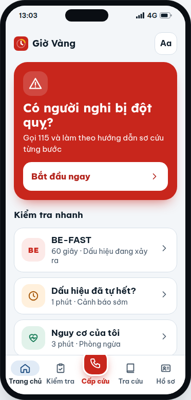
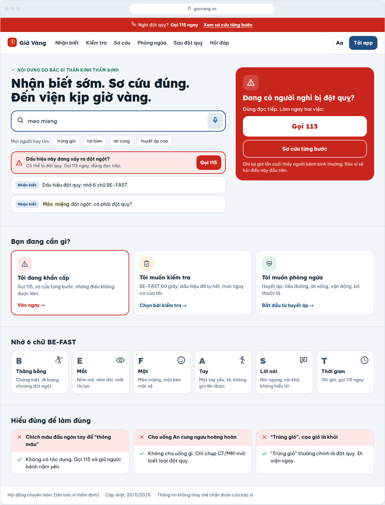
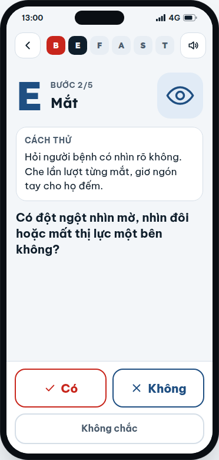
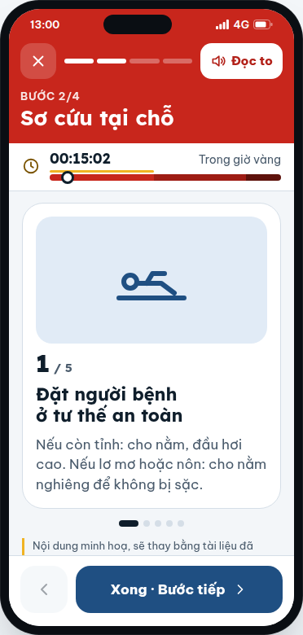
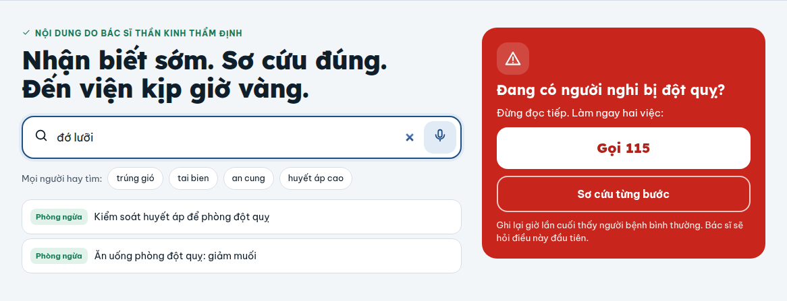
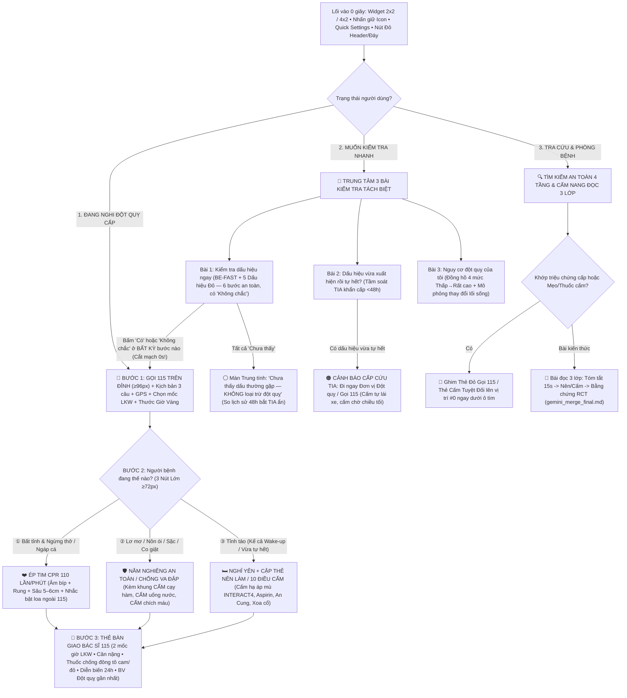

# Báo Cáo Thẩm Định Chéo Thiết Kế UI/UX & Đề Xuất Kiến Trúc Tối Ưu Hợp Nhất

> **Tệp báo cáo:** `gemini_review.md` · **Phiên bản:** `3.0 (Unified UI/UX Blueprint)` · **Ngày thực hiện:** 27/11/2026
> **Người thẩm định:** Gemini (Kiểm định độc lập bằng trình duyệt tự động Playwright/Chromium, công thức tương phản WCAG 2.2 và đối chiếu an toàn lâm sàng)
> **Phạm vi đối chiếu 3 nguồn:**
> 1. Thiết kế UI/UX của **Claude**: [`claude/docs/ui-ux/README.md`](claude/docs/ui-ux/README.md) và [`claude/docs/ui-ux/ban-thiet-ke.html`](claude/docs/ui-ux/ban-thiet-ke.html) (1.583 dòng, gồm tài liệu thiết kế + prototype App & Website).
> 2. Thiết kế UI/UX của **Gemini**: [`gemini/docs/ui-ux/README.md`](gemini/docs/ui-ux/README.md), [`gemini/docs/ui-ux/demo-giao-dien.html`](gemini/docs/ui-ux/demo-giao-dien.html) (2.008 dòng) và 2 ảnh concept trong [`gemini/docs/ui-ux/assets/`](gemini/docs/ui-ux/assets/).
> 3. Báo cáo review của **Claude**: [`claude_review.md`](claude_review.md) (754 dòng, bao gồm cả phần cập nhật *Mục 6.5 Lịch sử kiểm tra*).
> **Nguồn chuẩn y khoa đối chiếu:** [`gemini_merge_final.md`](gemini_merge_final.md) (`v3.0` — bản hợp nhất đã thẩm định chéo với `claude_merge_final.md` và xác minh độc lập văn bản gốc Bộ Y tế `3312/QĐ-BYT` cùng PubMed).

---

## Mục Lục

- [1. Tóm tắt điều hành (Executive Summary)](#1-tóm-tắt-điều-hành-executive-summary)
- [2. Phương pháp kiểm định thực nghiệm hai chiều](#2-phương-pháp-kiểm-định-thực-nghiệm-hai-chiều)
- [3. Bảng chấm điểm đối chiếu công bằng (Đã hiệu chỉnh sau đo đạc thực tế)](#3-bảng-chấm-điểm-đối-chiếu-công-bằng-đã-hiệu-chỉnh-sau-đo-đạc-thực-tế)
- [4. Review chuyên sâu thiết kế UI/UX của Claude (`claude/docs/ui-ux/`)](#4-review-chuyên-sâu-thiết-kế-uiux-của-claude-claudedocsui-ux)
- [5. Tự nhìn nhận thiết kế Gemini & phản biện khách quan `claude_review.md`](#5-tự-nhìn-nhận-thiết-kế-gemini--phản-biện-khách-quan-claude_reviewmd)
- [6. Thiết kế tối ưu hợp nhất (`Unified Gold Standard UI/UX v3.0`)](#6-thiết-kế-tối-ưu-hợp-nhất-unified-gold-standard-uiux-v30)
- [7. Danh mục công việc theo mức ưu tiên & cổng kiểm tra tự động (CI Gates)](#7-danh-mục-công-việc-theo-mức-ưu-tiên--cổng-kiểm-tra-tự-động-ci-gates)
- [8. Kế hoạch kiểm thử khả dụng thực chiến với người cao tuổi & người chăm sóc](#8-kế-hoạch-kiểm-thử-khả-dụng-thực-chiến-với-người-cao-tuổi--người-chăm-sóc)
- [9. Phụ lục: Số liệu đo đạc tự động bằng Playwright trên prototype Claude](#9-phụ-lục-số-liệu-đo-đạc-tự-động-bằng-playwright-trên-prototype-claude)

---

## 1. Tóm Tắt Điều Hành (Executive Summary)

### 1.1. Sự đồng thuận lớn về triết lý sản phẩm
Đặt hai bản thiết kế cạnh nhau, có thể thấy cả **Gemini** và **Claude** đều hội tụ chính xác vào những nguyên lý quan trọng nhất của một sản phẩm y tế khẩn cấp đa thế hệ tại Việt Nam:
- **Kiến trúc giao diện kép (*Dual-State UI*):** Tách bạch rõ trạng thái *Bình tĩnh học & phòng bệnh* với trạng thái *Khẩn cấp cứu não từng phút*.
- **Lấy `BE-FAST` và mốc `Last Known Well (LKW)` làm hạt nhân**, đi kèm cảnh báo trực diện các sai lầm dân gian gây chết người tại Việt Nam (*chích máu ngón tay, tự uống thuốc hạ áp/Aspirin/An Cung Ngưu Hoàng Hoàn, cạo gió, cho uống nước gừng/nước chanh*).
- **Ưu tiên người cao tuổi và người nhà đang hoảng loạn:** Không bắt tạo tài khoản/đăng nhập, hỗ trợ giọng đọc tiếng Việt rảnh tay, đồng hồ nhịp ép tim CPR `110 lần/phút`, Thẻ y tế báo bác sĩ 115, Widget ngoài màn hình chính Android, hoạt động **100% Offline** trên `.apk` từ cùng một nền tảng mã nguồn Web tĩnh + `Capacitor`.

### 1.2. Đánh giá hai chiều khách quan: Ai mạnh ở đâu, ai sót ở đâu?
1. **Về báo cáo [`claude_review.md`](claude_review.md) đối với Gemini:**
   - Claude đã làm một bài kiểm thử rất nghiêm túc và **chỉ ra hoàn toàn xác đáng 6 lỗi an toàn (`G1–G6`) cùng 11 điểm yếu trải nghiệm (`G7–G17`)** trong bản demo đầu tiên của Gemini (như hiển thị sẵn *"Mức 1: Bình thường"* trước khi trả lời, đặt nút *"Gọi 115"* quá thấp trên màn hình di động, gộp đau đầu sét đánh vào nhãn *"Muộn"*, thiếu lựa chọn *"Không chắc"*, dùng emoji thay vì SVG, và gộp kiểm tra cấp tính với nguy cơ nền). Gemini **tiếp thu trọn vẹn 100%** các phát hiện này.
   - Bổ sung mới của Claude ở **Mục 6.5 (Lịch sử kiểm tra)** mang lại một ý tưởng lâm sàng rất đắt giá: **bắt được mẫu triệu chứng "Có rồi tự hết" (nghi TIA) giữa 2 lần kiểm tra trong 48 giờ** và hỗ trợ gợi ý thu hẹp mốc `LKW`.

2. **Về những lỗ hổng nghiêm trọng trong thiết kế của Claude ([`ban-thiet-ke.html`](claude/docs/ui-ux/ban-thiet-ke.html)) và [`claude_review.md`](claude_review.md) mà Claude tự bỏ sót:**
   Khi chạy kiểm thử tự động bằng **Playwright/Chromium** trực tiếp trên mã nguồn [`ban-thiet-ke.html`](claude/docs/ui-ux/ban-thiet-ke.html) và đối chiếu an toàn y khoa, chúng tôi phát hiện **6 lỗi an toàn y khoa & thuật toán nghiêm trọng (`K1–K6`) ngay trong prototype của Claude** (dù Claude tự chấm mình `5/5` ở mục An toàn bài test và `5/5` ở mục Tìm kiếm):
   - **`K1` — Lỗi không cắt mạch cấp cứu trong BE-FAST:** Dù `README.md` và `ban-thiet-ke.html` tuyên bố *"Chỉ một câu Có hoặc Không chắc là chuyển ngay sang màn hình đỏ Gọi 115"*, mã thực tế (`ACT.ans`) **hoàn toàn không dừng lại** mà bắt người nhà đang hoảng loạn phải bấm trả lời hết đủ 5 câu (`B → E → F → A → S`) mới hiện màn hình gọi 115 (trong khi demo Gemini đã cắt mạch thật ngay từ câu đầu).
   - **`K2` — Lỗi hướng dẫn gây ngã chấn thương sọ não ở ngay Câu 1 BE-FAST:** Câu `B — Thăng bằng` hướng dẫn *“Quan sát khi người bệnh **đứng dậy hoặc bước đi vài bước**”*. Bảo người đang nghi đột quỵ tiểu não/liệt nửa người đứng dậy bước đi có nguy cơ cao gây **té ngã đập đầu (xuất huyết nội sọ thứ phát — chống chỉ định tiêm thuốc tiêu sợi huyết!)**.
   - **`K3` — Mất hoàn toàn nút `Gọi 115` ở Bước 2, 3, 4 của luồng Cấp cứu & giấu ép tim CPR tận Bước con 4/5:** Khi sang màn *Sơ cứu tại chỗ*, *Điều không làm* và *Thẻ bác sĩ*, nút `Gọi 115` **biến mất hoàn toàn khỏi màn hình**; đồng thời người bệnh ngừng thở phải bấm qua 3 màn hình kê gối, cởi cúc áo, nhịn ăn uống mới tới được nút nhịp ép tim CPR ở bước `4/5`.
   - **`K4` — Lỗi tìm kiếm nguy hiểm trên từ khóa tiếng Việt đời thường:** Gõ **`"đớ lưỡi"`** không hiện thẻ đỏ 115 mà trả về bài *“Kiểm soát huyết áp”* và *“Giảm muối”* (do từ `'do'` khớp nhầm vào `'đo huyết áp'` và `'chế độ ăn'`); gõ **`"nước gừng"`** trả về bài *“Ép tim CPR”* (do `'gung'` khớp chuỗi con trong `'ngừng thở'`); gõ **`"hạ huyết áp"`** trả về bài hạ áp mạn tính mà không cảnh báo **cấm hạ áp cấp tại nhà (`INTERACT4`)**; gõ **`"co giật"`, `"bất tỉnh"`, `"sặc nước"`, `"khàn tiếng"`, `"aspirin"`, `"tam thất"`, `"nattokinase"`, `"tắm đêm"`** đều **không có thẻ 115 và trả về 0 kết quả**.
   - **`K5` — Nghịch lý biểu tượng `✓ Có` / `✕ Không` & thiếu 5 Dấu hiệu Đỏ ngoài BE-FAST trong bài test:** Dùng dấu tích `✓` cho triệu chứng nguy hiểm (*Có*) và dấu chéo `✕` cho bình thường (*Không*) gây nhầm lẫn nhận thức ở người già; bài test tương tác bỏ sót hoàn toàn *đột ngột sặc/khó nuốt (Wallenberg)*, *vụng 1 bàn tay (hand-knob)* và *đau cổ cấp (bóc tách mạch)*.
   - **`K6` — Độ lệch lớn giữa thông số công bố và CSS thực tế của Claude:** Tài liệu ghi chữ mặc định `18px`, tối thiểu `14px`, nút `≥48px`; nhưng CSS thực tế của Claude đặt `.ui` gốc ở **`16px`** và `.site` (Website) ở **`15px`** (nhỏ hơn cả `16px` của Gemini), sinh ra hàng loạt chữ `11,6px – 13,8px` và các nút cao chỉ `29px – 44px`.
   - **Ngoài ra trong Mục 6.5 (Lịch sử kiểm tra) của `claude_review.md`:** Có **3 điểm rủi ro thiết kế/kỹ thuật cần chỉnh lại** trước khi lập trình: (1) Tự động chọn sẵn tên người của lần kiểm tra trước trên điện thoại dùng chung dễ gây **nhiễm chéo hồ sơ thuốc chống đông và lịch sử giữa Bố/Mẹ/Con**; (2) Xếp cơn TIA vừa xảy ra chỉ ưu tiên nút *"Bệnh viện gần nhất"* thay vì cảnh báo cấp cứu khẩn ngang đột quỵ cấp; (3) Đề xuất nhúng thư viện C++ `SQLCipher` làm phình kích thước `.apk` thêm `6–12 MB` và tiềm ẩn lỗi `16 KB page size` trên Android 15+, trong khi `AndroidKeyStore` AES-256-GCM thuần Kotlin đạt chuẩn mã hóa phần cứng với `0 KB` thư viện ngoài.

### 1.3. Định hướng hợp nhất tối ưu (`v3.0`)
Thay vì lấy nguyên khung của một bên, bản **Thiết kế Tối ưu Hợp nhất (`v3.0`)** ở Mục 6 kết hợp:
- **Từ Claude:** Đưa nút `Gọi 115` (`≥96px`) + Kịch bản nói chuyện + GPS lên đỉnh màn hình cấp cứu; Thước Giờ Vàng trực quan (`0–4,5h` / `4,5–24h` / `>24h`); quy tắc không bao giờ trấn an sai + tùy chọn *"Không chắc"*; Thẻ hành động 3 cấp cảm hứng NHS; 4 lối vào ngoài App Android; và cơ chế lưu Lịch sử bắt mẫu *"Có rồi tự hết"* (đã vá lỗi nhiễm chéo người dùng).
- **Từ Gemini:** Cổng phân nhánh tình huống thực tế ngay lập tức (đưa Ngừng thở/CPR và Nôn/Lơ mơ/Co giật lên ngay 1 chạm đầu tiên); cặp thẻ song song **`✅ Việc cần làm ngay` / `⛔ Tuyệt đối cấm`** gắn trực tiếp trên từng bước sơ cứu; cơ chế **cắt mạch thật sự** ngay câu dương tính đầu tiên; 5 Dấu hiệu Đỏ ngoài BE-FAST tương tác; kiến trúc bài viết **Đọc 3 Lớp**; 4 chế độ hiển thị hoạt động thực chất (*Theo máy · Ấm dịu chống chói thủy tinh thể · Tương phản cao AAA · Ban đêm*); Thẻ bác sĩ có **cân nặng** tính liều tiêu sợi huyết; và kho tri thức đầy đủ từ [`gemini_merge_final.md`](gemini_merge_final.md).

---

## 2. Phương Pháp Kiểm Định Thực Nghiệm Hai Chiều

Để đảm bảo tính công bằng tuyệt đối và không đánh giá cảm tính qua lời mô tả trong `README.md`, chúng tôi thực hiện cùng một quy trình kiểm định tự động hai chiều:

| Bước kiểm định | Công cụ & Tham số thực hiện | Nội dung đo đạc cụ thể |
| :--- | :--- | :--- |
| **1. Kiểm thử DOM & Trình duyệt thực** | `Playwright` + `Google Chrome Headless` ở `1366×900` (Desktop) và `390×844` (Mobile), chế độ Sáng/Tối, tỷ lệ chữ `1.0×` và `1.3×` | Đo `fontSize` thực tế của từng nút văn bản hiển thị, kích thước hộp chạm `getBoundingClientRect()`, độ tràn ngang `scrollWidth - clientWidth`, lỗi `pageerror` JavaScript. |
| **2. Kiểm thử máy trạng thái (State Machine)** | Giả lập thao tác bấm người dùng trên cả 2 prototype | Bấm `"Có"` và `"Không chắc"` ở Bước 1 BE-FAST xem có cắt mạch không; đếm số lần chạm để mở nhịp ép tim CPR khi bệnh nhân ngừng thở; kiểm tra tồn tại của nút `Gọi 115` qua từng bước cấp cứu. |
| **3. Stress-test Bộ tìm kiếm tiếng Việt** | Chạy tự động **19 truy vấn thực tế** (có dấu & không dấu, từ dân gian, triệu chứng hố sau, thuốc cấm) | Kiểm tra: (1) Có bật thẻ đỏ `Gọi 115` khi gõ triệu chứng nguy kịch không? (2) Có khớp nhầm sang bài phòng ngừa mạn tính khi gõ thuốc cấm/triệu chứng cấp không? |
| **4. Kiểm toán Tương phản WCAG 2.2** | Công thức độ chói tương đối chuẩn W3C ở cả Light Mode & Dark Mode | Đo tỷ lệ tương phản thực tế so với ngưỡng AA (`4,5:1` chữ thường, `3,0:1` chữ lớn) và AAA (`7,0:1`). |
| **5. Thẩm định An toàn Y khoa** | Đối chiếu từng câu hướng dẫn trên UI với [`gemini_merge_final.md`](gemini_merge_final.md) | Rà soát nguy cơ gây té ngã khi khám tại nhà, nguy cơ móc họng mù, nguy cơ trấn an sai khi âm tính giả hoặc TIA tự hết, và tính chính xác pháp lý (`QĐ 3312/QĐ-BYT`). |

---

## 3. Bảng Chấm Điểm Đối Chiếu Công Bằng (Đã Hiệu Chỉnh Sau Đo Đạc Thực Tế)

*(Thang điểm `1–5` chấm nghiêm ngặt dựa trên **hành vi thực tế của mã nguồn đang chạy**, kèm mục tiêu `5/5` của Thiết kế Hợp nhất `v3.0`)*

| Tiêu chí đánh giá | Demo Gemini (`v2.0`) | Prototype Claude (`v0.1`) | Thiết kế Hợp nhất (`v3.0`) | Giải thích khách quan sau kiểm thử hai chiều |
| :--- | :---: | :---: | :---: | :--- |
| **1. An toàn câu chữ kết quả & tùy chọn trả lời** | 2 | **4** *(Claude tự chấm 5)* | **5** | Gemini lỗi hiện sẵn *"Bình thường"* (`G1`) và thiếu *"Không chắc"* (`G3`). Claude làm tốt câu chữ âm tính & *"Không chắc"*, nhưng dùng icon `✓ Có` / `✕ Không` ngược ngữ nghĩa (`K5`). |
| **2. Cơ chế cắt mạch cấp cứu & an toàn thao tác khám** | **4** | **2** *(chưa chấm ở review cũ)* | **5** | Gemini **cắt mạch thật** ngay câu 1 và khám an toàn; Claude **quên lập trình cắt mạch** (bấm `"Có"` ở câu 1 vẫn bắt làm hết 5 câu — `K1`) và xúi người bệnh **đứng dậy bước đi** dễ té đập đầu (`K2`). |
| **3. Độ phủ triệu chứng ngoài BE-FAST (Tuần hoàn sau/SAH)** | **4** | 2 | **5** | Gemini có đủ 5 Dấu hiệu Đỏ tương tác + đưa vào bài test (nhưng gán nhầm nhãn *"Muộn"* — `G4`). Bài test của Claude chỉ hỏi 5 chữ BE-FAST, bỏ lọt *khó nuốt/sặc Wallenberg*, *vụng 1 tay*, *đau cổ bóc tách*. |
| **4. Tốc độ & tính liên tục của nút `Gọi 115`** | 2 | **3,5** *(Claude tự chấm 4)* | **5** | Gemini đặt nút `115` quá thấp (`G5`). Claude đặt nút `115` to trên đỉnh Bước 1 rất tốt, nhưng sang Bước 2, 3, 4 thì **nút `115` biến mất hoàn toàn** (`K3`). Bản `v3.0` giữ nút `115` cố định ở mọi bước. |
| **5. Luồng sơ cứu theo tình trạng bệnh nhân (CPR/Đường thở)** | **4** | 2,5 | **5** | Gemini cho chọn thẳng tình huống *Ngừng thở (CPR)*, *Nôn/Lơ mơ*, *Co giật*. Claude đi tuyến tính cứng nhắc, giấu nhịp ép tim CPR tận bước `4/5` sau khi kê gối & cởi áo (`K3`). |
| **6. Rào chắn chống sai lầm dân gian (`Nên làm` / `Cấm`)** | **5** | 3 | **5** | Gemini đặt khung `✅ Việc cần làm` và `⛔ Tuyệt đối cấm` ngay trên từng thẻ sơ cứu; Claude tách *Điều không làm* sang tận màn Bước 3 riêng biệt, người dùng dễ bỏ qua. |
| **7. Đồng hồ khởi phát `LKW` & Thước Giờ Vàng** | 2 | **5** | **5** | Claude thiết kế Thước Giờ Vàng (`0–4,5h` / `4,5–24h` / `>24h` + `"Không rõ"`) trực quan, chính xác hơn hẳn bộ đếm phút đơn giản của Gemini (`G6, G13`). |
| **8. Độ chính xác & an toàn của Bộ tìm kiếm** | 2 | **3** *(Claude tự chấm 5)* | **5** | Gemini bị nhảy trang & thiếu từ đồng nghĩa (`G7, G8`). Claude hiện tại chỗ tốt nhưng lỗi khớp từ nghiêm trọng: gõ `"đớ lưỡi"` ra bài *giảm muối*, `"nước gừng"` ra *CPR*, `"hạ huyết áp"` ra *hạ áp mạn*, `"co giật/sặc nước/tam thất"` ra `0` kết quả (`K4`). |
| **9. Cấu trúc đọc bài viết tra cứu (3 lớp)** | **5** | 3,5 | **5** | Kiến trúc **Đọc 3 lớp** của Gemini (*Tóm tắt 15s → Nên/Cấm → Bằng chứng RCT mở rộng*) phục vụ trọn vẹn cả cụ già mỏi mắt lẫn bác sĩ/người trẻ muốn tra nguồn. |
| **10. Lưu lịch sử kiểm tra & bắt mẫu TIA "Có rồi hết"** | 1 | 1 *(Mục 6.5 mới ở mức đặc tả)* | **5** | Cả hai prototype đều chưa lưu lịch sử. Đặc tả Mục 6.5 của Claude rất sáng tạo nhưng cần sửa lỗi *chọn sẵn người lần trước* gây nhầm hồ sơ gia đình và thay `SQLCipher` bằng `AndroidKeyStore`. |
| **11. Trợ năng chữ viết, vùng chạm & chế độ hiển thị** | 3 | 3 | **5** | Gemini có 3 chế độ màu hoạt động thật (*Ấm dịu, Tương phản cao, Ban đêm*) nhưng còn chữ `12–13px` & nút `38px`. Claude chữ thẻ to hơn nhưng `.site` gốc chỉ `15px`, còn chữ `11,6–13px`, nút `29–40px` và công tắc *Tương phản cao* chưa chạy. |
| **12. Hệ thống biểu tượng & minh họa sơ cứu** | 2,5 | **4** | **5** | Claude dùng bộ icon nét SVG đồng bộ, sạch đẹp hơn emoji của Gemini (`G14`); tuy nhiên hình vẽ tư thế ở cả hai bên đều cần vẽ lại chuẩn giải phẫu y khoa người Việt. |
| **13. Tính năng đặc thù Android `.apk` & Thẻ Bác Sĩ** | **4,5** | **4,5** | **5** | Gemini có Thẻ y tế lưu `localStorage` kèm **cân nặng** (tính liều tiêu sợi huyết) + Widget `4×2` + SMS vị trí. Claude có bộ 4 lối vào ngoài App (*Widget 2×2, Shortcuts, Quick Settings, Lock screen*) + chia sẻ Zalo. |

---

## 4. Review Chuyên Sâu Thiết Kế UI/UX Của Claude (`claude/docs/ui-ux/`)

| Trang chủ App trong prototype Claude (`#phone`) | Giao diện Website Mockup của Claude (`.site`) |
| :---: | :---: |
|  |  |

### 4.1. Chín ưu điểm xuất sắc của Claude cần kế thừa trọn vẹn

1. **Ưu tiên tuyệt đối cho nút `Gọi 115` ở màn hình Bước 1 Cấp cứu:** Nút gọi cao `116px`, chiếm trọn chiều ngang ngay đầu màn hình (`y ≈ 180px`, không cần cuộn), đi kèm **kịch bản 3 câu đọc thẳng cho tổng đài viên** và dòng địa chỉ GPS chữ rõ ràng.
2. **Thước Giờ Vàng (`Golden Hour Ruler`) xuất sắc về mặt truyền thông y khoa:** Biểu diễn trực quan mốc `0 – 4,5 giờ` (viền vàng), `4,5 – 24 giờ` (*"Còn cơ hội"* — tránh tuyệt đối chữ *"Bình thường"*) và `> 24 giờ` (*"Muộn — vẫn phải đi viện ngay"*), kèm tùy chọn `"Không rõ"` nhắc báo bác sĩ giờ đi ngủ.
3. **Thiết kế câu chữ kết quả âm tính chuẩn mực an toàn:** Không bao giờ dùng từ *"Bình thường / Ổn / Không bị đột quỵ"*; luôn ghi rõ *"Chưa thấy dấu hiệu BE-FAST. Kết quả này không loại trừ đột quỵ"* và xếp 3 thẻ hành động theo thứ tự ưu tiên từ đỏ xuống xanh.
4. **Có nút trả lời `"Không chắc"` và xử lý ngang mức cảnh báo dương tính:** Giải quyết đúng tâm lý lưỡng lự của người nhà khi thấy người thân nói hơi đớ nhẹ hoặc cười hơi lệch nhưng không dám khẳng định.
5. **Tách bạch 3 bài kiểm tra theo đúng ngữ cảnh người dùng:** (1) *BE-FAST 60 giây* (đang có dấu hiệu), (2) *Dấu hiệu đã tự hết?* (nghi TIA trong 24–48h qua), và (3) *Nguy cơ của tôi* (phòng ngừa dài hạn, có công tắc *"Thử thay đổi, xem nguy cơ giảm"* rất giàu tính giáo dục hành vi).
6. **Trải nghiệm tìm kiếm hiện kết quả ngay tại chỗ + dải giải thích từ đồng nghĩa:** Hiển thị thẻ vàng *"Đã hiểu: trúng gió thường là đột quỵ"* giúp giáo dục người dùng ngay trong tích tắc gõ phím, đồng thời trên di động có thanh 2 nút cố định dưới đáy Website (`Gọi 115 | Sơ cứu`).
7. **Hệ thống biểu tượng SVG nét `2px` sạch sẽ, nhất quán, `aria-hidden="true"` chuẩn chỉnh:** Không phụ thuộc phông emoji của từng hãng điện thoại Android và không làm nhiễu trình đọc màn hình TalkBack, đồng thời tôn trọng `prefers-reduced-motion` và `prefers-color-scheme: dark`.
8. **Tư duy "4 lối vào không cần mở App" trên Android:** Khai thác rất tốt hệ điều hành Android gồm *Widget 2×2*, *App Shortcuts* (nhấn giữ biểu tượng ứng dụng), *Quick Settings Tile* (vuốt thanh cài đặt nhanh) và *Thẻ y tế trên màn hình khóa*.
9. **Kỷ luật câu hỏi kiểm duyệt thiết kế:** Mỗi nguyên tắc thiết kế đều đi kèm một câu hỏi kiểm tra nhị phân ngắn gọn giúp đội lập trình tự rà soát mọi màn hình mới.

### 4.2. Sáu lỗi an toàn y khoa & thuật toán nghiêm trọng trong prototype Claude (`K1–K6`) cần khắc phục ngay

Đây là các lỗi phát hiện trực tiếp khi chạy kiểm thử thực nghiệm trên [`ban-thiet-ke.html`](claude/docs/ui-ux/ban-thiet-ke.html) mà bản tự đánh giá trong [`claude_review.md`](claude_review.md) chưa nhận ra:

| Mã | Lỗi phát hiện trong [`ban-thiet-ke.html`](claude/docs/ui-ux/ban-thiet-ke.html) | Bằng chứng mã nguồn & đo đạc Playwright | Hậu quả thực tế lúc cấp cứu | Giải pháp khắc phục triệt để ở bản Hợp nhất `v3.0` |
| :--- | :--- | :--- | :--- | :--- |
| **`K1`** | **Bài kiểm tra BE-FAST KHÔNG hề cắt mạch khi bấm `"Có"` hoặc `"Không chắc"`** (trái ngược hoàn toàn với mô tả trong `README.md` dòng 46 và `ban-thiet-ke.html` dòng 835) | Tại hàm `ACT.ans` (dòng 1524): `if(S.bfi<BF.length-1){S.bfi++; render();}`. Khi bấm `"Có"` ở Bước 1 (`B`), màn hình vẫn chuyển sang Bước 2 (`E`), Bước 3 (`F`), Bước 4 (`A`), Bước 5 (`S`) rồi mới báo gọi 115! | Bắt người nhà đang đứng cạnh bệnh nhân đột quỵ cấp phải làm thêm **4 bài khám thừa** (che từng mắt, cười, đếm 10 giây giơ tay, đọc câu mẫu), làm mất thời gian vàng vô ích. | Áp dụng cơ chế **Cắt mạch tức thì (`Smart Short-Circuit`)** như mã của Gemini: hễ bấm `"Có"` hoặc `"Không chắc"` ở bất kỳ bước nào là chuyển thẳng sang màn hình Đỏ `Gọi 115` trong `0 giây` (vẫn có liên kết nhỏ *"Ghi nhận thêm dấu hiệu khác cho bác sĩ"* không chặn cuộc gọi). |
| **`K2`** | **Câu 1 BE-FAST (`B — Thăng bằng`) xúi người đang nghi đột quỵ "đứng dậy hoặc bước đi vài bước"** | Mảng `BF[0].how` (dòng 903): *“Quan sát khi người bệnh đứng dậy hoặc bước đi vài bước.”* | Bệnh nhân đột quỵ tiểu não/thân não hoặc yếu kín đáo nửa người khi cố đứng dậy đi thử rất dễ **ngã đập đầu xuống nền cứng**, gây chấn thương sọ não / xuất huyết nội sọ thứ phát — biến một ca nhồi máu đáng lẽ tiêm được tiêu sợi huyết thành **chống chỉ định tiêu sợi huyết**! | **Cấm tuyệt đối hướng dẫn bệnh nhân đứng dậy đi thử!** Giữ người bệnh ngồi tựa hoặc nằm yên, đổi câu hỏi thành: *“Người bệnh có đột ngột thấy chóng mặt xoay tròn, ngồi không vững hoặc vừa đi loạng choạng trước đó không?”* |
| **`K3`** | **Nút `Gọi 115` biến mất hoàn toàn ở Bước 2, 3, 4 của luồng Cấp cứu; đồng thời Ép tim CPR bị chôn ở bước con `4/5`** | Hàm `R.aid`, `R.dont`, `R.ho` (dòng 1005–1026) ẩn thanh điều hướng đáy và không có bất kỳ nút `115` nào. Trong `R.aid`, nút nhịp ép tim `110 BPM` nằm tận `AID[3]` (bước `4/5`). | (1) Nếu người dùng vào thẳng *"Sơ cứu ngay"* từ lối tắt icon / Quick Settings mà chưa gọi 115, họ **không có nút nào để gọi 115** ở suốt 3 màn hình sau!<br>(2) Nếu người bệnh **ngừng thở / thở ngáp cá**, người nhà phải đọc qua 3 thẻ *Đặt tư thế → Cởi cúc áo → Không ăn uống* (5 lần chạm) mới thấy nút ép tim CPR! | (1) Ghim cố định nút đỏ **`📞 Gọi 115`** (`≥48px`) trên thanh đầu của **mọi bước** trong chế độ khẩn cấp.<br>(2) Đưa cổng phân nhánh 3 trạng thái (*① Bất tỉnh ngừng thở → CPR ngay lập tức · ② Lơ mơ/Nôn/Co giật → Nằm nghiêng · ③ Tỉnh táo*) lên ngay đầu luồng sơ cứu. |
| **`K4`** | **Bộ tìm kiếm khớp sai nguy hiểm với từ khóa triệu chứng & thuốc cấm phổ biến tại Việt Nam** | Kiểm thử Playwright trên `#s-q`:<br>• Gõ **`"đớ lưỡi"`** → Không hiện thẻ 115, ra bài *Kiểm soát huyết áp* & *Giảm muối* (do `'do'` khớp nhầm `'đo huyết áp'`, `'chế độ ăn'`).<br>• Gõ **`"nước gừng"`** → Ra bài *Ép tim CPR* (do `'gung'` khớp chuỗi con trong `'ngừng thở'`).<br>• Gõ **`"hạ huyết áp"`** → Ra bài hạ áp mạn tính, không cảnh báo cấm hạ áp cấp.<br>• Gõ **`"co giật"`, `"bất tỉnh"`, `"sặc nước"`, `"khàn tiếng"`, `"aspirin"`, `"tam thất"`, `"nattokinase"`, `"tắm đêm"`** → Không có thẻ 115, `0` kết quả! | Người nhà thấy bệnh nhân đớ lưỡi hoặc huyết áp vọt `200 mmHg` lên web gõ tìm sẽ nhận kết quả sai hoàn toàn (thậm chí hiểu nhầm cần uống thuốc hạ huyết áp ngay — gây hại `OR 1,30` theo `INTERACT4`!). | Thiết kế lại **Bộ tìm kiếm An toàn Y khoa 4 tầng**: so khớp theo **ranh giới âm tiết nguyên vẹn** (cấm khớp chuỗi con `'gung'` trong `'ngung'` hay từ đơn 2 ký tự `'do'`), bổ sung **Bộ chặn Cảnh báo Đỏ cho cả Triệu chứng cấp (`≥40` mẫu) lẫn Mẹo/Thuốc cấm (`13` mẫu)** ưu tiên lên vị trí `#0` trước mọi bài phòng ngừa. |
| **`K5`** | **Nghịch lý biểu tượng `✓ Có` / `✕ Không` & bỏ sót 5 Dấu hiệu Đỏ ngoài BE-FAST trong bài test** | `R.bf` (dòng 1037) vẽ nút đỏ **`✓ Có`** và nút xanh lam **`✕ Không`**. Mảng `BF` chỉ có 5 câu `B–E–F–A–S`; ngay cả thẻ lưu ý ở màn âm tính cũng thiếu *khó nuốt/sặc (Wallenberg)*, *vụng 1 bàn tay (hand-knob)* và *đau 1 bên cổ cấp (bóc tách mạch)*. | Người lớn tuổi quen nhìn dấu tích `✓` là *"Tốt / Đạt"* và dấu chéo `✕` là *"Sai / Có bệnh"*, rất dễ bấm ngược trong lúc luống cuống. Đồng thời bỏ lọt các thể đột quỵ thân não và vỏ não khu trú không có dấu BE-FAST. | Bỏ hoàn toàn cặp icon `✓`/`✕` trên nút trả lời triệu chứng (dùng chấm tròn trạng thái hoặc mũi tên cảnh báo `! Có dấu hiệu` vs `○ Chưa thấy`); bổ sung **Bước 6 rà soát 5 Dấu hiệu Đỏ ngoài BE-FAST** vào luồng kiểm tra. |
| **`K6`** | **Thao tác xử trí miệng ở Bước 2 sơ cứu thiếu rào chắn chống móc họng mù** | `AID[1]` (dòng 890): *“Lấy răng giả hoặc thức ăn còn trong miệng ra.”* — không kèm điều kiện an toàn và không có khung *Cấm làm* đi kèm. | Người nhà thấy bệnh nhân co giật hoặc nghiến răng dễ hiểu thành phải **cạy hàm hoặc thọc sâu ngón tay vào họng móc đờm/thức ăn**, gây đẩy dị vật bít thanh quản, chấn thương răng hàm hoặc đứt ngón tay. | Mọi thẻ sơ cứu bắt buộc đi kèm khung **`⛔ Tuyệt đối cấm`** ngay bên dưới: ghi rõ *“Chỉ lấy răng giả bị lỏng ở ngoài nếu dễ lấy; CẤM cạy răng, CẤM nhét bất kỳ vật gì vào miệng hay móc tay sâu vào họng”*. |

| Bằng chứng `K1` & `K5`: Bấm *"Có"* ở Bước 1 (`B` đã tô đỏ) nhưng không cắt mạch, kèm icon `✓ Có` / `✕ Không` | Bằng chứng `K3`: Màn *Sơ cứu tại chỗ* mất hẳn nút `Gọi 115`, thiếu khung *Điều cấm*, giấu CPR ở bước `4/5` |
| :---: | :---: |
|  |  |


*Hình trên — Bằng chứng `K4`: Gõ `"đớ lưỡi"` trên Website Claude không bật thẻ đỏ `Gọi 115` mà trả về 2 bài Phòng ngừa huyết áp và Giảm muối (do từ `'do'` khớp nhầm vào `'đo huyết áp'` và `'chế độ ăn'`).*

### 4.3. Bảy điểm lệch thông số & hạn chế trải nghiệm khác trong thiết kế Claude

1. **Cỡ chữ thực tế nhỏ hơn đáng kể so với tài liệu công bố:** `README.md` của Claude ghi chữ nội dung mặc định `18sp` và chú thích tối thiểu `14sp`. Thực tế đo bằng Playwright trên [`ban-thiet-ke.html`](claude/docs/ui-ux/ban-thiet-ke.html):
   - Khung App (`.ui`, dòng 117) đặt gốc `16px`, sinh ra **chữ `12px`** ở Thẻ bác sĩ (`.ticks`: *0 giờ / 4,5 giờ / 24 giờ*) và màn Kiểm tra (`.p-mr`), cùng **3 đến 13 đoạn chữ `13px`** trên toàn bộ 11 màn hình App.
   - Khung Website (`.site`, dòng 476) đặt gốc chỉ **`15px`** (nhỏ hơn cả mức `16px` của Gemini!), khiến **33 đoạn văn bản chỉ đạt `15px`** và **42 phần tử rơi xuống `11,6px – 14,3px`**.
2. **Nhiều vùng chạm dưới chuẩn `48px` trên cả App lẫn Website:** Ngoài các nút `36–40px` mà Claude đã tự nhận (`C5`), Playwright còn ghi nhận nút *"Xem sơ cứu từng bước"* trên dải đỏ đầu Website cao chỉ **`29px`**, 4 nút gợi ý tìm kiếm trên Website cao **`34px`**, nút đóng cấp cứu `✕` và nút `Đọc to` trên toàn bộ luồng khẩn cấp chỉ đạt **`44px`** (thấp hơn chuẩn `48dp` tối thiểu và `72dp` nhịp khẩn do chính Claude đề ra).
3. **Thẻ sơ cứu thiếu minh họa rõ nghĩa:** Ở `AID[0]`, một biểu tượng người que trừu tượng duy nhất (`lying`) phải gánh cùng lúc hai tư thế trái ngược (*nằm ngửa đầu hơi cao* và *nằm nghiêng chống sặc*), người cao tuổi nhìn vào không thể làm theo chính xác.
4. **Thẻ thông tin cho bác sĩ thiếu trường Cân nặng ước tính:** Trong cấp cứu nhồi máu não cấp, liều `Tenecteplase (0,25 mg/kg)` và `Alteplase (0,9 mg/kg)` tính chặt theo kilôgam cân nặng — chi tiết này đã có trong Thẻ bác sĩ của Gemini và cần bổ sung sang thẻ của Claude.
5. **Công tắc "Tương phản cao" mới là nút giả lập (`aria-pressed`), chưa có bảng màu CSS thật** và chưa có chế độ nền kem ấm chống lóa thủy tinh thể như Gemini.
6. **Chưa tích hợp `Screen Wake Lock API`** trong mã JavaScript và **phông chữ vẫn gọi trực tuyến từ `fonts.googleapis.com`** (y hệt điểm Claude phê bình demo Gemini ở mục `4.4`).
7. **Tải 2 họ phông chữ (`Lexend` + `Be Vietnam Pro` với 9 biến thể độ đậm):** Làm tăng dung lượng tải trang và kích thước gói tài nguyên offline không cần thiết, trong khi riêng `Be Vietnam Pro` ở độ đậm `700–800` đã hiển thị tiêu đề tiếng Việt cực kỳ khỏe khoắn và rõ dấu.

---

## 5. Tự Nhìn Nhận Thiết Kế Gemini & Phản Biện Khách Quan `claude_review.md`

### 5.1. Mười giá trị cốt lõi từ thiết kế của Gemini cần giữ vững
1. **Tư duy sơ cứu phân nhánh theo đúng bệnh cảnh thực tế trước mắt** (*Ngừng thở/ngáp cá, Lơ mơ/nôn/bất tỉnh còn thở, Đang co giật, Ngủ dậy mới thấy [Wake-up], Triệu chứng vừa tự hết [TIA], Tỉnh táo*).
2. **Cấu trúc đối xứng trực diện `✅ Việc cần làm ngay` cạnh `⛔ Tuyệt đối cấm` ngay trên từng thẻ sơ cứu**, giúp chặn đứng hành vi chích máu, nhét thuốc hạ áp, đút An Cung hay nước gừng ngay tại màn hình người nhà đang đọc.
3. **Cơ chế Cắt mạch cấp cứu (`Smart Short-Circuit`) hoạt động thật trong mã nguồn**, kết hợp đồng hồ đếm ngược 10 giây giơ hai tay có tiếng bíp và câu đọc mẫu tiếng Việt ngay trong thẻ hỏi.
4. **Độ phủ lâm sàng sâu sắc cho 5 Dấu hiệu Đỏ ngoài BE-FAST** (*Đau đầu sét đánh SAH, Khó nuốt/sặc/khàn tiếng Wallenberg, Vụng đơn độc 1 bàn tay hand-knob, Lú lẫn/ngủ gà/bỏ quên nửa không gian, Đau 1 bên cổ cấp ở người trẻ*).
5. **Kiến trúc bài viết "Đọc 3 Lớp" (`15 giây tóm tắt → Hành động chuẩn → Bằng chứng lâm sàng mở rộng`)** giải quyết triệt để mâu thuẫn giữa *người già cần ngắn gọn dễ hiểu* và *người trẻ/nhân viên y tế muốn kiểm chứng tới tận thử nghiệm RCT*.
6. **Ba chế độ hiển thị hoạt động thực tế bằng CSS Custom Properties:** *Ấm dịu (`#FAF9F6` giảm lóa đục thủy tinh thể)* · *Rõ nét tương phản cao (`#000000` trên `#FFFFFF` viền đậm cho ngoài trời nắng)* · *Ban đêm (`#11191E` không ánh tím)*.
7. **Thẻ Báo Bác Sĩ 115 lưu bền vững trên máy (`localStorage`), có sẵn trường Cân nặng ước tính và Thuốc chống đông tô đỏ.**
8. **Mẫu Widget Android `4×2` đa năng** tích hợp cả nút *Sơ cứu + Loa đọc*, *115 & Thẻ y tế* và *Test nhanh*.
9. **Bố cục Hero Website chia đôi 2 luồng ý định rõ rệt** + dãy Chip chủ đề nóng chạm 1 lần không cần gõ bàn phím.
10. **Kho nội dung kiểm chứng phong phú** bao phủ đủ cả `INTERACT4` (cấm hạ áp ngoại viện), `ANGONG TRIAL` (An Cung), `NAPS` (Nattokinase), *tắm đêm & 14 yếu tố châm ngòi*, *cửa sổ mô học 24 giờ*.

### 5.2. Tiếp thu trọn vẹn các lỗi của bản Demo & Ảnh Concept Gemini (`G1–G17`)
Gemini xác nhận toàn bộ các lỗi an toàn và trải nghiệm mà [`claude_review.md`](claude_review.md) đã đo đạc trên [`demo-giao-dien.html`](gemini/docs/ui-ux/demo-giao-dien.html) là **hoàn toàn chính xác và bắt buộc phải loại bỏ trong sản phẩm thật**:
- **Loại bỏ triệt để 6 lỗi an toàn (`G1–G6`):** Không bao giờ hiển thị trạng thái mặc định *"Mức 1: Bình thường"* khi chưa trả lời (`G1`); bổ sung tuyên bố *"Kết quả không loại trừ đột quỵ"* vào mọi màn âm tính (`G2`); thêm lựa chọn *"Không chắc"* (`G3`); tách rời hoàn toàn **Trục Mức Độ Nặng** khỏi **Trục Thời Gian LKW** để không bao giờ gọi đau đầu sét đánh là *"Muộn"* (`G4`); đưa nút `Gọi 115` lên vị trí số 1 trên đỉnh màn hình không cần cuộn (`G5`); và thay bộ đếm phút đơn giản bằng Thước Giờ Vàng chuẩn hóa (`G6`).
- **Khắc phục toàn bộ 11 điểm yếu UX & kỹ thuật (`G7–G17`):** Giữ ô tìm kiếm cố định hiện kết quả tại chỗ, mở rộng từ điển đồng nghĩa (`"te tay"`, `"tai bien"`), tách riêng bài *Kiểm tra dấu hiệu cấp* với bài *Nguy cơ của tôi*, bỏ nút *"Tình huống trước / tiếp theo"*, đổi hẳn giao diện đỏ tối giản khi vào chế độ Khẩn cấp kèm `WakeLock` thật, thay toàn bộ emoji bằng bộ icon SVG nét `2px`, kiểm tra giọng đọc `vi-VN` trước khi phát, nâng toàn bộ cỡ chữ tối thiểu lên `≥14px` (nội dung `18px`), vùng chạm `≥48–56px`, và làm đậm mã màu Xanh ngọc (`#115E59`) / Đỏ (`#B91C1C`) để đạt chuẩn tương phản thực chất.
- **Quy ước rõ vai trò của 2 ảnh AI Concept (`website-ui-concept.jpg`, `android-app-screens.jpg`):** Hai ảnh này chỉ đóng vai trò phác thảo cảm hứng màu sắc ban đầu; **tuyệt đối không dùng làm bản vẽ kỹ thuật cho lập trình viên** do chứa các chi tiết sai lệch của mô hình sinh ảnh (*nút "CÓ" màu xanh lá, đồng hồ đếm ngược `0:58:12` gây tâm lý bỏ cuộc, câu chữ "đầu thấp hơn thân"*).

### 5.3. Phản biện & hiệu đính 4 điểm quan trọng trong `claude_review.md`

Bên cạnh những nhận xét rất xác đáng của Claude, có **4 điểm trong [`claude_review.md`](claude_review.md) cần được hiệu đính lại** để đội phát triển không đi chệch hướng:

1. **Hiệu đính pháp lý & nguồn chuẩn y khoa duy nhất (Mục `4.6` và `6.8` của `claude_review.md`):**
   - Claude viết: *“Việc Quyết định 3312 thay thế 5331 cũng chưa được xác minh”* và đề xuất chỉ lấy nội dung từ `claude_merge_final.md`.
   - **Sự thật đã xác minh:** Trong [`gemini_merge_final.md`](gemini_merge_final.md) (`v3.0`), chúng tôi đã tra cứu nguyên văn **Điều 1, Điều 2 và Điều 3 Quyết định số 3312/QĐ-BYT ngày 05/11/2024 của Bộ Y tế** (do Thứ trưởng Trần Văn Thuấn ký), khẳng định văn bản này chính thức thay thế `Quyết định 5331/QĐ-BYT (2020)` (trong đó tiêu sợi huyết tĩnh mạch mở rộng `4,5–9 giờ` theo hình ảnh học và lấy huyết khối cơ học mở tới `6–24 giờ` ở ca chọn lọc; còn tiêu sợi huyết `4,5–24 giờ` là dữ liệu từ các RCT mới `TRACE-III` / `OPTION 2026`). Do [`gemini_merge_final.md`](gemini_merge_final.md) đã tích hợp đủ 5 hiệu đính thống kê của Claude, xóa sạch mọi nhãn `[BS, chưa kiểm]` bằng PubMed và giữ đầy đủ 14 cấp độ bệnh sinh + Quy tắc Ottawa SAH + bảng 6 cột kiểm chứng 13 mẹo Đông y/TPCN, **nguồn tri thức chuẩn duy nhất (SSOT) cho sản phẩm nên dùng [`gemini_merge_final.md`](gemini_merge_final.md)** (đồng thời tách đúng trích dẫn `58,7%` độ nhạy FAST tuần hoàn sau về đoàn hệ PCS thay vì gán cho `Aroor 2017`).

2. **Sửa lỗi "Chọn sẵn người của lần trước" (`6.5.4`) trong Mục `6.5 Lịch sử kiểm tra` — Tránh nhiễm chéo hồ sơ sinh tử trong gia đình Việt Nam:**
   - Ý tưởng lưu lịch sử để bắt mẫu **"Có dấu hiệu rồi tự hết" (nghi TIA trong 48h)** và **gợi ý thu hẹp mốc `LKW`** của Claude là cực kỳ xuất sắc. Tuy nhiên, ở Việt Nam một chiếc điện thoại Android thường dùng chung cho cả gia đình. Nếu tuần trước người con bấm thử dưới tên `Tôi` (hoặc sáng nay bấm cho `Bố`), đến chiều `Mẹ` bị đột quỵ mà ứng dụng âm thầm chọn sẵn người lần trước để *"không thêm bước nào"*, kết quả cấp cứu và Thẻ báo bác sĩ sẽ **lắp nhầm thuốc chống đông `Warfarin` của Bố sang cho Mẹ**, hoặc tạo ra cảnh báo giả *"Có rồi hết"* giữa hai người khác nhau!
   - **Cách sửa chuẩn ở `v3.0`:** Khi bấm vào bài kiểm tra cấp, **vào thẳng Câu 1 trong `0 giây` không bắt chọn người trước**; đến màn Kết quả hoặc Thẻ báo bác sĩ mới hiện thanh xác nhận 1 chạm rõ ràng: **`Kết quả này của ai? [Bố · 68t] [Mẹ · 64t] [Tôi] [Người khác]`** (chỉ tự gán mặc định nếu trên máy mới khai báo duy nhất 1 hồ sơ).

3. **Nâng mức cảnh báo khẩn cấp cho cơn TIA vừa xảy ra (`6.5.3`):**
   - Băng nhắc màu cam trong `claude_review.md` đặt nút chính là *"Bệnh viện gần nhất"* và câu *"Cần đi cấp cứu trong hôm nay"*, dễ làm người Việt hiểu là *"để chiều hết giờ làm chở đi khám cũng được"*. Theo `AHA TIA Statement` và nghiên cứu `EXPRESS`, nguy cơ đột quỵ liệt hoàn toàn dồn cực mạnh vào **vài giờ đến 48 giờ đầu** (mạch lớn có thể tắc lại bất kỳ lúc nào).
   - **Cách sửa chuẩn ở `v3.0`:** Với dấu hiệu vừa tự hết trong `<24 giờ`, tiêu đề phải khẳng định: **“Cấp cứu khẩn ngay lập tức — Đưa thẳng tới Khoa Cấp cứu Bệnh viện có Đơn vị Đột quỵ (Gọi 115 hoặc đi ô tô ngay, TUYỆT ĐỐI không tự lái xe, không chờ chiều tối)”**.

4. **Thay thư viện C++ `SQLCipher` (`6.5.6`) bằng mã hóa phần cứng `AndroidKeyStore` thuần Kotlin:**
   - Nhúng thư viện C++ `SQLCipher` (`@capacitor-community/sqlite`) chỉ để lưu vài trăm bản ghi JSON lịch sử sẽ làm file `.apk` nặng thêm **6–12 MB** (cản trở tải app qua 3G/4G yếu ở nông thôn) và dễ vướng lỗi căn trang bộ nhớ `16 KB page size` của Google Play trên Android 15/16.
   - **Cách sửa chuẩn ở `v3.0`:** Sử dụng trực tiếp **mã hóa phần cứng `AES-256-GCM` tích hợp sẵn trong `AndroidKeyStore` của hệ điều hành Android** (viết gọn trong ~60 dòng Kotlin cùng plugin Widget) lưu xuống file nội bộ hoặc SQLite chuẩn, loại khỏi `Auto Backup` (`android:allowBackup="false"` / `dataExtractionRules`) — vừa bảo mật cấp độ phần cứng cho dữ liệu sức khỏe nhạy cảm (tuân thủ Nghị định `13/2023/NĐ-CP` và Luật Bảo vệ dữ liệu cá nhân `2025`), vừa tốn **`0 KB` thư viện C++ bên ngoài**!

---

## 6. Thiết Kế Tối Ưu Hợp Nhất (`Unified Gold Standard UI/UX v3.0`)

Bản thiết kế hợp nhất `v3.0` chắt lọc toàn bộ điểm mạnh nhất của cả **Gemini** và **Claude**, đồng thời vá kín mọi lỗ hổng an toàn (`G1–G17` và `K1–K6`) để làm bản đặc tả kỹ thuật chính thức trước khi bước vào giai đoạn viết mã sản phẩm.

### 6.1. Mười hai nguyên tắc thiết kế bất biến (Kèm câu hỏi kiểm duyệt màn hình)

| # | Nguyên tắc cốt lõi | Kế thừa từ | Câu hỏi kiểm duyệt bắt buộc (Trả lời "Sai" 1 câu → Phải thiết kế lại) |
| :--- | :--- | :--- | :--- |
| **1** | **Hai chế độ tâm lý tách biệt hoàn toàn (*Calm vs. Emergency*)** | Cả hai | Khi vào chế độ Cấp cứu, thanh điều hướng phụ đã ẩn đi, nền đầu trang đã chuyển Đỏ, màn hình đã bật `WakeLock` giữ sáng và tự động gợi ý đọc to chưa? |
| **2** | **Nút `Gọi 115` ở đỉnh Bước 1 VÀ ghim cố định ở mọi bước sau** | Claude + Sửa `K3` | Từ bất kỳ bước nào trong luồng Cấp cứu (kể cả Sơ cứu, Điều cấm, Thẻ bác sĩ), người dùng có thấy ngay nút `Gọi 115` trên màn hình mà không cần cuộn hay bấm quay lại không? |
| **3** | **Cắt mạch tức thì & Không bao giờ trấn an sai** | Gemini (`K1`) + Claude (`G1–G3`) | Khi chưa trả lời có bị hiện sẵn chữ *"Bình thường"* không? Bấm `"Có"` hoặc `"Không chắc"` ở ngay Câu 1 có nhảy thẳng sang màn Đỏ `115` trong `0 giây` không? Màn âm tính có ghi rõ *"Không loại trừ đột quỵ"* không? |
| **4** | **Cấm mọi thao tác khám tại nhà có nguy cơ gây té ngã hoặc sặc** | Sửa `K2` & `K6` | Có câu nào xúi người đang nghi đột quỵ *"đứng dậy bước đi"*, uống thử nước lọc hay móc tay sâu vào họng không? |
| **5** | **Tách rời Trục Mức Độ Nặng và Trục Thời Gian (`LKW`)** | `gemini_merge_final.md` Mục 3 | Dấu hiệu nguy kịch (*ngừng thở, lơ mơ, nôn, co giật, đau đầu sét đánh*) đã được xử trí ưu tiên đường thở ở mọi mốc giờ thay vì gọi nhầm là *"Muộn"* chưa? |
| **6** | **Phân nhánh 3 trạng thái sinh tồn ngay đầu sơ cứu** | Gemini (rút gọn chuẩn 3 nút) | Nếu bệnh nhân ngừng thở/thở ngáp cá, người nhà có mở được nhịp ép tim CPR `110 lần/phút` chỉ sau **1 lần chạm** thay vì phải đi qua các bước kê gối, cởi áo không? |
| **7** | **Cặp đối xứng `✅ Việc cần làm ngay` & `⛔ Tuyệt đối cấm` trên từng thẻ** | Gemini | Ngay trên thẻ hướng dẫn tư thế/chờ xe, người đọc có thấy trực diện các điều cấm chí mạng liên quan (*cấm hạ áp, cấm Aspirin/An Cung, cấm chích máu, cấm uống nước*) không? |
| **8** | **Bộ tìm kiếm chặn kép: Triệu chứng cấp & Thuốc/Mẹo nguy hiểm** | Claude + Sửa `K4` | Khi gõ `"đớ lưỡi"`, `"sặc nước"`, `"co giật"` hay `"hạ huyết áp"`, `"nước gừng"`, `"an cung"`, hệ thống có ghim Thẻ Đỏ Cảnh Báo lên vị trí `#0` và khớp đúng ranh giới âm tiết không? |
| **9** | **Kiến trúc bài viết Đọc 3 Lớp từ một nguồn `.md` duy nhất** | Gemini + Claude | Bài viết đã chia rõ *Lớp 1 (Tóm tắt 15s) → Lớp 2 (Nên làm / Cấm làm) → Lớp 3 (Bằng chứng lâm sàng mở rộng)* kèm tên bác sĩ thẩm định và ngày cập nhật chưa? |
| **10** | **Lưu lịch sử bắt mẫu TIA "Có rồi hết" nhưng chống nhiễm chéo hồ sơ** | Claude `6.5` + Sửa `5.3` | Kết quả cũ có luôn gắn mốc giờ không? Có bắt được mẫu *"Có rồi tự hết"* trong 48h không? Và đã bỏ cơ chế tự gán ngầm tên người lần trước khi máy có nhiều hồ sơ gia đình chưa? |
| **11** | **Chữ lớn `≥18px`, nhãn phụ `≥14px`, vùng chạm `≥48–96px`, SVG không emoji** | Cả hai (chuẩn hóa thật) | Đã chạy script kiểm tra tự động xác nhận **0 phần tử chữ `<14px`**, **0 nút chạm `<48px`**, độ tương phản đạt chuẩn ở cả 4 chế độ màu và phóng chữ `200%` không tràn ngang chưa? |
| **12** | **Offline 100% cho Cấp cứu/Kiểm tra, Không tài khoản, Riêng tư tuyệt đối** | Cả hai | Bật chế độ Máy bay (Airplane mode) mở `.apk` lên: toàn bộ luồng Cấp cứu, BE-FAST + 5 Dấu hiệu Đỏ, Tìm kiếm, Phông chữ tiếng Việt và Thẻ y tế có chạy mượt `100%` không? |

---

### 6.2. Kiến trúc thông tin hợp nhất (App Android `.apk` & Website chuẩn SEO)



#### A. Ứng dụng Android (`.apk`) — Thanh điều hướng đáy 5 mục (`≥58px`, nhãn `≥14px`)
1. **Trang chủ:** Khối Đỏ khẩn cấp trên cùng (`Có người nghi đột quỵ? Gọi 115 & Sơ cứu`) → Băng nhắc hành động dở dang (nếu có ca dương tính/TIA chưa xử trí) → Thẻ *"Lần kiểm tra gần nhất"* (chỉ hiện khi đã có lịch sử) → 3 lối vào Kiểm tra nhanh → Lưới tương tác `6 chữ BE-FAST` + `5 Dấu hiệu Đỏ ngoài BE-FAST` (chạm mở ngăn giải thích nhanh như Gemini).
2. **Kiểm tra:** 3 bài tách biệt (*Kiểm tra dấu hiệu ngay* · *Dấu hiệu vừa tự hết?* · *Nguy cơ của tôi*) + mục *Lịch sử kiểm tra*.
3. **Cấp cứu (Nút Đỏ nổi bật ở chính giữa):** Vào thẳng luồng Cấp cứu Mục `6.3`.
4. **Tra cứu:** Ô tìm kiếm thông minh có micro giọng nói + Hàng Chip chủ đề nóng `≥48px` + Danh mục 6 chuyên đề + Bài đọc 3 lớp.
5. **Hồ sơ & Cài đặt:** Thẻ Y tế Khẩn cấp (hỗ trợ nhiều thành viên gia đình: *Bố, Mẹ, Tôi*, có trường **Cân nặng** & **Thuốc chống đông**), Cỡ chữ (`Thường 18px · Lớn 21px · Rất lớn 24px`), Chế độ giao diện (`Theo máy · Ấm dịu · Tương phản cao AAA · Ban đêm`), Giọng đọc tiếng Việt offline, Quản lý lịch sử.

**4 Lối vào ngoài ứng dụng trên Android (Không cần mở khóa tìm icon):**
- **Widget `2×2`** (*1 nút Đỏ khẩn cấp duy nhất*) và **Widget `4×2` kiểu Gemini** (*Nút Đỏ Sơ cứu + Loa đọc · Nút Mở bàn phím 115 & Thẻ Y tế · Nút Kiểm tra nhanh*).
- **App Shortcuts** (nhấn giữ icon ứng dụng): `📞 Gọi 115 ngay` (mở thẳng bàn phím `tel:115` chỉ 1 chạm!), `🚨 Sơ cứu từng bước`, `🧪 Kiểm tra dấu hiệu`.
- **Quick Settings Tile** trên thanh vuốt thông báo Android: `Sơ cứu đột quỵ`.
- **Thông tin Y tế trên Màn hình khóa** (tùy chọn bật cho máy của ông bà).

#### B. Giao diện Website (Desktop, Tablet & Mobile Browser)
- **Thanh Cảnh báo Đỏ mảnh trên đỉnh mọi trang (Desktop)** & **Thanh 2 nút cố định dưới đáy màn hình ở vùng ngón cái (Mobile Web):** `📞 Gọi 115 ngay` | `🚨 Sơ cứu từng bước`.
- **Khung Hero Trang chủ kết hợp tinh hoa hai bên:**
  - *Cột trái (hoặc khối đầu trên Mobile):* Ô tìm kiếm tiếng Việt đời thường + Hàng Chip câu hỏi nóng (*"trúng gió", "tê nửa người", "chích máu ngón tay", "uống thuốc hạ áp", "an cung"*) hiện kết quả tức thì ngay bên dưới + 3 Cánh cửa theo tâm trạng (*Khẩn cấp · Kiểm tra · Phòng ngừa*).
  - *Cột phải:* Khối Đỏ Cấp cứu trực diện gồm nút trắng chữ đỏ cực lớn **`📞 Gọi 115`** và nút **`🚨 Sơ cứu từng bước (Có loa đọc)`**.
- **Kiến trúc SEO từ `gemini_merge_final.md`:** Mỗi triệu chứng kín đáo, mỗi ngộ nhận dân gian/Đông y, mỗi nhóm phòng ngừa xuất thành một URL tĩnh riêng biệt (SSG), tốc độ tải tức thì `< 0,5 giây`, có Schema `MedicalWebPage` và thông tin bác sĩ kiểm duyệt rõ ràng.

---

### 6.3. Luồng cấp cứu & sơ cứu tối ưu ("0 Giây – Đúng Tình Huống – Không Rời Nút 115")

Khắc phục đồng thời lỗi `G5` của Gemini (nút `115` nằm sâu) và lỗi `K3`, `C2`, `C3` của Claude (mất nút `115` từ bước 2, thiếu chọn tình huống, tách rời điều cấm):

```
┌──────────────────────────────────────────────────────────┐
│ [✕ Thoát]   ⏱️ 00:14:25 · GIỜ VÀNG   [🔊 Đọc] [📞 115] │ ← Thanh Đỏ cố định ở MỌI bước!
├──────────────────────────────────────────────────────────┤
│ BƯỚC 2: NGƯỜI BỆNH ĐANG THẾ NÀO NGAY LÚC NÀY?            │
│                                                          │
│ ┌──────────────────────────────────────────────────────┐ │
│ │ 🔴 1. BẤT TỈNH & KHÔNG THỞ BÌNH THƯỜNG (NGÁP CÁ)     │ │ ← ≥72px, 1 chạm mở ngay
│ │    Mở ngay nhịp ép tim CPR 110 lần/phút              │ │   màn hình Ép tim CPR!
│ └──────────────────────────────────────────────────────┘ │
│ ┌──────────────────────────────────────────────────────┐ │
│ │ 🟠 2. LƠ MƠ, NÔN ÓI, NUỐT SẶC HOẶC ĐANG CO GIẬT     │ │ ← ≥72px, 1 chạm mở ngay
│ │    Đặt nằm nghiêng chống sặc & bảo vệ đường thở      │ │   phác đồ Đường thở!
│ └──────────────────────────────────────────────────────┘ │
│ ┌──────────────────────────────────────────────────────┐ │
│ │ 🟡 3. VẪN TỈNH TÁO (Méo miệng, yếu tay, nói khó...)  │ │ ← ≥72px, gồm cả nhánh
│ │    Tư thế nghỉ an toàn & 10 điều cấm chờ xe 115      │ │   Wake-up & TIA tự hết
│ └──────────────────────────────────────────────────────┘ │
└──────────────────────────────────────────────────────────┘
```

1. **Bước 1 — Gọi 115 & Ghi mốc Giờ Vàng (`≤ 10 giây`):**
   - Nút **`📞 GỌI 115`** cao `≥ 96px` nằm ngay trên cùng (mở bàn phím quay số `tel:115` không cần xin quyền `CALL_PHONE`).
   - Khung **Kịch bản 3 câu đọc cho tổng đài 115** (*"Có người nghi đột quỵ não cấp — Địa chỉ GPS hiện tại — Triệu chứng bắt đầu lúc..."*) + nút gửi nhanh SMS/Zalo tọa độ cho con cháu.
   - Hàng chọn nhanh **Lần cuối thấy bình thường (`LKW`):** `Vừa xong` · `15 phút` · `30 phút` · `1 giờ` · `3 giờ` · `Ngủ dậy mới thấy (Wake-up)` · `Chọn giờ cụ thể` · `Không rõ`. Ngay khi chọn, **Thước Giờ Vàng** bắt đầu chạy xuyên suốt trên thanh đầu.
2. **Bước 2 — Cổng phân nhánh 3 trạng thái sinh tồn (`1 lần chạm`):** Đưa người dùng tới đúng phác đồ cứu mạng sát thực tế nhất mà không bị rối bởi 10 nút nhỏ.
3. **Bước 3 — Thẻ hành động đơn nhiệm kèm Cặp song song `✅ Nên làm` / `⛔ Tuyệt đối cấm`:**
   - **Nhánh ① (Ngừng thở/Ngáp cá):** Bật ngay máy đếm nhịp **110 lần/phút** (âm bíp + vòng nhịp thị giác + rung xúc giác), hướng dẫn ấn giữa xương ức sâu `5–6 cm`, nhắc bật loa ngoài điện thoại nghe điều phối viên 115; khung Cấm nhắc *không mất thời gian bắt mạch cổ, không nhầm thở ngáp cá là thở bình thường*.
   - **Nhánh ② (Lơ mơ / Nôn / Sặc / Co giật):** Hình vẽ chuẩn giải phẫu **Tư thế nằm nghiêng an toàn** (xoay đồng trục, **đầu ngang tự nhiên hơi ngửa nhẹ dẫn lưu đờm dãi — tuyệt đối không kê đầu thấp hơn thân**). Nếu đang co giật: lót mềm dưới đầu, nới cổ áo; khung **`⛔ Tuyệt đối cấm`** ngay bên cạnh in đậm: *CẤM cạy hàm hay nhét đũa/ngón tay vào miệng, CẤM móc họng mù, CẤM đút nước hay An Cung*.
   - **Nhánh ③ (Tỉnh táo / Wake-up / TIA):** Cho nằm nghỉ thoải mái, nới lỏng quần áo, nhịn ăn uống hoàn toàn (`NPO`), gom vỏ thuốc đang dùng; khung **`⛔ Tuyệt đối cấm`** nhấn mạnh: *CẤM tự uống thuốc hạ huyết áp (dù HA 200 mmHg — gây hại nhồi máu não theo INTERACT4), CẤM uống Aspirin, CẤM uống An Cung Ngưu Hoàng Hoàn, CẤM chích máu ngón tay/dái tai, CẤM cạo gió hay xoa bóp vùng cổ, CẤM tự chở bằng xe máy*.
4. **Bước 4 — Thẻ Bàn Giao Bác Sĩ 115 (`Doctor Handoff Card`):**
   - Hiển thị chữ cực lớn, tương phản cao (có nút **Phóng to toàn màn hình**): **(1) Hai mốc giờ** (*Giờ LKW đã xác nhận* + *Giờ phát hiện*) trên Thước Giờ Vàng; **(2) Cân nặng ước tính (`kg`)**; **(3) Thuốc chống đông / kháng tiểu cầu đang dùng** (tô nền Cam/Đỏ cảnh báo bác sĩ); **(4) Các dấu hiệu đã ghi nhận & Diễn biến các lần kiểm tra trong 24h**; **(5) Bệnh nền & Dị ứng**; **(6) Danh sách cơ sở có Đơn vị Đột quỵ gần nhất** (trích từ mạng lưới 124 bệnh viện đột quỵ tại Việt Nam lưu sẵn offline theo tỉnh/thành).

---

### 6.4. Hệ thống bài kiểm tra đa trục an toàn tuyệt đối

Đồng bộ 100% với **Mô hình 3 Lớp Đa Trục** tại Mục 3 của [`gemini_merge_final.md`](gemini_merge_final.md):

1. **Bài 1 — "Kiểm tra dấu hiệu cấp ngay lúc này" (`60 giây` · 6 bước an toàn):**
   - Trước khi vào Câu 1, hiện dải cảnh báo Đỏ trên đầu: *“Không cần làm bài kiểm tra — GỌI 115 NGAY nếu người bệnh bất tỉnh, khó thở, co giật hoặc đau đầu dữ dội như sét đánh!”*
   - **6 bước thực hành an toàn (đánh số là `Bước 1/6` → `Bước 6/6`, tuyệt đối không gọi là "Giai đoạn"):**
     - `Bước 1 (F — Mặt):` Nhờ người bệnh cười tươi hoặc nhe răng → Một bên mặt/khóe miệng có xệ lệch không?
     - `Bước 2 (A — Tay & Bàn tay):` Nhờ người bệnh ngồi/nằm an toàn, nhắm mắt giơ thẳng hai tay ra trước (lòng bàn tay ngửa) kèm **Nút bấm đếm ngược 10 giây có âm báo** → Một tay có rơi xuống, xoay sấp, tê yếu hoặc đột ngột cầm rơi đũa/không viết được chữ không?
     - `Bước 3 (S — Lời nói):` Nhờ đọc to **một câu chuẩn thống nhất toàn hệ thống**: *“Hôm nay trời rất đẹp, cả nhà ăn cơm ngon”* (đủ âm môi `m/b`, âm đầu lưỡi `t/đ/l/n`, thanh điệu tiếng Việt) → Có nói đớ, ngọng, ú ớ, tìm từ khó hoặc không hiểu lời không?
     - `Bước 4 (B — Thăng bằng — ĐÃ SỬA LỖI TÉ NGÃ K2):` **Giữ người bệnh ngồi tựa hoặc nằm yên, KHÔNG bắt đứng dậy đi thử!** Hỏi & quan sát: *“Người bệnh có đột ngột chóng mặt xoay tròn, cảm giác nhà cửa quay cuồng, ngồi không vững hoặc vừa đi loạng choạng trước đó không?”*
     - `Bước 5 (E — Mắt):` Hỏi kiểm tra từng mắt → Có đột ngột nhìn mờ, tối sầm một mắt như rèm che, nhìn một thành hai (song thị) hoặc mất nửa tầm nhìn không?
     - `Bước 6 (5 Dấu hiệu Đỏ ngoài BE-FAST):` Có bất kỳ biểu hiện mới khởi phát đột ngột nào sau đây không: *(a) Đột ngột sặc nước, khó nuốt, khàn tiếng; (b) Đau đầu dữ dội chưa từng có đạt cực đại tức thì; (c) Lú lẫn cấp, ngủ gà gọi khó tỉnh hoặc bỏ quên một bên không gian; (d) Đau chói một bên cổ/gáy mới xuất hiện kèm chóng mặt/sụp mi?*
   - **Quy tắc trả lời & Cắt mạch thật sự:**
     - Ba nút lớn (`≥68px`), **không dùng icon `✓`/`✕`**: `[ ! Có dấu hiệu ]` (viền/chữ Đỏ) · `[ ○ Chưa thấy ]` (viền Xanh ngọc đậm) · `[ ? Không chắc ]` (nút rộng bên dưới, xử lý an toàn ngang mức `"Có"`).
     - **Cắt mạch tức thì (`0 giây`):** Ngay khi chạm `"Có dấu hiệu"` hoặc `"Không chắc"` ở bất kỳ bước nào → lập tức dừng bài test, lưu dấu hiệu vào Thẻ bác sĩ và mở **Màn hình Đỏ Cấp Cứu `Gọi 115`**.
     - **Khi chưa trả lời xong:** Không hiển thị bất kỳ ô kết quả nào.
     - **Khi cả 6 bước đều chọn `"Chưa thấy"`:** Hiển thị **Màn Trung Tính** (nền trắng ngà, viền xám, không dùng màu xanh lá, không dùng từ *"Bình thường / Ổn / An toàn"*): *“Chưa ghi nhận các dấu hiệu đột quỵ thường gặp ở thời điểm kiểm tra. Kết quả này KHÔNG loại trừ 100% đột quỵ.”* — đi kèm nút hỏi nhanh *“Dấu hiệu vừa xuất hiện rồi tự hết?”*, nút *“Nhắc kiểm tra lại sau 15 phút”* và nút phụ `Gọi 115` nếu người nhà vẫn thấy người bệnh khác lạ.

2. **Bài 2 — "Dấu hiệu vừa xuất hiện rồi tự hết?" (`1 phút` · Tầm soát TIA khẩn cấp):**
   - Khi chọn *"Có, vừa xuất hiện rồi tự hết trong 48 giờ qua"*: Hiện **Màn Cảnh Báo Khẩn Cấp TIA** (*"Cơn thiếu máu não thoáng qua là báo động đỏ trước đột quỵ thật, nguy cơ cao nhất trong 48 giờ đầu — Đưa ngay tới Khoa Cấp cứu bệnh viện có Đơn vị Đột quỵ hoặc Gọi 115, TUYỆT ĐỐI không tự lái xe, không tự uống Aspirin tại nhà"*), kèm 4 câu ghi nhận nhanh không bắt buộc (*dấu hiệu gì, lúc mấy giờ, kéo dài mấy phút, bên trái hay phải*) để nạp thẳng vào Thẻ báo bác sĩ.

3. **Bài 3 — "Nguy cơ đột quỵ của tôi" (`3 phút` · Chỉ dành cho người đang khỏe mạnh không có triệu chứng cấp):**
   - Dùng **Đồng hồ bán nguyệt 4 mức** (*Thấp · Trung bình · Cao · Rất cao* — không hiện con số thập phân vô nghĩa), kết hợp tính năng **"Thử bật/tắt thay đổi lối sống để xem kim nguy cơ giảm xuống"** (kiểm soát huyết áp `<130/80`, bỏ thuốc lá, điều trị rung nhĩ bằng thuốc chống đông bác sĩ kê, vận động thể lực, giảm muối `<5g/ngày`) và danh mục xét nghiệm tầm soát có đích theo 10 nhóm nguy cơ trong Mục 13 của [`gemini_merge_final.md`](gemini_merge_final.md).

---

### 6.5. Kiến trúc "Lịch sử kiểm tra & Diễn biến triệu chứng" (`v3.0` — Tinh chỉnh từ Mục 6.5 của Claude)

Kế thừa trọn vẹn **8 quy tắc an toàn `H1–H8`** của [`claude_review.md`](claude_review.md) (*kết quả cũ luôn gắn giờ + cảnh báo cũ sau `2 giờ`; âm tính dùng màu trung tính; tự động bật cảnh báo TIA trên đỉnh nếu có lần dương tính trong `48 giờ` trước đó rồi lần này âm tính; không vẽ xu hướng hay tính trung bình cho BE-FAST; chỉ gợi ý giờ `LKW` có xác nhận người dùng; không bao giờ đẩy khối Đỏ `115` xuống dưới; chỉ nhắc kiểm tra lại sau kết quả âm tính; lỗi bộ nhớ không bao giờ chặn màn kết quả*) và **bổ sung Quy tắc `H9` cùng kiến trúc lưu trữ gọn nhẹ**:

- **Quy tắc bắt buộc `H9` (Chống nhiễm chéo hồ sơ gia đình trên điện thoại dùng chung):**
  - Khi bấm bắt đầu bài kiểm tra cấp, ứng dụng **không gán ngầm tên người của phiên trước** (trừ khi máy chỉ có đúng 1 hồ sơ duy nhất).
  - Bài kiểm tra vào thẳng Câu 1 trong `0 giây`. Tại màn Kết quả (hoặc khi mở Thẻ báo bác sĩ), hiện thanh chọn 1 chạm: `Lưu cho: [Bố] [Mẹ] [Tôi] [Người khác]`. Chỉ so sánh lịch sử `48 giờ` (*mẫu "Có rồi hết"*) và chỉ nạp đơn thuốc chống đông vào Thẻ bác sĩ **sau khi đã khớp đúng `person_id`**.
- **Kiến trúc lưu trữ bảo mật, siêu nhẹ (`0 KB` thư viện C++ ngoài):**
  - Giao diện trừu tượng chung `HistoryStore` (`add`, `list`, `getRecentByPerson`, `confirmLKW`, `logAction`, `exportJSON`, `remove`, `clearAll`).
  - **Trên Website:** Lưu trong `IndexedDB` + gọi `navigator.storage.persist()`, hiển thị rõ dòng thông báo dữ liệu chỉ nằm trên trình duyệt này.
  - **Trên Android `.apk`:** Lưu cục bộ được mã hóa bằng **thuật toán phần cứng `AES-256-GCM` thông qua `AndroidKeyStore`** viết gọn trong plugin Kotlin nội bộ (không dùng `SQLCipher` để tránh tăng `6–12 MB` dung lượng `.apk` và tránh lỗi `16 KB page size` trên Android 15+), đồng thời khai báo loại trừ khỏi `Android Auto Backup` để dữ liệu sức khỏe nhạy cảm không tự đồng bộ lên đám mây khi chưa có sự đồng ý.

---

### 6.6. Bộ tìm kiếm an toàn y khoa 4 tầng & chuẩn hóa bài viết `.md` 3 lớp

#### A. Thuật toán Tìm kiếm Tiếng Việt 4 Tầng (Khắc phục triệt để lỗi `G7, G8` của Gemini và `K4` của Claude)
1. **Tầng 1 — Bộ chặn Ý định Sinh tử (`Safety Intent Interceptor` chạy trước khi xếp hạng bài viết):**
   - **Nhóm 1A — Từ khóa Triệu chứng cấp (`≥45` cụm từ có dấu/không dấu & phương ngữ):** `méo miệng/mồm`, `lệch mặt`, `xệ mặt`, `liệt dây 7`, `tê/yếu/bại/liệt tay/chân/nửa người`, `nằm đè tay`, `rơi đũa`, `mất viết`, `nói khó/ngọng/đớ/lắp/ú ớ`, `đớ lưỡi`, `chóng mặt`, `loạng choạng`, `tiền đình`, `nhìn mờ/đôi`, `song thị`, `mù 1 mắt`, `rèm che mắt`, `sặc nước`, `khó nuốt`, `nghẹn`, `khàn tiếng`, `đau đầu sét đánh/dữ dội`, `cứng gáy`, `đau cổ/gáy`, `lú lẫn`, `ngủ gà`, `lơ mơ`, `bất tỉnh`, `ngất`, `hôn mê`, `co giật`, `ngừng thở`, `ngáp cá`, `trúng gió`, `tai biến`. → **Ghim Thẻ Đỏ `GỌI 115 & SƠ CỨU NGAY` ở vị trí đầu tiên (`#0`)**.
   - **Nhóm 1B — Từ khóa Can thiệp Tại nhà Nguy hiểm (`13` nhóm mẹo/thuốc):** `hạ huyết áp`, `huyết áp 200`, `ngậm thuốc dưới lưỡi`, `nifedipine`, `captopril`, `aspirin`, `an cung`, `chích máu`, `nặn máu`, `kim chích`, `dái tai`, `cạo gió`, `giác hơi`, `xoa cổ`, `bấm huyệt`, `bẻ cổ`, `nước gừng`, `nước chanh`, `nước đường`, `tam thất`, `nattokinase`, `chở xe máy`. → **Ghim Thẻ Đỏ `⛔ CẢNH BÁO: TUYỆT ĐỐI KHÔNG TỰ LÀM KHI NGHI ĐỘT QUỴ!` ở vị trí `#0`** (ngăn tuyệt đối việc gõ `"hạ huyết áp"` lại chỉ ra bài kiểm soát huyết áp mạn tính như lỗi `K4`).
2. **Tầng 2 — Chuẩn hóa âm tiết & Khớp theo Ranh giới Từ nguyên vẹn (`Whole-Syllable & Phrase Matching`):**
   - Bóc tách theo cụm 2–3 âm tiết trước (`"do luoi"` → đồng nghĩa `"noi kho"`), sau đó mới xét từng âm tiết nguyên vẹn có biên khoảng trắng (`' ' + token + ' '`). **Cấm tuyệt đối** khớp chuỗi con kiểu `'gung'` bên trong `'ngung'` hay khớp âm tiết đơn 2 chữ cái phổ biến (`'do'`, `'ha'`, `'co'`) không có ngữ cảnh đi kèm.
3. **Tầng 3 — Hiển thị kết quả tức thì ngay dưới ô tìm kiếm (`In-place Live Results`):** Không bao giờ tự ý chuyển trang làm mất ô tìm kiếm; hiển thị nhãn giải thích từ đồng nghĩa dân gian (*"Đã hiểu: đớ lưỡi → nói khó đột ngột"*).
4. **Tầng 4 — Hàng Chip Chủ Đề Nóng chạm 1 lần (`≥48px`) & Tìm bằng giọng nói tiếng Việt.**

#### B. Khung chuẩn file `.md` cho mỗi bài kiến thức 3 lớp (Biên dịch tự động từ [`gemini_merge_final.md`](gemini_merge_final.md))

```markdown
---
id: cam-ha-huyet-ap-va-aspirin-tai-nha
title: Tại sao tuyệt đối cấm tự uống thuốc hạ huyết áp và Aspirin khi nghi đột quỵ?
category: so-cuu-sai-lam        # nhan-biet | so-cuu-sai-lam | phong-ngua | phuc-hoi | hoi-dap
action_level: emergency         # emergency (Đỏ) | urgent_today (Cam) | routine (Xanh ngọc)
keywords: [hạ huyết áp, huyết áp 200, ngậm dưới lưỡi, aspirin, interact4]
tldr_15s:                       # LỚP 1: Tóm tắt 15 giây chữ lớn cho người vội / người cao tuổi
  - Trước khi chụp CT sọ não, không ai phân biệt được tắc mạch (77%) hay vỡ mạch chảy máu (18%).
  - Tự uống thuốc hạ áp làm sập dòng máu nuôi vùng não đang hấp hối; tự uống Aspirin làm máu chảy ồ ạt.
reviewed_by: Hội đồng Chuyên môn Đột quỵ (Cần bác sĩ ký duyệt trước phát hành)
updated: 2026-11-27
source_section: gemini_merge_final.md#23-mười-điều-tuyệt-đối-không-làm
---

:::nen-lam
- Ghi lại con số huyết áp và giờ đo để báo cho kíp cấp cứu 115.
- Đặt người bệnh nằm yên an toàn và đưa tới bệnh viện có chụp CT sọ não nhanh nhất.
:::

:::tuyet-doi-cam
- Nhỏ hoặc ngậm thuốc hạ huyết áp dưới lưỡi (kể cả khi huyết áp 180–210 mmHg).
- Tự uống Aspirin, thuốc chống đông còn thừa hoặc An Cung Ngưu Hoàng Hoàn.
:::

:::bang-chung-lam-sang
Thử nghiệm ngẫu nhiên đa trung tâm **INTERACT4** (*NEJM* 2024, n = 2.404) và Hướng dẫn Huyết áp **ESO 2025/2026** chứng minh: hạ huyết áp tích cực trên xe cứu thương trước khi chụp CT gây hại có ý nghĩa thống kê trên nhóm nhồi máu não cấp (`OR 1,30` tăng tàn phế)...
:::
```

---

### 6.7. Hệ thống Design System chuẩn hóa cuối cùng (Đa thế hệ · Đạt chuẩn WCAG thực chất)

#### A. Bảng màu ngữ nghĩa 4 chế độ (Đã kiểm toán công thức tương phản WCAG 2.2)

| Token vai trò | Chế độ Ấm dịu / Sáng | Chế độ Ban đêm | Chế độ Tương phản cao AAA | Tỷ lệ tương phản thực đo & Quy tắc bất biến |
| :--- | :--- | :--- | :--- | :--- |
| `--bg-page` | `#FAF9F6` *(Kem ngà ấm)* | `#0C141A` | `#FFFFFF` | Giảm chói lóa thủy tinh thể người già so với trắng gắt `#FFFFFF`. |
| `--bg-card` | `#FFFFFF` (viền `#CBD5E1`) | `#132029` (viền `#2A3C4A`) | `#FFFFFF` (viền `#000000` `2px`) | Tách khối rõ ràng, không phụ thuộc bóng đổ mờ. |
| `--ink-primary` | `#0F172A` | `#F1F5F9` | `#000000` | **`16,9 : 1` (AAA)** — sắc nét tối đa. |
| `--ink-muted` | `#334155` / `#475569` | `#CBD5E1` | `#111827` | **`7,2 : 1` đến `9,8 : 1` (AAA)** — cấm dùng xám nhạt dưới `4,5:1`. |
| `--primary` | `#115E59` *(Xanh ngọc đậm)* | `#2DD4BF` *(chữ `#042F2E`)* | `#064E3B` | **`7,58 : 1` với chữ trắng (AAA thật sự)** — điềm tĩnh, tin cậy y khoa. |
| `--emergency` | `#B91C1C` *(Đỏ cấp cứu)* | `#DC2626` *(nền)* / `#FCA5A5` *(nhãn)* | `#991B1B` | **`6,47 : 1` với chữ trắng** — **Độc quyền tuyệt đối cho Cấp cứu & Điều cấm** (không dùng cho nút xóa lịch sử hay lỗi nhập liệu). |
| `--golden-time` | `#F0B323` *(chữ `#1A1200`)* | `#F5C451` *(chữ `#1A1200`)* | `#F59E0B` *(viền đen)* | **`9,50 : 1` (AAA)** — dùng cho Thước Giờ Vàng và viền tiêu điểm bàn phím (`:focus-visible`). |
| `--warn-tia` | `#B45309` *(nền nhạt `#FFFBEB`)* | `#F59E0B` | `#92400E` | **`5,02 : 1` với chữ trắng** — dùng cho cảnh báo TIA và thuốc chống đông. |
| `--do-safe` | `#15803D` *(nền nhạt `#F0FDF4`)* | `#4ADE80` | `#14532D` | **`5,02 : 1` với chữ trắng** — chỉ dùng cho khung `✅ Việc cần làm` (tuyệt đối không dùng cho kết quả âm tính!). |

#### B. Hệ thống Chữ viết (`Typography`) & Vùng chạm (`Touch Ergonomics`)
- **Một họ phông duy nhất đóng gói sẵn Offline:** `Be Vietnam Pro` định dạng `.woff2` subset tiếng Việt (`400, 600, 700, 800` — tổng dung lượng chỉ `~85 KB` nhúng thẳng vào gói build, **không gọi mạng tới Google Fonts**, đảm bảo mở offline vẫn giữ đúng phông chữ rõ dấu tiếng Việt!). Số đồng hồ/thước thời gian bật thuộc tính `font-variant-numeric: tabular-nums` để chữ số không nhảy ngang mỗi giây.
- **Quy chuẩn cỡ chữ thực tế (Áp dụng đồng nhất trên cả App và Website — không còn lỗi `.site = 15px` hay `.ui = 16px`):**
  - Mức **Thường (Mặc định):** Nội dung chính **`18px`** (`line-height: 1.6`), Chữ phụ **`16px`**, Nhãn nhỏ/Thanh điều hướng **tối thiểu cứng `14px`** (cấm tuyệt đối `11–13px`), Tiêu đề thẻ **`22px`**, Tiêu đề khẩn cấp **`30–34px`**.
  - Mức **Lớn (`A+`):** Nội dung `21px`, Nhãn tối thiểu `16px`.
  - Mức **Rất lớn (`A++`):** Nội dung `24px`, Nhãn tối thiểu `18px`.
  - Toàn bộ đơn vị khoảng cách và kích thước chữ viết bằng `rem` để tự động phóng theo cài đặt cỡ chữ `200%` của hệ điều hành Android mà không cắt chữ hay tràn ngang.
- **Quy chuẩn vùng chạm chống run tay:**
  - Nút phụ, Chip tìm kiếm, Nút `Aa`, Nút đóng `✕`, Nút `Đọc to`: **tối thiểu cứng `48 × 48px`** (xóa bỏ mọi nút `29–44px`).
  - Nút tiêu chuẩn, dòng danh sách: **`56px`**.
  - Nút chọn tình huống cấp cứu & Nút trả lời `Có / Chưa thấy / Không chắc`: **`72px`**.
  - Nút chính **`📞 GỌI 115`** ở Bước 1: **`≥ 96px`**, rộng hết chiều ngang màn hình. Khoảng cách rãnh giữa hai nút liền kề **`≥ 10–12px`**.

#### C. Biểu tượng SVG & Minh họa Y khoa Việt Nam
- Sử dụng **100% biểu tượng nét SVG `2px` bo tròn** kèm nhãn chữ tường minh (loại bỏ toàn bộ ký tự emoji).
- **Bộ 8 hình vẽ sơ cứu chuyên biệt (Vector SVG đa sắc nhẹ):** Vẽ nhân vật ông bà/con cháu Việt Nam, **mỗi hình chỉ diễn tả duy nhất 1 thao tác** (tách riêng hình *Tư thế nằm nghiêng an toàn đầu ngang hơi ngửa* với hình *Tư thế nằm nghỉ khi tỉnh*, hình *Vị trí đặt 2 tay giữa xương ức ép tim sâu 5–6 cm*, hình *Xử trí co giật lót mềm đầu*). Mọi hình vẽ sơ cứu bắt buộc có chữ ký xác nhận của bác sĩ cấp cứu/đột quỵ trước khi phát hành.

---

### 6.8. Kiến trúc kỹ thuật đóng gói Website + Android `.apk` siêu nhẹ (`< 5 MB`)

1. **Tầng Nội dung & Biên dịch (`Single Source of Truth`):**
   - Tách tự động [`gemini_merge_final.md`](gemini_merge_final.md) qua script kiểm định lúc build thành các tệp `.md` chuẩn khung Mục `6.6` và chỉ mục tìm kiếm tĩnh (`< 180 KB`).
2. **Tầng Giao diện Chung (`Astro` + `Vanilla CSS Tokens` + `TypeScript`):**
   - Xuất tĩnh (`Static Site Generation`) cho **Website** đạt điểm tuyệt đối `100/100` Lighthouse Performance, Accessibility & SEO; cài đặt sẵn `Service Worker` lưu đệm toàn bộ luồng Cấp cứu, Kiểm tra và phông `Be Vietnam Pro` ngay lần mở đầu tiên.
3. **Tầng Ứng dụng Android (`.apk` qua `Capacitor` + `1 Plugin Kotlin Nội bộ ~250 dòng`):**
   - Toàn bộ HTML/CSS/JS, hình vẽ SVG và dữ liệu y khoa đóng gói sẵn trong `assets/` của `.apk` → mở lên trong `< 0,3 giây` không cần Internet.
   - Plugin Kotlin nội bộ đảm nhiệm gọn nhẹ 7 tác vụ hệ thống mà không cần kéo hàng chục thư viện bên thứ ba nặng nề:
     1. `AppWidgetProvider` cho 2 mẫu Widget (`2×2` và `4×2`).
     2. `ShortcutManager` & `TileService` cho lối tắt nhấn giữ icon và ô Quick Settings.
     3. `WindowManager.LayoutParams.FLAG_KEEP_SCREEN_ON` giữ sáng màn hình tuyệt đối trong chế độ Cấp cứu.
     4. `Intent(Intent.ACTION_DIAL, Uri.parse("tel:115"))` mở bàn phím gọi ngay không cần quyền nhạy cảm `CALL_PHONE`.
     5. `android.speech.tts.TextToSpeech` tốc độ `0,9×`, tự kiểm tra gói ngôn ngữ `vi-VN` offline (nếu máy thiếu thì hiện nút mở thẳng màn cài đặt giọng đọc tiếng Việt của Android).
     6. `VibrationEffect` rung xúc giác theo nhịp ép tim `110 BPM` và khi cắt mạch cảnh báo đỏ.
     7. `AndroidKeyStore` (`AES/GCM/NoPadding`) mã hóa `HistoryStore` và `Thẻ Y Tế` ngay trên phần cứng thiết bị.

---

## 7. Danh Mục Công Việc Theo Mức Ưu Tiên & Cổng Kiểm Tra Tự Động (CI Gates)

### 7.1. Lộ trình triển khai (`P0` → `P1` → `P2`)

| Ưu tiên | Hạng mục công việc | Khắc phục mã lỗi |
| :--- | :--- | :--- |
| **`P0` (Bắt buộc trước bản Alpha nội bộ)** | **1.** Dựng luồng Cấp cứu `v3.0`: Nút `Gọi 115` (`≥96px`) trên đỉnh Bước 1 + Thanh đỏ ghim nút `115` cố định xuyên suốt mọi bước sau + Cổng 3 trạng thái (*Ngừng thở CPR 1 chạm · Nôn/Lơ mơ/Co giật · Tỉnh táo*) + Cặp thẻ `✅ Nên làm / ⛔ Tuyệt đối cấm` tại chỗ. | `G5`, `G11`, `G12`, `K3`, `K6`, `C1–C3` |
| **`P0`** | **2.** Dựng bài kiểm tra 6 bước (*BE-FAST + 5 Dấu hiệu Đỏ*): **Cắt mạch thật 0 giây** khi chọn `"Có"` hoặc `"Không chắc"`; bỏ câu xúi đứng dậy bước đi; bỏ kết quả mặc định *"Bình thường"*; bỏ icon `✓/✕`; chuẩn hóa màn âm tính trung tính. | `G1–G4`, `G9`, `G10`, `K1`, `K2`, `K5` |
| **`P0`** | **3.** Tích hợp Thước Giờ Vàng `0–4,5h` / `4,5–24h (Còn cơ hội)` / `>24h` + 7 mốc chọn `LKW` đồng bộ sang Thẻ Bàn Giao Bác Sĩ (có Cân nặng + Thuốc chống đông). | `G6`, `G13` |
| **`P0`** | **4.** Xây dựng Bộ tìm kiếm An toàn 4 tầng (Chặn kép *Triệu chứng cấp* & *13 Mẹo/Thuốc cấm*, khớp ranh giới âm tiết nguyên vẹn, hiện kết quả tại chỗ). | `G7`, `G8`, `K4` |
| **`P0`** | **5.** Chuẩn hóa dữ liệu từ nguồn duy nhất [`gemini_merge_final.md`](gemini_merge_final.md) + Vẽ mới bộ 8 minh họa sơ cứu SVG chuẩn giải phẫu để bác sĩ chuyên khoa ký duyệt. | `4.5`, `4.6`, `C12` |
| **`P1` (Bản phát hành chính thức `v1.0`)** | **6.** Triển khai Design System `v3.0`: Phông `Be Vietnam Pro` offline (`18/21/24px`, tối thiểu `14px`), vùng chạm cứng `≥48px`, bảng màu 4 chế độ (*Theo máy · Ấm dịu · Tương phản cao AAA · Ban đêm*), `WakeLock` + TTS `vi-VN` có kiểm tra giọng. | `G14–G16`, `C4–C8`, `K6` |
| **`P1`** | **7.** Triển khai `HistoryStore` mã hóa `AndroidKeyStore` AES-256-GCM (App) & `IndexedDB` (Web) tuân thủ 9 quy tắc `H1–H9` (bắt mẫu TIA *"Có rồi hết"* trong 48h, gợi ý `LKW` có xác nhận, xác nhận người 1 chạm chống nhiễm chéo hồ sơ). | `G17`, `C13`, `5.3` |
| **`P1`** | **8.** Hoàn thiện 4 lối vào ngoài App Android (*Widget 2×2 & 4×2, App Shortcuts, Quick Settings Tile, Lock-screen Medical ID*) + Danh sách tra cứu offline 124 bệnh viện đột quỵ theo tỉnh/thành + Chia sẻ Zalo/SMS vị trí. | `6.2`, `6.8` |
| **`P2` (Mở rộng giai đoạn 2–3)** | **9.** Nhật ký đo huyết áp tại nhà & nhắc lịch uống thuốc dự phòng; Bản đồ định vị thời gian di chuyển tới Đơn vị Đột quỵ; Trắc nghiệm tương tác giáo dục cộng đồng cho người trẻ; Nghiên cứu thử nghiệm hỗ trợ cảm biến (chỉ báo dương tính, có hội đồng đạo đức y sinh duyệt). | — |

### 7.2. Mười Cổng Kiểm Tra Tự Động (`Playwright CI Safety Gates`) — Sai 1 điều kiện là chặn Build
Để đảm bảo không bao giờ tái diễn khoảng cách giữa *tài liệu thiết kế* và *mã chạy thật* (như đã xảy ra ở cả hai prototype đầu), hệ thống CI sẽ chạy script Playwright tự động chặn lệnh xuất bản nếu vi phạm bất kỳ điều kiện nào sau đây:
1. **Gate 1 (Short-Circuit):** Bấm `"Có"` hoặc `"Không chắc"` ở bất kỳ bước nào từ Bước 1 đến Bước 6 trong bài kiểm tra cấp phải chuyển sang màn hình Đỏ `Gọi 115` ngay lập tức (`1 click`, `0` câu hỏi phụ).
2. **Gate 2 (Persistent 115):** Trên mọi màn hình thuộc luồng Cấp cứu (`Bước 1 → Bước 4`), phải luôn có ít nhất 1 nút `Gọi 115` hiển thị trong khung nhìn (`boundingBox.top >= 0 && boundingBox.bottom <= viewportHeight`) không cần cuộn.
3. **Gate 3 (Zero False Reassurance):** Khi mới mở bài kiểm tra chưa trả lời, không có phần tử kết quả nào hiển thị; trên màn kết quả âm tính, tuyệt đối không xuất hiện các chuỗi `"bình thường"`, `"an toàn"`, `"ổn định"`, `"không bị đột quỵ"` và không dùng token màu xanh lá `--do-safe`.
4. **Gate 4 (TIA Catch-48h):** Giả lập bản ghi dương tính cách `6 giờ` cho `person_id = "bo"`, sau đó làm bài kiểm tra âm tính cho `"bo"` → Thẻ cảnh báo khẩn cấp TIA bắt buộc nằm phía trên khối kết quả trung tính.
5. **Gate 5 (Search Safety):** Chạy bộ **50 từ khóa kiểm thử bắt buộc** (`"đớ lưỡi"`, `"sặc nước"`, `"co giật"`, `"bất tỉnh"`, `"rối loạn tiền đình"`, `"hạ huyết áp"`, `"aspirin"`, `"nước gừng"`, `"an cung"`, `"chích máu"`, `"tam thất"`...) → `100%` phải ghim Thẻ Đỏ Cảnh Báo ở vị trí `#0` và `0` truy vấn rơi vào kết quả rỗng hay khớp nhầm bài giảm muối/CPR.
6. **Gate 6 (Minimum Font Floor):** Quét toàn bộ DOM ở mức chữ *Thường* trên cả Web và App: **0 nút văn bản hiển thị có `computedStyle.fontSize < 14px`**, và văn bản nội dung chính đạt `≥ 18px`.
7. **Gate 7 (Minimum Touch Target):** Quét mọi phần tử tương tác (`button, a, input, summary, [role="button"]`): **0 phần tử có chiều cao `< 48px` hoặc chiều rộng `< 44px`**.
8. **Gate 8 (WCAG Contrast):** Mọi cặp chữ–nền ở cả 4 chế độ hiển thị đạt tối thiểu `4,5:1` (`3,0:1` cho chữ lớn `≥24px`); riêng `--primary` và `--ink-primary` đạt `≥ 7,0:1` (AAA).
9. **Gate 9 (200% Zoom & Zero Overflow):** Ở kích thước màn hình `360×760` và `390×844` với cỡ chữ phóng `200%`, `scrollWidth - clientWidth === 0` trên mọi màn hình.
10. **Gate 10 (100% Offline Airplane Test):** Ngắt toàn bộ kết nối mạng trong Playwright (`context.setOffline(true)`): mở trang, chuyển mọi màn hình, làm bài test, gõ tìm kiếm, mở Thẻ bác sĩ và kiểm tra phông chữ tiếng Việt đạt `0` lỗi mạng / `0` lỗi JS.

---

## 8. Kế Hoạch Kiểm Thử Khả Dụng Thực Chiến Với Người Cao Tuổi & Người Chăm Sóc

Trước khi phát hành rộng rãi tới cộng đồng, bản hợp nhất cần vượt qua đợt kiểm thử thực tế với **35–45 người dùng Việt Nam** (trong đó tối thiểu **15 người từ 65–80 tuổi** có lão thị/run tay nhẹ và **15 người chăm sóc cha mẹ già**):

| Kịch bản thực chiến | Đối tượng & Điều kiện thử | Tiêu chí nghiệm thu đạt chuẩn |
| :--- | :--- | :--- |
| **1. Gọi 115 & Đọc địa chỉ dưới áp lực thời gian** | 12 cụ 65–80 tuổi, cầm điện thoại 1 tay, có tiếng ồn nền | `≥ 11/12` người mở được bàn phím quay số `115` trong **`< 8 giây`** và đọc đúng câu báo đột quỵ + địa chỉ trên màn hình. |
| **2. Phân nhánh Ngừng thở vs. Nôn ói lơ mơ** | 12 người chăm sóc, cho 2 tình huống giả định ngẫu nhiên | `100%` bật được nhịp ép tim `110 BPM` trong `≤ 2 chạm` ở ca ngừng thở; `100%` chọn đúng tư thế nằm nghiêng và nêu được điều cấm (*không đút nước/thuốc*) ở ca nôn ói. |
| **3. Bẫy tìm kiếm dân gian & huyết áp cao 200 mmHg** | 10 người dùng bất kỳ, yêu cầu tra *"bố bị đớ lưỡi huyết áp 200 có nên cho ngậm thuốc hạ áp / uống nước gừng không?"* | **`100%` dừng ngay ý định cho uống thuốc hạ áp/nước gừng** trong vòng `10 giây` nhờ Thẻ Đỏ Chặn Ngộ Nhận trên đầu kết quả tìm kiếm. |
| **4. Hiểu đúng kết quả Âm tính & Mẫu TIA "Có rồi hết"** | 10 người dùng thử kịch bản âm tính và kịch bản sáng méo miệng 5 phút tự hết | **`0 người`** nói *"vậy là yên tâm không sao rồi"*; **`100%`** hiểu TIA tự hết phải đi Cấp cứu Đơn vị Đột quỵ ngay lập tức. |
| **5. Dùng chung điện thoại gia đình & Đọc Thẻ Bác Sĩ ngoài nắng** | 8 cặp cha mẹ – con cái thử ngoài trời sáng gắt | Không xảy ra ca nào lưu nhầm thuốc của Bố sang Mẹ; nhân viên y tế đọc chính xác giờ `LKW`, cân nặng và tên thuốc chống đông trong **`< 5 giây`**. |

---

## 9. Phụ Lục: Số Liệu Đo Đạc Tự Động Bằng Playwright Trên Prototype Claude

*(Bổ sung đối xứng với Phụ lục 9.1 của [`claude_review.md`](claude_review.md) — toàn bộ số liệu dưới đây được trích xuất tự động bằng `Playwright + Google Chrome` trực tiếp trên tệp [`claude/docs/ui-ux/ban-thiet-ke.html`](claude/docs/ui-ux/ban-thiet-ke.html) ngày 27/11/2026)*

### 9.1. Kiểm thử hành vi luồng cấp cứu & bài kiểm tra trên prototype Claude (`#ph`)

| Phép thử tự động | Kết quả thực đo trên `ban-thiet-ke.html` | Đánh giá an toàn |
| :--- | :--- | :--- |
| Lỗi JavaScript (`pageerror`) & Tràn ngang ở `390px` (`scale = 1.3`) | `0` lỗi JS · Tràn ngang `0px` | **Đạt tốt** |
| Bấm `"Có"` ở Câu 1 BE-FAST (`B — Thăng bằng`) | `data-scr` giữ nguyên ở `"bf"`, chuyển sang Câu 2 (`E — Mắt`), bắt làm hết 5 câu mới tới màn đỏ | **Lỗi an toàn `K1`** *(Chưa cắt mạch như tài liệu mô tả)* |
| Bấm `"Không chắc"` ở Câu 2 BE-FAST (`E — Mắt`) | `data-scr` giữ nguyên ở `"bf"`, chuyển tiếp sang Câu 3 (`F — Mặt`) | **Lỗi an toàn `K1`** |
| Nội dung hướng dẫn Câu 1 (`B — Thăng bằng`) | *“Quan sát khi người bệnh đứng dậy hoặc bước đi vài bước.”* | **Lỗi y khoa `K2`** *(Nguy cơ té ngã chấn thương sọ não)* |
| Sự hiện diện của nút `Gọi 115` ở các màn `aid` (Bước 2/4), `dont` (3/4), `ho` (4/4) | `0` nút `Gọi 115` trên toàn màn hình (thanh điều hướng đáy cũng đã ẩn) | **Lỗi luồng khẩn cấp `K3`** |
| Vị trí nút nhịp ép tim CPR trong luồng `Sơ cứu tại chỗ` (`AID[0..4]`) | Nằm ở bước con **`4 / 5`** (*sau Đặt tư thế → Nới quần áo → Không ăn uống*) | **Lỗi ưu tiên sinh tồn `K3`** |

### 9.2. Phân bố cỡ chữ & vùng chạm thực tế trên prototype Claude

- **Khung App (`#ph`, CSS `.ui` đặt gốc `16px` ở mức *Thường*):**
  - `tests`: `12px` (**5 đoạn**) · `13px` (**8 đoạn**) · `14px` (5) · `15,2px` (1) · `16px` (1) · `17px` (4) · `22px` (1).
  - `ho` *(Thẻ bác sĩ)*: `12px` (**3 đoạn**: mốc `0 giờ / 4,5 giờ / 24 giờ`) · `13px` (**13 đoạn**) · `14px` (5) · `15px` (1) · `16px` (4) · `17px` (2) · `26px` (1) · `36px` (1).
  - `lib` *(Tra cứu)* & `tia`: mỗi màn có **13 đoạn chữ `13px`**; `me` *(Hồ sơ)* có **8 đoạn `13px`** và **11 đoạn `14px`**.
  - **Các nút chạm dưới chuẩn `48px` trên App:** Nút cỡ chữ `A / A+ / A++` (`35×36px`), 5 nút gợi ý tìm kiếm (`40px`), nút `+` thêm người (`42×44px`), nút `✕ Thoát cấp cứu` và nút `Đọc to` trên toàn bộ các màn khẩn cấp (`44px`), nút `Quay lại` (`44px`).
- **Khung Website (`.site`, CSS đặt gốc `15px` ở mức *Thường*):**
  - Phân bố cỡ chữ: `11,6px` (2) · `12px` (1) · `12,8px` (8) · `13,2px` (11) · `13,5px` (6) · `13,8px` (5) · `14,3px` (9) · `15px` (**33 đoạn**).
  - **Các nút chạm dưới chuẩn `48px` trên Website:** Nút *"Xem sơ cứu từng bước"* trên dải đỏ đầu trang (**cao `29px`**), 4 nút từ khóa gợi ý (**cao `34px`**), nút `Aa` và `Tải app` (`42px`), nút `Gọi 115` trong kết quả tìm kiếm và thanh công cụ bài viết (`44px`).

### 9.3. Kết quả kiểm thử 19 truy vấn tiếng Việt trên Bộ tìm kiếm của Claude (`#s-q`)

| Truy vấn người dùng gõ | Bật Thẻ Đỏ `Gọi 115`? | Số bài khớp | Kết quả đầu tiên trả về thực tế trên `ban-thiet-ke.html` | Đánh giá |
| :--- | :---: | :---: | :--- | :--- |
| `meo mieng` / `trúng gió` | **Có** | 2 – 5 | *Dấu hiệu đột quỵ: nhớ 6 chữ BE-FAST* / *Cạo gió, xoa dầu...* | Tốt |
| **`đớ lưỡi`** *(triệu chứng cấp)* | **KHÔNG** | 2 | **Phòng ngừa: Kiểm soát huyết áp để phòng đột quỵ** *(khớp nhầm chữ `do`!)* | **Sai nguy hiểm (`K4`)** |
| **`nước gừng`** *(mẹo gây sặc)* | **KHÔNG** | 1 | **Sơ cứu: Ép tim ngoài lồng ngực (CPR)** *(khớp nhầm `gung` trong `ngung tho`!)* | **Sai hoàn toàn (`K4`)** |
| **`hạ huyết áp`** *(nguy cơ tự uống thuốc)* | **KHÔNG** | 4 | **Phòng ngừa: Kiểm soát huyết áp để phòng đột quỵ** *(thiếu cảnh báo cấm hạ áp cấp!)* | **Thiếu rào chắn (`K4`)** |
| **`rối loạn tiền đình`** *(bẫy hố sau)* | **KHÔNG** | 2 | **Phòng ngừa: Rung nhĩ và nguy cơ đột quỵ** *(khớp nhầm chữ `loan`!)* | **Khớp lệch (`K4`)** |
| **`sặc nước` / `khàn tiếng` / `co giật` / `bất tỉnh`** | **KHÔNG** | **0** | *(Không có kết quả nào & không hiện thẻ gọi 115)* | **Bỏ lọt cấp cứu (`K4`)** |
| **`khó nuốt` / `mù 1 mắt` / `nhìn đôi` / `ngủ dậy liệt`** | **KHÔNG** | 3 – 5 | Hiện bài nhận biết nhưng **không bật thẻ đỏ Gọi 115** | **Thiếu cảnh báo đỏ** |
| **`aspirin` / `tam thất` / `nattokinase` / `tắm đêm`** | **KHÔNG** | **0** | *(Không có kết quả nào)* | **Thiếu kho bài (`K4`)** |

---

*Báo cáo thẩm định chéo và kiến trúc UI/UX hợp nhất `v3.0`. Toàn bộ nội dung y khoa triển khai trên giao diện sản phẩm đối chiếu theo nguồn chuẩn duy nhất [`gemini_merge_final.md`](gemini_merge_final.md) và bắt buộc có bước ký duyệt chuyên môn của bác sĩ chuyên khoa trước khi phát hành chính thức.*
